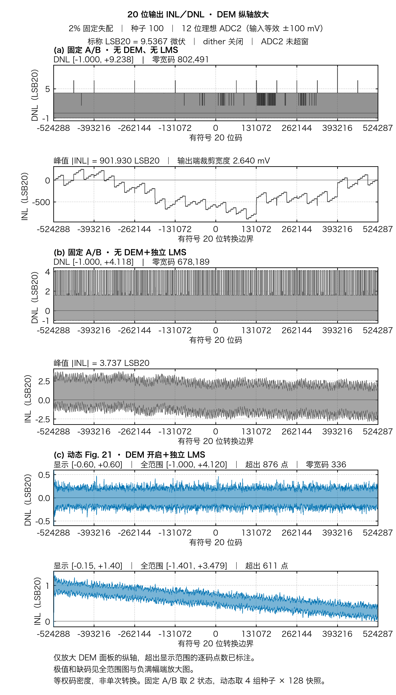
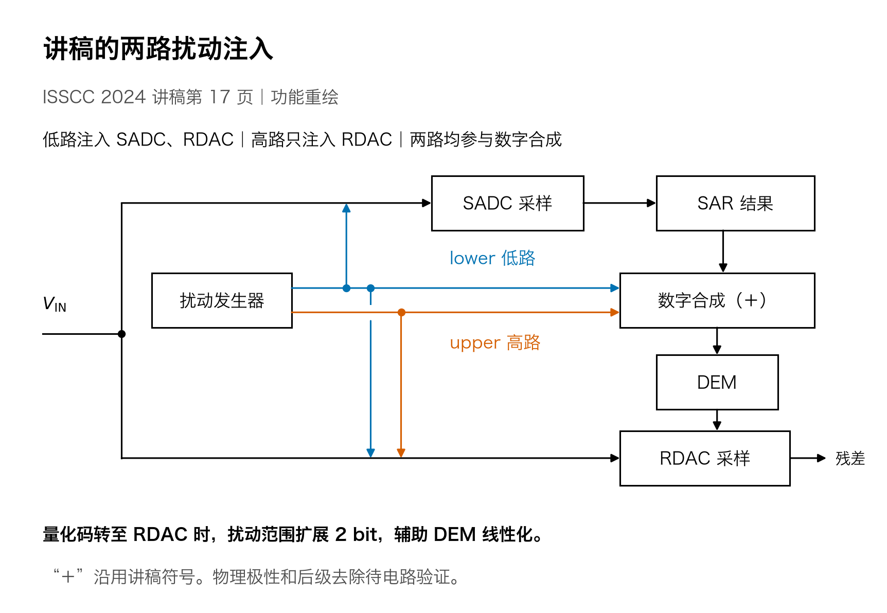
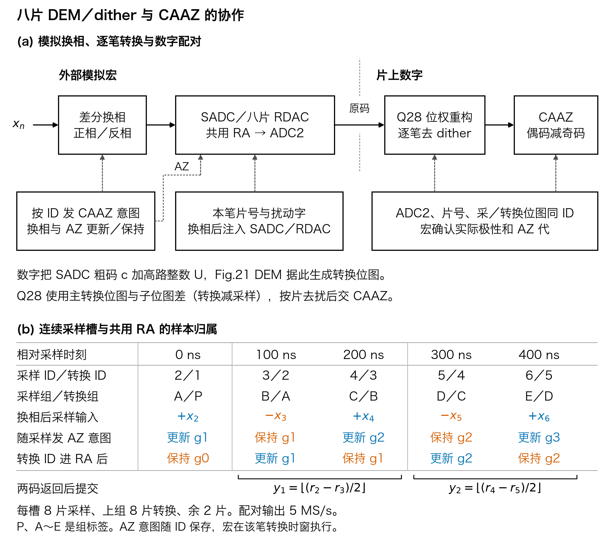

# 20b10mtask｜20 位、10 MS/s SAR ADC 数字交付树

这是**硕士同学的任务交付树**。项目以 ISSCC 2024 的交织前级和相关专利为参考，采用 9 位前级，目标为 20 位输出码、10 MS/s 原始转换，并研究北大斩波辅助自归零。18 片资源池中每次选 8 片采样，上一笔的 8 片转换，其余 2 片空闲。

[任务规格与分工](task1/SPEC.md) · [模块一](task1/README.md) · [统一 LMS 实验标准](task1/EXPERIMENT_STANDARD.md) · [原始论文与专利](references/README.md)

**当前交付版本：**数字合同统一为 `k=c−U`、`conv_sub+sample_sub`，新结果与旧图／旧 GDS 分开。
新模型以显式受控电荷源实现负注入，假定注入与转换共享子权重；真实模拟底板轨尚未绑定。
[本轮结果和复现](task2/evidence/eight_negative/README.md) · [数字验收记录](task_integration/evidence/negative/README.md)

**同学接手：**固定并复现已验证版本，确认模拟接口后，按 DEM／LMS → dither → CAAZ 的顺序完成逐笔对拍与效果图，最后完成目标工艺数字后端验收。[九个月交付与验收](task1/SPEC.md#接手顺序与九个月交付)

除数字 RTL 外，本仓库还含一套**行为级模型复现**（`src/adi_model/` 与 `task2/eight/`），
按 ISSCC 2024 论文的公开数字做定量对标。它与 RTL 交付是两条独立的证据线，状态见
[「现在交付到哪里」](#现在交付到哪里)的最后一行；两者的结论不能互相替代。

## 20 位 INL／DNL：三组对照

同一颗 **2% 固定电容失配**虚拟芯片、理想 12 位第二级、输入等效 ±100 mV；三组的 dither 均关闭。LMS 两条路径分别训练、冻结，再用独立输入评估。图中每个 20 位码分别计算，纵轴使用 **LSB20＝9.5367 μV**。



| 处理方式 | 峰值 INL（LSB20） | DNL 范围（LSB20） | 零宽内码 |
| :--- | ---: | :--- | ---: |
| DEM 关、LMS 关 | 901.930 | −1.000～+9.238 | 802,491 |
| DEM 关、仅 LMS | 3.737 | −1.000～+4.118 | 678,189 |
| 跨段 DEM 开＋独立 LMS | 3.479 | −1.000～+4.120 | 336 |

图中的 DEM 纵轴已放大，超出范围的极值、点数和缺码均有标注。未校准基线的输出端高端裁剪对应 2.640 mV 输入宽度；它与 ADC2 超窗分别统计。[3% 对照图](task1/evidence/inl_dnl/full20/adc2_12bit_sigma_3pct_three_arms_body_zoom.png) · [全范围及端点放大](task1/evidence/inl_dnl/full20/README.md) · [原始数据与计算方法](task1/evidence/inl_dnl/README.md)

固定 A/B 使用两组固定状态；动态 DEM 使用 4 组种子各 128 个状态快照作等权统计，**不是每笔都重新抽电容**。这些是理想两节点和理想 ADC2 的统计结果，不是实际芯片的逐笔 DNL。按这组模型，DEM 明显减少统计零宽码，但最小 DNL 仍为 −1 LSB20。[什么是 512 个状态、什么是无 DEM](task1/STATE_AND_BASELINES.md)

## Dither 是什么效果？

讲稿中的低路扰动同时作用于前级 SADC 和 RDAC；高路只进入 RDAC。两路的数字信息还参与 DEM 之前的码处理。原文短句、七片示例位分配和本项目生成方式见 [dither 原文与注入](task2/ORIGINAL_SOURCES.md)。



**先看不使用 LMS：**Fig.21 DEM 始终开启，只有 dither 改变。在同一颗 2%／3% 固定失配芯片中，统计零宽内码分别从 434,691／396,727 降至 0，但峰值 INL 从 63.602／96.952 增至 75.950／112.907 LSB20。dither 平滑码宽，不保证 INL 或 SNDR 同时改善。


**再看加入 LMS：**两档各使用混合开关训练后冻结的同一组系数。输出单位为 LSB20＝9.5367 μV，ADC2 为理想 12 位、输入折算 ±100 mV。


| 固定失配 | dither 关→开 SNDR | dither 关→开 SFDR | dither 关→开峰值 INL |
| :--- | :--- | :--- | :--- |
| 2% | 103.941→103.728 dB | 127.089→128.049 dBc | 0.493→0.523 LSB20 |
| 3% | 103.573→103.521 dB | 128.268→128.215 dBc | 0.492→0.461 LSB20 |

评价范围是 ±3.671875 V 的共同输入窗，256 个等权配对状态、754,319 个内码，属于统计平均码密度。满幅均匀输入及等权字下，前端平均拒绝宽度为 0.0723805 V（全幅的 0.723805%）；全部字共同名义下限为 −4.855239 V，拒绝主要移到负端。**不是全幅单次转换无缺码或目标精度达标证明。**

[完整八种开关、训练、原始数据及复现](task2/evidence/eight_negative/README.md) · [旧正注入归档](task2/evidence/eight_native/README.md) · [专利七片示例](task2/evidence/fig19_seven/README.md)

## CAAZ 如何与 DEM、dither 协作？

每笔先使用自己的 8 片物理编号、DEM 掩码和 dither 位图完成重构与去扰，再将相邻两笔交给 CAAZ。两笔共享的是 RA 的 AZ 代，不是电容失配或 dither 字；AZ 更新／保持意图必须随样本 ID 对齐到该笔的 RA 时窗。




这组**样本域模型**在 CDAC 残差之后、ADC2 量化之前加入明确的 AZ 和独立噪声。在相同 5 MS/s 输出条件下，独立 AZ 总交流误差为 19.264 μV RMS，理想共享 AZ 后为 13.875 μV RMS，加入示例保持误差后为 14.041 μV RMS。四组共 16,384 个原始码、8,192 个配对结果均已在数字 RTL 逐码重放；前两组配对在外部计算，后两组由 RTL CAAZ 生成。真实 RA 噪声、保持泄漏与时序仍待模拟验证。[原始噪声数据](task3/evidence/negative/joint_noise/summary.json) · [RTL 新版验收](task_integration/evidence/negative/README.md)

## 现在交付到哪里？

| 项目 | 当前状态 | 入口 |
| :--- | :--- | :--- |
| 切片调度＋DEM | 18／8／8／2、有序 ID、释放资格和 Fig.21 跨段候选已有 Python／RTL 对拍；跨段名义补偿与模拟连接仍须系统验证 | [代码与接口](task1/BRIDGE_SPEC.md) · [数字验证](task1/evidence/bridge_rtl/README.md) |
| 电容失配＋LMS | 训练在片外；可写权重的片上重构 RTL 已与定点参考对拍。2%／3% 留出数据和关闭 LMS 的对照均已归档 | [八片校准与对照](task2/evidence/eight_negative/README.md) · [片上重构](task_reconstruction/README.md) |
| SKY130 数字后端 | 旧正注入版已有 GDS、TT STA、DRC／LVS；本次负注入 RTL 必须重新跑后端，不能继承旧版通过状态 | [整体 GDS 与状态](task2/physical/README.md) · [模块一 GDS](task1/physical/README.md) |
| 分路 dither | 18 片中选择 8 片，六位字、逐片底板采样、同笔 ID 和命令码有 Python／RTL 对拍及有界形式验证；模拟辅助 DAC 和真实参考开关仍须验收 | [八片效果](task2/evidence/eight_negative/README.md) · [RTL 合同](task2/eight_rtl/SPEC.md) |
| CAAZ | 斩波相位、自归零控制和两笔数字配对已有 RTL 对拍；模拟宏、实际保持误差和联合后仿仍待验证 | [模块三说明](task3/README.md) |
| 行为级模型复现 | 噪声层已对上论文：DR 94.49 dB（折算后）、噪声密度 9.26 nV/√Hz。**未对上**：SNR 高 0.82 dB、DNL 峰值差 2.3 倍、THD 无 C-V 机制产生不出。门禁 G1–G7 为 3 绿 4 红 | [动态对标](task2/evidence/paper_alignment/ALIGNMENT.md) · [静态 12 格](task2/evidence/paper_alignment/STATIC.md) · [门禁与收据](task2/evidence/behavior_freeze/gate.json) |

SKY130 是本阶段指定的数字工艺；它**不是**未来 180 nm BCD 的签核结果。当前目标输出码宽为 20 位，不等于已证明 20 位有效精度。实际 SADC、RDAC、RA、ADC2 和斩波／自归零开关由模拟宏提供。

## 数字交付的可追溯性

33 条验收项（`REQ-M1-*` 13、`REQ-D8-*` 5、`REQ-CAAZ-*` 6、`REQ-TOP-*` 5、`REQ-RECON-*` 4）
分散在五个 task 的 `verification_plan.yaml` 里，此前没有一处能一次看全。现在两条命令：

```sh
python3 tools/build_req_matrix.py   # 汇总成 trace/req_matrix.csv，一条需求一行
python3 tools/digital_status.py     # 模块/TB/检查命令/证据新旧 → trace/digital_status.json
```

`req_matrix.csv` 的「证据」一列固定写「待确认」：evidence 的 JSON 里没有 REQ 字段，
自动建链会得到看似精确、实则瞎猜的结果，这一列留给人补。表里 `declared_status`
为 `BLOCKED` 的项（当前 `REQ-CAAZ-05`）是计划表作者自己写下的「缺输入」，比任何外部推断都可信。

当前数字侧：**11 个 RTL 模块、11 个 TB、5 组检查命令**。RTL 回归需要 Verilator，
本机没有安装，命令列在 `digital_status.json` 的 `per_task.*.check_commands`，
交给有工具的环境执行。

已知的结构性缺口：**五份计划表用了四种 schema、两种方向**（task1/task3/task_integration
是「需求→测试」，task2/task_reconstruction 是「测试→需求」），且 33 条里有 26 条
没有声明验证方法等级（只有测试名或 oracle 描述），所以 `req_matrix.csv` 的 `method`
列大量为空。这是计划表本身的债，不是解析器的问题。

## 运行和目录

需要 Python 3.12、Verilator；校准和静态分析使用固定提交的 ADCToolbox。输出目录应是**尚不存在的仓库外目录**。

**数值回归必须钉住依赖版本**：`numpy==2.5.3`、`adctoolbox==0.9.1`。版本漂移会让
基线指纹假红——那不是模型变了，是 FFT 与量化器的最后一位变了。下面的 `uv` 命令
就是为此写的；直接用系统 `python3` 会拿到别的版本。

```sh
# 数字 RTL（需要 Verilator；本机若没有，命令会直接报缺工具）
python -m pip install -r task1/requirements-calibration.txt
PYTHONPATH=.:src python -m pytest -q task1/tests
PYTHONPATH=.:src python task1/tools/run_rtl_checks.py --out /tmp/task1-rtl-run-001
PYTHONPATH=.:src python task1/tools/run_bridge_checks.py --out /tmp/task1-bridge-run-001

# 行为模型：全量回归与基线指纹
uv run --python 3.12 --with pytest --with "numpy==2.5.3" \
  --with "matplotlib" --with "adctoolbox==0.9.1" python -m pytest -q
uv run --python 3.12 --with pytest --with "numpy==2.5.3" \
  --with "matplotlib" --with "adctoolbox==0.9.1" python tools/snapshot_baseline.py --check

# 行为模型：论文对标与门禁（会写 task2/evidence/paper_alignment 与 behavior_freeze）
uv run --python 3.12 --with pytest --with "numpy==2.5.3" \
  --with "matplotlib" --with "adctoolbox==0.9.1" python task2/eight/paper_alignment.py \
  --out task2/evidence/paper_alignment
uv run --python 3.12 --with pytest --with "numpy==2.5.3" \
  --with "matplotlib" --with "adctoolbox==0.9.1" python tools/gate_behavior_model.py

# 台账、分层与源码矩阵（纯 Python，不需要额外依赖）
PYTHONPATH=src:. python3 tools/check_source_matrix.py
PYTHONPATH=src:. python3 tools/check_layering.py
python3 tools/build_req_matrix.py
python3 tools/digital_status.py
```

`tools/gate_behavior_model.py` 在 verdict 为 `RED` 时**退出码就是 1**，这是设计而不是
脚本故障：门禁允许红，红了才说明它有判别力。当前 G1/G5/G6/G7 四门红，原因逐条记在
`trace/milestones.json` 的 M9 条目里。

| 路径 | 用途 |
| :--- | :--- |
| `task1/rtl/`、`model/`、`tb/`、`tests/` | 模块一 RTL、Python 模型和验证 |
| `task1/experiments/`、`evidence/` | 实验脚本、中文图片、原始数据和收据 |
| `task1/physical/`、`design/` | SKY130 GDS／STA、约束、需求与验证记录 |
| `task2/` | dither 字发生器、八片 RTL、模型、效果图和物理流程 |
| `task3/` | CAAZ 数字控制、配对、验证和模拟接口 |
| `task_reconstruction/`、`task_integration/` | 可写权重的片上重构和三模块整体数字顶层 |
| `src/adi_model/` | **行为模型的库层**：电容与电荷域、`noise` 噪声源、`reference` 参考动态建立与 RA 非线性、`timing` 时偏与极点、`codes` 码域换算、`impairments` 非理想效应总开关 |
| `tools/` | 门禁与台账工具：基线指纹、源文矩阵、分层检查、需求矩阵、数字状态盘点、行为模型门禁 |
| `trace/` | 源文台账（`source_matrix.csv`）、里程碑与回退锚点（`milestones.json`）、需求矩阵（`req_matrix.csv`） |
| `references/` | ISSCC 与北大论文、讲稿及专利索引 |

校准对照统一执行[失配与 LMS 标准](task1/EXPERIMENT_STANDARD.md)：同一物理失配池、明确开关、训练／留出分离，并同时报告收益、噪声和越界。完整复现及条件见 [模块一说明](task1/README.md)。
