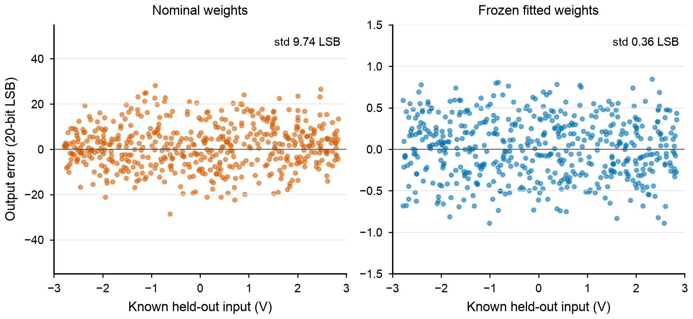
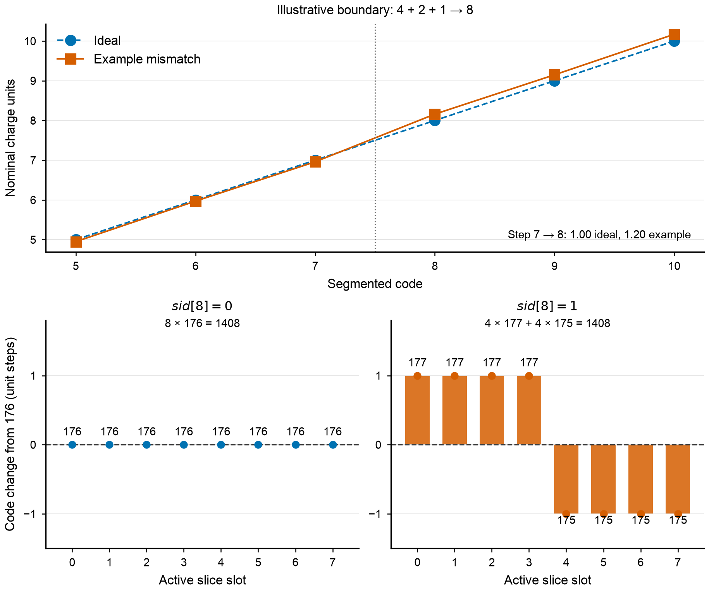

# 20 位 / 40 MS/s 流水 SAR ADC：行为模型与数字实现

[English](README_EN.md) · [目录规范](docs/PROJECT_LAYOUT.md) · [模型范围](docs/model_scope.md) · [DSP 接口](ad4080_dsp/docs/SAR20_INTERFACE.md)

本仓库依据 [ISSCC 2024 Session 9.8 论文](https://doi.org/10.1109/ISSCC49657.2024.10454329)和相关专利，研究两级残差 SAR ADC 的切片调度、电容失配、数字校准与后处理。它包含 Python 行为模型、SAR 数字 RTL，以及独立的 AD4080 风格 DSP 子系统。默认采样率为 **40 MS/s**。

> **证据边界**：这是研究原型；20 位是数字输出码宽，不等于 20-bit ENOB。图中的性能数字来自指定条件下的行为仿真，不是芯片实测，也不代表版图、PDK 或时序签核。

## 先看结果

| 关心的问题 | 工程中的处理 | 在什么条件下看到什么 |
|---|---|---|
| **电容失配** | 片外拟合有效权重，装入数字 RTL 后重构 | 两组静态失配夹具的独立留出误差标准差分别为 **55.75 → 2.08 µV**、**59.38 → 2.14 µV**；见[图 4](#电容失配如何校准效果是什么) |
| **交织时序失配** | 随机选择 slice，分散误差杂散 | 指定 10 ps 假设下，`fs/2−fin` 杂散为 **−96.44 → −123.05 dBFS/bin**，但总误差 RMS 增大；见[图 6](#交织失配杂散与总误差) |
| **模型与 RTL 是否一致** | 对齐开关掩码、参考事件和样本归属 | 项目合同下 **262144 组**码／DEM 状态掩码一致，三种 dither 模式的 **10752 个**参考事件对拍一致；见 [ADR 0021](docs/adr/0021-structural-contract-calibration.md) |

这些数字分别来自静态行为夹具或指定条件的行为仿真；随机调度不是逐 slice 时序校准，以上结果也不是芯片测量。

## 架构与配置


*图 1．按公开文字和本仓库源码独立绘制的架构示意，不是论文原图。*

论文披露 20 b / 40 MS/s、18 个切片及共享残差放大等线索。模型把采样、粗量化、残差电荷、RA、ADC2 和数字重构串联；结构 RTL 提供相位控制、比较器接口和数字重构。DSP 通过项目接入层对接重构输出，具体接线见下文。

| 配置 | 采样率 | 一级量化与 DAC | 说明 |
|---|---:|---|---|
| `Config()` | 40 MS/s | 7 位、unary | 原有默认行为配置；Python SADC 采用阈值查找，不模拟逐位 SAR 时序 |
| `Config.paper_literal()` | 40 MS/s | 9 位、63+8 split | 贴近论文数字位数的候选；63+8 物理分配是本项目假设 |
| `Config.rtl_structural()` | 40 MS/s | 9 位、63+8 split | 对齐结构 RTL 的预热、slice 顺序、dither 和 16 相位参考事件；仍是工程假设 |
| `sar20_digital_core` 结构 RTL | 目标 40 MS/s | 9 位、63+8 split | 16 个数字相位/样本；若每相位一个时钟，预算为 640 MHz，尚无目标工艺 STA 证明 |

这些 Python 配置不应被当作完全相同的电路，也不能仅凭标称采样率推断 RTL 实际可运行速率。参见 [`config.py`](src/adi_model/config.py)、[`sadc.py`](src/adi_model/sadc.py) 和 [RTL 算术契约](docs/rtl/RTL_ARITHMETIC_CONTRACT.md)。

## 数字部分：作用、完成情况与主要问题

数字工作分为四块；下文的“已完成”均指指定条件下验证的研究原型。

**1. 转换控制与样本管理。** 负责采样、粗判决、残差形成和 ADC2 转换，并记录每笔数据的归属。已实现 16 相位控制、比较器接口、slice 调度、样本 ID 和异常标志，Python 结构对照已与 RTL 对齐切片顺序及 7 个 RDAC 已决事件。**还需**落实真实比较器完成时刻、模拟开关／参考相位，以及系统级异常和复位。

**2. DEM、dither 与交织失配。** 负责重排 slice 与电容单元以分散误差，并加入已知扰动。已有固定物理池、交织失配行为实验、RTL 的 slice 分配、DEM 地址、bridge 候选及 dither 发生器；物理掩码与三种 dither 模式已对拍。**还需**逐 slice 失调、增益、时序和带宽的可辨识估计／补偿；讲稿 bridge 完整电路和双端口 dither 增强也未复现。DEM 是误差重排，不会自行测量失配。

**3. 电容校准与数字重构。** 负责从已知参考和数字观测估计有效权重，结合已知扰动重构输出。已贯通结构 RTL 观测、片外拟合、量化装载和独立留出复验，条件与数据见 [ADR 0021](docs/adr/0021-structural-contract-calibration.md)。**还需**真实参考及观测传输、动态建立／漂移与 ADC2 自身非线性验证；现有 748 位并行观测口没有 FIFO 或反压。

**4. 系统校正、DSP 与数据输出。** 负责整个信号链的增益／失调校正，以及滤波、缓存和外部接口。SAR 与 DSP 顶层已连接，校正、SINC、FIFO、SPI 和错误阻断均有原型。**还需**修正两点系数方向，补齐有效滤波系数、FIFO 到串行路径、输出元数据和无损 DDR／差分接口。

**共同优先级。** 先落实真实参考、观测读出和模拟相位接口，再研究逐 slice 校正与动态误差，随后完善 DSP 和输出。样本 ID、异常、复位及验证贯穿四块；形式等价、CDC／RDC、目标工艺 STA 和模拟后仿仍未完成。16 相位对应的 640 MHz 是 40 MS/s 下的理想时钟预算。

ADC 核的电容权重校正与 [AD4080 手册](https://www.analog.com/media/en/technical-documentation/data-sheets/ad4080.pdf)中的系统增益／失调校正作用于不同层次；[历史任务复核](docs/digital_task_assessment.md)将集成验证单列，此处把它作为共同工作。

## 论文、专利与工程实现

以下表格直接列出文献机制、工程实现和未闭合边界。

| 机制 | 工程中已有 | 尚需注意 |
|---|---|---|
| 粗量化器 / 残差 DAC 分离 | Python 量化、电荷模型和结构 RTL 信号路径 | 电容分配、开关时序等含工程假设，未得到论文完整网表 |
| 电容失配与 DEM | 固定物理单元、权重拟合、单元重排及 RTL 重构 | DEM 改变误差分布，不自动测得或消除电容误差；Python/RTL 物理掩码已按项目候选合同统一；它不证明原芯片的具体 bridge 电路 |
| 交织失配 | slice offset、时序偏差、带宽差异及调度敏感性模型 | 尚无逐 slice offset、时间偏差、带宽的完整硬件估计与校正闭环 |
| dither | 行为注入/数字补偿和 RTL 发生器 | 结构对照支持关闭、采样和量化器三种模式；双端口范围增强与大输入越界仍需处理 |
| RA、参考与 ADC2 | RA/参考动态行为和理想 ADC2 量化 | 结构对照的 7 个已决负载事件已对拍；ADC2 自身非线性学习、模拟电路和 PDK 验证未完成 |

完整出处和代码定位见 [`mechanism_inventory.json`](mechanism_inventory.json)、[`sources_manifest.json`](sources_manifest.json)、[工程与文献对照](docs/engineering_vs_patents_papers.md)和 [已知限制](docs/rtl/KNOWN_LIMITS_20261104.md)。主要公开资料包括 [量化器与残差 DAC 分离](https://patents.google.com/patent/US10516408B2/en)、[dither](https://patents.google.com/patent/US10505561B2/en)、[DEM](https://patents.google.com/patent/US10511316B2/en) 与 [交织跟踪](https://patents.google.com/patent/US10707889B1/en)。公开资料与项目候选实现不是一一还原关系。[论文](https://doi.org/10.1109/ISSCC49657.2024.10454329)参考文献 [12] 的印刷编号为 10,797,889，而题名及作者对应 [US 10,707,889 B1](https://patents.google.com/patent/US10707889B1/en)；本库按后者分析，编号差异是本次核对判断，并非作者正式勘误。

## 电容失配：如何校准，效果是什么


*图 2．结构数字 RTL 观测、片外拟合和独立留出复验；由随库结果数据生成的原创示意，静态行为失配夹具不是芯片。*

数字观测与独立参考输入送入 Python 批量拟合器，得到冻结的有效单元权重；系数量化为 Q30 权重和 Q32 标量，装入 RTL `weight_store`、`calib_regs`，由 `recon_core` 重构。原有 [ADR 0019](docs/adr/0019-fitted-weight-rtl-closure.md) 使用 Python 训练观测；现在也能直接采集结构 DUT 的原始观测，详细合同见 [ADR 0021](docs/adr/0021-structural-contract-calibration.md)。


*图 3．对应讲稿第 38 页输入频率的行为对照：40 MS/s、1.05 MHz、峰值 2.85 V、N=16000、seed 42。训练与留出数据分开，使用同一模拟物理池和精确外部训练参考。讲稿未公开幅度、FFT 和完整噪声条件。*

含噪时输出 SNDR 为 **88.88 → 92.46 dB**；误差标准差为 **72.53 → 48.04 µV**。模型噪声预算使用了拟合的 94.6 dB，因此不能把本结果当成对论文 SNR 的独立预测。更多静态误差和无噪对照见 [逐页实验对照](docs/paper_comparisons/README.md)。



*图 4．真实结构数字 DUT 的 512 个留出样本：seed 42，40 MS/s 对应理想 640 MHz 相位时钟，静态固定失配 plant、4096 训练样本、无额外噪声；左右纵轴量程不同。由随库保留的 DUT 输入和输出数据独立绘制。*

片外拟合器只接收 DUT 物理开关观测与独立已知输入，不读取 plant 电容真值。两组物理失配种子的误差标准差为 **55.75 → 2.08 µV** 和 **59.38 → 2.14 µV**；加入假设 48 µV RMS 输入等效噪声的另一测试为 **71.25 → 54.40 µV**。拟合系数已冻结、装回 DUT，并与独立定点模型逐码核对。这是数字 RTL + 静态行为 plant 的闭环，不是片内自学习或硅片验证。

### Binary-to-unary bridge 是什么？



*图 5．上：人为设置的权重失配使 7→8 码边界的电荷步从 1.00 增至 1.20；下：由本工程 Python 开关译码器生成的名义零和交换。原创说明图，非论文原图，也不声称复现讲稿的完整电路。*

讲稿把标为 8 的温度计码单元和标为 4、2、1 的二进制/dither 单元放在一起；两段交界的实际电容比有误差时，会影响码边界的电荷步。本工程采用 63 个主单元和 8 个子单元的候选划分，`176=22×8+0`：状态 `sid[8]=0` 时 8 个 slice 各为 176；状态 `sid[8]=1` 时 4 个为 177、4 个为 175，总名义码仍为 1408。175 即 `21×8+7`，跨过主/子码边界。这是一个桥接相关的工程代理，改变物理单元的使用方式及失配误差分布，**没有复现讲稿完整互换电路，也不是测量或自动消除失配**。512 个码 × 512 个 DEM 状态的实际结构 RTL 掩码与独立项目参考逐项一致；这个 50% 状态门控仅是工程假设，不能等同讲稿的 `P=50%` 物理真值表。

另一个 `C_bridge` 是主、子阵列间的**物理桥接电容**，影响子阵列有效权重，与上述选择机制不是同一对象。两者作用、具体例子、dither 配合和尚缺的电路信息见 [bridge 专题](docs/binary_unary_bridge.md)。

## 交织失配：杂散与总误差


*图 6．对应讲稿第 21–22 页：40 MS/s、时序失配标称 10 ps；本图假设该值为独立 slice 静态高斯标准差，输入约 4.0015 MHz / 2.85 V 峰值，N=16384，随机噪声关闭。讲稿未公开精确输入、10 ps 的统计定义或 FFT 设置。*

固定轮换与随机 8-of-18 调度下，`fs/2 − fin` 处杂散从 **−96.44 降到 −123.05 dBFS/bin**，但本例对理想输入的误差 RMS 从 **127.97 增至 182.15 µV**。这是频谱重分配，不是时序偏差学习或补偿。其余种子、另一种 10 ps 定义、1 kHz、线性度、参考负载及实验条件边界见 [逐页实验对照](docs/paper_comparisons/README.md)。

slice 失调、增益与带宽差异也会造成交织误差；既有 [失调/增益对照图](docs/readme/fig/unified_7_interleave_effect.png)说明随机调度对杂散和总 RMS 的不同影响。当前仍无逐 slice 时序、带宽的独立硬件学习与补偿闭环。

## DSP 接入与错误处理


*图 7．工程接入示意：按当前 RTL 独立绘制。*

[`sar20_system_top.sv`](ad4080_dsp/rtl/sar20_system_top.sv) 实例化 SAR 数字核与 DSP；也可单独使用 [`sar20_ad4080_top.sv`](ad4080_dsp/rtl/sar20_ad4080_top.sv) 接收 SAR 结果、逐样本标志及独立的 `analog_ovf` 粘滞位。SAR 现有 `dout_analog_bad` 与结果 ID 对齐，但 DSP 当前仍使用模拟异常粘滞位停流。入口将 offset-binary 转为 DSP 内部补码，并行出口转回 offset-binary；串行数据仍为补码。任一结果标志或模拟溢出粘滞位触发阻断并锁存故障。`dsp_restart` 或 `sar_epoch_clear` 复位 DSP，**同时清空其 FIFO、滤波状态和寄存器配置**；模拟粘滞位须由 SAR 的 epoch clear 清除，随后需要重新配置。

接口侧输出接受/拒收事件与 ID；滤波和 FIFO 的结果**尚不携带逐结果 ID 或输入标志**。两侧要求同一时钟及同步释放复位，没有新增 CDC。单 lane 数字串行器在每 16 时钟一个输入样本的条件下不能无损发送 20 位帧，且 FIFO 数据未接入串行发送器；不包含 DDR 差分 PHY。SINC5 补偿系数默认是占位值。其余事项见 [DSP README](ad4080_dsp/README.md)。

DSP 的独立 `cal_two_point` 当前对固定横坐标拟合 `y=m·x+c`。若以固定已知输入为横坐标、测得原始码为纵坐标，得到的是**正向传递系数**，不能直接作为原始码的逆向校正；它也没有接入顶层自动学习流程。

## 来源与验证


*图 8．按运行时参数来源账本独立绘制。拟合和假设产生的结果不能升级为披露值或芯片测量值。*

Python 模型、RTL 仿真、历史 FPGA 证据与目标 PDK 综合/STA 分属不同验证层级。图 3 和图 6 来自基线 `6863fc3` 的 40 MS/s 行为仿真；图 4 是当前结构数字 DUT 与静态行为 plant 的联合仿真；均不是晶体管或硅片数据。历史版本的详细说明保留在 [`docs/history/`](docs/history/)，历史测试结果不自动代表当前工作树重新通过。

### 代码与数据入口

| 想看什么 | 入口 |
|---|---|
| 行为模型、配置和开关映射 | [`src/adi_model/`](src/adi_model/) |
| 结构 RTL 与观测／重构接口 | [`sar20_digital_core.sv`](rtl/top/sar20_digital_core.sv) · [RTL 合同](docs/adr/0021-structural-contract-calibration.md) |
| 校准训练、装载与留出复验 | [`run_structural_calibration.py`](tools/run_structural_calibration.py) · [结果数据](docs/readme/data/) |
| 交织、参考及论文对照实验 | [逐页实验对照](docs/paper_comparisons/README.md) |
| DSP 和外部接口 | [DSP README](ad4080_dsp/README.md) · [SAR 接口](ad4080_dsp/docs/SAR20_INTERFACE.md) |

### 快速开始

```bash
python3 -m venv .venv
source .venv/bin/activate
python -m pip install -e '.[dev]'
python -c 'from adi_model import Config; print(Config().fs, Config().b1, Config().dac_arch)'
pytest -m 'not slow' -q
```

RTL 回归需要 Verilator 5.x 和 C++ 编译器；DSP 独立脚本需要 Icarus Verilog：

```bash
python tools/run_open_rtl.py --tops calibration_fit_tb sar20_dsp_integration_tb sar20_system_top_tb
BUILD_DIR="${TMPDIR:-/tmp}/ad4080-dsp-build" bash ad4080_dsp/sim/run_all.sh
MPLBACKEND=Agg PYTHONPATH=src python docs/readme/make_unified_figures.py
MPLBACKEND=Agg PYTHONPATH=src python docs/readme/make_contract_figures.py \
  --out "${TMPDIR:-/tmp}/sar-adc-contract-figures"
PYTHONPATH=src python docs/readme/reproduce_interleave_40m.py \
  --out "${TMPDIR:-/tmp}/sar-adc-interleave-new" --compare-frozen
```

重绘脚本读取随库保存的轻量数据；它重画已记录的结果，不会重新训练模型。结构 DUT 观测和训练/留出复现命令见 [ADR 0021](docs/adr/0021-structural-contract-calibration.md)。交织复现脚本的 `--out` 必须是尚不存在的新目录。完整仿真输出建议写到仓库外，例如 `adi-run-all --results-dir "${TMPDIR:-/tmp}/sar-adc-results"`。目录职责和历史证据例外见 [文件规范](docs/PROJECT_LAYOUT.md)。

## 许可与引用

代码采用 [BSD-3-Clause](LICENSE)，第三方权利和专利声明见 [NOTICE](NOTICE) 与 [CITATION.cff](CITATION.cff)。示意图和结果图由本仓库独立绘制，不复制论文、讲稿或专利原图；原文文件不随仓库分发。本项目与 Analog Devices 无从属或背书关系，不授予专利许可。
