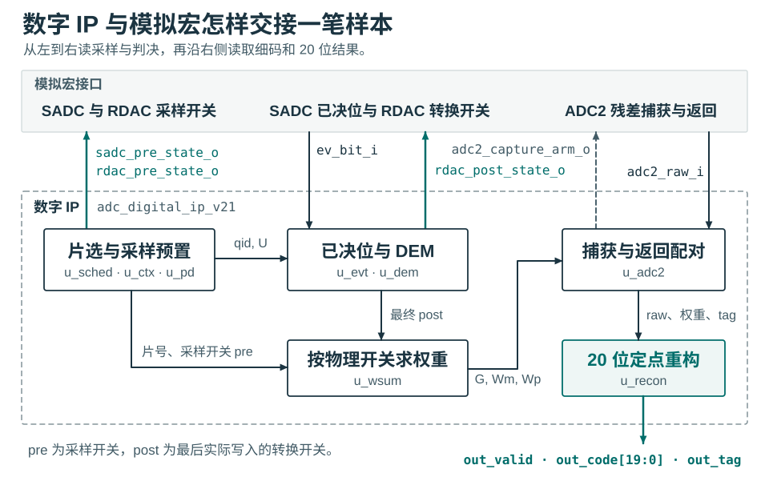

# 20 位两级 SAR ADC 数字 IP

这套数字逻辑把两次量化合成一个 20 位结果。前级 SAR 先给出粗判决，数字 IP 据此逐位切换残差 DAC（RDAC）。第二级 ADC（ADC2）测量剩余电压并返回 13 位原码。要算准最终结果，还需要知道**这一笔实际用了哪八片电容，采样和转换时分别打开了哪些开关**。顶层将这些记录、校准权重和原码按样本标签配对，再输出最终码。

工作树只有一个生产顶层 `adc_digital_ip_v21`。`v21` 是它在源码与构建清单中的名称。模拟比较器、残差放大器和 ADC2 通过宏接口连接。Python 行为模型用来研究电荷、失配、噪声和静态线性度。[顶层 RTL](rtl/v21/adc_digital_ip_v21.sv) · [生产源清单](flow/build/filelists/files_adc_v21.f) · [接口合同](docs/CONTRACT_CURRENT.md)

[**打开完整数字 IP 图册（矢量 PDF）**](docs/algorithms/digital-ip-atlas.pdf) · [在线读算法、状态机与可编辑原图](docs/algorithms/README.md)

## 从一笔采样看功能

| 步骤 | 数字 IP 做什么 | 对应实现与图 |
| --- | --- | --- |
| 选片与交接 | 18 个物理片中，8 片采集、8 片转换、2 片备用。受理新请求时保存片号、样本标签和量化器编号。前一采集组整组转入转换。 | [片选 RTL](rtl/sched18.sv) · [片号逐拍图](docs/algorithms/digital.md#schedule) |
| 生成并注入扰动 | 生产时将 `dither_force_i` 接 0。每次受理，片内产生一个六位字。所选的 SADC 接收低段七位开关，另一套保持。八片 RDAC 接收完整采样预置 `pre`。 | [两端开关译码](rtl/dither_pre.sv) · [扰动通路与交替写入状态图](docs/algorithms/digital.md#pre) |
| 跟随判决并轮换单元 | 数字逻辑只提交前级已确定的位。动态单元匹配（DEM）让不同电容承担同一个名义码。最高区拒绝 512 试探时，本拍关闭写门，从 bit5 继续；末次实际写入的开关记作 `post`。 | [SAR 状态图](docs/algorithms/digital.md#events) · [DEM 开关矩阵](docs/algorithms/digital.md#dem) |
| 捕获与重构 | 用八片的物理编号查片外标定、片内装载的权重。ADC2 返回原码后，使用同笔 `post` 的权重加回转换贡献，扣除同笔 `pre` 的权重，输出 20 位码、标签和状态。 | [ADC2 归属](rtl/v21/adc2_capture.sv) · [权重计算](rtl/v21/wsum_v21.sv) · [定点重构](rtl/v21/recon_v21.sv) |

## 效果与验证条件

| 可以核对的效果 | 实测或模型条件 |
| --- | --- |
| **扰动能否扣回** | 本地 Verilator 驱动生产顶层，理想宏读取真实 SADC、RDAC 开关。固定输入连续 1,024 笔，片内字源覆盖全部 64 个字，每笔输出 410304。单独在重构端漏扣字 53 的采样权重，输出多 13,568 码；重复扣则少 13,568 码。[逐笔数据与复现命令](docs/audit/TREE_AUDIT_REPORT.md#dither-word-audit) |
| **错配能校正多少** | 给一个物理子单元施加已知偏差，同批 192 笔原码使用名义权重时有 24 笔偏离 ±32 码。装入已知系数后，192 笔全部回到参考值。全码 DNL/INL 另由静态电荷模型评估，图注列出失配、训练和测试条件。[数字 IP 算法与效果](docs/algorithms/README.md) · [全码 DNL/INL 对照](docs/audit/TREE_AUDIT_REPORT.md#全码静态线性度) |
| **能否连续 40 MS/s** | 在 640 MHz 理想数字时钟、比较判决和宏握手按约到达时，顶层连续交付 192 笔，输出间隔 25 ns。数字时钟本身为 40 MHz 时，第一笔余差在预定采样沿尚未获得捕获授权。实际模拟宏时限和同版整核物理时序待验收。[时钟条件与对照结果](docs/STATUS.md#持续采样率) |

## 文件放在哪里

根目录的四个文件是本页、Python 打包配置 `pyproject.toml`、Git 忽略规则 `.gitignore` 和检出规则 `.gitattributes`。九个目录按下表使用。

| 根目录 | 内容和入口 |
| --- | --- |
| [rtl/](rtl/README.md) | 生产 SystemVerilog。顶层与专用模块在 `v21/`，片选、DEM、扰动预置与倒数叶子在 `rtl/`。`core/` 和 `top/` 另供组件验证。 |
| [tb/](tb/) | SystemVerilog 测试台、C++ 顶层驱动与冻结向量。集成 ADC 的事件、交接、连续采样和重构检查在 [tb/v21/](tb/v21/)。 |
| [src/](src/adi_model/) | Python 包 `adi_model`。`control/` 实现控制算法，`topology/` 和 `behavioral/` 描述电荷与非理想，`simulation/` 推进样本，`calibration/`、`metrics/` 求系数和误差。 |
| [flow/](flow/) | `build/filelists/` 选编译源，[sim/](flow/sim/README.md) 说明仿真和夹具，`tests/` 保存 Python 回归，`formal/`、`synth/` 保存形式验证和后端流程。 |
| [tools/](tools/) | 可执行入口。定向 RTL 测试用 `run_open_rtl.py`，正式 VCS 回归用 `verify_v21.sh`，结构与图册分别由 `check_engineering.py` 和 `v21_algorithm_atlas.mjs` 核对。 |
| [docs/](docs/INDEX.md) | [接口合同](docs/CONTRACT_CURRENT.md)、[项目状态](docs/STATUS.md)、[算法与状态机](docs/algorithms/README.md)、[审计证据](docs/audit/README.md)。行为图和全码线性度图在 `figures/`，旧工程记录在 `_history/`。 |
| [references/](references/README.md) | 论文、讲稿、来源清单。查论文原图和相应页码从这里进入。 |
| [subsys/](subsys/) | 独立 DSP、斩波辅助自归零（CAAZ）和研究实验。生产 ADC 的编译范围由上述源清单确定。 |
| [.github/](.github/) | CI 工作流、协作约定及维护模板。 |

## 跑起来

从仓库根运行。下面三条只读检查分别清点工作树、核对工程链接及接口、核对算法图与图源。

~~~bash
python3 -B tools/check_doc_counts.py
python3 -B tools/check_engineering.py
node tools/v21_algorithm_atlas.mjs --check
~~~

**看 64 笔 Python 行为输出。** 默认行为模型的名义物理增益 `g0=Cnorm/Cf` 为 **32.0**。同一模型的定点码本只计入参与转换驱动的单元，权重和约为 **31.028**；细码解码按两者的比例换算。[模型定点约定](src/adi_model/contracts/README.md)

输出目录含 `codes.npz`、`metadata.json` 与 `assumptions.json`，可一起核对样本、参数和假设。[Python 快速上手](docs/guide/QUICKSTART.md)

~~~bash
run_dir="$(mktemp -d)"
bash tools/pyenv.sh --run -m adi_model simulate --samples 64 --output "$run_dir/sim"
~~~

**复核数字顶层。** 本机有 Verilator 和 C++ 工具链时，以下命令记录连续采样、扰动和定点重构。顶层的 `summary.csv` 对照各场景，`samples.csv` 保存逐笔引脚与出码。正式 VCS 回归、综合与等价各有独立入口。[仿真与 RTL 测试](flow/sim/README.md) · [综合与等价](flow/synth/README.md)

~~~bash
rtl_dir="$(mktemp -d)"
bash tools/pyenv.sh --run tools/run_open_rtl.py --simulator verilator \
  --tops v21_sample_cadence tb_i4_recon tb_recon_stream --out "$rtl_dir/results"
~~~

[文件归属与维护](docs/meta/REPOSITORY_LAYOUT.md) · [变更记录](docs/meta/CHANGELOG.md) · [English overview](docs/meta/README_EN.md)
