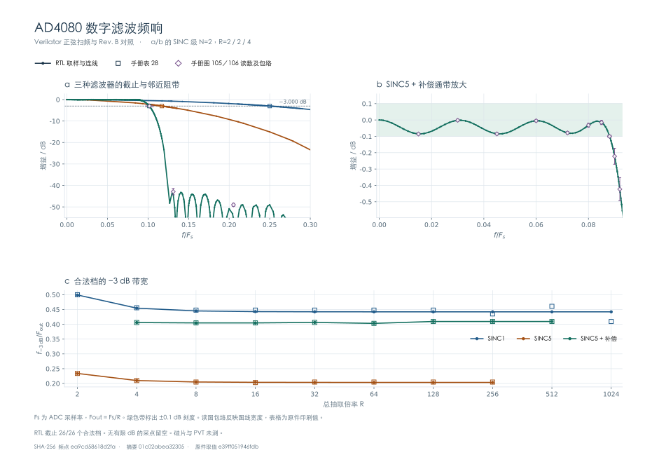

# 20 位两级 SAR ADC 数字 IP（AD4080 对标单芯片架构）

这套工程实现了面向 **20-bit / 40 MSPS** 精密两级 SAR ADC 的完整数字芯片顶层与黄金行为模型。前级快速量化器（SADC）给出粗判决，数字核据此驱动 18 片残差 DAC（RDAC）切片池完成交织、分路扰动与三维 DEM；第二级 ADC（ADC2）返回 13 位细码后，片内按该笔实际物理片号与开关状态查表重构 20 位结果，再经片上系统校正、可编程滤波、16K FIFO 存储与 SPI/LVDS 读出。

**单芯片数字顶层是 `ad4080_chip_top`，转换核子模块是 `adc_digital_ip_v21`。** 默认 Python 模型（[9.0.1+adi.repro](pyproject.toml)）与转换核使用同一套字源、片选、DEM 和定点重构规则。[单芯片 RTL](rtl/top/ad4080_chip_top.sv) · [转换核 RTL](rtl/sar_core/adc_digital_ip_v21.sv) · [接口合同](docs/CONTRACT_CURRENT.md) · [项目状态](docs/STATUS.md)


---

## 核心功能精讲（从原理到代码，逐块拆透）

想快速看懂每个关键模块“**为什么这么设计、传统方案卡在哪、硬件电路和 RTL 每一行怎么实现**”，直接进入对应精讲（[精讲总导读](docs/guide/deep_dive/README.md)）：

| 关键模块 | 一句话看懂核心原理 | 详细图文精讲 | 对应源码 / 模型 |
| --- | --- | --- | --- |
| **RDAC 分离与 18 选 8 交织** | 摘出大电容不做试错，吃下 6 大红利；18 片池留 2 片备用轮换打散 $f_s/2$ 杂散 | [01 · RDAC 与 18 选 8 交织精讲](docs/guide/deep_dive/01_rdac_and_interleaving.md) | [sched18.sv](rtl/sar_core/sched18.sv) |
| **整数 + 小数 Split Dither** | “米尺 + 游标”分开晃：整数晃 RDAC 且就地抵消不撑爆 RA；8 片平均凭空造出 $f/8$ 小数 | [02 · Split Dither 精讲](docs/guide/deep_dive/02_split_dither.md) | [dither_pre.sv](rtl/sar_core/dither_pre.sv) |
| **三维 DEM 与 50% 半格桥接** | 用 $k=213$ 手绘 8×8 棋盘；每个 `8Cu` 拆成两个 `4Cu` 抹平一元区与二进制区的跨界死缝 | [03 · 三维 DEM 与半格桥接精讲](docs/guide/deep_dive/03_3d_dem_and_bridge.md) | [dem_mask_v3.sv](rtl/sar_core/dem_mask_v3.sv) |
| **两段式动态参考** | 转换期红路缓冲器扛 99% 体力活，余差期蓝路无缓冲直连 `REF_IN`，电流降 100 倍且零温漂 | [04 · 动态参考精讲](docs/guide/deep_dive/04_dynamic_reference.md) | [reference_mux.py](src/adi_model/behavioral/reference_mux.py) |
| **共享 ×32 余差放大器 RA** | 闭环 `gmR+OTA` 容忍参考继续建立；Auto-Zero 亏 −1.6 dB，宽切窄带赢回 +1.3 dB | [05 · 余差放大器 RA 精讲](docs/guide/deep_dive/05_residue_amplifier.md) | [ra.py](src/adi_model/behavioral/ra.py) |
| **事件跟随、校准与 7 级重构** | 512 保护门限防溢出；片外求 18×20 权重表；7 级整数流水线只扣一次真实 `Wp` 精准还码 | [06 · 跟随、校准与重构精讲](docs/guide/deep_dive/06_events_calib_recon.md) | [sar_evt_v21.sv](rtl/sar_core/sar_evt_v21.sv) · [recon_v21.sv](rtl/sar_core/recon_v21.sv) |
| **单芯片顶层与数字外围** | 20-bit 码出核后的后半生：系统校正、26 档滤波、16K SRAM/MBIST、SPI/LVDS 与电源域 | [07 · 单芯片与数字外围精讲](docs/guide/deep_dive/07_peripherals_and_chip_top.md) | [ad4080_chip_top.sv](rtl/top/ad4080_chip_top.sv) |

<a id="先选你要看的东西"></a>
<a id="跟一笔样本走完数字主线"></a>

---

## 核心实测效果图

### 1. 转换核单笔全链追踪（`tag 54`，字 53 → `410304` 码）


### 2. 全码 20-bit 静态线性度（INL / DNL）


### 3. 动态频谱（SNDR 94.63 dB / SFDR 118.97 dB）


### 4. 产品外围 26 档数字滤波扫频（Verilator vs 手册表 28）



---

## 效果与验证条件

| 可以核对的效果 | 实测或模型条件 |
| --- | --- |
| **扰动能否扣回** | 本地 Verilator 驱动生产顶层，理想宏读取真实 SADC、RDAC 开关。固定输入连续 1,024 笔，片内字源覆盖全部 64 个字，每笔输出 410304。漏扣字 53 采样权重多 13,568 码；重复扣少 13,568 码。[逐笔数据与复现命令](docs/audit/TREE_AUDIT_REPORT.md#dither-word-audit) |
| **错配能校正多少** | 给单个物理子单元注入偏差后，192 笔里 24 笔出现 ±32 码误差；装入已知权重后 192 笔全部归零。全码静态模型下拟合权重将峰值 \|INL\| 从 0.934 压至 0.174 LSB20。[192 笔权重配对图](docs/algorithms/figures/integer-arithmetic.svg) · [全码 DNL/INL 对照](docs/audit/TREE_AUDIT_REPORT.md#全码静态线性度) |
| **能否连续 40 MS/s** | 单时钟核 `adc_digital_ip_v21` 在 640 MHz / 1.6 GHz 理想时钟下连续交付 192 笔；新增双域核 [adc_digital_ip_v21_40msps.sv](rtl/sar_core/adc_digital_ip_v21_40msps.sv) 将 >95% 重逻辑收口至真实 40 MHz（25 ns）主时钟、仅 ~1k 门跟随器走自定时突发，已在 **TSMC 28 nm HPC+** 完成 VCS RTL / DC（`clk_fs` 0 违规 `+2.72 ns` MET）/ PrimeTime 四角点 / 179k 单元 VCS 门级网表仿真闭环。[28 nm 签核报告与 40 nm 迁移清单](docs/synopsys_signoff/README.md) · [时钟对照](docs/STATUS.md#持续采样率) |
| **产品外围验收** | 50 MHz 配置 SPI 通过 1 ps 保持复验；26 档滤波频响与手册表 28 对拍；单路 400 MHz / 双路 200 MHz DDR LVDS 384 笔逐位通过；另提供可综合流片边界封装（可编程 CRC-24、OTP 宏+`ROM_CRC_ERR`、4×4096×20 SRAM、LVDS ODDR/DCO PHY 及三域 IO SDC）。[产品外围验收](rtl/ad4080_periph/integration/product/ACCEPTANCE.md) · [逐模块手册对照 PDF](rtl/ad4080_periph/report/manual-trace.pdf) |

更多专题图集：[数字 IP 图册 PDF](docs/algorithms/digital-ip-atlas.pdf) · [在线算法与状态机](docs/algorithms/README.md) · [外围台架逐沿时序图](rtl/ad4080_periph/figures/signal-timing.svg) · [裸片电源与复位架构图](rtl/ad4080_periph/power/power_architecture.svg)

---

## 快捷命令与目录结构

| 命令 | 结果与前提 |
| --- | --- |
| `make lint` | 四套层级的严格 Verilator Lint，及转换核、外围、总顶层的 sv2v/Yosys 结构检查。 |
| `make sim-core` | 在配置了 VCS 的运行主机执行转换核全回归。 |
| `make sim-periph` | 外围仿真、结构和手册对拍。ADI 开源驱动及接收器通过 `ADI_NOOS_ARCHIVE`、`ADI_HDL_SOURCE_DIR` 指定。 |
| `make sim-top` | 单芯片两笔理想宏转换的码、标签、真实 DSP 接收及故障隔离。 |
| `make cal` | ADCToolbox 主机估计、26 档滤波频响及真实 SPI 写入后读回。 |
| `make audit` | 目录、相对链接、算法图册、手册追溯和交付 SHA-256。 |

从仓库根运行，可用 `RUN_ROOT` 指定工作树外输出目录；工具版本与完整验收见[重构报告](docs/audit/RTL_REFACTOR.md)。

| 根目录 | 内容和入口 |
| --- | --- |
| [rtl/](rtl/README.md) | 单芯片装配在 `top/`，转换核在 `sar_core/`，校正与滤波在 `ad4080_dsp/`，控制、存储和读出在 `ad4080_periph/`。[编译清单](rtl/filelists/README.md) |
| [tb/](tb/) | SystemVerilog 测试台、C++ 顶层驱动与冻结向量，集成测试在 [tb/v21/](tb/v21/)。 |
| [src/](src/adi_model/) | Python 包 `adi_model`（[defaults.py](src/adi_model/defaults.py) / [digital_conversion.py](src/adi_model/digital_conversion.py)），按 `control/`、`behavioral/`、`topology/`、`calibration/`、`contracts/` 分层。 |
| [flow/](flow/) | [仿真夹具](flow/sim/README.md)、Python 回归（`tests/`）、形式验证（`formal/`）与综合脚本（`synth/`）。 |
| [tools/](tools/) | `run_open_rtl.py`、`verify_v21.sh`、`check_engineering.py`、`check_doc_counts.py`、`v21_algorithm_atlas.mjs`。 |
| [docs/](docs/INDEX.md) | [核心原理精讲](docs/guide/deep_dive/README.md)、[接口合同](docs/CONTRACT_CURRENT.md)、[项目状态](docs/STATUS.md)、[算法与状态机](docs/algorithms/README.md)、[审计证据](docs/audit/README.md)。 |
| [references/](references/README.md) | 论文、讲稿与专利来源清单。 |
| [experiments/](experiments/) · [archive/](archive/) · [.github/](.github/) | Fig.11 与 CAAZ 研究扩展、旧数字核历史对照源码、CI 工作流与协作规范。 |

---

## 跑起来

```bash
# 1. 只读自检（目录、相对链接、图资产与合同一致性）
python3 -B tools/check_doc_counts.py --check
python3 -B tools/check_engineering.py

# 2. 用 Python 复现单笔数字转换（输入 -0.6522216796875 V，强制字 53 → 输出 202 206 6016 410304）
run_dir="$(mktemp -d)"
bash tools/pyenv.sh --run -m adi_model simulate --dc -0.6522216796875 --samples 1 --dither-word 53 --output "$run_dir/sim"
bash tools/pyenv.sh --run - "$run_dir/sim/codes.npz" <<'PYTHON'
import numpy as np, sys
with np.load(sys.argv[1]) as data:
    print(*(int(data[name][0]) for name in ("coarse", "k", "adc2_code", "code")))
PYTHON

# 3. 用本地 Verilator 复核转换核连续采样、扰动闭环与定点重构
rtl_dir="$(mktemp -d)"
bash tools/pyenv.sh --run tools/run_open_rtl.py --simulator verilator \
  --tops v21_sample_cadence tb_i4_recon tb_recon_stream --out "$rtl_dir/results"
```

[Python 快速上手](docs/guide/QUICKSTART.md) · [文件归属与维护](docs/meta/REPOSITORY_LAYOUT.md) · [变更记录](docs/meta/CHANGELOG.md) · [English overview](docs/meta/README_EN.md)
