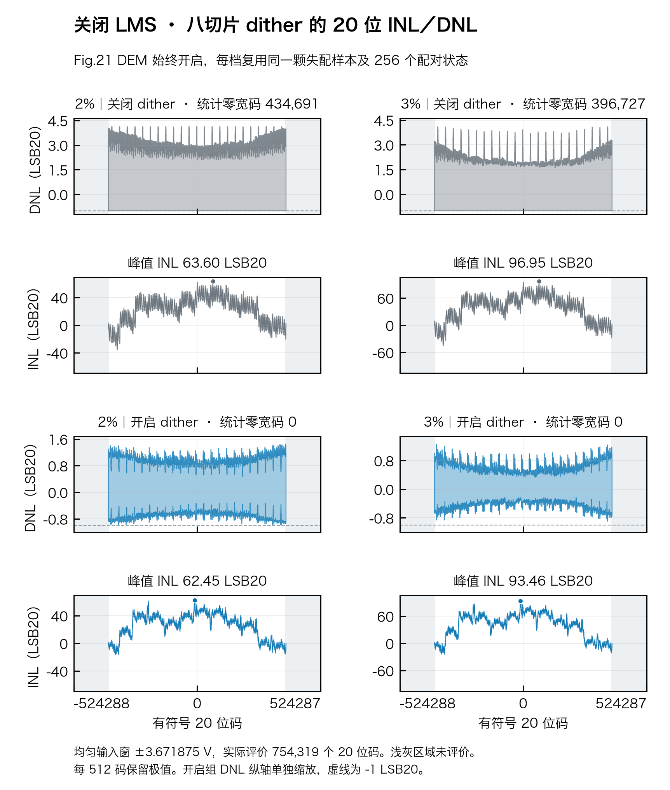
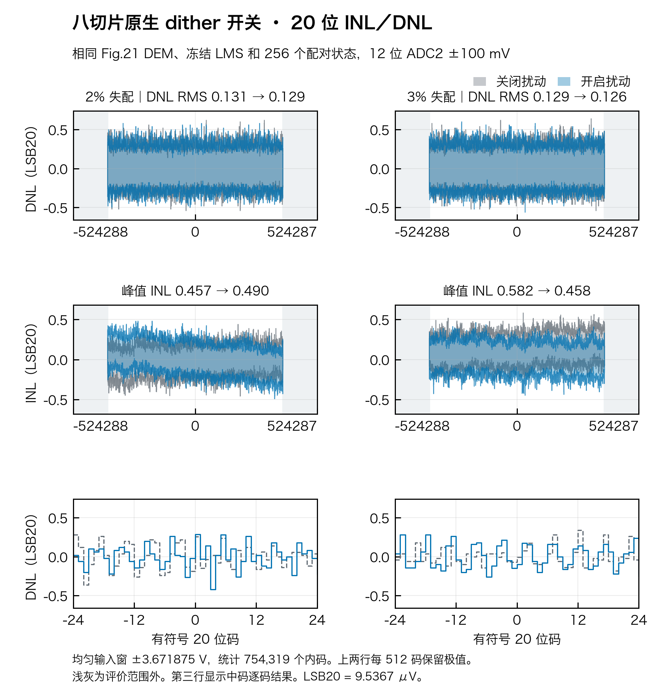
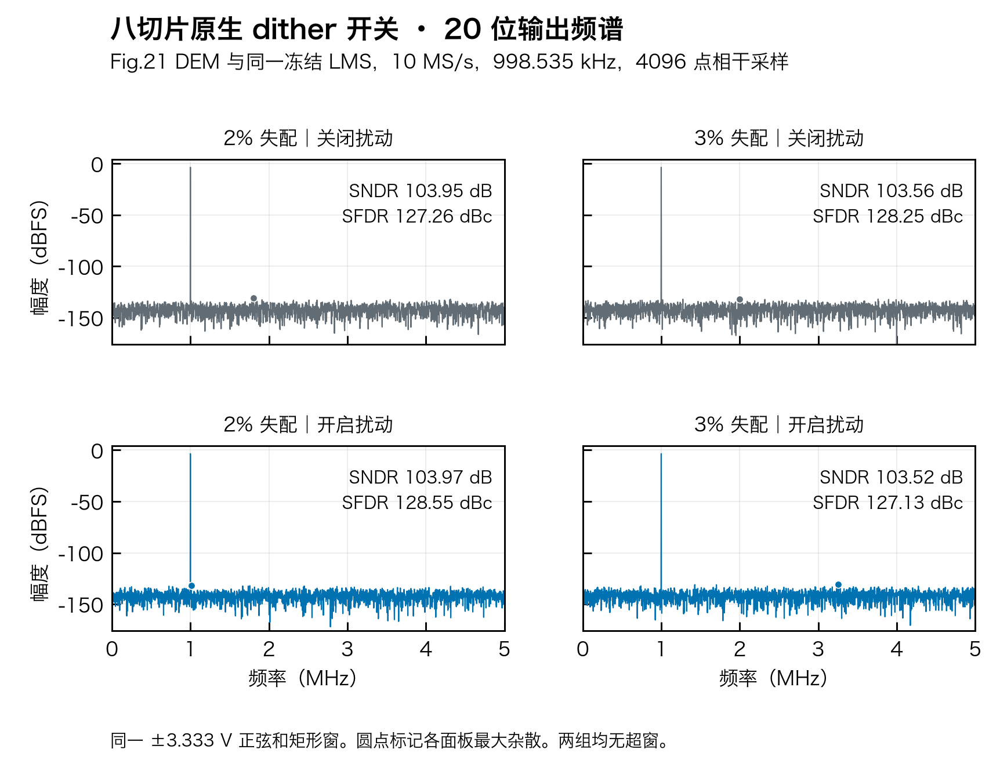

# 20b10mtask｜20 位、10 MS/s SAR ADC 数字交付树

这是**硕士同学的任务交付树**。项目以 ISSCC 2024 的交织前级和相关专利为参考，采用 9 位前级，目标为 20 位输出码、10 MS/s 原始转换，并研究北大斩波辅助自归零。18 片资源池中每次选 8 片采样，上一笔的 8 片转换，其余 2 片空闲。

[任务规格与分工](task1/SPEC.md) · [模块一](task1/README.md) · [统一 LMS 实验标准](task1/EXPERIMENT_STANDARD.md) · [原始论文与专利](references/README.md)

## 20 位 INL／DNL：三组对照

同一颗 **2% 固定电容失配**虚拟芯片、理想 12 位第二级、输入等效 ±100 mV；三组的 dither 均关闭。LMS 两条路径分别训练、冻结，再用独立输入评估。图中每个 20 位码分别计算，纵轴使用 **LSB20＝9.5367 μV**。


| 处理方式 | 峰值 INL（LSB20） | DNL 范围（LSB20） | 零宽内码 |
| :--- | ---: | :--- | ---: |
| DEM 关、LMS 关 | 901.930 | −1.000～+9.238 | 802,491 |
| DEM 关、仅 LMS | 3.737 | −1.000～+4.118 | 678,189 |
| 跨段 DEM 开＋独立 LMS | 3.479 | −1.000～+4.120 | 336 |

图中的 DEM 纵轴已放大，超出范围的极值、点数和缺码均有标注。未校准基线的输出端高端裁剪对应 2.640 mV 输入宽度；它与 ADC2 超窗分别统计。[3% 对照图](task1/evidence/inl_dnl/full20/adc2_12bit_sigma_3pct_three_arms_body_zoom.png) · [全范围及端点放大](task1/evidence/inl_dnl/full20/README.md) · [原始数据与计算方法](task1/evidence/inl_dnl/README.md)

固定 A/B 使用两组固定状态；动态 DEM 使用 4 组种子各 128 个状态快照作等权统计，**不是每笔都重新抽电容**。这些是理想两节点和理想 ADC2 的统计结果，不是实际芯片的逐笔 DNL。按这组模型，DEM 明显减少统计零宽码，但最小 DNL 仍为 −1 LSB20。[什么是 512 个状态、什么是无 DEM](task1/STATE_AND_BASELINES.md)

## Dither 是什么效果？

讲稿中的低路扰动同时作用于前级 SADC 和 RDAC；高路只进入 RDAC。两路的数字信息还参与 DEM 之前的码处理。原文短句、七片示例位分配和本项目生成方式见 [dither 原文与注入](task2/ORIGINAL_SOURCES.md)。


**先看不使用 LMS：**下图两边都开启 Fig.21 DEM，仅改变 dither。2%／3% 固定失配下，开启 dither 后统计零宽码分别从 434,691／396,727 降至 0；峰值 INL 分别为 63.60 → 62.45／96.95 → 93.46 LSB20。静态码密度变平，但频谱 SNDR 仍只有约 52／48 dB。



[不使用 LMS 的频谱图与数据](task2/evidence/eight_native/NO_LMS.md) · [DEM、LMS、dither 八种组合](task2/evidence/eight_native/eight_native_factorial.png)

**再看加入 LMS：**下图按实际选择的 8 片逐一计算子电容底板注入；每档为同一颗固定失配虚拟芯片，DEM 和 LMS 系数在开关两侧相同。理想 12 位 ADC2 的输入等效范围为 ±100 mV。





2% 失配下 DNL RMS 为 0.1310 → 0.1288 LSB20，SFDR 为 127.265 → 128.554 dBc；3% 下分别为 0.1294 → 0.1265 LSB20、128.253 → 127.126 dBc。箭头为 dither 关 → 开，收益和退化均如实保留。静态图在 ±3.671875 V 输入窗内以 256 个配对状态统计 754,319 个 20 位码，属于平均码密度，不是全幅单次转换结果。满幅均匀输入下，dither 使正端约 0.8617% 输入宽度被拒绝。

必须将 dither 开启时出现的子电容状态纳入训练：直接沿用只在关闭态训练的旧系数，2%／3% 的 SNDR 分别降至 78.16／74.65 dB。[八种开关、训练图与原始数据](task2/evidence/eight_native/README.md) · [专利七片示例](task2/evidence/fig19_seven/README.md)

## 现在交付到哪里？

| 项目 | 当前状态 | 入口 |
| :--- | :--- | :--- |
| 切片调度＋DEM | 18／8／8／2、有序 ID、释放资格和 Fig.21 跨段候选已有 Python／RTL 对拍；跨段名义补偿与模拟连接仍须系统验证 | [代码与接口](task1/BRIDGE_SPEC.md) · [数字验证](task1/evidence/bridge_rtl/README.md) |
| 电容失配＋LMS | 2%／3% 固定失配有独立训练、留出、INL／DNL 和频谱对照；LMS 目前是**片外 Python** | [LMS 对照](task1/evidence/bridge_lms/README.md) · [INL／DNL](task1/evidence/inl_dnl/README.md) |
| SKY130 数字后端 | 两个顶层均已导出 GDS；6.25 ns 下 TT 角 setup／hold 通过。基础版 setup 仅有约 1.4 ps 裕量；独立 DRC／LVS 尚未执行 | [GDS、时序和版本](task1/physical/README.md) |
| 分路 dither | 18 片中选择 8 片，六位字、逐片底板采样、同笔 ID 和命令码有 Python／RTL 对拍及有界形式验证；模拟辅助 DAC 和真实参考开关仍须验收 | [八片效果](task2/evidence/eight_native/README.md) · [RTL 合同](task2/eight_rtl/SPEC.md) |
| CAAZ | 斩波相位、自归零控制和两笔数字配对已有 RTL 对拍；模拟宏、实际保持误差和联合后仿仍待验证 | [模块三说明](task3/README.md) |

SKY130 是本阶段指定的数字工艺；它**不是**未来 180 nm BCD 的签核结果。当前目标输出码宽为 20 位，不等于已证明 20 位有效精度。权重训练与重构乘加的最终硬件归属待定。

## 运行和目录

需要 Python 3.12、Verilator；校准和静态分析使用固定提交的 ADCToolbox。输出目录应是**尚不存在的仓库外目录**。

```sh
python -m pip install -r task1/requirements-calibration.txt
PYTHONPATH=.:src python -m pytest -q task1/tests
PYTHONPATH=.:src python task1/tools/run_rtl_checks.py --out /tmp/task1-rtl-run-001
PYTHONPATH=.:src python task1/tools/run_bridge_checks.py --out /tmp/task1-bridge-run-001
```

| 路径 | 用途 |
| :--- | :--- |
| `task1/rtl/`、`model/`、`tb/`、`tests/` | 模块一 RTL、Python 模型和验证 |
| `task1/experiments/`、`evidence/` | 实验脚本、中文图片、原始数据和收据 |
| `task1/physical/`、`design/` | SKY130 GDS／STA、约束、需求与验证记录 |
| `task2/` | dither 字发生器、八片 RTL、模型、效果图和物理流程 |
| `task3/` | CAAZ 数字控制、配对、验证和模拟接口 |
| `src/adi_model/`、`tools/` | 本任务复现依赖的电荷／频谱参考和 RTL 工具辅助 |
| `references/` | ISSCC 与北大论文、讲稿及专利索引 |

校准对照统一执行[失配与 LMS 标准](task1/EXPERIMENT_STANDARD.md)：同一物理失配池、明确开关、训练／留出分离，并同时报告收益、噪声和越界。完整复现及条件见 [模块一说明](task1/README.md)。
