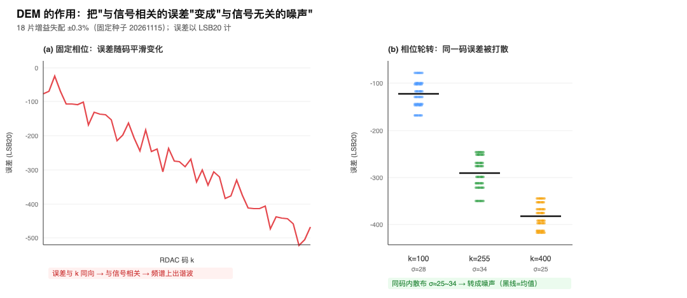
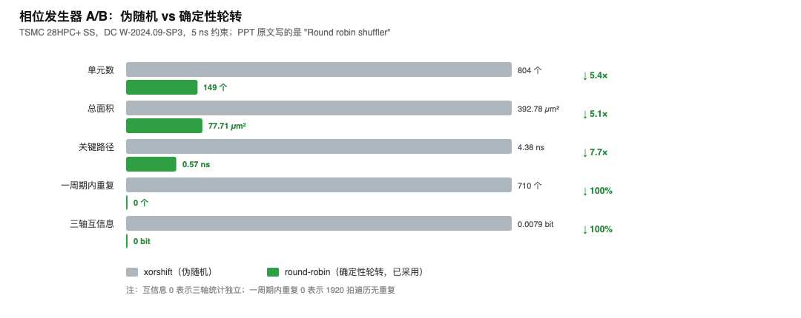

# 20bit SAR ADC 数字 IP

依据 ISSCC 2024 Session 9.8 公开机制、按明确工程假设实现的**可综合数字 IP**。
不是 ADI 硅片的还原（公开资料不足），也不声称与该芯片逐位一致。

## 核心文件：只有这 8 个

**下面这张表就是全部核心。** 其余 30 多个目录是辅助、子系统与仓库常规文件（见 [`PROJECT_MAP.md`](PROJECT_MAP.md)）。

| # | 文件 | 一句话 |
|:--:|:---|:---|
| 1 | `rtl/d3d4_ip.sv` | **IP 顶层**——单时钟域，输入 k + dither，输出物理开关命令 |
| 2 | `rtl/sched18.sv` | **D1** 18 片池调度（8 采集 / 8 转换 / 2 备用） |
| 3 | `rtl/follower_rt.sv` | **D2** RDAC follower（逐事件累加 k，边产生边载入） |
| 4 | `rtl/dem_mask_v3.sv` | **D3** DEM：粗码 → 8×20 物理 mask |
| 5 | `rtl/dem_phase_rr.sv` | **D3** 相位发生器（round-robin） |
| 6 | `rtl/dither_pre.sv` | **D4** Split Dither：6 位字 → 8 片 × 4 位预置 |
| 7 | `src/adi_model/dem_dither.py` | DEM/Dither 的**唯一参考实现**（纯函数，零依赖） |
| 8 | `tools/verify_d3d4_ip.sh` | **唯一验收入口**，四层一起跑 |

辅助但重要：

| 文件 | 作用 |
|:---|:---|
| `tb/tb_d3d4_ip.sv` | IP 级 512 笔对拍 |
| `tb/tb_event_align.sv` | 逐事件对齐（k / 160 位 mask / 标志必须同事件） |
| `tb/tb_dem_dither.sv` | 叶子级 133,376 + 512 组穷举 |
| `rtl/digital_top_w.sv` | 旧链顶层（D1–D6 全链，4+3+2 / `c−U`），仅作兼容资产 |

**关键点**：`dem_mask_v3` 与 `dither_pre` 原本是纯组合模块，相位由端口外部喂，
所以"三维随机化"在叶子层并不存在。`d3d4_ip` 把 `dem_phase_rr` 接进来之后，
随机化才第一次真正落在 RTL 里。

## 效果：DEM 到底起什么作用



**左图**：固定相位时，18 片 ±0.3% 增益失配造成的误差随码 `k` 平滑变化——
它与信号相关，在频谱上表现为**谐波杂散**。

**右图**：相位轮转后，同一个码的误差在 64 个相位间被打散，σ≈25~34 LSB20——
系统性误差变成**与信号无关的噪声**。

这就是 DEM 的本质：**不降低误差总量，只改变误差的形态**。
注意右图三组的均值仍相差约 260 LSB20，那是失配本身的直流项，DEM 管不了。

## 实现选择：为什么用确定性轮转而不是伪随机



ISSCC 2024 PPT 第 29–31 页原文写的是 **`Round robin shuffler`**。
换成确定性轮转后，不但与原文一致，面积降 5.1×、关键路径降 7.7×，
统计指标也更好（χ²=0、三轴互信息=0、1920 拍内零重复）。

伪随机版保留在 `rtl/dem_phase_gen.sv`，加 `+define+D3D4_PHASE_XORSHIFT` 可切回，
用作 A/B 对照。详见 [docs/PHASE_AB.md](docs/PHASE_AB.md)。

## 一条命令验证（三层）

```bash
bash tools/verify_d3d4_ip.sh
```

预期输出：

```
[1/4] L1 叶子级逐位对拍（133376 + 512 组）
      DEM    133376/133376 组  失配 0
      Dither 512/512 组  失配 0
      RESULT: PASS
[2/4] L2 IP 级逐位对拍（含相位发生器，512 笔）
      RESULT: PASS (512 tx bit-exact)
[2.5] sched18 随机性统计（20000 拍）
      RESULT: PASS
[3/4] L3 门级等价
      RESULT: PASS (512 tx bit-exact)
```

远端 VCS（本机无仿真器时）：

```bash
D3D4_RUNNER=vm-yian bash tools/verify_d3d4_ip.sh
```

含门级（需要先做过综合，网表路径自定）：

```bash
D3D4_RUNNER=vm-yian \
D3D4_NETLIST=/path/to/d3d4_ip_net.v \
D3D4_SCMODEL=/path/to/tcbn28hpcplusbwp7t40p140.v \
bash tools/verify_d3d4_ip.sh
```

脚本会因空日志、截断日志、覆盖不足、仿真失败、任一层未出现 `RESULT: PASS`
而返回非零。L3 未提供网表时会显式打 `SKIPPED` 并提示"本次只证明 RTL 层正确"。

## 综合

见 `docs/SYNTH_D3D4.md`。摘要（TSMC 28HPC+ SS）：

| 项 | 值 |
|:---|:---|
| 面积 | 1770.08 µm²（3017 cells，322 FF） |
| 逻辑级数 / 关键路径 | **40 级 / 2.82 ns**（换 round-robin 前是 146 级 / 7.91 ns） |
| 25 ns 下 setup | +19.88 ns |
| 25 ns 下 hold | +0.0017 ns —— **不构成签核结论**，见 SYNTH_D3D4.md §4 |

## 目录结构

**核心只有这些，其余都是辅助或历史。**

```
rtl/                       RTL 源码
  d3d4_ip.sv                 ← IP 顶层（本任务交付物）
  sched18.sv                 ← D1 片池调度
  follower_rt.sv             ← D2 逐事件 RDAC
  dem_mask_v3.sv             ← D3 DEM
  dem_phase_rr.sv            ← D3 相位（round-robin）
  dither_pre.sv              ← D4 Dither
  digital_top_w.sv           ← 旧链顶层（D1-D6，4+3+2 / c-U）

tb/                        testbench 与金标
  tb_d3d4_ip.sv              ← IP 级 512 笔
  tb_event_align.sv          ← 逐事件对齐（k/mask 同事件）
  tb_dem_dither.sv           ← 叶子级 133,376 + 512 组
  vec_*.txt                  ← 金标向量

tools/verify_d3d4_ip.sh    ← **唯一验收入口，四层一起跑**
flow/build/filelists/           ← 4 个编译清单（先看里面的 README）
flow/synth/d3d4/                ← 综合脚本与 SDC
src/adi_model/dem_dither.py← DEM/Dither 唯一参考实现
docs/                      ← 顶层 14 份当前文档，其余在 docs/_history/
```

**历史与外围，不要混入主线**：
- `docs/_history/` —— 已作废文档（98 份 / 4.7 MB）
- `subsys/` —— 外围子系统（AD4080 DSP、CAAZ 扩展、180nm 存档），
  它们有 CI 依赖所以不能删，但与本任务无关

**两条链不要混用**：

| 链 | 顶层 | 口径 | 有 20 位码？ |
|:---|:---|:---|:---|
| 新（本轮） | `rtl/d3d4_ip.sv` | 3+3+3 / `c+U` | 无（到开关命令层） |
| 旧 | `rtl/digital_top_w.sv` | 4+3+2 / `c−U` | 有（D1–D6 全链） |

## 阅读顺序

0. **`docs/D3D4_IP_INTERFACE.md`（IP 对外合同）** —— 端口、时序、两种模式、
   位序、合法性标志、不能声称的清单
0.5 **`docs/HANDOFF_D3D4.md`（接手者先读这个）** —— 本轮做了什么、
   如何验证、我为什么认为功能与综合完成、以及**最可能被推翻的 5 个地方**
1. 本文（交付什么、怎么跑）
2. `docs/CONTRACT_CURRENT.md`（适用哪份合同、版本优先级）
3. `docs/DIGITAL_ALGORITHM.md`（DEM / Dither 原理与源码对应）
4. `docs/ACCEPTANCE_STATUS.md`（哪个模块在哪个提交通过了什么）

## 已知边界

| 项 | 说明 |
|:---|:---|
| 范围 | D3/D4 叶子 + `d3d4_ip` 顶层 + `sched18`（D1 调度器）。D2/D5/D6 不在本阶段 |
| 综合 | **已做**块级综合 + 门级等价（`docs/SYNTH_D3D4.md`）。未做 P&R / CTS / DRC / LVS |
| 形式等价 | **未做**。门级仿真覆盖功能，不等价于形式证明 |
| hold | **不能签核**。零线载假设下的 +0.013 ns 不构成结论，见 `SYNTH_D3D4.md` §4 |
| 功耗 | **不能签核**。`report_power` 无色切换率输入，只作量级参考 |
| 接主链 | **未接**。`digital_top_w` 仍走 `dem_shuffle` + `dither_split`（4+3+2 / `c−U`），不含本 IP |
| 两相位交织 | **已接入**。`d3d4_ip` 例化 `sched18`，输出 acq/conv/idle 掩码与片 ID |
| RDAC follower | **已接入**。事件流模式下 k 由 `follower_rt` 逐事件累加（实测 1→3→…→511） |
| bridging | 与 PPT Fig.31 的 2×2 形态**不同**，按合同 §6.1 的等电荷 E 实现；见 `docs/BRIDGE_VS_FIG31.md` |
| 来源 | `3+3+3`、8 宏列×16 半单元、β=1/8、guard 512–520 均为 `[E]` 工程补全 |
| 历史文档 | `docs/_history/DIGITAL_SPEC.md` 等早于合同 v2.1，仅作追溯，不作现行规格 |
| 笔数口径 | 仓库里 `8509` 笔那条走旧链，**不是本 IP 的证据** |

## 状态表

见 `docs/ACCEPTANCE_STATUS.md`（每条绑定提交与证据路径）。
