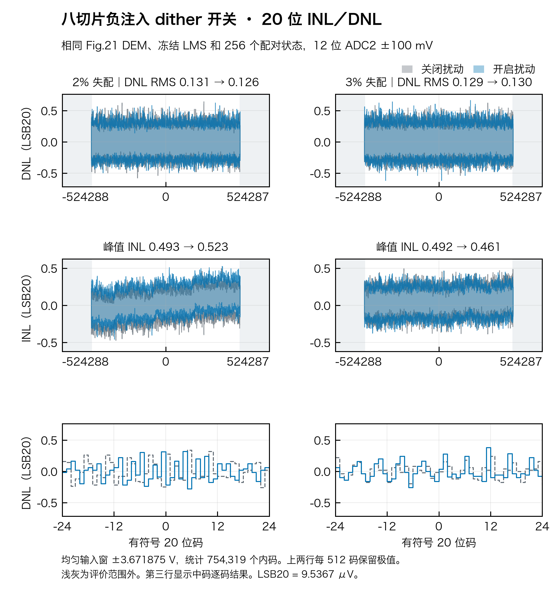
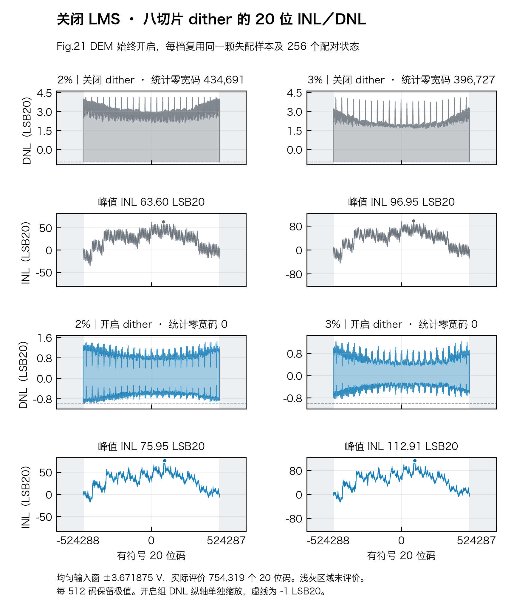
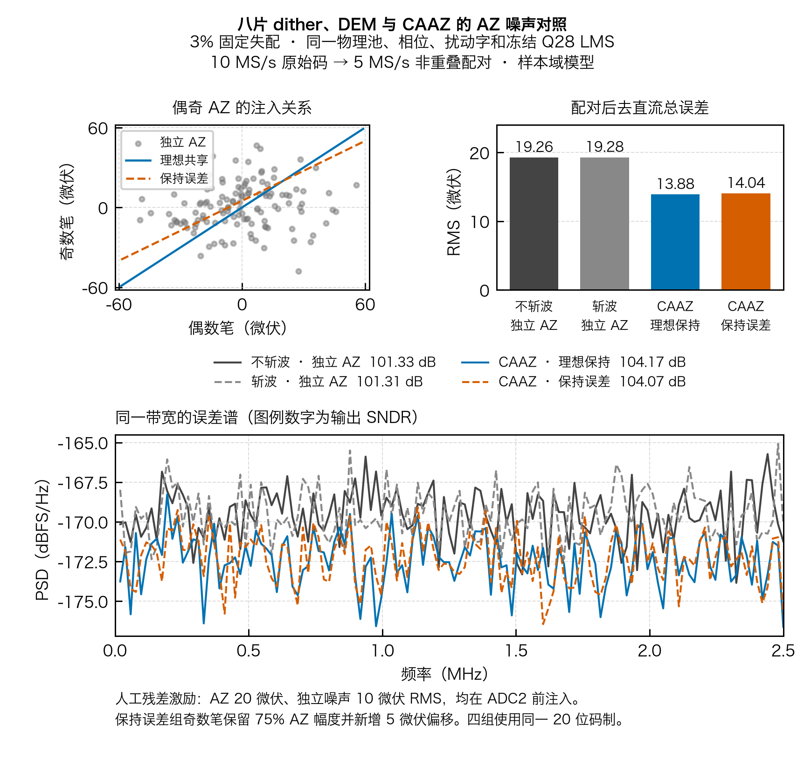
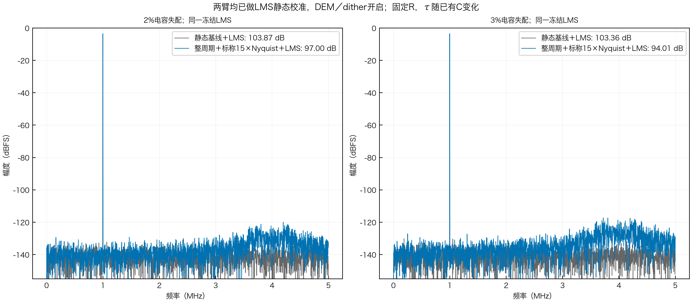

# 20b10mtask｜20位、10 MS/s ADC数字任务交付树

你将在这个分支完成三项数字技术：**切片调度与DEM（动态元件匹配）、dither（扰动注入与去扰）、CAAZ（斩波辅助自归零）**。
已有Python、RTL和部分验证结果可以复用。你的工作是复现这些结果，补齐模拟接口与性能验证，
再交付与模型一致的RTL、GDS和时序报告。

**先读本页，再按[任务书](task1/SPEC.md)执行。** 论文／专利位置及工程假设分别在各模块说明中给出；
[原文索引](references/README.md)用于核对来源，不能把工程选值当作原文披露。

## 1. 你要交付什么

<a id="现在交付到哪里"></a>

| 工作包 | 可以复用什么 | 你需要完成什么 |
| :--- | :--- | :--- |
| 切片调度＋DEM | 18片中8片采集、8片转换、2片空闲的调度；片号与DEM配置随样本保存；已有Python／RTL对拍 | 核对物理单元及开关映射，复现DEM／LMS四组对照，解释线性度与频谱的收益和代价 |
| Dither | 六位扰动字、八片注入模型、去扰重构和同笔ID检查；已有开关对照 | 绑定真实辅助注入与参考轨，核对符号及端点余量，验证无LMS和冻结LMS两种条件下的效果 |
| CAAZ | 斩波相位、AZ更新／保持控制、非重叠配对和样本域噪声模型 | 绑定模拟AZ确认与保持误差，证明与DEM、dither协作正确，交同带宽效果图及错误配对负例 |
| 整体集成与后端 | 片外LMS训练、可写权重的片上重构、整体对拍入口和指定版本的SKY130记录 | 冻结接口与定点规则，完成对应版本的Python／RTL验证、数字宏GDS和提取后时序验收 |

学生负责数字接口、算法建模、RTL、验证和数字后端。模拟组负责采样前端、量化器、RA（残差放大器）、ADC2（后级量化器）、参考及斩波／自零电路，
提供或确认连接、响应和时序。**LMS（最小均方）校准现有实现是片外训练、片上加载权重并重构；训练参考与更新方式须在接口冻结时确定。**

| 项目条件 | 当前约定与边界 |
| :--- | :--- |
| 系统目标 | ISSCC交织架构为参考，9位前级，差分输入±5 V，20位输出码，原始10 MS/s；20位码宽不等于20位有效精度 |
| 调度与时钟 | 18／8／8／2；若保持16拍一笔，数字时钟目标160 MHz，须经模拟时序和数字STA验证 |
| ADC2与CAAZ | 模型采用理想12位ADC2、输入折算±100 mV；真实RA增益与内部窗口待绑定。CAAZ每两笔输出一笔，为5 MS/s |
| 电容网络 | 当前工程模型为主阵列15×2C＋2×1C、子阵列8C／4C／2C／C／C、桥接C；实际可切换单元和参考接法尚须核对 |
| 实现平台 | 本阶段使用SKY130完成数字后端；180 nm BCD是后续目标工艺，必须以该工艺库另做实现和验收 |

## 2. 第一周先完成这三件事

1. **固定接手版本并跑回归。** 记录提交号和依赖版本。动态修复提交`bef5654`的本机Python回归为218项通过；你应保存自己运行的结果，不能直接沿用归档结论。
2. **复现下面三项技术的基线图。** 给每张图注明输入、固定失配池、开关、训练／留出、量程和统计范围，说明它证明了什么。
3. **列出需要冻结的模拟接口。** 包括物理开关位图（mask）映射、采样／转换时序、扰动参考与极性、RA／ADC2窗口、CAAZ捕获／保持确认。按[任务书接手清单](task1/SPEC.md#同学第一周怎么开始)与模拟组逐项落实。

## 3. 每项技术交什么图，怎样验收

### 切片调度＋DEM：看清静态失配怎样被处理

交选片时序、单元使用统计，以及**DEM开／关×LMS开／关四组**20位INL／DNL与频谱。
2%和3%固定失配分别测试；各组使用相同物理电容池、输入和可比的控制条件。
LMS训练后冻结，用未参与训练的数据验证。
现有DEM按本工程网络运行；完整原文3D开关矩阵的复现及真实模拟连接尚未证明。



**已有结果供你复现：**2%失配、dither关闭时，峰值端点INL从无DEM／无LMS的655.668 LSB20，
降到仅LMS的0.788 LSB20，再到DEM＋LMS的0.493 LSB20。
这是±3.671875 V共同窗内、256个等权配对状态的平均码密度，未证明全幅单次转换无缺码。
图中LSB20=10 V/2²⁰=9.5367 μV，不能改用前级LSB。

**验收：**切片与配置归属正确、名义电荷关系满足已冻结网络、Python／RTL逐事件一致；
效果图同时报告收益和代价，不以“用了DEM”代替性能证据。
[模块一与接口](task1/README.md) · [固定失配与LMS统一标准](task1/EXPERIMENT_STANDARD.md)

### Dither：看清注入、去扰和端点余量

交原文对应的注入／去扰示意，在**无LMS、冻结LMS**两种条件下分别比较dither关／开，
并交全幅输入拒绝／内部超窗图。每笔必须使用自己的字、片号、采样位图和转换位图。



**已有结果供你复现：**DEM开启、LMS关闭时，2%／3%固定失配的统计零宽内码由434,691／396,727降为0，
但峰值INL反而增大。它能平滑平均码密度，不能由此声称INL、SNDR同时改善。

当前命令为`k=c−U`，重构子特征为`conv_sub+sample_sub`。
负注入由受控电荷源实现、注入与转换共享子权重仍是工程假设，真实底板轨尚未绑定。
全部扰动字共同名义下限为−4.855239 V，目标±5 V的端点验收尚未完成。

**验收：**原文机制、实际接轨、数字符号逐项对应；去扰后整数重构与RTL逐笔一致；
拒绝和超窗必须保留，不以静默限幅得到通过结果。
[原文与注入说明](task2/ORIGINAL_SOURCES.md) · [八片结果、数据与复现](task2/evidence/eight_negative/README.md)

### CAAZ：看清共享AZ是否带来额外收益

交AZ更新／保持与配对时序，在**相同5 MS/s输出及相同带宽**下比较普通两笔配对、共享AZ、
加入保持误差三种情况；再交一次故意错绑ID的负例，证明错误会被识别。



**已有结果供你复现：**此样本域噪声例的总交流误差为19.264→13.875 μV RMS，
加入示例保持误差后为14.041 μV RMS。参数是声明的模型设置，尚非真实RA／CBIAS测量。

**验收：**每笔先重构去扰，再按极性、样本ID和AZ代配对；两笔可使用不同切片和扰动字。
模拟确认、丢笔、错相及坏码都有确定处理；普通平均的收益与共享AZ的收益分开比较。
[CAAZ任务与接口](task3/README.md) · [当前联合数据](task3/evidence/negative/joint_noise/summary.json)

## 4. 当前优先补齐：让性能图对应真实模拟条件

上面的主要结果来自静态电荷模型或声明噪声的样本模型。
你接下来要把输入建立、数字串扰和参考建立接入同一验证链，再判断技术在实际条件下的收益。
已有动态入口修正了整周期采集、共享输入／ADC2孔径、粗预充与精确参考分工，结构与数学检查已交付。



**这张图两条曲线都开启DEM、dither，使用同一组冻结的静态LMS。**
2%／3%失配下，静态SNDR为103.87／103.36 dB，条件输入模型为97.00／94.01 dB。
后者采用固定R、τ随电容变化、标称15×Nyquist的工程假设；没有用动态数据重新训练，不能直接预测芯片性能。

| 你要补的内容 | 模拟组提供／确认 | 你的交付与验收 |
| :--- | :--- | :--- |
| 输入建立 | 实际采集响应、初始状态、逐片差异及输入相关性 | 接入后交理想／有限建立的误差、频谱、INL／DNL，明确模型适用范围 |
| 数字串扰 | 受扰节点、耦合投影和恢复响应 | 使用有时刻的真实翻转活动，交活动与误差对齐图及关／开效果图 |
| 参考与RA | 粗／精参考网络、逐事件负载、RA响应与初态 | 交参考和残差随时间图、电荷检查及关／开性能对照 |
| 联合与统计 | 全幅与内部余量合同、冻结的性能预算 | 交三项联合图及全幅20位有限命中结果，报告实际最少命中、拒绝和不确定度 |

**目前仍缺：**真实参数标定、完整联合验证和全幅有限命中。
新交付的128码局部图只检查该窗口，不能当作ISSCC讲稿32页整机INL／DNL复现。
性能门槛在模拟预算与模型MC后冻结；回归通过不等于达到约100 dB目标。
[动态模型与模拟数据接入](task2/eight/DYNAMIC_MODEL.md) · [三张图、条件及复现](task2/evidence/dynamics_fixed/README.md)

## 5. 九个月按什么顺序交付

| 时间 | 阶段交付 | 阶段通过条件 |
| :--- | :--- | :--- |
| M1–M2 | 接手基线、冻结接口，交调度和DEM／LMS四组效果图 | 能复现、有独立留出、物理映射与时序可核对，Python／RTL控制一致 |
| M3–M5 | 八片dither、2%／3%对照、注入／去扰图、端点与动态误差图 | 同笔归属与重构一致，工程假设有来源，超窗明确，解释收益与代价 |
| M6–M7 | CAAZ及三技术联合，交同带宽噪声图、AZ时序和错误负例 | 模拟捕获／保持合同落实，配对正确，联合模型条件与性能预算可追溯 |
| M8–M9 | 冻结整体RTL，交综合、数字GDS、网表、约束、提取后时序和物理检查 | 同版本Python／RTL验证通过；setup／hold、DRC／LVS分别留证，未完成项明确列出 |

每阶段交一个可复现的包：**运行说明＋配置／原始数据／冻结系数＋效果图＋测试记录**。
最终包另含GDS和原始工具报告。记录提交号、工具版本与摘要；不能用旧版图的通过结果覆盖新RTL。

现有[SKY130交付包](delivery/negative_66b2e2e/README.md)来自冻结源码`66b2e2e`，是已有实现的参考记录，
不是你此后代码的验收。其单角及公开规则结果不等于完整签核；含片上LMS大顶层未在该包交付。
180 nm BCD需获得对应库及约束后重新实现，不能沿用SKY130结论。

## 6. 从哪里开始运行、读代码

使用Python 3.12环境，按依赖清单固定版本；RTL检查另需Verilator，形式检查需Yosys。
输出使用尚不存在的仓库外目录，先复现再选择要归档的工件。

```sh
# 在已激活的Python 3.12环境中，安装固定依赖并运行Python回归。
python -m pip install -r task1/requirements-ci.txt
PYTHONPATH=.:src OPENBLAS_NUM_THREADS=1 MPLBACKEND=Agg python -m pytest -q

# 复现本页的条件输入图；这里不重新训练LMS。
PYTHONPATH=.:src OPENBLAS_NUM_THREADS=1 MPLBACKEND=Agg \
  python -m task2.eight.dynamic_experiment --out /tmp/sar-dynamics-run-001

# 模块一的RTL逐拍检查，另需已安装Verilator。
PYTHONPATH=.:src python task1/tools/run_rtl_checks.py --out /tmp/sar-task1-rtl-001
PYTHONPATH=.:src python task1/tools/run_bridge_checks.py --out /tmp/sar-task1-bridge-001
```

| 先读哪里 | 用来完成什么 |
| :--- | :--- |
| [任务书](task1/SPEC.md) | 工作边界、接口、每阶段图片和验收条件 |
| `task1/` | 调度／DEM的模型、RTL、验证与固定失配实验 |
| `task2/` | dither的原文对应、八片模型／RTL、静态与动态效果实验 |
| `task3/` | CAAZ相位、AZ确认、数字配对和噪声实验 |
| `task_reconstruction/`、`task_integration/` | 权重装载与定点重构、三模块整体对拍 |
| `src/adi_model/` | 电荷域、噪声、建立与参考等可复用模型核 |
| `delivery/` | 绑定冻结源码的已有后端工件，使用前先核对版本和适用范围 |

各阶段图的重跑／重绘和RTL命令放在对应模块说明，不必一次运行全部实验。
原有[定量对标与未通过项](task2/evidence/paper_alignment/ALIGNMENT.md)作为归档背景阅读；
当前结论应使用本页链接的同版本代码、数据和验证记录。
