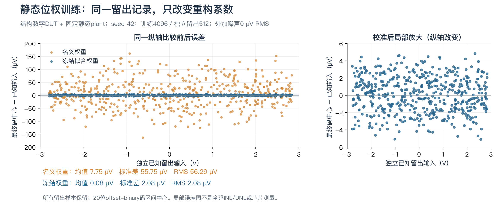
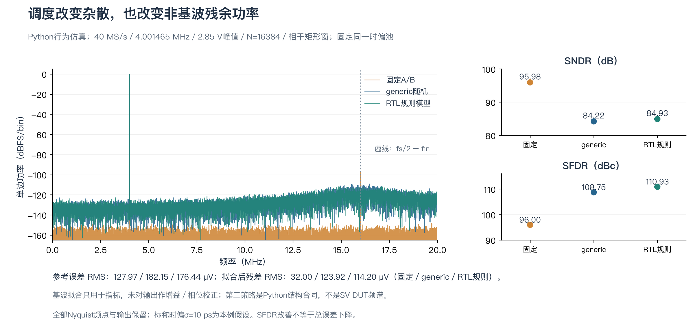
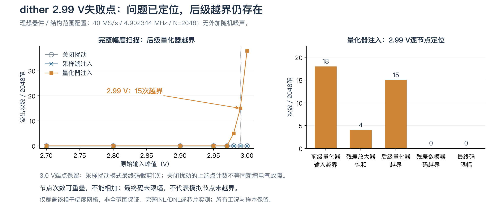
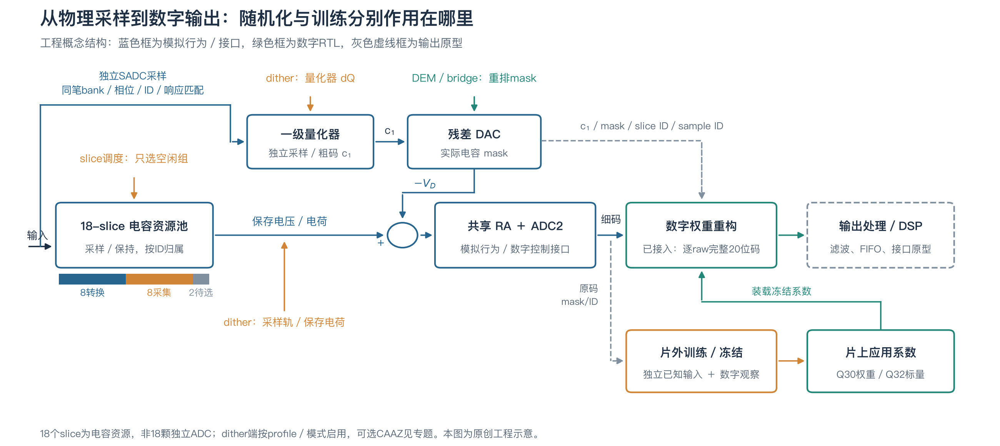

# 20-bit / 40 MS/s Pipelined SAR ADC: Behavioral Modeling, Static Calibration and Digital Implementation

[中文](README.md) · [Detailed status](docs/STATUS.md) · [Papers and presentations](references/README.md) · [Environment and contributing](CONTRIBUTING.md)

## Purpose and scope

This project studies capacitor mismatch, sampling/interleaving errors and the limits of digital calibration in a two-stage SAR ADC with capacitor slices used for sampling and charge storage. It delivers three components: **an ADC behavioral model, a static mismatch calibration flow, and digital control/reconstruction RTL**. Dynamic element matching (DEM), known injected perturbations (dither) and slice scheduling are evaluated in the corresponding implementations and experiments. Output digital signal processing (DSP) and chopping-assisted auto-zeroing (CAAZ) are described as extensions.

**20 bits is the final output word width, and 40 MS/s is the default sample-rate parameter.** Current evidence includes behavioral simulation, register-transfer-level (RTL) digital simulation, and joint simulation of RTL with a behavioral model representing the analog ADC. It establishes neither an effective number of bits (ENOB) of 20 nor hardware operation at the target sample rate. Target-process timing, transistor-level and post-layout verification remain open.

## Delivered work and current status

| Work item | What has been implemented | Evidence entry point | Current finding | What remains |
|---|---|---|---|---|
| **ADC behavioral model** | Stores sampled charge by physical slice and models the first-stage quantizer (SADC), residue DAC (RDAC), shared residue amplifier (RA) and backend quantizer (ADC2), including mismatch, noise and finite settling | [Model scope and assumptions](docs/model_scope.md) · Interleaving/dither experiments below | Conversion and error experiments run; scheduling tradeoffs and headroom limits have been identified. Full dynamic performance against the target remains unproven | Real switches, closing edges, reference settling and device-noise transfer validation |
| **Static mismatch calibration flow** | Estimates effective weights from independently known inputs and digital observations, keeps the trained coefficients fixed, loads them into RTL, and produces integer codes for data excluded from training | [Figure 1 data](docs/readme/data/structural_calibration_summary.json) · [Training and validation](docs/REPRODUCING.md#静态权重训练与结构dut留出) | Validated under specified static conditions; error standard deviation decreases for both mismatch models | Real reference, observation readout, drift/dynamic training and backend nonlinearity |
| **Digital control and reconstruction RTL** | Implements conversion timing, physical selection, DEM/dither, sample association, weight loading, fixed-point reconstruction and fault handling | [Interface rules](docs/adr/0021-structural-contract-calibration.md) · [Arithmetic rules](docs/rtl/RTL_ARITHMETIC_CONTRACT.md) · [CI for the tested commit](https://github.com/defineiocc02/20bit_SAR_ADC_Behaviour_Verification/actions/runs/41970250280) | Project masks/events agree with Python; specified integer comparisons and digital regressions pass | Timing and electrical validation of the existing comparator and analog-macro interfaces, observation transport, target-process implementation and timing validation |

**Extensions and their current limits.** DSP has correction, filtering, FIFO buffering and serial-output prototypes. Two-point correction direction, usable filter coefficients, FIFO-to-serial connectivity and per-result metadata still have gaps. CAAZ is disabled by default and has digital pairing plus conditional behavioral experiments. When enabled, the project uses 40 MS/s individual conversions and 20 MS/s paired outputs. Actual auto-zero capacitor retention and the ratio of noise transfer to signal gain (H/K) remain unverified. These extensions are evaluated separately. See the [status page](docs/STATUS.md).

## Main experimental results

### Static calibration reduces error standard deviation from 55.75 to 2.08 µV

Effective capacitor-ratio weights are trained off-chip and then held fixed, or frozen. Nominal and trained coefficients process **the same original per-conversion observations**, including coarse codes, backend codes, physical slices and switch selections. These are the raw observations. Both reconstructions produce final 20-bit integer codes. Training additionally uses independently known inputs and does not read the true capacitor values. Validation samples are kept out of training, forming the independent holdout set.



*Figure 1 | Static calibration is validated under the stated conditions. Digital RTL plus a fixed static-mismatch behavioral model; seed 42, DEM plus sampling D=2, 4096 training samples, 512 independent validation samples and no added random noise. Before/after results share the vertical scale, with the residual explicitly enlarged at right. [Data](docs/readme/data/structural_calibration_summary.json) · [Retrain and validate](docs/REPRODUCING.md#静态权重训练与结构dut留出).*

The second model, seed 91, also improves from **59.38 to 2.14 µV**, and its results are retained. Mean, standard deviation and root-mean-square (RMS) error are recorded separately. This demonstrates static effective-weight correction. Dynamic settling, the real reference, drift and backend nonlinearity remain outside that validation, as does full-code INL/DNL.

### Interleaving tradeoff: SFDR improves 14.93 dB while SNDR falls 11.05 dB

SFDR is the spur-free dynamic range, comparing the fundamental with the largest remaining spectral peak. SNDR is the signal-to-noise-and-distortion ratio, including residual noise and distortion. Fixed A/B slice allocation, generic behavioral random selection and **Python selection following the RTL allocation rules** use the same timing-skew pool, input and final-code quantization. The heading reports the third strategy relative to fixed A/B slice allocation. It spreads spurs while increasing residual power outside the fundamental. This completes a study of the scheduling tradeoff; per-slice skew estimation and compensation remain unimplemented.



*Figure 2 | Interleaving comparison in the behavioral model. 40 MS/s, approximately 4.001465 MHz / 2.85 V peak, N=16384, the same realization of nominal 10 ps Gaussian skew, capacitor mismatch and other random noise disabled; coherent rectangular window and one-sided dBFS/bin spectra across the full Nyquist band, from final 20-bit codes. The third trace is not an SV-output spectrum. [Conditions and data](docs/readme/data/interleave_40m.json) · [Resimulate and compare strictly](docs/REPRODUCING.md#交织调度的当前严格基线).*

Error RMS relative to the ideal input is **127.97 / 182.15 / 176.44 µV**, retaining fundamental gain/phase error. SNDR uses residual power after removing DC and the fitted fundamental. Fitting computes metrics only and does not correct the output. The result does not establish that random scheduling always improves accuracy, or reproduce undisclosed paper conditions quantitatively.

### Near-full-scale dither overflow has been located and remains unresolved

An input-amplitude sweep with separate node counts identifies the near-full-scale limit of structural quantizer dither. **At 2.99 V peak, the RDAC command remains legal and the final code stays within its digital output limits, with zero clipping, while internal limits are exceeded. The SADC input is outside its nominal range 18 times, the residue amplifier saturates four times, and the backend quantizer overflows 15 times.** Dither-off and sampling-dither modes have none of these analog excursions under the same conditions.



*Figure 3 | Headroom diagnosis with the issue located and overflow still unresolved. Ideal-device structural configuration, 40 MS/s, N=2048, fin=251Fs/2048; all 24 amplitude/mode combinations and failed points are retained. Node counts may overlap and cannot be added together. [Data and node definitions](docs/readme/data/dither_headroom.json) · [Repeat the sweep](docs/REPRODUCING.md#dither的近满幅余量).*

The structural perturbation sequence is set by fixed D=2. The floating amplitude field does not control it, as the effective-configuration report now states explicitly. Next, define the legal operating amplitude and backend headroom, then validate the proposed treatment. This presentation update preserves the original ranges, failed points and criteria.

### DEM selection and usage statistics are available. Incremental accuracy benefit needs separate validation

The bridge candidate makes a nominal zero-sum exchange of RDAC unit codes among the active logical positions.

| Counted object | Observed result | Denominator and finding |
|---|---|---|
| Fixed k=10 and fixed logical position (slot), over 512 states | Main unit 56 selects the positive rail 16 times and the other 62 units eight times each; with bridge enabled, some subunits show 160/96 selections while the others show 128 | Denominator is 512 states. The nominal weighted code is conserved, but positive-rail selection is uneven |
| 16384 conversions using actual physical-slice selection, seed 42 | Generic random and Python selection following RTL rules both retain approximately twice as many positive-rail selections for main unit 56 | Each physical slice uses its own selection count as denominator. A common denominator of 16384 or fixed-slot counts would describe a different statistic |

These counts refer to mask=1 selecting the positive reference rail. A zero mask still contributes a negative-rail charge term. The [distribution plot, original counts and denominators](docs/randomization_caaz/README.md) retain all results. DEM's incremental accuracy benefit still needs performance evidence using the same physical pool, input and quantization.

## How the system works



*Figure 4 | Relationships and locations of the three deliverables. Blue boxes represent analog behavior/interfaces, green boxes digital RTL, and gray dashed boxes output prototypes. Implementation status is given in the results table above. This is an original engineering structure, not a reconstruction of the original chip's complete circuit.*

The 18 slices are sampling/capacitor resources. In one cycle, eight convert, eight acquire and two remain available, sharing the residue amplifier and backend quantizer. The first-stage quantizer samples independently while preserving the current sample's timing and association. Slice selection chooses the physical group; DEM changes the capacitors used for a code; dither injects a known perturbation at a specified node with corresponding code adjustment and reconstruction; trained weights are applied digitally.

Consecutive conversions must consume the physical groups acquired earlier. Structural RTL uses one bit for both unit DEM and random slice selection, so these controls are coupled. Effective weights represent observable ratios such as the effective contribution of a unit capacitor relative to the feedback capacitor, C/Cf. They do not uniquely identify absolute capacitor values. See the [implementation figures](docs/randomization_caaz/README.md).

| Configuration entry | First stage / DAC and scheduling | Purpose and model assumptions |
|---|---|---|
| `Config()` | Retained 7-bit / unary reference, with restrictions at each execution entry | Budgets and early mechanisms; separate from the 9-bit RTL circuit model |
| `Config.paper_literal()` | 9-bit / 63+8 split candidate, generic behavioral scheduling | Physical-pool and mechanism sensitivity; an ideal dual-port assumption when quantizer dither is enabled |
| `Config.rtl_structural()` | 9-bit / 63+8 split, 12-bit backend, 16 phases | Structural-RTL sample, mask and reference-event comparison, using discrete range dither rules |

Dither is disabled by default in all three configurations. One clock per phase would imply a 640 MHz implementation budget; functional simulation does not establish that clock rate. The 63+8 allocation, bridge gating and some analog parameters are engineering choices. See the [configuration scope](docs/model_scope.md).

## Unfinished work

**Identified issues and range limits awaiting resolution**

| Issue | Next action | Required evidence |
|---|---|---|
| Near-full-scale dither exhausts internal headroom | Define operating amplitude and the injection, code-transfer and backend-range approach | Node ranges, saturation and final clipping on the same grid, retaining failed points |
| DEM usage bias, a statistical limitation | Define the balancing target, then compare mappings and performance costs | Usage statistics, SFDR/SNDR and total error from the same physical pool, beyond counts alone |
| Gaps in prototype DSP correction, filtering and output | Fix two-point direction, usable coefficients, FIFO-to-serial routing and metadata | Continuous-output consistency of codes, sample IDs, faults and throughput |

**Validation and engineering interfaces still needed.** First define and fix the real sample/hold, reset, non-overlap and closing-edge timing, and verify reference/amplifier/backend settling before the deadline. Then establish the independent reference and observation-readout approach. Use actual readable data for training, fixed-coefficient application and independent validation, preserving sample and coefficient-epoch association through missing records or coefficient changes. The 748-bit observation port has no FIFO, ready signal or external transport. At 40 MS/s, its nominal data volume is 29.92 Gbit/s, requiring a bandwidth budget or controlled capture. Target-process implementation, timing, clock-domain crossing, transistor-level and post-layout verification require separate evidence.

**Optional extensions.** Per-slice skew/bandwidth learning, the original chip's complete bridge/dual-port circuit, CAAZ analog macros and the CICC continuous-time backend are separate research items. CAAZ needs the same auto-zero state retained across two cycles and H/K matching. Existing output SINC filtering, pretracking and digital pairing do not implement the CICC backend's tracking averaging. Define observations, signal/noise budgets and completion criteria for each. See [dependencies and closure conditions](docs/STATUS.md#按依赖排序的未闭合项) and the [combination analysis](docs/randomization_caaz/README.md).

## Reproduction and code entry points

Prepare dependencies using the [environment instructions](CONTRIBUTING.md). New experiments require a **new output directory that does not yet exist**. Full settings, output files and criteria are in the [reproduction guide](docs/REPRODUCING.md).

**A. Quick functional check.** Requires Python numerical dependencies and pytest. It checks reference events, sample association and illegal configurations, without Verilator or an accuracy assessment.

```bash
PYTHONPATH=src pytest -q tests/unit/test_structural_contract.py
```

**B. Retrain and validate.** Additionally requires Verilator 5.x and a C++ compiler. The structural configuration and fixed static-mismatch model produce original observations, fixed coefficients and summary.json. Success requires sample alignment, integer agreement, zero faults and the specified static-improvement criteria.

```bash
OPENBLAS_NUM_THREADS=1 PYTHONPATH=src python tools/run_structural_calibration.py \
  --output "${TMPDIR:-/tmp}/sar-calibration-new" --train 4096 --holdout 512 --chip-seeds 42 91
```

**C. Redraw existing data only.** Requires Matplotlib and a usable Chinese font. Reads the repository's JSON/NPZ to generate the PNG/SVG figures above and input hashes. It performs no new simulation, training or numerical improvement.

```bash
MPLBACKEND=Agg PYTHONPATH=src python docs/readme/make_overview_figures.py \
  --out "${TMPDIR:-/tmp}/sar-overview-figures"
```

| What to understand | Code and detailed entry points |
|---|---|
| How the model converts inputs and introduces errors | [Signal chain](src/adi_model/pipeline_engine.py) · [Configuration](src/adi_model/config.py) · [Scope](docs/model_scope.md) |
| DEM, dither and physical selection | [DEM](src/adi_model/dem.py) · [Physical pool](src/adi_model/slice_pool.py) · [Sampling injection](src/adi_model/sampling_charge.py) · [Mechanism and usage figures](docs/randomization_caaz/README.md) |
| How coefficients are trained, held fixed and applied | [Weight fitting](src/adi_model/weight_calibration.py) · [Fixed-point reconstruction](src/adi_model/fixed_point.py) · [Observation and loading rules](docs/adr/0021-structural-contract-calibration.md) |
| How RTL preserves sample association and handles faults | [Digital core](rtl/top/sar20_digital_core.sv) · [Arithmetic rules](docs/rtl/RTL_ARITHMETIC_CONTRACT.md) · [Prototype DSP interface](ad4080_dsp/docs/SAR20_INTERFACE.md) |
| Reproduction and remaining limits | [Reproduction](docs/REPRODUCING.md) · [Detailed status](docs/STATUS.md) · [Review decisions and maintenance](docs/reviews/20261105-readability-maintenance.md) |
| Originals and historical evidence | [Three paper/presentation pairs](references/README.md) · [Source manifest](sources_manifest.json) · [Historical documents](docs/history/) |

Code is distributed under [BSD-3-Clause](LICENSE). Selected originals retain their original copyright and embedded notices; see [NOTICE](NOTICE). This project is independent of the original device authors/manufacturers and grants no patent license. Adjacent JSON and reproduction records trace each figure's code version, configuration, data and generating script.
