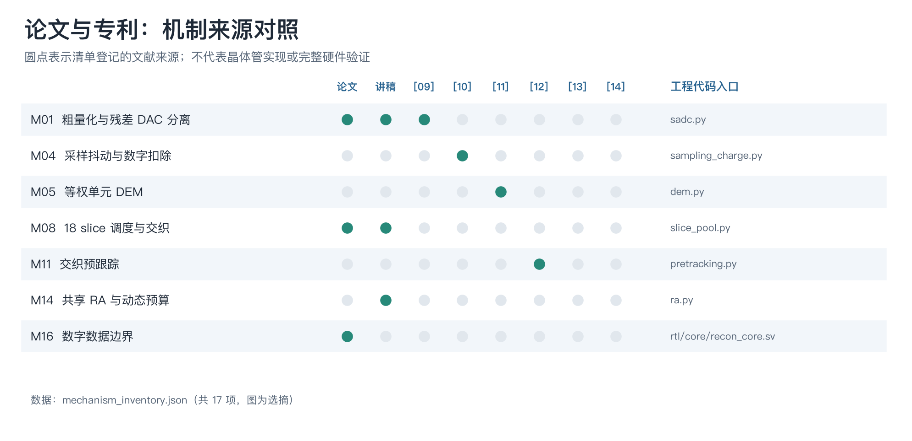
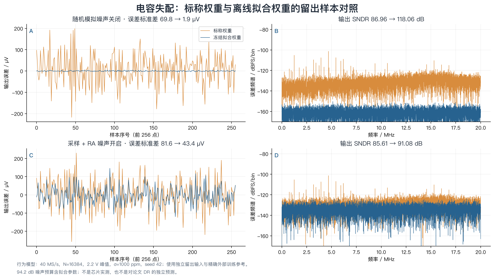
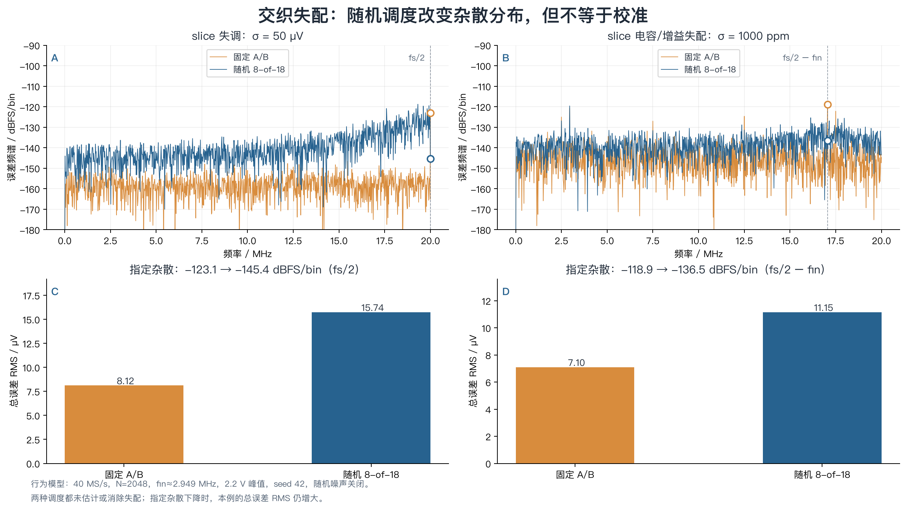

# 20-bit / 40 MS/s Pipelined SAR ADC: Models and Digital RTL

[中文](README.md) · [Repository layout](docs/PROJECT_LAYOUT.md) · [Model scope](docs/model_scope.md) · [DSP interface](ad4080_dsp/docs/SAR20_INTERFACE.md)

This research repository studies slice scheduling, capacitor mismatch, digital calibration and post-processing for a two-stage residue SAR ADC, guided by [ISSCC 2024 Session 9.8](https://doi.org/10.1109/ISSCC49657.2024.10454329) and related patents. It contains a Python behavioral model, SAR digital RTL and a separate AD4080-inspired DSP subsystem. The default sampling rate is **40 MS/s**.

> **Evidence boundary:** This is a research prototype. A 20-bit output word does not imply 20-bit ENOB. The plotted performance figures are conditional behavioral simulations, not silicon measurements, PDK signoff or timing closure.

## Architecture and configurations


*Figure 1. An original illustration based on public descriptions and repository code, not a reproduction of the paper figure.*

The paper discloses a 20 b / 40 MS/s converter, an 18-slice structure and a shared residue amplifier. The model connects acquisition, coarse quantization, residue charge, RA, ADC2 and digital reconstruction. Structural RTL implements phase control, comparator interfaces and reconstruction; a project interface connects the DSP to the reconstructed result.

| Profile | Sampling rate | Coarse quantization and DAC | Boundary |
|---|---:|---|---|
| `Config()` | 40 MS/s | 7-bit, unary | Retained behavioral default; Python SADC uses threshold search rather than bit-by-bit SAR timing |
| `Config.paper_literal()` | 40 MS/s | 9-bit, 63+8 split | Candidate matching the paper's coarse-bit reading; physical 63+8 allocation is a project assumption |
| Structural `sar20_digital_core` | 40 MS/s target | 9-bit, 63+8 split | 16 digital phases/sample imply a 640 MHz clock budget if one clock is used per phase; target-library STA is unavailable |

The Python profiles are not identical circuit models. A nominal sample-rate setting is not evidence of attainable RTL timing. See [`config.py`](src/adi_model/config.py), [`sadc.py`](src/adi_model/sadc.py) and the [RTL arithmetic contract](docs/rtl/RTL_ARITHMETIC_CONTRACT.md).

## Mapping public sources to this project



*Figure 2. An original illustration derived from the machine-readable mechanism ledger; a dot identifies a cited source, not a transistor-level implementation.*

| Mechanism | Implemented here | Boundary |
|---|---|---|
| Separate quantizer and residue DAC | Python quantization/charge models and structural RTL signal path | Capacitor allocation and switch timing include assumptions; no complete paper netlist |
| Capacitor mismatch and DEM | Fixed physical units, weight fitting, element permutations and RTL reconstruction | DEM redistributes error rather than measuring it; the Python/RTL bridge-mask contract remains unresolved |
| Interleaving mismatch | Slice offset, timing skew, bandwidth spread and scheduling sensitivity models | No complete hardware estimation/correction loop for slice offset, skew and bandwidth |
| Dither | Behavioral injection/digital correction and RTL generator | Injection, range and correction contracts differ by mode; large inputs can overflow |
| RA, reference and ADC2 | RA/reference dynamics and ideal ADC2 quantization | Reference-loading event contracts differ; ADC2 nonlinearity learning, analog implementation and PDK verification remain open |

See [`mechanism_inventory.json`](mechanism_inventory.json), [`sources_manifest.json`](sources_manifest.json) and the [source comparison](docs/engineering_vs_patents_papers.md). Selected public references cover [quantizer/RDAC separation](https://patents.google.com/patent/US10516408B2/en), [dither](https://patents.google.com/patent/US10505561B2/en), [DEM](https://patents.google.com/patent/US10511316B2/en) and [interleaved tracking](https://patents.google.com/patent/US10707889B1/en). The candidate implementation is not a complete reconstruction of a disclosed product.

## Capacitor mismatch: calibration and effect


*Figure 3. Original project illustration of the existing external fit and RTL reconstruction path.*

Digital observations and an independent reference input feed a Python batch estimator. Frozen effective unit weights are quantized into Q30 weights and Q32 scalars, loaded into RTL `weight_store` and `calib_regs`, and applied by `recon_core`. The fixed example uses 2048 training records, a full-rank 1279-column matrix and 128 independent holdout records; see [ADR 0019](docs/adr/0019-fitted-weight-rtl-closure.md).



*Figure 4. Independently redrawn from behavioral audit data: 40 MS/s, 2.2 V peak, N=16384, seed 42, mismatch σ=1000 ppm. The right plots are error spectra; SNDR in their titles comes from the output code stream. Training and holdout records are separate, while sharing the simulated physical pool and an exact external training reference.*

With sampling and RA noise enabled, the error standard deviation changes from **81.61 to 43.43 µV**, and output SNDR from **85.61 to 91.08 dB**. The 94.2 dB noise budget includes fitted parameters; the values characterize only this simulation. Data, source revision and the plotting script are in [`docs/readme/data/`](docs/readme/data/) and [`make_unified_figures.py`](docs/readme/make_unified_figures.py).

The RTL holdout test shows that fitted registers can be loaded and applied to obtain expected fixed-point results; its training observations originate in the Python model. A complete **structural DUT observation → fitting → load → independent DUT holdout** loop is still missing and is not an on-chip self-calibration claim.

## Interleaving mismatch: spurs and total error



*Figure 5. Project behavioral model at 40 MS/s, N=2048, approximately 2.949 MHz / 2.2 V peak input, seed 42 and random noise disabled; neither scheduling option estimates mismatch parameters.*

Slice offset can produce interleaving-related error at `fs/2`; slice capacitor/gain mismatch can produce a sideband at `fs/2 − fin`. In this example, random 8-of-18 scheduling reduces the selected spurs by about 22 dB and 18 dB, while total error RMS increases from **8.12 to 15.74 µV** and from **7.10 to 11.15 µV**. This is a redistribution of the error spectrum, not calibration.

Timing skew couples to input slope. Bandwidth mismatch requires the dynamic acquisition/settling path to be enabled. Both can be explored behaviorally, but dedicated skew/bandwidth estimation and hardware correction are not closed.

## DSP connection and fault handling


*Figure 6. An original illustration of the current RTL integration boundary.*

[`sar20_system_top.sv`](ad4080_dsp/rtl/sar20_system_top.sv) instantiates the SAR digital core and DSP. Alternatively, connect [`sar20_ad4080_top.sv`](ad4080_dsp/rtl/sar20_ad4080_top.sv) separately to SAR `dout`, `dout_valid`, `dout_sample_id` and `dout_flags`. It converts offset binary to the DSP's two's-complement input and converts the parallel output back; serial payloads remain two's complement. Any SAR result flag rejects the sample and latches a stream fault, preventing an error-held old SAR word from entering the filter. `dsp_restart` or `sar_epoch_clear` resets the DSP, **including FIFO, filter state and register configuration**; configure it again after reset.

Acceptance/rejection events and IDs exist at the input boundary; filtered and FIFO outputs **do not yet carry per-output IDs or source flags**. Both sides require the same clock and synchronous reset release; no new CDC is provided. See the [DSP README](ad4080_dsp/README.md) for correction, filtering, SPI, FIFO, serial digital logic and unresolved items. DDR differential PHY is absent and the default SINC5 compensation coefficients are placeholders.

## Provenance and verification


*Figure 7. Original illustration generated from the runtime parameter provenance ledger. Fitted and assumed results are not disclosed facts or chip measurements.*

Behavioral models, RTL simulation, historical FPGA evidence and target-PDK synthesis/STA are separate evidence levels. Figure 4 comes from the independent audit of baseline `40ae71d`; Figure 5 comes from a 40 MS/s behavioral probe on integrated baseline `d809da6`. Neither represents transistor or silicon data. Historical detailed documentation is retained in [`docs/history/`](docs/history/); historical tests are not automatically new results for the present checkout.

### Quick start

```bash
python3 -m venv .venv
source .venv/bin/activate
python -m pip install -e '.[dev]'
python -c 'from adi_model import Config; print(Config().fs, Config().b1, Config().dac_arch)'
pytest -m 'not slow' -q
```

RTL regression requires Verilator 5.x and a C++ compiler; the independent DSP script requires Icarus Verilog:

```bash
python tools/run_open_rtl.py --tops calibration_fit_tb sar20_dsp_integration_tb sar20_system_top_tb
BUILD_DIR="${TMPDIR:-/tmp}/ad4080-dsp-build" bash ad4080_dsp/sim/run_all.sh
MPLBACKEND=Agg PYTHONPATH=src python docs/readme/make_unified_figures.py
PYTHONPATH=src python docs/readme/reproduce_interleave_40m.py \
  --out "${TMPDIR:-/tmp}/sar-adc-interleave-new" --compare-frozen
```

The plotting script redraws the retained small data sets; it does not retrain the model. The interleaving reproduction script requires a new, non-existent `--out` directory. Store full new simulation outputs outside the repository, for example `adi-run-all --results-dir "${TMPDIR:-/tmp}/sar-adc-results"`. See the [file conventions](docs/PROJECT_LAYOUT.md) for directory responsibilities and historical evidence exceptions.

## License and citation

Code is distributed under [BSD-3-Clause](LICENSE); see [NOTICE](NOTICE) and [CITATION.cff](CITATION.cff) for third-party and patent statements. Illustrations and result plots are independently drawn and do not copy paper, slide or patent figures; original source documents are not redistributed. This independent project has no affiliation with or endorsement from Analog Devices and grants no patent license.
