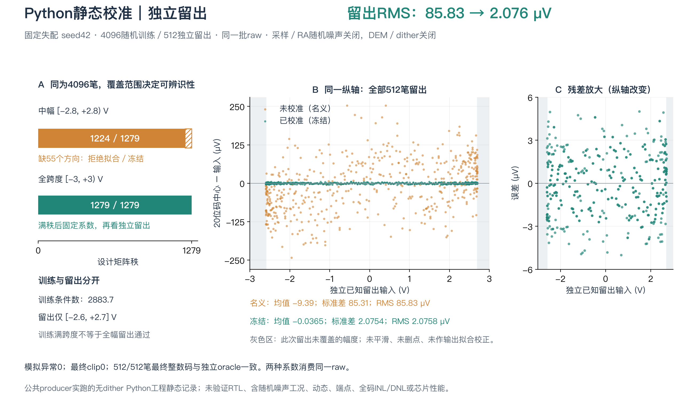
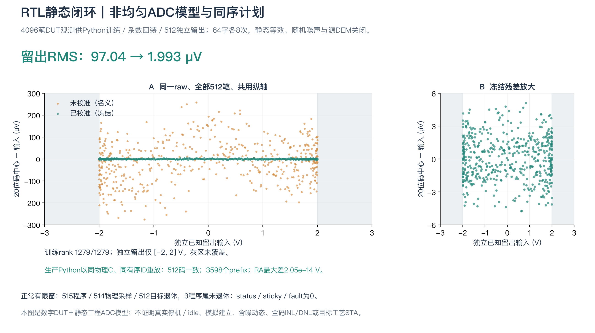
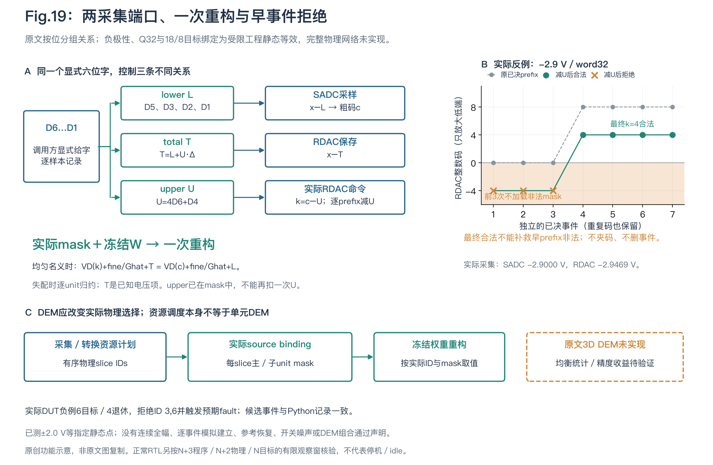
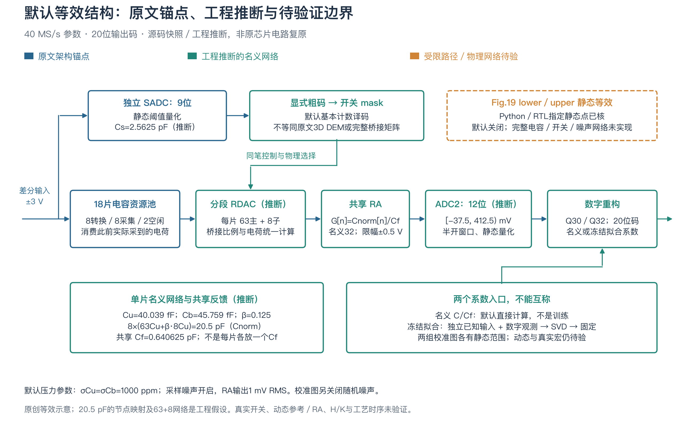

# 20-bit / 40 MS/s SAR ADC: behavior, static calibration and digital implementation

[中文](README.md) · [Status](docs/STATUS.md) · [Digital status matrix](docs/digital_status_matrix.md) · [Source map](docs/current_digital_source_map.md) · [Papers and slides](references/README.md) · [Acceptance report (CN)](docs/ACCEPTANCE_20261112.md)

> **Which page is authoritative.** `README.md` (Chinese) is the maintained front page and
> carries the current patent-by-patent mapping and ablation numbers. This English page still
> frames the project around the earlier *static-calibration* deliverables, so parts of it lag
> behind. Where the two disagree, the Chinese page and the JSON data under
> `docs/reviews/20261113_p3p4/` win.

## Update 2026-11-12: package layout, dither in the main loop, refreshed figures

* **Layout.** `src/adi_model/` is now split into `contracts/ topology/ control/ behavioral/
  calibration/ simulation/ metrics/`. 43 modules moved; a SHA256 behavior fingerprint over
  12 output arrays is **bit-identical** before and after, and the A0–A5 ablation numbers are
  unchanged to the last digit.
* **Dither is now in the loop.** A second topology (`dither_port=`, "charge port") injects the
  dither word at the *sampling node*, keeps the RDAC code at the decided value, and subtracts
  `T` digitally. Unlike the older code-shift path it works with the real segmented codebook,
  device mismatch and thermal noise, so ablation config **A6 changed from `NOT_RUN` to `RUN`**.
* **Measured effect (same chip, seed 20261105, σ = 1e-3, 256 levels × 32 repeats).**
  INL 24.5 → 20.5 LSB20 (−16%), binned DNL 16.5 → 5.9 LSB20 (−64%), at the cost of
  SNDR −0.53 dB, **SFDR −1.34 dB (worse)**, and 0.188 V of usable input range (−3.2%).
  Dither helps DNL most; it does not flatten the INL bow — DEM and calibration do that.
* **Figures regenerated.** All 12 review figures now carry `source_sha = 38df6a7`; the previous
  copies were produced 12 commits earlier and were stale evidence.
* **Read the limitations before quoting anything.** DNL is still measured at ramp-step
  granularity, *not* as 20-bit code-density DNL. A7 (full dynamic path) remains `NOT_RUN`
  because the engine refuses to emit a scalar diagnostic once reference/RA/ADC2 settling is
  active. No RTL was re-run this round.

## Purpose and scope

This project studies capacitor mismatch, sampled charge, residue reconstruction and digital calibration in a two-stage SAR ADC. It has three deliverables: **an ADC behavioral model, a static mismatch calibration flow, and digital control/reconstruction RTL**. Output DSP and chopping-assisted auto-zeroing (CAAZ) are separate extensions. DEM, dither and slice selection each have their own implementation and evidence boundaries.

**20 bits is the final code width; 40 MS/s is the default raw-sample-rate parameter.** Neither establishes 20-bit ENOB or implementation speed in a target process. Disclosed architecture, engineering inference, implementation state and evidence level are recorded separately.

## Delivered work and current state

| Work item | Implemented scope | Current conclusion | Remaining work | Entry |
| :--- | :--- | :--- | :--- | :--- |
| **ADC behavioral model** | Explicit physical slices, capacitor/bridge network, independent SADC, shared RA and ADC2, with centralized overridable defaults | The default command executed4096 records with nominal20-bit codes, node flags and an assumption ledger; specified static cases have independent holdout evidence | Settling, real switches/references, noise covariance and analog macros | [Defaults](src/adi_model/defaults.py), [pipeline](src/adi_model/simulation/pipeline_engine.py) |
| **Static mismatch calibration flow** | Fits effective C/Cf from digital observations and an independent reference, checks rank and applies frozen coefficients with integer arithmetic | The no-dither Python case and restricted Fig.19 RTL static case both have actual holdouts. Python trains the RTL coefficients, which are then loaded into the DUT | Real reference/readout, dynamic/noisy or drifting cases and ADC2 nonlinearities | [Python rerun](tools/run_static_calibration.py), [RTL rerun](tools/run_fig19_rtl_calibration.py) |
| **Digital control and reconstruction RTL** | 20 listed modules implement 9-bit SAR, the18/8 resource pool,16 phases, coefficient loading, context and reconstruction with two explicit source bindings | The eight-file bundle, two acquisition ports, calobs v2, RDAC events and integer results were compared in the specified same-pool finite capture | Real stop/drain/park, observation transport, macro settling and target-process verification | [RTL entry](rtl/README.md), [ABI2 contract](docs/rtl/CURRENT_INTERFACE_AND_ARITHMETIC.md) |
| Output DSP extension | 15 modules for parallel correction, SINC, capture, SPI/registers and GPIO; unavailable source parameters are rejected explicitly | Handoff003 binds15 sources,14 selected digital cases and5 strict profiles, including reported-controller-fault isolation/recovery | Whole-chain filter-selection numeric routing, output metadata, unreported ID gaps, retained-record reset after real stop/park, data PHY/CNV and inverse two-point learning | [DSP](ad4080_dsp/README.md) |
| CAAZ extension | Explicit input-referred AZ records, digital control and pairing after complete reconstruction | Disabled by default; the current eight-file component checks four digital pairs, with325 separate field comparisons for the pairing unit | CBIAS retention, H/K, analog chopping and final combined verification | [Status matrix](docs/digital_status_matrix.md) |

The default output uses **nominal coefficients without training**. Successful `adi-simulate` execution means the selected inferred model generated records. Calibration gain, source-mechanism reproduction and target precision require separate evidence.

## Main experimental results

### Python static calibration: independent-holdout RMS 85.83 → 2.076 µV

A fixed mismatched engineering model is trained with 4096 uniform random known references over [−3,+3) V. Schema2 coefficients are frozen, then nominal/frozen decoders consume the same 512 independent raw holdout records. The same 4096-sample count over [−2.8,+2.8) V is rejected at rank1224/1279. Full-span training reaches1279/1279 with condition number2883.7.



*Figure 1 | Actual final-source public-producer cases `fullspan_positive` and rejected `midrange_rank_negative`, bound to the producer and36 actually loaded source hashes. Seed42, unit/bridge mismatch0.001 each; dither/unit DEM and sampling/RA random noise off. Holdout covers only [−2.6,+2.7] V. RMS85.829→2.07577 µV, standard deviation85.314→2.07544 µV; zero analog-invalid/clipping records and512 integer words match the independent oracle. [Point data and provenance](docs/readme/data/source_bound_static_calibration.json), [rerun training](docs/REPRODUCING.md#3-静态校准重新训练固定与留出). This verifies the specified Python engineering-static case, not RTL, dynamic/noisy operation, endpoints, full-code INL/DNL or silicon performance.*

### RTL static loop: same-holdout RMS 97.04 → 1.993 µV

The DUT produced4096 word-zero observations across the full training span using one fixed nonuniform ADC model. An off-DUT Python fit with an independent reference reached rank1279/1279, then the frozen coefficients were loaded into the DUT. The independent holdout is the specified2 V peak sine, using each of the64 words eight times. Both decoders use the same physical pool, ordered slice plan, switch records and512 raw observations; training and holdout reference values do not overlap.



*Figure 2 | Actual DUT `full_typechecked_001` and four same-pool production-Python replays on the same source bytes. This is a specified static equivalent with random conversion noise and unit DEM off. RMS97.04090→1.99287 µV and standard deviation96.28313→1.99087 µV. The normal holdout has515 programmed controls,514 physical samples and512 target retirements; three programmed tail records are unretired. Status, sticky, fault and result flags are zero. All512 words match production Python and the independent integer oracle; the3598 RDAC events include two sampled tail records. [Points and receipt identity](docs/readme/data/source_bound_rtl_calibration.json), [rerun and replay](docs/REPRODUCING.md#5-显式导出与rtl组件执行). The finite static capture does not establish real stop, endpoints, dynamics or silicon precision.*

Figures1 and2 use different stimuli and resource plans. They verify their respective calibration loops; the difference between them does not measure the incremental benefit of dither.

### Fig.19 perturbation: separate acquisitions and event checks

One six-bit word produces lower, total and upper. Lower enters SADC sampling, total enters the RDAC hold path, and upper adjusts every resolved RDAC candidate. Reconstruction uses the actual masks and frozen weights, removing the known perturbation once. See the [ABI2 contract](docs/rtl/CURRENT_INTERFACE_AND_ARITHMETIC.md#2-两采集端口与同笔归属) for bit groups, Q32 units and endpoints.



*Figure 3 | Original mechanism diagram and actual DUT counterexample. At−2.9 V/word32, SADC and RDAC acquire−2.9000 V and−2.946875 V. Final k=4 is legal, but the first three candidates are−4 and their invalid masks are never loaded. Four of six DUT targets retire; IDs3/6 are rejected with the expected controller fault. [Original event identities and evidence](docs/readme/data/source_bound_fig19_evidence.json). ±2 V describes specified static points and the holdout stimulus. Integer-domain checks do not establish reference/analog settling or source3D DEM. No original figure is copied.*

<details>
<summary>Historical af8/9bdf calibration, interleaving, retired dither and DEM records</summary>

The following three figures retain their original bytes. They are **historical results under the af8 functional contract, retained by documentation revision 9bdf**. Actual executed source identities remain in their adjacent JSON files. Revision 9bdf is not a new execution identity for those experiments. The old SID/zero-sum bridge, range and fixed-four-times perturbation schemes are retired from current execution.


*Figure 4 | Historical static mismatch fixture: seed 42, DEM plus sampling D=2, 4096 training and 512 independent holdout records, no added random conversion noise. Standard deviation was 55.75→2.08 µV under that switching/observation contract. [Original data and source hashes](docs/readme/data/structural_calibration_summary.json). The second chip and noisy condition remain retained. Figure1 uses a separate current public-producer execution; these are not one shared performance record.*


*Figure 5 | Historical Python comparison with the same nominal 10 ps skew pool, 40 MS/s and N=16384. The Python strategy following the old RTL allocator improved SFDR by 14.93 dB and reduced SNDR by 11.05 dB relative to fixed A/B. This is not an SV output spectrum. [Original conditions, arrays and metrics](docs/readme/data/interleave_40m.json). It does not establish current per-slice skew/bandwidth compensation.*


*Figure 6 | Historical headroom diagnosis for the retired engineering perturbation scheme: 18 SADC excursions, four RA saturations and 15 ADC2 overflows at 2.99 V, while final clipping remained zero. Failed points and the old endpoint convention remain intact. These counts are not current Fig.19-model results. [Original data](docs/readme/data/dither_headroom.json).*

Historical DEM plots count positive-rail usage under the retired mapping with explicit denominators. Nominal conservation does not establish balanced usage or accuracy gain. The [9bdf topic](https://github.com/defineiocc02/20bit_SAR_ADC_Behaviour_Verification/blob/9bdf7708f42733896d7ead89935be41b4258fb6f/docs/randomization_caaz/README.md) is retained as historical explanation. Figures1/2 show the current specified static loops. Dynamic performance and interleaving compensation require separate verification.

</details>

## How the system works and its defaults



*Figure 7 | Original default-equivalent architecture: independent SADC, 18-slice pool, inferred 63+8 array, shared RA/Cf, ADC2 and two coefficient entry points. Blue marks architecture anchors, green engineering inference and orange the verified restricted static path and the remaining physical network. The complete physical network remains unimplemented. No original paper image is copied.*

Each conversion uses eight slices while eight acquire and two remain available. A model instance retains its fabricated mismatch. The basic integer decoder selects main/sub counts; resource randomization is separate from unit DEM. Nominal reconstruction reads nominal design values. The estimator receives digital observations and an independent reference, without reading actual capacitances, true gain or held voltages.

| Parameter or structure | Central default | Provenance and boundary |
| :--- | :--- | :--- |
| Sampling, output and resources | 40 MS/s; 9-bit first stage; 20-bit output; eight converting slices from 18 | Architecture anchors, not ENOB or technology timing closure |
| Nominal input and gain | ±3 V differential-equivalent peak; nominal gain 32 | Actual charge gain depends on selected capacitances and feedback capacitance |
| SADC and basic decoder | 513 uniform boundaries, valid window[−3,+3) V; default k=c; main count k//8, sub count k%8 | Uniform thresholds, canonical masks and integer counting are engineering choices, not source3D DEM or the complete binary-to-unary matrix |
| Per-slice network | 63 main + 8 sub; beta=1/8; Cu=40.0390625 fF, Cb≈45.7589286 fF | An engineering realization mapping 20.5 pF to nominal Cnorm, not a disclosed layout inventory |
| Active and feedback capacitance | Cnorm=20.5 pF; shared Cf=0.640625 pF; independent SADC capacitance 2.5625 pF | Node interpretation and SADC matching are inferred; Cf is shared by the converting group |
| Backend and swing | 12-bit ADC2; [−0.0375,+0.4125) V; RA clipping ±0.5 V | Engineering budgets at the RA output; half-open endpoints and retained flags |
| Mismatch and noise | Unit/bridge relative standard deviation 0.001 each, feedback zero; 300 K, chi=2; RA output noise 1 mV RMS | Sensitivity/noise assumptions; sampling and RA noise enabled by default, without DR back-solving |
| Integer reconstruction | Q30 weights/Q32 normalized voltage V/Vfs; 48/64-bit interfaces, checked96-bit accumulation,20-bit output | Engineering arithmetic; nominal coefficients are untrained |
| Sampling and connections | All-Signal by default; ±Vfs reference coordinates; zero top/sub initial equivalent coordinates and nominal parasitics | Static assumptions, without real switching-noise covariance or reference dynamics |
| Disabled/zero defaults | Dither, unit DEM, CAAZ and dynamics off; zero slice skew/offset; driver noise off | Runtime metadata records actual options; unsupported requests are rejected without silent downgrade |

`DefaultParameters` exposes overrides and each run records their provenance. Changing one capacitance does not silently retune another to restore the old gain. Low-level `Config` checks missing inputs; high-level `default_model()` supplies the runnable engineering defaults.

**Dither and DEM scope.** Source dither and unit DEM are off by default. The optional Fig.19 path consumes explicit six-bit words: upper `U=4D6+D4`, lower/total `T=L+U·Delta`, engineering-equivalent SADC input `x−L`, RDAC sample `x−T` and command `k=c−U`. The uniform nominal-codebook identity is `VD(k)+r+T`; actual mismatch reconstruction reduces per-unit masks with frozen weights, without subtracting U again. Negative polarity, Q32 rounding of 4:2:1/7 and the 18/8 target binding are engineering assumptions. This is a **restricted engineering static equivalent compared at specified Python/RTL conditions**. The [source map](docs/current_digital_source_map.md) separates this from the complete physical network. Source 3D DEM and the complete binary-to-unary switching matrix are not implemented.

| Combination | Current evidence and boundary |
| :--- | :--- |
| Fig.19 static equivalent + causal18/8 slice plan + fixed nonuniform capacitor pool + frozen calibration | Actual RTL holdout uses each of the64 words eight times and passes same-pool replay with the same ordered IDs/plan and independent integer comparison. Resource randomization and unit DEM require separate evidence |
| Fig.19 + source3D unit DEM | The source3D network is unimplemented; static v1 rejects unit-DEM combinations. Resource scheduling does not establish combined operation |
| Fig.19 + CAAZ | A real shared-AZ combination is unverified; v1 rejects additional nonzero RA disturbances. Zero-AZ records or digital pairing alone do not prove CBIAS retention, H/K or noise cancellation |
| Fig.19 + dynamics/random conversion noise | The restricted path explicitly rejects these conditions and requires noise-off settings. Dedicated dither-capacitor/switch mismatch and noise covariance are unmodeled |

## Unfinished work

| Area | Required next work | Evidence needed |
| :--- | :--- | :--- |
| Real readout and calibration domain | Establish independent references, readable observations and an explicit configuration epoch; test noise, drift and ADC2 nonlinearities | Actual capture and reference, rank, frozen coefficients, integer results and all flags |
| Headroom, randomization and interleaving | Early-event underflow near the negative limit is located and rejected; source-supported range/physical mapping, source3D unit DEM and slice aperture/bandwidth observations and correction remain | Legal events/endpoints, fixed-pool and same-stimulus/bandwidth comparisons with SFDR, SNDR and usage statistics |
| Stop and physical verification | Define stop, drain, park and independent analog idle; complete continuous acquisition, the real reference-threshold loop, RA/ADC2 settling and PVT/MC | Retained or explicitly cancelled records, macro timing, target synthesis/STA, CDC/RDC and PEX |
| Optional extensions | CAAZ storage/H/K and combined noise, whole-chain DSP filter routing, output metadata and data PHY | Separate evidence for the applicable signal domain, chain, macro and protocol |

The [13 pending evidence records](docs/STATUS.md#按依赖排序的未闭合项) detail the remaining acquisition, reference, drift and observation-transport work.

## Reproduction and code entry points

Choose a nominal run, fresh training, actual RTL capture, or frozen-data redraw. See [CONTRIBUTING](CONTRIBUTING.md) and [reproduction](docs/REPRODUCING.md).

```bash
python -m pip install -e .
python -m adi_model simulate --samples 256 --output ../sar-output/nominal-demo-001
```

The output directory must not exist. It receives `codes.npz`, `assumptions.json`, then `metadata.json` as the completion record. `UNCALIBRATED_NOMINAL_20BIT` is a nominal result, not training. `adi-validate-config --config FILE.json` validates inputs without simulation.

| Question | Entry |
| :--- | :--- |
| Defaults, assumptions and signal chain | [defaults.py](src/adi_model/defaults.py), [pipeline_engine.py](src/adi_model/simulation/pipeline_engine.py) |
| Fig.19, actual masks and resource selection | [dither.py](src/adi_model/control/dither.py), [dem.py](src/adi_model/control/dem.py), [slice pool](src/adi_model/simulation/slice_pool.py) |
| Training, freezing and integer application | [weight_calibration.py](src/adi_model/calibration/weight_calibration.py), [fixed_point.py](src/adi_model/contracts/fixed_point.py) |
| Current interface, state and source evidence | [Current ABI2 contract](docs/rtl/CURRENT_INTERFACE_AND_ARITHMETIC.md), [source map](docs/current_digital_source_map.md), [status matrix](docs/digital_status_matrix.md) |
| Historical redraw and executable archives | [Reproduction](docs/REPRODUCING.md), [archive policy](docs/history/EXECUTABLE_ARCHIVES.md) |
| New figures, point data and renderer | [Redraw asset index](docs/readme/data/source_bound_assets_manifest.json), [data guide](docs/readme/data/README.md) |

Code is [BSD-3-Clause](LICENSE). The [22 source entries](NOTICE) and [six selected originals](references/README.md) retain their original copyrights and embedded notices. This is an independent project and grants no patent licence.
