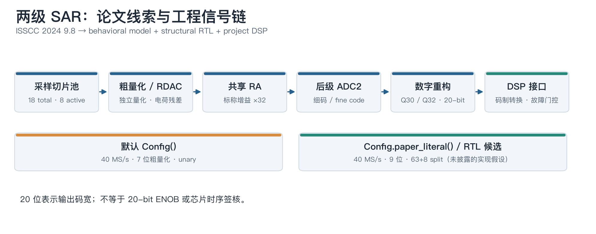
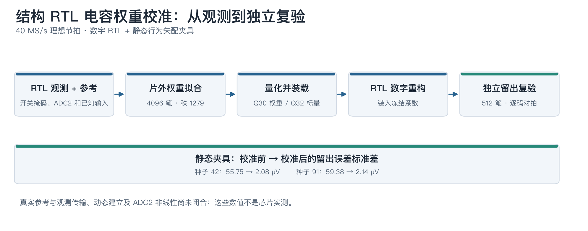
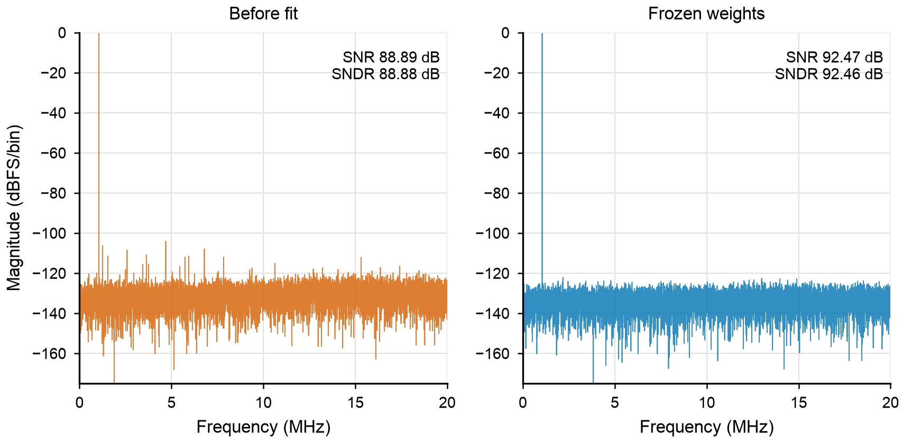
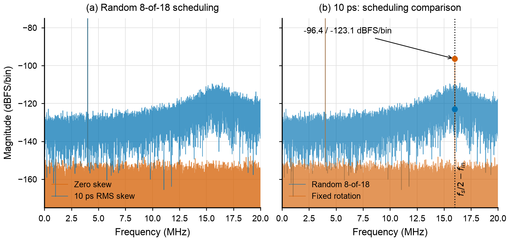
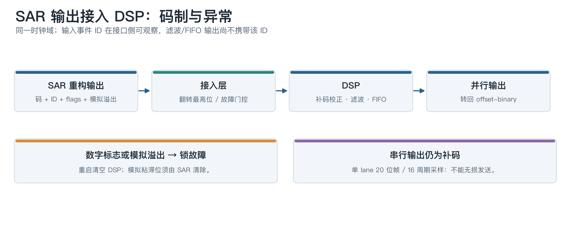
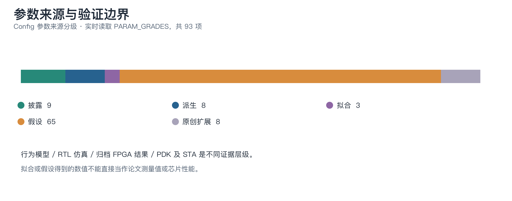

# 20-bit / 40 MS/s Pipelined SAR ADC: Models and Digital RTL

[中文](README.md) · [Repository layout](docs/PROJECT_LAYOUT.md) · [Model scope](docs/model_scope.md) · [DSP interface](ad4080_dsp/docs/SAR20_INTERFACE.md)

This research repository studies slice scheduling, capacitor mismatch, digital calibration and post-processing for a two-stage residue SAR ADC, guided by [ISSCC 2024 Session 9.8](https://doi.org/10.1109/ISSCC49657.2024.10454329) and related patents. It contains a Python behavioral model, SAR digital RTL and a separate AD4080-inspired DSP subsystem. The default sampling rate is **40 MS/s**.

> **Evidence boundary:** This is a research prototype. A 20-bit output word does not imply 20-bit ENOB. The plotted performance figures are conditional behavioral simulations, not silicon measurements, PDK signoff or timing closure.

## Architecture and configurations



*Figure 1. An original illustration based on public descriptions and repository code, not a reproduction of the paper figure.*

The paper discloses a 20 b / 40 MS/s converter, an 18-slice structure and a shared residue amplifier. The model connects acquisition, coarse quantization, residue charge, RA, ADC2 and digital reconstruction. Structural RTL implements phase control, comparator interfaces and reconstruction; a project interface connects the DSP to the reconstructed result.

| Profile | Sampling rate | Coarse quantization and DAC | Boundary |
|---|---:|---|---|
| `Config()` | 40 MS/s | 7-bit, unary | Retained behavioral default; Python SADC uses threshold search rather than bit-by-bit SAR timing |
| `Config.paper_literal()` | 40 MS/s | 9-bit, 63+8 split | Candidate matching the paper's coarse-bit reading; physical 63+8 allocation is a project assumption |
| Structural `sar20_digital_core` | 40 MS/s target | 9-bit, 63+8 split | 16 digital phases/sample imply a 640 MHz clock budget if one clock is used per phase; target-library STA is unavailable |

The Python profiles are not identical circuit models. A nominal sample-rate setting is not evidence of attainable RTL timing. See [`config.py`](src/adi_model/config.py), [`sadc.py`](src/adi_model/sadc.py) and the [RTL arithmetic contract](docs/rtl/RTL_ARITHMETIC_CONTRACT.md).

## Mapping public sources to this project

The table maps published mechanisms to the implemented paths and their limits.

| Mechanism | Implemented here | Boundary |
|---|---|---|
| Separate quantizer and residue DAC | Python quantization/charge models and structural RTL signal path | Capacitor allocation and switch timing include assumptions; no complete paper netlist |
| Capacitor mismatch and DEM | Fixed physical units, weight fitting, element permutations and RTL reconstruction | DEM redistributes error rather than measuring it; the Python/RTL bridge-mask contract remains unresolved |
| Interleaving mismatch | Slice offset, timing skew, bandwidth spread and scheduling sensitivity models | No complete hardware estimation/correction loop for slice offset, skew and bandwidth |
| Dither | Behavioral injection/digital correction and RTL generator | Injection, range and correction contracts differ by mode; large inputs can overflow |
| RA, reference and ADC2 | RA/reference dynamics and ideal ADC2 quantization | Reference-loading event contracts differ; ADC2 nonlinearity learning, analog implementation and PDK verification remain open |

See [`mechanism_inventory.json`](mechanism_inventory.json), [`sources_manifest.json`](sources_manifest.json), the [source comparison](docs/engineering_vs_patents_papers.md) and the [known limitations](docs/rtl/KNOWN_LIMITS_20261104.md). Selected public references cover [quantizer/RDAC separation](https://patents.google.com/patent/US10516408B2/en), [dither](https://patents.google.com/patent/US10505561B2/en), [DEM](https://patents.google.com/patent/US10511316B2/en) and [interleaved tracking](https://patents.google.com/patent/US10707889B1/en). The candidate implementation is not a complete reconstruction of a disclosed product.

## Capacitor mismatch: calibration and effect



*Figure 2. Original project illustration of the existing external fit and RTL reconstruction path.*

Digital observations and an independent reference input feed a Python batch estimator. Frozen effective unit weights are quantized into Q30 weights and Q32 scalars, loaded into RTL `weight_store` and `calib_regs`, and applied by `recon_core`. The fixed example uses 2048 training records, a full-rank 1279-column matrix and 128 independent holdout records; see [ADR 0019](docs/adr/0019-fitted-weight-rtl-closure.md).



*Figure 3. A behavioral comparison at the input frequency reported on slide 38: 40 MS/s, 1.05 MHz, 2.85 V peak, N=16000, seed 42. Training and holdout records are separate, share the simulated physical pool, and use an exact external training reference. The slides do not disclose amplitude, FFT settings, or complete noise conditions.*

With noise enabled, output SNDR improves **88.88 to 92.46 dB** and input-referred error standard deviation improves **72.53 to 48.04 µV**. The 94.6 dB noise budget is fitted, so this is not an independent prediction of paper SNR. The [experiment comparison](docs/paper_comparisons/README.md) includes static and noiseless results.

The RTL holdout test shows that fitted registers can be loaded and applied to obtain expected fixed-point results; its training observations originate in the Python model. A complete **structural DUT observation → fitting → load → independent DUT holdout** loop is still missing and is not an on-chip self-calibration claim.

## Interleaving mismatch: spurs and total error



*Figure 4. Inspired by slides 21–22: 40 MS/s and a nominal 10 ps skew. The project assumes independent static Gaussian slice skew, an approximately 4.0015 MHz / 2.85 V peak input, N=16384, and no random noise. The slides do not disclose the exact input, 10 ps statistical definition, or FFT setup.*

The `fs/2 − fin` bin falls from **−96.44 to −123.05 dBFS/bin** when fixed rotation is replaced by random 8-of-18 scheduling. Reference error RMS rises from **127.97 to 182.15 µV** in this example. The scheduler redistributes error; it does not estimate or correct timing skew. Other seeds, a second 10 ps interpretation and the remaining slide comparisons are in the [experiment comparison](docs/paper_comparisons/README.md).

Slice offset, gain, and bandwidth differences also cause interleaving errors; the [offset/gain comparison](docs/readme/fig/unified_7_interleave_effect.png) shows that spur and total RMS changes can differ. Dedicated hardware learners and compensation for per-slice timing and bandwidth are not closed.

## DSP connection and fault handling



*Figure 5. An original illustration of the current RTL integration boundary.*

[`sar20_system_top.sv`](ad4080_dsp/rtl/sar20_system_top.sv) instantiates the SAR digital core and DSP. Alternatively, connect [`sar20_ad4080_top.sv`](ad4080_dsp/rtl/sar20_ad4080_top.sv) separately to the SAR result, per-sample flags and independent sticky `analog_ovf`. It converts offset binary to the DSP's two's-complement input and converts the parallel output back; serial payloads remain two's complement. Any result flag or sticky analog overflow halts the stream and latches a fault. `dsp_restart` or `sar_epoch_clear` resets the DSP, **including FIFO, filter state and register configuration**; the SAR epoch clear is needed to clear its sticky analog fault before reconfiguration.

Acceptance/rejection events and IDs exist at the input boundary; filtered and FIFO outputs **do not yet carry per-output IDs or source flags**. Both sides require the same clock and synchronous reset release; no new CDC is provided. The single-lane serial prototype cannot losslessly send 20-bit frames when inputs arrive every 16 clocks, and FIFO read data is not connected to the serializer. DDR differential PHY is absent and the default SINC5 compensation coefficients are placeholders. See the [DSP README](ad4080_dsp/README.md) for the remaining boundaries.

The separate `cal_two_point` block currently fits `y=m·x+c` at fixed x coordinates. If x is a known input and y is the measured raw code, its result describes the **forward transfer**, not the inverse correction to apply to raw codes; it is not connected to an automatic top-level learning flow.

## Digital work packages

Five functional packages describe their role in the signal chain and main work:

| Work package | Purpose | Main work |
|---|---|---|
| SAR control and conversion timing | Coordinate sampling, successive decisions, residue conversion and output for the same sample | Complete phase and decision timing; align Python and structural RTL reference events and sample/status association |
| DEM and interleaving error treatment | DEM selects slices and reorders capacitor units to redistribute fixed mismatch in the error spectrum; interleaving compensation estimates and corrects slice offset, gain, skew or bandwidth differences | Check 8-of-18 scheduling, unit permutations and bridge masks; add identifiable observations, estimation and correction, then compare spurs and total error. DEM is not mismatch calibration |
| Capacitor calibration and reconstruction | Fit effective capacitor weights using an external reference, freeze the coefficients and combine coarse/fine outputs | Close structural DUT observation → fitting → loading → independent holdout; address ADC2 nonlinearity and faults |
| DSP and output path | Filter and buffer reconstructed data, support configuration and fault handling, and provide external output | Correct inverse two-point compensation, connect FIFO to output, resolve serial throughput and output/status association |
| Integration and verification | Check that assembled modules meet their data, control and fault contracts | Close end-to-end sample association and reset contracts; obtain formal equivalence, CDC/RDC and target-PDK synthesis/STA evidence |

SAR control, DEM, weight fitting and DSP prototypes exist; a complete hardware learning/correction loop for individual slices does not. See [known limitations](docs/rtl/KNOWN_LIMITS_20261104.md) and the [experiment comparison](docs/paper_comparisons/README.md).

## Provenance and verification



*Figure 6. Original illustration generated from the runtime parameter provenance ledger. Fitted and assumed results are not disclosed facts or chip measurements.*

Behavioral models, RTL simulation, historical FPGA evidence and target-PDK synthesis/STA are separate evidence levels. Figures 3–4 are 40 MS/s behavioral simulations on baseline `6863fc3`; neither represents transistor or silicon data. Historical detailed documentation is retained in [`docs/history/`](docs/history/); historical tests are not automatically new results for the present checkout.

### Quick start

```bash
python3 -m venv .venv
source .venv/bin/activate
python -m pip install -e '.[dev]'
python -c 'from adi_model import Config; print(Config().fs, Config().b1, Config().dac_arch)'
pytest -m 'not slow' -q
```

RTL regression requires Verilator 5.x and a C++ compiler; the independent DSP script requires Icarus Verilog:

```bash
python tools/run_open_rtl.py --tops calibration_fit_tb sar20_dsp_integration_tb sar20_system_top_tb
BUILD_DIR="${TMPDIR:-/tmp}/ad4080-dsp-build" bash ad4080_dsp/sim/run_all.sh
MPLBACKEND=Agg PYTHONPATH=src python docs/readme/make_unified_figures.py
PYTHONPATH=src python docs/readme/reproduce_interleave_40m.py \
  --out "${TMPDIR:-/tmp}/sar-adc-interleave-new" --compare-frozen
```

The plotting script redraws the retained small data sets; it does not retrain the model. The interleaving reproduction script requires a new, non-existent `--out` directory. Store full new simulation outputs outside the repository, for example `adi-run-all --results-dir "${TMPDIR:-/tmp}/sar-adc-results"`. See the [file conventions](docs/PROJECT_LAYOUT.md) for directory responsibilities and historical evidence exceptions.

## License and citation

Code is distributed under [BSD-3-Clause](LICENSE); see [NOTICE](NOTICE) and [CITATION.cff](CITATION.cff) for third-party and patent statements. Illustrations and result plots are independently drawn and do not copy paper, slide or patent figures; original source documents are not redistributed. This independent project has no affiliation with or endorsement from Analog Devices and grants no patent license.
