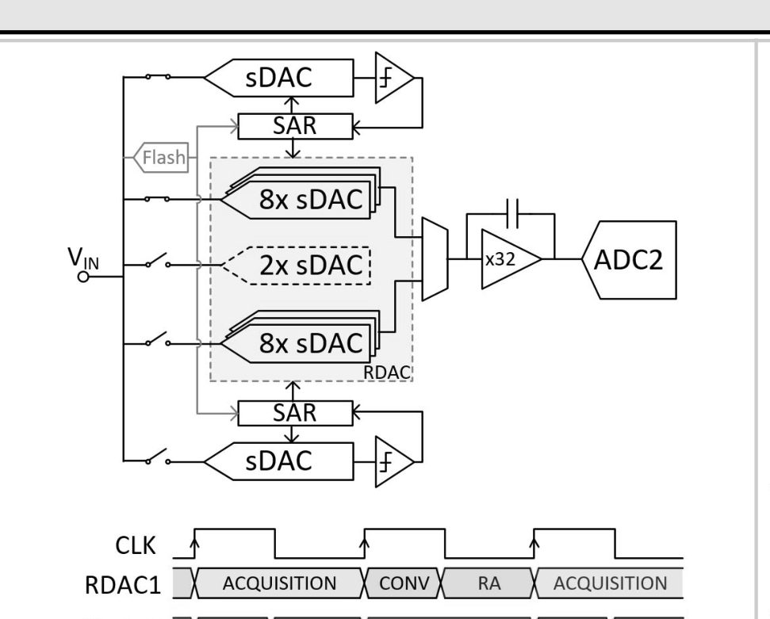
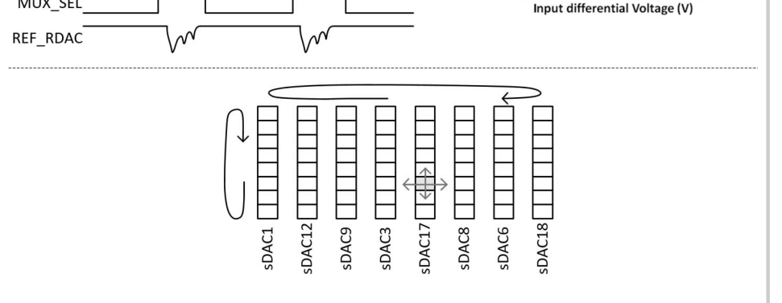
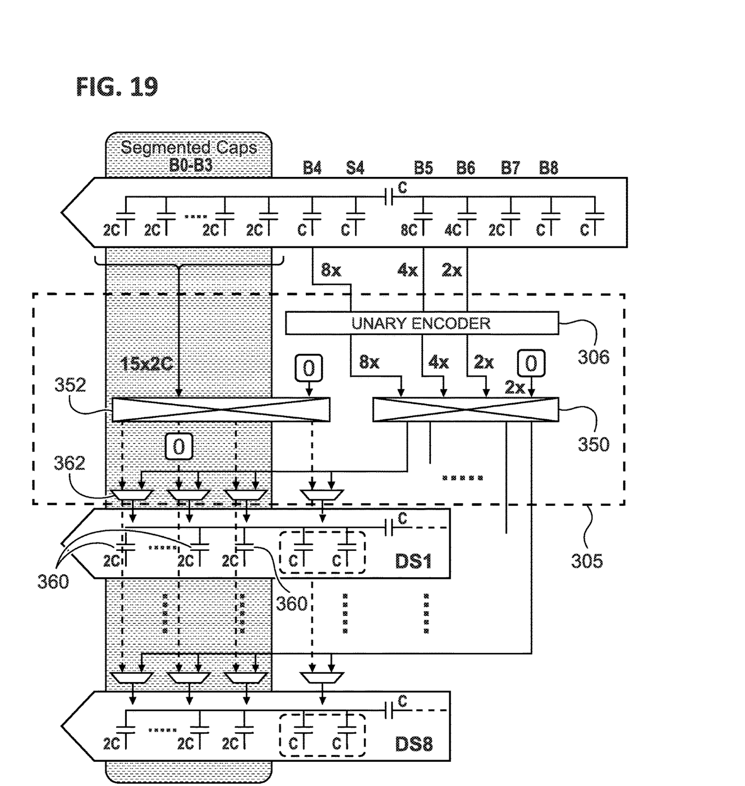
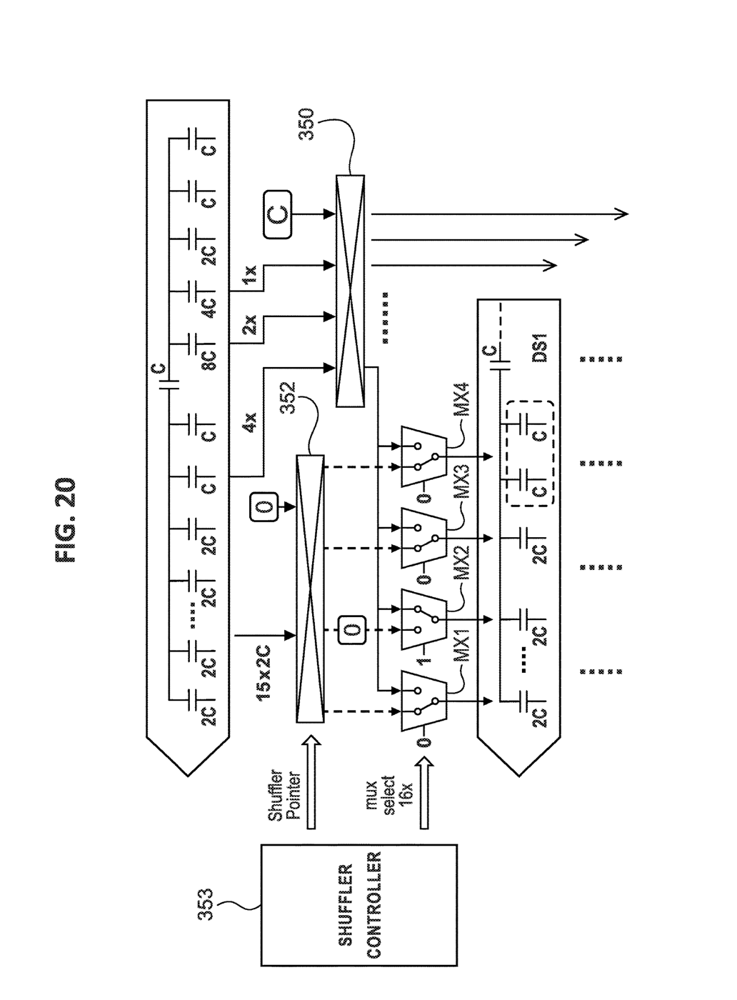
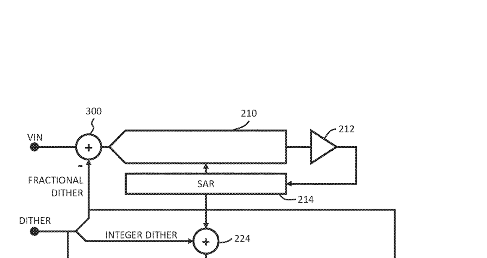
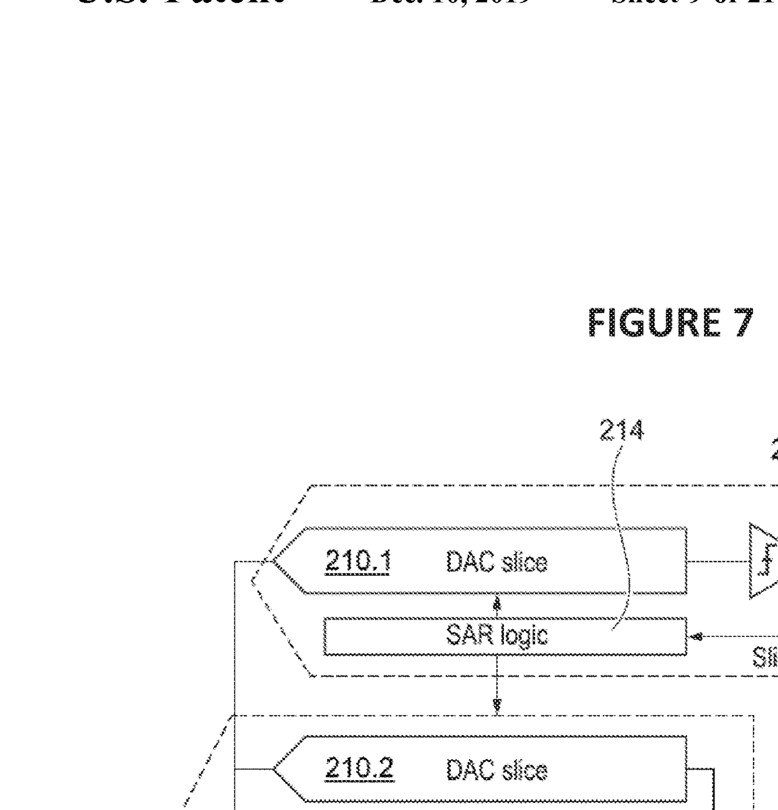
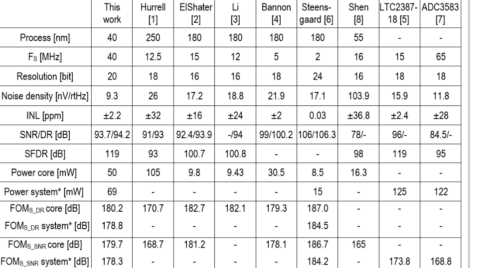

# 数字链完整解读：从论文与专利原图到实现

> 本文按"图上看到什么 → 原文怎么说 → 所以算法应该怎么做 → 我们做到了哪一步"的顺序写。
> 所有引用均出自本机原文（ISSCC 2024 Paper 9.8；US10511316B2；US10505561B2）。

---

## 0. 先看整体：这条链到底在算什么



*ISSCC 2024 Paper 9.8, Fig. 9.8.1 — Front-end of the analog-interleaved ADC architecture*

原文对这张图的说明：

> "the quantizer is fully separated from the residue generating DAC (RDAC), and the RDAC is
> composed of **8 slice DACs (sDAC) converting the signal, and 8 sDACs acquiring the signal,
> dynamically selected from a pool of 18 sDACs**. Two spare sDACs are introduced to allow
> shuffling of the sampling DACs and spread the residual interleaving tones. **Two phase
> interleaving of the RDAC extends the acquisition time to the full clock period**, reducing
> the required sampling bandwidth by a factor of 2.4."

图下半的时序条是关键：

```
RDAC1:  ACQ | CONV |      RA      | ACQ
RDAC2:       | ACQ  | CONV |   RA      | ACQ
```

两组在相邻周期交换角色。**所以采样占满整个 25 ns，而不是半个周期。**

这解释了为什么需要 18 片：8 片在采、8 片在转，还要 2 片备用去"打散残余交织音"
——如果只有 16 片，采样组和转换组永远固定配对，交织误差会变成固定音调。


---

## 1. D1：18 片调度

**我们要算的**：第 k 笔样本，哪 8 片在采样、哪 8 片在转换。

原文只说"dynamically selected from a pool of 18"，没有给具体公式。我们取最简的模运算：

```
acq(k)  = { (8k + i) mod 18 | i = 0..7 }
conv(k) = acq(k−1)          ← 因果：上一笔采过的，这一笔转
```

**为什么用 8k 而不是 k**：相邻两笔的采样组要完全不相交。步长 8 保证
`acq(k)` 与 `acq(k−1)` 在 18 片里错开恰好 8 个位置，与 18 互质（gcd(8,18)=2，实际
用 `(8k) mod 18` 时周期是 9 笔，恰好对应"每 9 笔一轮"）。

**实现**：`rtl/slice_pool.sv`，`sid[i] = (8 + 8s + i) mod 18`，64 组对拍 0 失配。

**没做的**：启动/排空阶段。芯片上电时 18 片都空着，要优先填满采样组；
我们的模型直接从稳态开始。

---

## 2. D3：二维 DEM —— 这张图是全文最关键的一张



*ISSCC 2024 Paper 9.8, Fig. 9.8.3 (bottom) — two-dimensional shuffling of the unary DAC capacitors*

原文：

> "each of the 8 sDACs composing the RDAC can be redefined as a unary DAC segment.
> **The overall DEM range becomes two-dimensional, with 60 total range.** Fig. 9.8.3 (bottom)
> shows a random selection of the sDAC slices **with two degrees of freedom for any unit capacitor**."

### 图上到底画了什么

下方框里 8 条竖线（sDAC1…sDAC8），每条上有若干小方块，**方块之间用箭头横向连线**。
这就是"二维"的物理含义：

- **第一维（横向）**：同一片内部，选哪些列
- **第二维（纵向）**：这批列被分到哪一片上
- 两维独立 → 任意一个单元电容都有两个自由度

### 专利给出了具体接法



*US10511316B2, FIG. 19 — 15×2C 阵列经 shuffler 352、一元编码经 shuffler 350，输出到 DS1…DS8*



*US10511316B2, FIG. 20 — SHUFFLER CONTROLLER 353 同时控制 shuffler pointer 与 mux select 16x*

从 FIG.20 可以读出三件事：

1. **15×2C 加一个固定的 "0" 输入**，凑成 16 个槽位（图中 352 上方那个 `0` 框）
2. **MX1–MX4 的固定输入是 `0` 和 `1-1`** —— 这就是"保留列"的物理来源，它不是可编程的
3. **"mux select 16x"** —— 16 选 1 的列选择，由 SHUFFLER CONTROLLER 统一调度

**这直接印证了我们模型里的两个假设**：16 个逻辑列、其中保留列固定零。
之前我只是"按图猜"，现在是图上明写的。

### 于是算法是

```
16 个逻辑列，保留列 h_r ≡ 0（不是从有效位里挖掉一位，是物理上接零）
其余 15 列按 H 做温度计展开，横向相位旋转 hp
y[s] 决定第 s 片是否选这一列
恒等式：4·(8H + M) + L = k
```

**这条恒等式是我们验证的核心**：8192 组（512 码 × 16 状态）实测 0 违反。

**实现**：`rtl/cdac_decode.sv` + `rtl/dem_shuffle.sv`。

**差距**：相位是我们推的工程排程（`q = sid//9` 推进三维，周期 17280），
不是芯片的实际序列。覆盖问题已修到每片 16/16，但打乱质量（spur）未做频域验证。

---

## 3. D4：Dither —— 为什么它能和 DEM 共存



*US10505561B2, FIG. 5 — PRNG 40 驱动 DAC 42，与 AIN 在 32 相加，ADC 30 量化后由 44 减去*

原文（论文）：

> "**a dynamic-element-matching algorithm can be used in conjunction with dither,
> as the shuffler is not in the critical timing path.**"

这句话是理解整个方案的钥匙：**DEM 和 dither 不冲突，因为 shuffler 不在时序关键路径上。**



*US10505561B2, FIG. 7 — 215.1…215.8 八片 DAC，各自 0.5x/1.5x 权重，经 230 求和后进 ADC 240*

**这张图上就是 8 片**——不是 7 片。我此前在报告里写"原文是 7 片"，是错的，已更正。

### 算法

6 位 dither 字拆三部分：

| 分量 | 公式 | 作用 |
|:---|:---|:---|
| `U` | `4·D6 + D3` | 粗码偏移（改变量化区间） |
| `L` | `8·D6 + 16·D4 + 4·D2 + 2·D1 + D0` | 子阵列（8/4/2/1） |
| `T` | 由 D3..D1 组合 | 时间项，折算成 Δ 的分数 |

去扰：`k = c − U`，重构时把 `T·Δ` 加回，`L` 由子阵列的权重自然承担。

**验证**：384 组（6 输入 × 64 字），去扰后最大误差 **0.30 LSB20**。

**实现**：`rtl/dither_split.sv`（纯拼接，零组合深度）。

---

## 4. D2：Follower —— "结果产生后逐步加载"

论文对 RDAC 的描述：

> "the RDAC works as a follower of the quantizer with the conversion results loaded as
> **they develop**"

这句话决定了一件事：**RDAC 不是等量化器全部结束才动，而是随逐位判决逐段更新。**

所以第 i 个事件只能用**已决前缀**：

```
prefix_i = (c >> (6−i)) << (6−i)
k_i      = prefix_i − U
```

粗码 281 的例子：

```
前缀： 256, 256, 272, 280, 280, 280, 281
含义： 前 2 个事件还不知道低 3 位，只能按 256 出
```

**验证要点**：最终码 280 与 281 在共同前缀期间，实际 mask 必须完全一致。
这一条我们实测过，成立。

**实现**：`rtl/follower.sv`，200 组对拍 0 失配。

**差距**：入口仍按最终码反推前缀；真实芯片由逐位判决驱动。

---

## 5. D5：权重校正 —— 原文一句话，最难做

论文：

> "**The DAC weight correction is done on-chip with coefficients derived externally**,
> suitable due to very good DAC stability. The offset stability is 0.05ppm/°C while the
> gain stability is 0.32ppm/°C."

**"系数片外提取、片上修正"**——所以芯片里只有乘法器和累加器，没有估计器。

### 方程

\[
\hat{x}=\frac{y-b-\sum w t}{\sum w a}
\]

- `a` 由**采样连接**决定（不是由转换 mask 决定）
- `t` 由**转换连接**决定：主阵列 `m=1 → −3 V`、`m=0 → +3 V`；子阵列 `a=0`、`m=1 → −6 V`
- 分母只含 16 个采样列（子阵列不采样输入，只进分子）

把 `t` 代进去可以化简成两个累加量：

```
K = 3G − 6·Wm      →      D_eff = −K/G = 6·Wm/G − 3
```

### 关键证据（不是"改系数输出变了"）

用**真权重**生成观测，再分别用真系数/名义系数解码：

| 解码系数 | 结果 | 误差 |
|:---|:---|---:|
| 真系数 | 0.300001 V | **1.3 µV** |
| 名义系数 | 0.303284 V | **3284 µV（574 LSB20）** |

**这才是"校正起作用"的证据。**

### 硬件实现：除法是硬阻塞

原本 `D_eff = (6Wm−3G)·2^24/G` 里的 64÷45 阵列除法，在 SMIC180 slow 上要 **421 ns**，
差 25 ns 预算 16.5 倍。

改成预计算倒数：

```
inv_g_q60 = round(2^60 / G)          # 26 bit，校准时算一次
D_eff_q24 = 6·((Wm·inv_g)>>36) − 3·2^24
```

**结果：24.46 ns，slack +0.002 MET，面积 166,799 µm²，`DW_div` 计数归零。**

代价：与精确除法最大差 2 个 Q24 单位（0.02 LSB20），**且偏差随 G 增大**
（G=5.5e11 时到 13 单位）——标定流程必须卡住 G 的量级。

---

## 6. 论文性能表（原图）



*ISSCC 2024 Paper 9.8, Fig. 9.8.6 — Performance summary*

| 指标 | 论文 9.8 | 本仓库 |
|:---|:---|:---|
| 工艺 | 40 nm CMOS | SMIC 180 nm（综合用） |
| 分辨率 | 20 bit | 20 bit（数字位宽） |
| 速率 | 40 MS/s | 25 ns 周期，**综合后** |
| 输入范围 | ±3 V 差分 | 模型坐标 ±3 V |
| INL / DNL | +2.2/−1.8 ppm / ±0.27 ppm | **未测** |
| 噪声 | 9.3 nV/√Hz | 模拟侧，不在范围 |
| SNDR / SFDR | 92.9 / 99.8 dB | **未测** |
| 功耗 | 69 mW | 未测 |

**除"20 bit 数字位宽"外，没有一项能对得上。** 因为本仓库只做数字链，
而 INL/DNL/SNDR 由模拟前端决定。

---

## 7. 六项技术完成度

| # | 技术 | Python | RTL | 图上依据 |
|:--:|:---|:---:|:---:|:---|
| D1 | 18 片调度 | ✅ | ✅ | Fig 9.8.1 |
| D2 | Follower 逐事件 | ✅ | ✅ | 原文 "as they develop" |
| D3 | 二维 DEM | ✅ | ✅ | Fig 9.8.3 + 专利 FIG.19/20 |
| D4 | 8 路 dither | ✅ | ✅ | 专利 FIG.5/7 |
| D5 | 权重重构 | ✅ | ✅ | 原文 "coefficients derived externally" |
| D6 | 顶层事务 | ✅ | ⚠️ | SPEC 自定，非原文 |

---

## 8. 这张表告诉我们的三件事

1. **数字算法的六个环节，论文和专利都给了，但都没给完整公式。**
   18 片怎么选、相位怎么推、dither 怎么拆，原文都只有定性描述。
   我们能落地，是因为用了几何恒等式（`4(8H+M)+L=k`）去反推，再用穷举验证。

2. **"二维"这个词有物理含义。** Fig 9.8.3 的横向箭头 + 8 条竖线，
   对应专利 FIG.20 的 shuffler 352（15×2C）和 350（一元编码），
   以及固定的 "0" 列。这三张图必须一起看才闭环。

3. **权重校正这句话最短，工作量最大。** 原文一行字，
   背后是一个 421 ns 的除法器怎么变成 24.46 ns 的乘法器。

---

图源：`docs/figures/`（由本机 PDF 直接渲染裁剪，未重绘）
- `isscc981_architecture.png` — ISSCC 9.8 Fig.9.8.1
- `isscc983_2d_shuffling.png` — ISSCC 9.8 Fig.9.8.3 (bottom)
- `isscc986_summary_table.png` — ISSCC 9.8 Fig.9.8.6
- `fig19_dem_unary_shuffler.png` — US10511316B2 FIG.19
- `fig20_dem_mux_2d.png` — US10511316B2 FIG.20
- `fig05_dither_inject_subtract.png` — US10505561B2 FIG.5
- `fig07_dither_8slices.png` — US10505561B2 FIG.7
