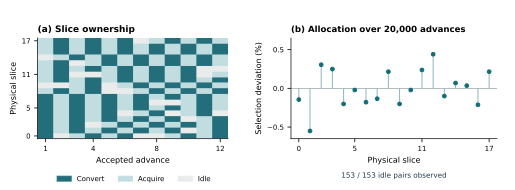

# 数字 IP 的算法、效果与状态机

对象是 [adc_digital_ip_v21](../../rtl/v21/adc_digital_ip_v21.sv) 和其[生产清单](../../flow/build/filelists/files_adc_v21.f)。清单有 11 份 RTL：顶层、8 种直接实例和 2 种传递依赖。这里用片号、开关位、定点码、标签和错误标志衡量数字 IP 的效果。

从左侧采样请求开始，沿线可以追到 SADC 的判决、RDAC 最后一次开关写入，以及 ADC2 原码和权重的交接。框内的 `u_*` 是顶层中的实例名。[顶层接线](../../rtl/v21/adc_digital_ip_v21.sv) · [扰动如何分到两端](digital.md#pre) · [512 门限的两个出口](digital.md#events)

[下载完整矢量图册（PDF）](digital-ip-atlas.pdf) · [采集与转换交接沿的逐引脚实测](../audit/ISSUE_10.md)

默认 Python 已按本页的数字链运行。五种工况共 1,792 笔与生产顶层按标签对拍，核对八槽片号、开关、已决写门、原码和输出。运行入口及直接对照原图的差异见[快速上手](../guide/QUICKSTART.md)与[论文／专利复核](../audit/AUDIT_ALGO_VS_SOURCE.md)。

## 相同的粗码，哪些开关在工作？

一格代表一个槽的一列等权主单元。命令固定为 283，桥交换关闭，每次转换都使用 35 个位置。左图把同一组开关重复 64 次，有 29 个位置一次也没用到。右图给横纵相位的 64 种组合各发一次命令，64 个位置就各工作了 35 次。两组都累计选通 2,240 次，轮换改变的是谁承担这些选通。

开关位取自 D3/D4 叶子的归档 VCS 输出。固定组重复其中一行，轮换组逐行统计 64 条不同输出。整个归档中的 133,376 组转换掩码和 512 组采样预置与当前参考逐位一致。归档头未记录构建提交。图中给定的相位顺序由测试指定。[原始输出节选](../../tb/vec_dem_dither_effects.txt) · [解码与轮换流程](digital.md#dem)

## 同一份输入，写入正确权重能修正几码？

理想 ADC2 原码为 4096，对应 20 位输出 **567,040**。给物理片 0 的一个子单元设置已知偏差，再把它引起的残差注入 ADC2 原码。每行都把完全相同的原码分别送给两张权重表。仅在转换时选中该单元，默认表算出 **567,008**，少 32 码；仅在采样时选中，算出 **567,072**，多 32 码。写入已知系数后，两者均回到 **567,040**。两侧都选或都不选的两行是零响应对照。

把写入的校正量减半，前两行分别还差 −16 和 +16 码。开关取自归档，权重偏差与细码是人工设置的数字激励，输出由当前定点参考计算。这里检验的是已知系数的作用方向和修正量。片外求出的系数能有多准、样片的 DNL/INL 能改善多少，仍需相应数据。[输入、完整整数结果与哈希](figures/digital-evidence.json) · [权重求和](digital.md#sum) · [重构流程](digital.md#reconstruct)

## 优势、效果、算法与状态

| 技术 | 优势 | 可核对的效果 | 算法与状态 |
| --- | --- | --- | --- |
| **D1　片组调度** | 一组采集时，另一组能使用先前的片号转换 | 逐拍镜像与 4,096 行冻结向量零差异；推进 20,000 次，8/8/2 互斥违例为 0，覆盖 153/153 种空闲片对 | 旧 ACQ 交给 CONV，从其余十片去掉两片；无 adv 保持。[片选图](digital.md#schedule) |
| **D2　已决位跟随** | 只有合法判决才更新 RDAC，拒绝的试探不会误写 | 定向输入 B 提交 7 次，命令从 256 到 258。A 接受 512 门限后提交 5 次，453 到 519；若拒绝门限，该次不写底板 | Flash → 普通 SAR 或 guard → 完成；身份、位序、范围错误抑制 apply。[事件图](digital.md#events) |
| **D3　DEM 与桥交换** | 让不同位置轮流承担相同命令 | 命令 283 遍历相位后，64 个等权位置各用 35 次。另在命令 8 下，桥交换改变 9 个开关位，名义总量仍为 8 Cu | 水平热码 → 纵向保留列 → 半单元交换 → 按物理 ID 写门。[掩码](digital.md#dem) · [桥交换](digital.md#bridge) · [物理路由](digital.md#physical-route) |
| **D4　扰动生成、注入与扣回** | 同一受理沿给正确的 SADC 写低段、给八片 RDAC 写完整预置 | 本地生产顶层 RTL 实测中，片内序列 1,024 笔覆盖全部 64 个字，固定输入逐笔回到 410304。断开 SADC 低段时 96/192 笔余差越窗 | 接受请求 → 取片内字 → 两端分路 → 保存实际开关 → 同笔扣回。[生成与状态](digital.md#pre) · [权重和](digital.md#sum) |
| **D5　权重与重构** | 按同一笔的片号和开关计算校正量 | 定向注入时，写入已知系数使 −32、+32 码误差分别归零。RTL 通过 8,209 笔冻结向量和 21 笔逐标签对拍，含负数过中点、夹空拍 | 空表 → 装载 → 提交锁定；G/Wm/Wp 和 tag 逐级推进。[配置 FSM](digital.md#config) · [权重和](digital.md#sum) · [倒数](digital.md#reciprocal) · [余数修正](digital.md#correction) · [重构](digital.md#reconstruct) · [舍入](digital.md#round96) |
| **D6　采集与返回归属** | 下一笔已开始时，旧 raw 仍能配回自己的权重和 tag | 同沿返回 A 并登记 B：响应取 A，沿后保存 B。无 owner 的 raw 置迟到错误 | ACQ 已采 → CONV → 捕获；owner 空 → 持有 A → 交给 B → 空。[双槽](digital.md#ownership) · [授权和登记](digital.md#arming) · [返回 FSM](digital.md#capture) |

[生产 Python 与 RTL 对拍的 CI（d97afa1）](https://github.com/defineiocc02/20bit_SAR_ADC_Behaviour_Verification/actions/runs/44500594977) · [一笔数字交易的总流程](digital.md#transaction) · [数字证据和图数据](figures/digital-evidence.json) · [工程合同](../CONTRACT_CURRENT.md)

## 与论文披露的数字部分对照

ISSCC 2024 图 9.8.1 和 9.8.3 给出 18 片中 8 采、8 转、2 备用，已决结果驱动 RDAC，以及横纵打乱。正文还披露 DAC 系数在片外求得、校正在片上进行。v21 有对应的片选、事件接口、掩码与加载后加权运算；横纵相位、coin 和比较结果由上游供给，扰动字由顶层在受理沿内部产生。guard 编码、13 位 raw、Q24/Q30、360 个配置字和握手优先级属于本工程合同。重构已在模块接口逐笔对拍。顶层在理想宏握手下已按 25 ns 连续交付 192 笔。实际宏的逐位接口时序与目标工艺仍待验收。 [论文原图，图 9.8.1–3](../../references/ISSCC2024_PAPER.pdf#page=2) · [接口合同](../CONTRACT_CURRENT.md) · [当前状态](../STATUS.md)

## 看图复核

**片选。** 左图每列是一次有效推进，右图是各片被选次数相对均匀期望的偏差。推进序号是数字事件计数。

**事件。** 圆点是现有测试台定向序列的有效提交。两幅纵轴均为整数命令，各自覆盖该用例的码域。

**归属。** 中间一列沿前为 A，输出响应为 A，沿后持有 B。这是按源码构造的三沿协议算例。

## 维护与验收

**绘图依据。** ADI 的 AD4630-FMC 把 SPI Engine、DMA 和器件接口画在各自的边界内，并在线上注明 CNV、BUSY 和数据方向。本册的总框图据此标出数字实例和宏引脚。[ADI 设计说明](https://developer.analog.com/docs/hdl/projects/ad4630_fmc/index.html) · [ADI 原图源码](https://github.com/analogdevicesinc/hdl/blob/main/docs/projects/ad4630_fmc/ad463x_hdl_cm0_cz1_1.svg)

OpenTitan 的电源管理图把快、慢时钟域分列，条件紧贴转移边。本 IP 的 SADC 写门与 SAR 事件使用同一数字时钟，分别画出谁在受理沿写入、512 门限拒绝后回哪一步。NVIDIA 的 NVDLA 把配置接口和引擎数据通路分开；本册把等待控制与每笔携带的权重、标签分别标注。这三份开源图提供画法。ADC 的功能依据和逐项验证见上方论文对照。[OpenTitan 状态机原图](https://github.com/lowRISC/opentitan/blob/master/hw/ip_templates/pwrmgr/doc/pwrmgr_fsms.svg) · [OpenTitan 工作原理](https://opentitan.org/book/hw/ip/pwrmgr/doc/theory_of_operation.html) · [NVDLA 原图源码](https://github.com/nvdla/doc/blob/master/doc/nvdla-primer-core-diagram.svg) · [NVDLA 硬件架构](https://nvdla.org/hw/v1/hwarch.html)

- 新增或替换生产源时更新相应算法图、实现链接与定向测试。组合逻辑画数据流，流水注明 valid/tag 的推进；并发槽须注明哪些状态可同时有效。
- 图注给出输入位宽、进入条件、寄存归属、同沿优先级、复位、拒绝和完成方式。错误出口应能观察到 flag、写门或样本 tag。
- 效果注明输入、对照、计数及证据层级。测试台期望值、本地整数复算、实际 RTL 运行和网表等价分别登记。
- 总框图、片选、DEM、扰动通路和两张状态图直接编辑 SVG。其他流程在算法页的折叠区编辑 Mermaid。每张图只有一份可编辑图源，出版包提供对应的矢量 PDF。

从仓库根复核。下列命令只进行静态检查和数字参考运算。

~~~bash
node tools/v21_algorithm_atlas.mjs --check
python3 -B tools/check_engineering.py
bash tools/pyenv.sh --run tools/verify_v21_algorithms.py --out /tmp/v21-digital-figures-$$
~~~

逐格复核两张开关图时，片组选取向量每行最后三项依次是采集、转换、备用的十八位掩码。DEM 记录中最后八个十六进制数对应槽 0–7，每个开关矩阵位置取对应宏列的两个主半单元位。

~~~bash
head -n 2 tb/vec_r18_sched.txt
rg '^M 283 (0 0|2 3) 0 ' tb/vec_dem_dither_effects.txt
~~~

导出 SVG、单图 PDF 与离线图册时，向出版程序提供本机已有的 Mermaid 脚本、Playwright 模块和浏览器。输出目录须是新目录。

~~~bash
node tools/v21_algorithm_atlas.mjs --render --out "$V21_ATLAS_OUT" \
  --mermaid-js "$MERMAID_JS" --playwright "$PLAYWRIGHT_MODULE" --browser "$CHROME_BIN"
cp "$V21_ATLAS_OUT"/svg/*.svg "$V21_ATLAS_OUT"/svg/rendered.json docs/algorithms/figures/
cp "$V21_ATLAS_OUT"/atlas.pdf docs/algorithms/digital-ip-atlas.pdf
node tools/v21_algorithm_atlas.mjs --check
~~~
