# 数字 IP 的算法、状态机与效果

[打开完整矢量图册（PDF）](digital-ip-atlas.pdf) · [逐模块查算法和状态机](digital.md) · [读取顶层逐笔 CSV](../../tb/v21/sample_cadence.csv)

## 跟一笔样本看扰动怎样扣回

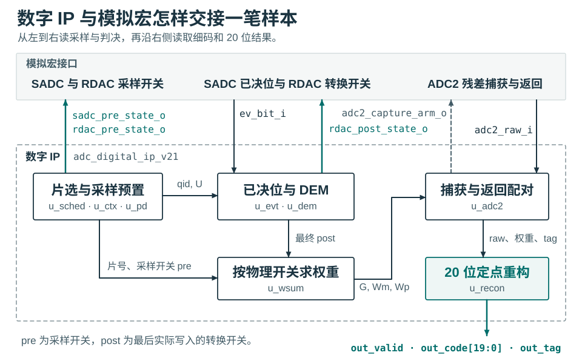

**分路注入扰动，再按同笔权重扣回。**

从字 53 分两条线读。所选前级量化器取得低段 `L=2.625`，返回粗码 202；RDAC 八槽的完整预置平均为 `T=6.625`。高段 `U=4` 加到已决码，最后一次写入命令是 206。理想宏按实际开关返回细码 6016，片内用同笔 `post` 加回转换贡献、用 `pre` 扣回采样贡献，输出 **410304**。[生产顶层](../../rtl/v21/adc_digital_ip_v21.sv) · [字源与两端开关](digital.md#pre)

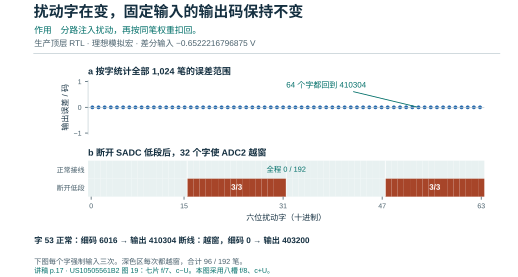

上图的误差线包含片内序列的全部 1,024 笔。下图是独立的受控试验，每个字强制三遍。断开低段，字 16–31 和 48–63 每次都使 ADC2 越窗；正常连接下同批 192 笔均在量程内。两种接法的字 53 在图中列出原码和输出。[端口与激励](../../tb/v21/sample_cadence.cpp) · [论文和专利披露](../audit/AUDIT_ALGO_VS_SOURCE.md)

## 哪一拍换样本，哪一拍可以写开关

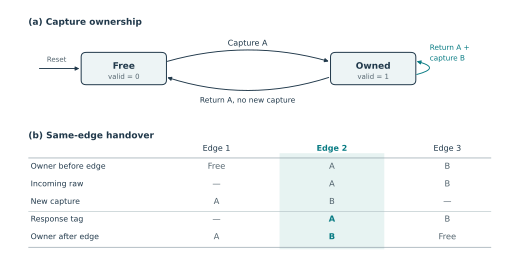

沿竖线读第 32 沿。tag 1 返回 ADC2 细码，tag 2 捕获余差，tag 3 采集输入。在此 640 MHz 理想时钟和约定宏响应下，全部 192 笔的相邻输出均隔 25 ns。[宏时序条件](../STATUS.md#持续采样率) · [片组交接优先级](digital.md#ownership)

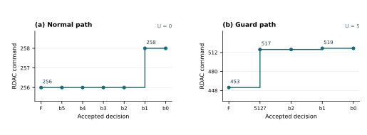

格内是 RDAC 实际写入命令，空白表示该 tag 已经结束。第 2 行在比较后拒绝 512，下一事件从 bit5 继续，因此这一行有 8 个事件和 7 次写入。每行展示首个观测标签，分支计数使用全部 192 笔。[逐位状态机](digital.md#events)

## 相同命令怎样轮换，已知失配能修正多少

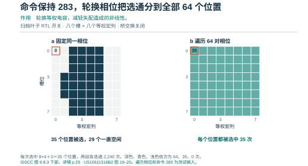

方框追踪相同槽号和宏列。命令固定为 283，两侧总选通次数相同。固定对照重复同一条叶子记录，轮换组使用全部 64 对相位各一次。叶子归档头记录了工具与原始流摘要，未记录构建提交。[原始掩码](../../tb/vec_dem_dither_effects.txt) · [二维 DEM](digital.md#dem)

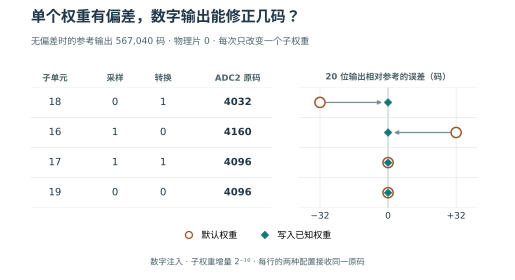

两次运行按 tag 配对，并核对输入、原码、八个物理片号和两侧开关。只有转换时选中偏差单元的 10 笔低了 32 码；只有采样时选中的 14 笔高了 32 码。装入已知物理权重后，192 笔全部返回参考值。此处系数直接给定；片外拟合另见下一节。[实际顶层数据](../../tb/v21/sample_cadence.csv) · [权重与重构](digital.md#sum)

## 全码线性度在什么条件下改善

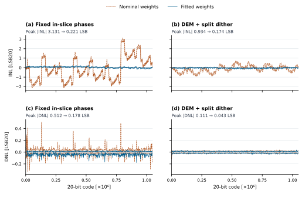

两组都开启 DEM 和扰动，只更换权重表。同一颗相对失配 0.01% 的模型器件，峰值绝对 INL 由 **0.934 降到 0.174 LSB20**，峰值绝对 DNL 由 **0.111 降到 0.043 LSB20**。曲线按码段保留所有内部码的最小和最大值，圈出名义表的最坏位置。

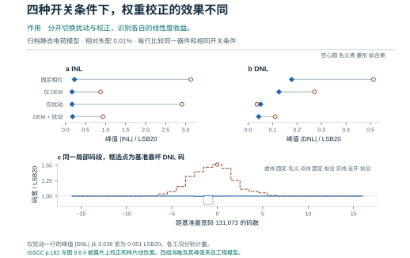

按行比较同一开关条件。仅开启扰动时，换表使 DNL 峰值由 0.036 增至 0.051 LSB20。下图固定在未校准基准的最坏码附近，横轴按单个输出码计。这两张图均来自归档的静态行为模型，数字顶层的定向权重试验单独列在上节。[完整模型条件](../audit/TREE_AUDIT_REPORT.md#全码静态线性度) · [数值摘要](../figures/static_linearity/summary.json)

## 直接核对原图与原文

| 对照位置 | 原件确实给出的关系 | 图中由工程确定或实测的部分 |
| --- | --- | --- |
| [ISSCC 图 9.8.1–2](../../references/ISSCC2024_PAPER.pdf#page=2) · [讲稿第 9–12 页](../../references/ISSCC2024_SLIDES.pdf#page=9) · [US10516408B2 图 16](https://patents.google.com/patent/US10516408B2/en) | 独立量化器驱动 RDAC 跟随已决码，18 片池分两组并留两片备用，共享 RA 和 ADC2。 | 三个 tag 在第 32 沿的归属、512 试探和 8 次比较 7 次写入都来自真实顶层记录。 |
| [原讲稿第 17 页](../../references/ISSCC2024_SLIDES.pdf#page=17) · [US10505561B2 图 19 原图](../mechanisms/figures/US10505561B2_FIG19_dither_injection.jpg) · [说明书图 19 段](https://patents.google.com/patent/US10505561B2/en) | 字源 400 的低段经 300 到量化器 200，全字经 222 到采样 DAC 220，上段在 224 调整粗码。正文七片实施例以 1/7 分数分配并减上段，剩余扰动在后级扣回。 | 八槽的低段分数为 f/8，实际转换用 c+U，重构扣同笔 Wp。名义条件下 16(Wm−Wp)=k−T=c−L。字源递推、权重与极性均为工程选取。 |
| [ISSCC 图 9.8.3 下部](../../references/ISSCC2024_PAPER.pdf#page=2) · [讲稿第 29、31 页](../../references/ISSCC2024_SLIDES.pdf#page=29) · [US10511316B2 图 19](../mechanisms/figures/US10511316B2_FIG19_two_stage_shuffler.jpg)和[图 20](../mechanisms/figures/US10511316B2_FIG20_reserved_column_mux.jpg) | 讲稿给出横纵两个 3 位分段与跨段桥接；专利的 350、352 与 MUX 进一步示意保留列分配。 | 命令 283 时每个等权位置选通 35 次，是给定相位遍历的叶子结果。片 0 的已知偏差和 ±32 码是独立的顶层权重试验。 |
| [ISSCC 正文第 182 页](../../references/ISSCC2024_PAPER.pdf#page=1)、[图 9.8.4](../../references/ISSCC2024_PAPER.pdf#page=2) · [原讲稿第 32 页](../../references/ISSCC2024_SLIDES.pdf#page=32) | 正文披露片外求系数、片上校正。样片 INL +2.2/−1.8、DNL ±0.27 在正文用 ppm，图 9.8.4 的纵轴与讲稿第 32 页用 LSB（20 位）。 | 工作树按端点 LSB20 计算该模型器件的码宽误差。6 V 满幅时 1 ppm FS＝1.048576 LSB20。全码曲线、真值注入和样片实测分别标注。 |

在本页展开已有原件，按编号看实际连线

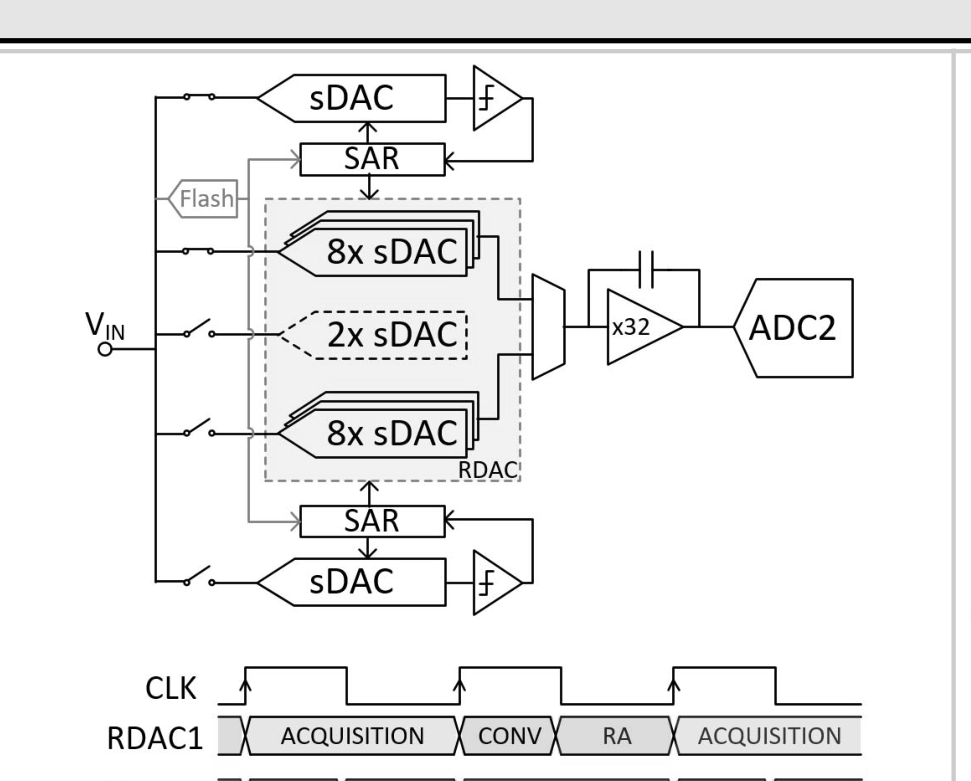

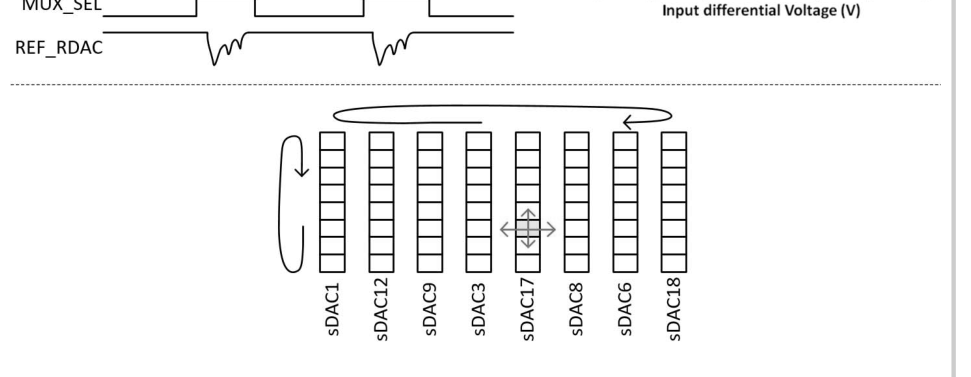

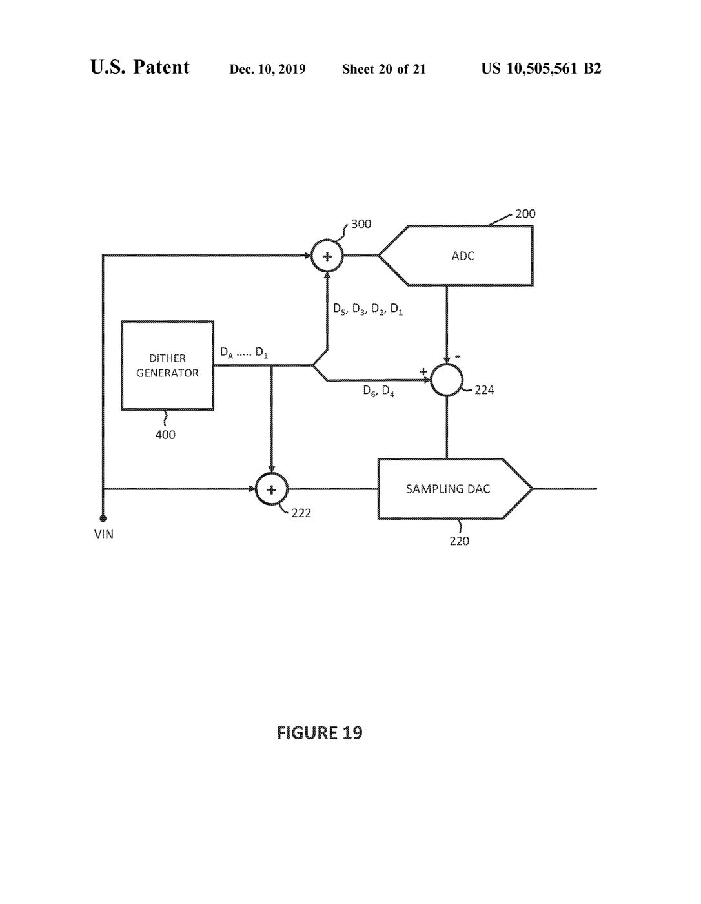

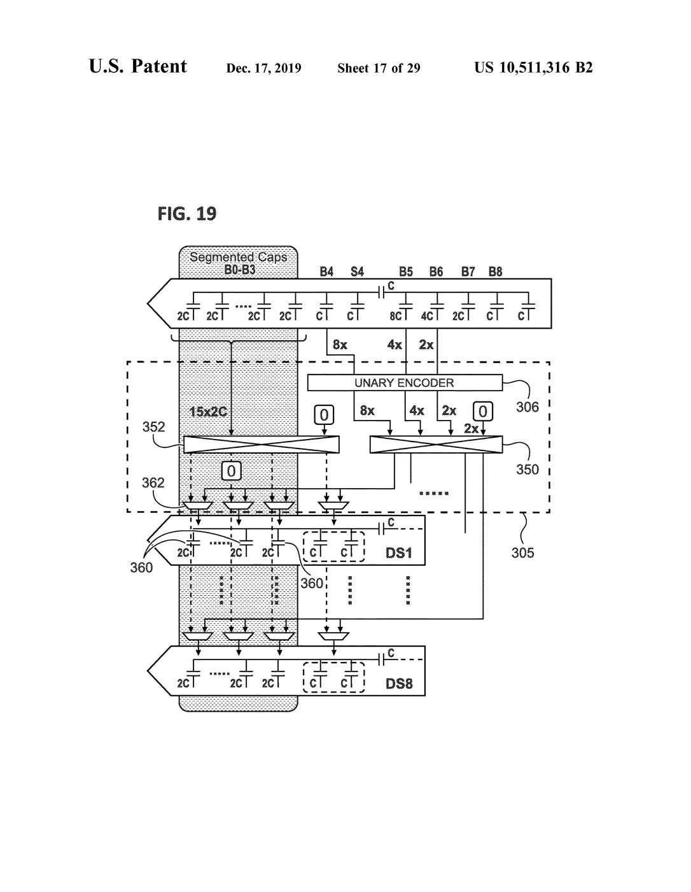

[论文图 9.8.1–4 同页原图](../../references/ISSCC2024_PAPER.pdf#page=2) · [讲稿第 17 页分路原图](../../references/ISSCC2024_SLIDES.pdf#page=17) · [讲稿第 29 页二维 DEM 原图](../../references/ISSCC2024_SLIDES.pdf#page=29)

## 优势、效果、算法与状态

| 技术 | 优势 | 可核对的效果 | 算法与状态 |
| --- | --- | --- | --- |
| **D1　片组调度** | 一组采集时，另一组能使用先前的片号转换 | 逐拍镜像与 4,096 行冻结向量零差异；推进 20,000 次，8/8/2 互斥违例为 0，覆盖 153/153 种空闲片对 | 旧 ACQ 交给 CONV，从其余十片去掉两片；无 adv 保持。[片选图](digital.md#schedule) |
| **D2　已决位跟随** | 只有合法判决才更新 RDAC，拒绝的试探不会误写 | 定向输入 B 提交 7 次，命令从 256 到 258。A 接受 512 门限后提交 5 次，453 到 519；若拒绝门限，顶层实测该路径 8 个事件只写 7 次 | Flash → 普通 SAR 或 guard → 完成；身份、位序、范围错误抑制 apply。[事件图](digital.md#events) |
| **D3　DEM 与桥交换** | 让不同位置轮流承担相同命令 | 命令 283 遍历相位后，64 个等权位置各用 35 次。另在命令 8 下，桥交换改变 9 个开关位，名义总量仍为 8 Cu | 水平热码 → 纵向保留列 → 半单元交换 → 按物理 ID 写门。[掩码](digital.md#dem) · [桥交换](digital.md#bridge) · [物理路由](digital.md#physical-route) |
| **D4　扰动生成、注入与扣回** | 同一受理沿给正确的 SADC 写低段、给八片 RDAC 写完整预置 | 本地生产顶层 RTL 实测中，片内序列 1,024 笔覆盖全部 64 个字，固定输入逐笔回到 410304。断开 SADC 低段时 96/192 笔余差越窗 | 接受请求 → 取片内字 → 两端分路 → 保存实际开关 → 同笔扣回。[生成与状态](digital.md#pre) · [权重和](digital.md#sum) |
| **D5　权重与重构** | 按同一笔的片号和开关计算校正量 | 给片 0 子单元 18 注入已知偏差，同一批 192 笔的 10 个 −32 码和 14 个 +32 码误差在装表后归零。RTL 通过 8,209 笔冻结向量和 21 笔逐标签对拍，含负数过中点、夹空拍 | 空表 → 装载 → 提交锁定；G/Wm/Wp 和 tag 逐级推进。[配置 FSM](digital.md#config) · [权重和](digital.md#sum) · [倒数](digital.md#reciprocal) · [余数修正](digital.md#correction) · [重构](digital.md#reconstruct) · [舍入](digital.md#round96) |
| **D6　采集与返回归属** | 下一笔已开始时，旧 raw 仍能配回自己的权重和 tag | 同沿返回 A 并登记 B：响应取 A，沿后保存 B。无 owner 的 raw 置迟到错误 | ACQ 已采 → CONV → 捕获；owner 空 → 持有 A → 交给 B → 空。[双槽](digital.md#ownership) · [授权和登记](digital.md#arming) · [返回 FSM](digital.md#capture) |

[生产 Python 与 RTL 对拍的 CI（d97afa1）](https://github.com/defineiocc02/20bit_SAR_ADC_Behaviour_Verification/actions/runs/44500594977) · [一笔数字交易的总流程](digital.md#transaction) · [数字证据和图数据](figures/digital-evidence.json) · [工程合同](../CONTRACT_CURRENT.md)

## 与论文披露的数字部分对照

ISSCC 2024 图 9.8.1 和 9.8.3 给出 18 片中 8 采、8 转、2 备用，已决结果驱动 RDAC，以及横纵打乱。正文还披露 DAC 系数在片外求得、校正在片上进行。v21 有对应的片选、事件接口、掩码与加载后加权运算；横纵相位、coin 和比较结果由上游供给，扰动字由顶层在受理沿内部产生。guard 编码、13 位 raw、Q24/Q30、360 个配置字和握手优先级属于本工程合同。重构已在模块接口逐笔对拍。顶层在理想宏握手下已按 25 ns 连续交付 192 笔。实际宏的逐位接口时序与目标工艺仍待验收。 [论文原图，图 9.8.1–3](../../references/ISSCC2024_PAPER.pdf#page=2) · [接口合同](../CONTRACT_CURRENT.md) · [当前状态](../STATUS.md)

## 调度统计

左侧沿同一物理片号读采集、转换和备用。右侧的零线为均匀频数。整数调度镜像的前 4,096 行与冻结向量逐行相符；20,000 次有效推进用于统计片对覆盖。[调度向量](../../tb/vec_r18_sched.txt) · [生产片选](digital.md#schedule)

## 维护与验收

**绘图依据。** ADI 的 AD4630-FMC 把 SPI Engine、DMA 和器件接口画在各自的边界内，并在线上注明 CNV、BUSY 和数据方向。本册的总框图据此标出数字实例和宏引脚。[ADI 设计说明](https://developer.analog.com/docs/hdl/projects/ad4630_fmc/index.html) · [ADI 原图源码](https://github.com/analogdevicesinc/hdl/blob/main/docs/projects/ad4630_fmc/ad463x_hdl_cm0_cz1_1.svg)

OpenTitan 的电源管理图把快、慢时钟域分列，条件紧贴转移边。本 IP 的 SADC 写门与 SAR 事件使用同一数字时钟，分别画出谁在受理沿写入、512 门限拒绝后回哪一步。NVIDIA 的 NVDLA 把配置接口和引擎数据通路分开；本册把等待控制与每笔携带的权重、标签分别标注。这三份开源图提供画法。ADC 的功能依据和逐项验证见上方论文对照。[OpenTitan 状态机原图](https://github.com/lowRISC/opentitan/blob/master/hw/ip_templates/pwrmgr/doc/pwrmgr_fsms.svg) · [OpenTitan 工作原理](https://opentitan.org/book/hw/ip/pwrmgr/doc/theory_of_operation.html) · [NVDLA 原图源码](https://github.com/nvdla/doc/blob/master/doc/nvdla-primer-core-diagram.svg) · [NVDLA 硬件架构](https://nvdla.org/hw/v1/hwarch.html)

- 新增或替换生产源时更新相应算法图、实现链接与定向测试。组合逻辑画数据流，流水注明 valid/tag 的推进；并发槽须注明哪些状态可同时有效。
- 图注给出输入位宽、进入条件、寄存归属、同沿优先级、复位、拒绝和完成方式。错误出口应能观察到 flag、写门或样本 tag。
- 效果注明输入、对照、计数及证据层级。测试台期望值、本地整数复算、实际 RTL 运行和网表等价分别登记。
- 每张图的作用句限 30 字。图旁另列原图、工程选择与数据。离线 HTML 可以展开原始论文、讲稿和专利图；PDF 保留可点击的原图链接。总框图、片选、DEM、扰动通路和两张状态图直接编辑 SVG。其他流程在算法页的折叠区编辑 Mermaid。每张图只有一份可编辑图源，出版包提供对应的矢量 PDF。

从仓库根复核。数字图直接读取归档 CI 的逐笔引脚输出和叶子掩码；线性度图可以用仓内的全码极值包络离线重画。完整原始逐码数组目录也可传给同一 `--redraw-from` 入口，按原始码宽重新计算端点指标。[CI 采集来源](https://github.com/defineiocc02/20bit_SAR_ADC_Behaviour_Verification/actions/runs/44508573316) · [数值和来源哈希](figures/digital-evidence.json)

~~~bash
node tools/v21_algorithm_atlas.mjs --check
python3 -B tools/check_engineering.py
fig_work="$(mktemp -d)"
bash tools/pyenv.sh --run tools/verify_v21_algorithms.py --out "$fig_work/digital"
bash tools/pyenv.sh --run tools/run_static_linearity.py --redraw-from docs/figures/static_linearity --out "$fig_work/static"
~~~

逐格复核两张开关图时，片组选取向量每行最后三项依次是采集、转换、备用的十八位掩码。DEM 记录中最后八个十六进制数对应槽 0–7，每个开关矩阵位置取对应宏列的两个主半单元位。

~~~bash
head -n 2 tb/vec_r18_sched.txt
rg '^M 283 (0 0|2 3) 0 ' tb/vec_dem_dither_effects.txt
~~~

导出 SVG、单图 PDF 与离线图册时，向出版程序提供已有的 Mermaid、Playwright 和浏览器。Chrome 若拒绝一次打印整本，程序按正文、附录分印，用带 pypdf 的 Python 合并矢量页面与链接。`PDF_PYTHON` 可指定带文档依赖的解释器。可用 Poppler 的 `pdftoppm` 时，HTML 会直接展示指定原页的预览，点击预览可查看原 PDF。输出写入新目录，`originals/` 与 HTML 放在一起可离线看原件。

~~~bash
node tools/v21_algorithm_atlas.mjs --render --out "$V21_ATLAS_OUT" \
  --mermaid-js "$MERMAID_JS" --playwright "$PLAYWRIGHT_MODULE" --browser "$CHROME_BIN"
cp "$V21_ATLAS_OUT"/svg/*.svg "$V21_ATLAS_OUT"/svg/rendered.json docs/algorithms/figures/
cp "$V21_ATLAS_OUT"/atlas.pdf docs/algorithms/digital-ip-atlas.pdf
node tools/v21_algorithm_atlas.mjs --check
~~~
