# 集成 ADC 的控制与定点通路

总框图按宏接口与数字 IP 分层，方框中给出可以在 RTL 搜到的实例名。状态图把条件写在箭头旁，标明寄存器状态或一笔样本的阶段。采集和转换两个上下文槽可以同时有效。具体管脚与位序以 [v21 顶层](../../rtl/v21/adc_digital_ip_v21.sv) 和 [工程合同](../CONTRACT_CURRENT.md) 为准。

## 一笔样本怎样从采集走到出码

**优势。** 让开关、细码和权重始终属于同一笔。

**效果与验证。** 重构模块已逐级核对 21 笔事务的结果、标签和延迟。生产顶层在理想宏握手和快时钟下已连续交付 192 笔，各相邻输出间隔为 25 ns。

生产事务的 Python 入口和 CLI 已与顶层对齐。默认单位、正向扰动与 guard 的选择可沿同一组输入核对。[逐笔数据](../../tools/check_default_rtl.py) · [论文与专利差异](../audit/AUDIT_ALGO_VS_SOURCE.md)

**入口与出口。** 在 `prepare_valid && prepare_ready` 的沿冻结 tag、qid、片号、相位和实际采样预置。下一次合法提升使这笔进入转换。ADC2 返回后随同笔冻结的求和结果进入 D5，最终输出 `out_valid/out_tag/out_code/out_err`。采样开关与最后实际写入的转换开关分别送到 u_wsum。u_adc2 登记同一笔的权重和 tag，待细码返回后送给 u_recon。 [顶层接线](../../rtl/v21/adc_digital_ip_v21.sv) · [端到端测试](../../tb/v21/tb_i4b_e2e.sv)

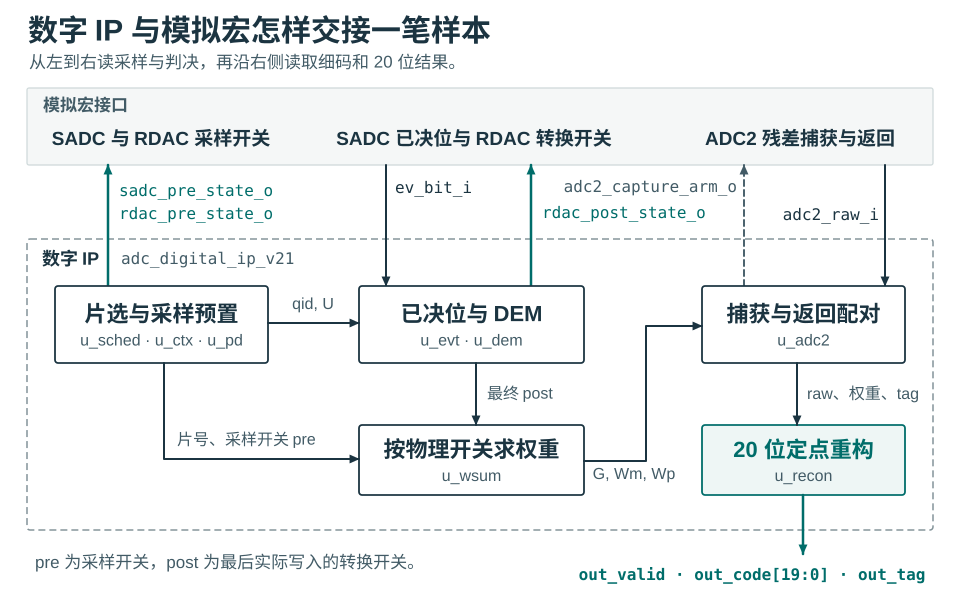

## D5　校准权重装载与原子生效

**优势。** 防止冷启动、半张表或运行中误写影响出码。

**效果与验证。** 20 条配置断言覆盖缺一字、重复写、非法权重及重新装载。

入口是 `cfg_we/sel/sid/idx/data`、commit、reload；出口为 valid、busy 和范围错误。主表 18×16，子表 18×4，共 360 个 Q30 字。每个合法地址只置一位写入位图。 [权重寄存器](../../rtl/v21/wsum_v21.sv) · [配置合同](../v21/CONFIG_CONTRACT.md) · [20 项检查](../../tb/v21/tb_cfg_lifecycle.sv)


查看可编辑图源（Mermaid）

~~~text
flowchart TD
 W["配置写请求"] --> L{"地址、数据、锁合法？"}
 L -->|否| E["拒绝写入"]
 L -->|是| S["更新权重与位图"]
 S --> C{"旧位图全满且 commit？"}
 C -->|是| A["锁定生效"]
 C -->|否| H["等待提交"]
~~~


查看可编辑图源（Mermaid）

~~~text
stateDiagram-v2
 direction LR
 [*] --> ST_IDLE
 ST_IDLE --> ST_LOADING: written 非空
 ST_LOADING --> ST_ACTIVE: 完整且 commit
 ST_LOADING --> ST_IDLE: reload
 ST_ACTIVE --> ST_IDLE: reload
~~~

复位和 reload 先清位图、locked 和范围错。busy 由位图直接产生，状态寄存器按旧位图更新，第一笔写后两者可能相差一拍。补最后一字与 commit 同沿时，位图在沿后才完整，需要另一次 commit。reload 的全系统排空前提由上游保证。

## D1　18 片池与随机片选

**优势。** 共用一个 18 片池，给采集留出整段采集窗。

**效果与验证。** 调度镜像本次推进 20,000 次，分区违例为 0，覆盖全部 153 种 IDLE 片对。

**输入与不变量。** `adv=sched_adv_o` 对应一次真实 prepare。沿前的采集组交给本笔，按升序打包八个 5 位 ID。18 位候选掩码排除这八片，从余下十片中选两个不同位置留空。复位的首组是 0–7；首次推进前转换组为空。稳态采集、转换各八片、空闲两片且互斥。种子零映射到缺省非零种子。 [调度 RTL](../../rtl/sched18.sv) · [逐拍 Python 镜像](../../src/adi_model/sched18_rtl.py) · [前两次推进的原始向量](../../tb/vec_r18_sched.txt) · [冻结向量测试台](../../tb/tb_sched18.sv)

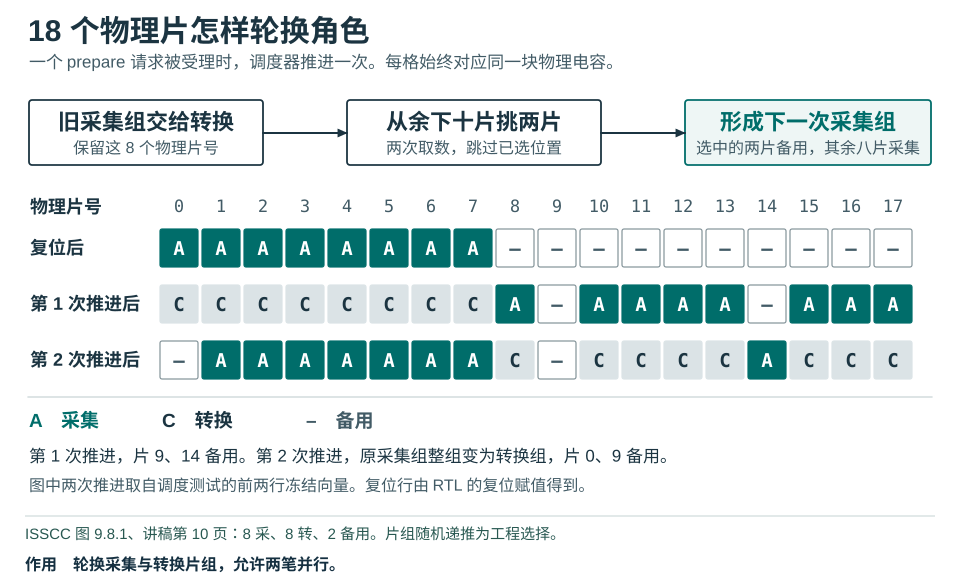


查看可编辑图源（Mermaid）

~~~text
stateDiagram-v2
 direction LR
 state "上电采集组 0–7" as Initial
 state "稳态片组寄存器" as Running
 [*] --> Initial
 Initial --> Running: 首个 adv
 Running --> Running: adv 交换并重新选片
 Running --> Initial: reset_n 拉低
~~~

同沿 seed_we 与 adv 时，后写的 x2 推进值胜出，见 `sched18.sv` 的时序块；软件装载种子应在片组空闲时完成。相位和 coin 是 v21 的独立外部输入，片选生成器本身不产生它们。

## D6　采集槽、转换槽与排空

**优势。** 新采集和旧转换可以并行持有不同的片组。

**效果与验证。** A 释放、B 晋升、C 受理时，沿前由 B 采集、A 转换，沿后由 C 采集、B 转换。片选、采样写门和预置数据共用同一组物理片号。两侧实测交集均为零。

**受理条件。** `rst_n && cfg_valid && !stop_i` 且 ACQ 空闲或已采可提升。已有 CONV 需要满足余差已采、hold 已确认且安静计数达阈值才可释放。图按一个 tag 画生命周期；沿上可以一边释放旧 CONV，一边把另一个 ACQ 提升，再建立新 ACQ。 [上下文 RTL](../../rtl/v21/acq_conv_ctx.sv) · [同沿与冻结反例](../../tb/v21/tb_acq_ctx_fixed.sv) · [交接沿逐引脚实测](../audit/ISSUE_10.md)


查看可编辑图源（Mermaid）

~~~text
flowchart TD
 A["prepare 或 stop"] --> B{"旧 ACQ 已采且 CONV 可用？"}
 B -->|合法 prepare| C["将旧 ACQ 描述符整体提升"]
 B -->|stop 且 CONV 已空| D["仅排空提升"]
 A --> E{"可受理新 ACQ？"}
 E -->|是| F["取沿前 sched_ids 与本拍 pre"]
 E -->|否| G["拒收，片池不推进"]
 C --> H["新 CONV 清捕获和安静计数"]
 D --> H
 F --> I["沿后冻结新 ACQ 与物理预置"]
~~~


查看可编辑图源（Mermaid）

~~~text
stateDiagram-v2
 direction LR
 [*] --> Empty
 Empty --> ACQ: prepare
 ACQ --> Sampled: 采样确认
 Sampled --> CONV: 提升或排空
 CONV --> Empty: release_fire
~~~

异步低复位清两个槽。CONV 的旧描述符在受理沿仍有效，提升写入新描述符优先于仅释放清空。停收期间不再接受新请求；排空提升要求 CONV 已空。不能把整个双槽实现压成一个互斥四态寄存器。

## D4　扰动字怎样生成、注入和扣回

**优势。** 每笔从片内产生一个已知的字，量化器和残差 DAC 接收同源预置。重构仍按这笔样本实际选中的物理权重扣回一次。

**效果与验证。** 生产模式的前四字为 45、7、17、40。1,024 笔覆盖所有 64 个字。固定输入得到 1,024 个正确的 410304。另用 192 笔强制字遍历、192 笔混合模式、断开低段及单个权重误差验证同一顶层。

**端口。** 生产时 dither_force_i 接 0。片内独立 xorshift32 从 0xC001D00D 复位，连续异或移 13、17、5 位，每笔取新状态的低六位。受理沿才推进，强制字也占用一笔。SADC0 与 SADC1 的七位开关分别由 sadc_pre_state_o 的低七位和高七位保存，只写 sadc_pre_wr_o 指定的 bank。位 6 至 0 依次是 0、D5、0、D3、D2、D1、0。[顶层接线](../../rtl/v21/adc_digital_ip_v21.sv) · [字源参考](../../src/adi_model/control/dither_word.py) · [实际端口回归](../../tb/v21/sample_cadence.cpp)

**电荷。** U=4D6+D4，f=4D3+2D2+D1，L=2D5+f/8，T=U+L。SADC 接 L，RDAC 八槽的平均预置为 T。字 53、相位 3 时，SADC 控制为 0x2A，RDAC 槽位为 6、6、6、7、7、7、7、7。采样时保存 pre，重构时按实际片号求 Wp 并扣回一次。[开关译码](../../rtl/dither_pre.sv) · [权重计算](../../rtl/v21/wsum_v21.sv) · [逐字测试](../../tb/tb_dem_dither.sv)

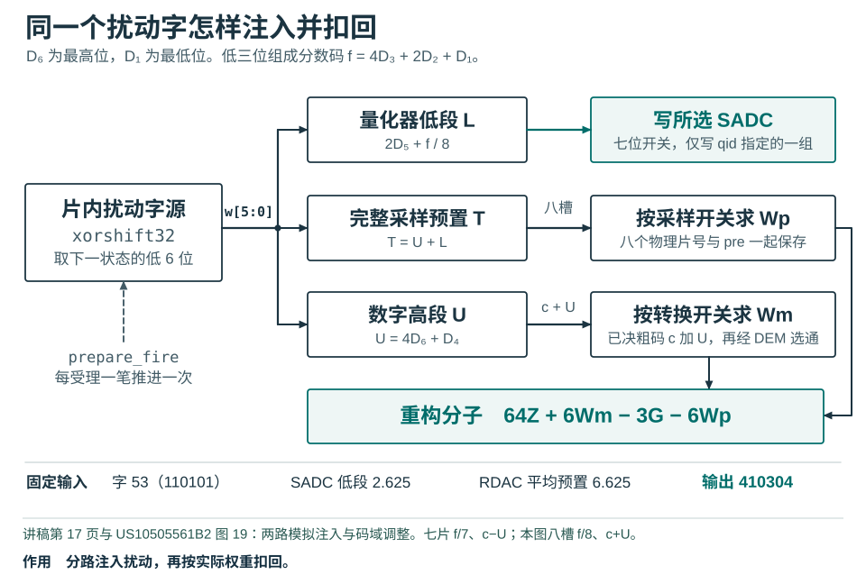

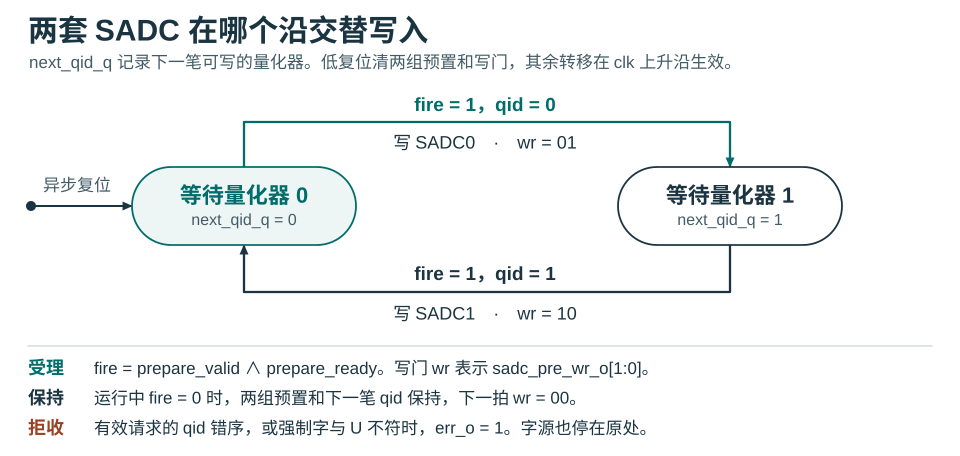

## D2　Flash/SAR 已决事件与保护码

**优势。** 已决位到来即更新，减少大阵列的试探切换。

**效果与验证。** 普通路径七次有效写。最高区拒绝 512 试探时写门保持关闭；qid、序号、范围失败抑制 apply。

**约束。** v21 用 `commit_fire` 开始事件上下文，锁存沿前 ACQ 的 qid、tag、U 和可用的 Flash 结果。相同 qid 的真实 Flash 可以在采样沿、采样后、交接沿或首事件同沿到达并更新前缀。首事件确认最终使用的 Flash。若准备码只是占位值，宏须在首提交之前或同沿提供真实 Flash。首提交后的返回不再改动本笔前缀。独立事件模块有 abort，顶层接低。普通区事件 1 提交 Flash 前缀，事件 2–7 依次处理 bit5 至 bit0。应提交的事件必须匹配 qid、事件序号、位号及范围。 [事件 RTL](../../rtl/v21/sar_evt_v21.sv) · [事件测试](../../tb/v21/tb_i2_events.sv) · [联合测试](../../tb/v21/tb_i12_full.sv)


查看可编辑图源（Mermaid）

~~~text
flowchart LR
 A["本笔事件 qid、序号、位号"] --> D{"身份、位序与 命令范围合法？"}
 P["由已决前缀得到 k = prefix + U"] --> D
 D -->|否| X["置错，关闭写门"]
 D -->|是| G{"拒绝 512？"}
 G -->|是| H["回到 bit5 本拍不写"]
 G -->|否| W["写 post 末次冻结"]
~~~

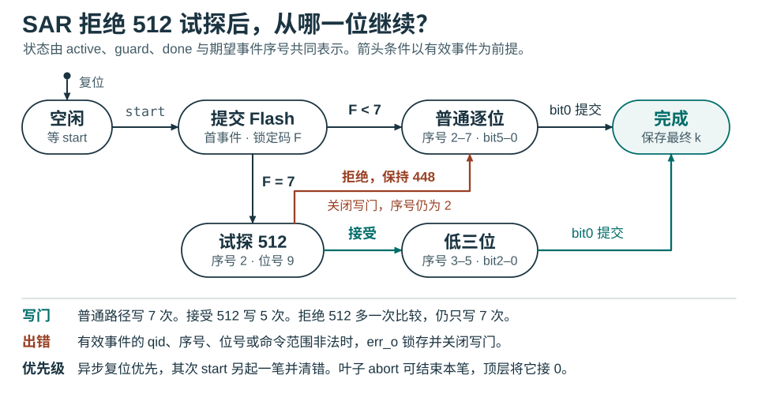

叶子的时序优先级是复位、start、abort、有效位事件。错误会抑制后续 apply；重启分配新上下文。Flash 提交也执行合法性检查。guard 拒绝的比较消耗事件时间，但绝不写物理底板。普通路径额外需要一个启动沿，所以两个普通样本的启动至少相隔八拍。数字时钟周期为 25 ns 时，单看普通事件级，上限为 5 MS/s。顶层的 40 MS/s 定向结果使用 1.5625 ns 数字时钟，比较结果由理想宏按拍返回。

## D3　二维 DEM 和 guard 解码

**优势。** 让同一个粗码可以选用不同的等权位置。外部均匀给出横纵相位时，各位置能够分担选通次数。

**效果与验证。** 固定命令 283、桥交换关闭，每次选 35 个等权位置。64 次重复同相位只用到 35 个位置，64 种相位各用一次则全部 64 个位置各选 35 次。

统计直接读取归档叶子输出的八个开关字。桥关闭时两个主半单元同时选通，每对只计一次。逐位参考比较覆盖 521 个合法命令、256 种相位与桥控制组合；名义权重按含子支路的完整掩码核对。[两组使用次数图](figures/physical-masks.svg) · [归档输入行](../../tb/vec_dem_dither_effects.txt)

**输出。** 8 个槽每槽 20 位。普通码 `k=64H+8V+L`。水平旋转七位热码及保留零位；保留列 `(7+h) mod 8` 内用纵向旋转的 V 个 1，其他列用水平选择。两相等的半单元先一同选中。保护码由独立支路形成实际开关。 [掩码 RTL](../../rtl/dem_mask_v3.sv) · [合同枚举](../../tools/contract_v2.py) · [叶子测试](../../tb/tb_dem_dither.sv)

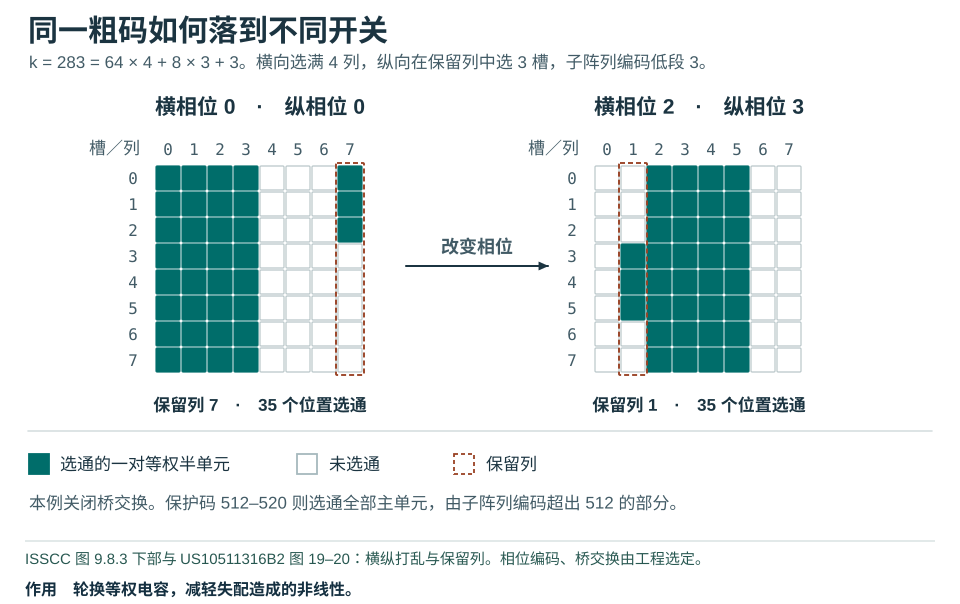

## D3　跨段等名义电荷交换

**优势。** 打散二进制段和一元段边界的确定性误差。

**效果与验证。** 交换保持名义总电荷；失配收益需与 DEM 消融一起解释。

在基础 post 形成后，coin 决定是否交换。选择 `slot=v_phase`、保留宏列和指定 half，将该主半单元的开关与八片共有的 4Cu 子支路选择对调。名义两边各为 4Cu；失配下实际 Wm 依赖交换后的位图。此算法复用同一个组合叶子，随后由物理写门决定应用时刻。 [交换逻辑](../../rtl/dem_mask_v3.sv) · [电荷核查](../../tools/bridge_charge_check.py) · [测试台](../../tb/tb_dem_dither.sv)


查看可编辑图源（Mermaid）

~~~text
flowchart LR
 A["基础 post、coin、half"] --> B{"coin 置位？"}
 B -->|否| Z["保留基础 post"]
 B -->|是| C["读取选中主半单元及子 4Cu 位"]
 C --> D["该主位取子位 八片子位取旧主位"]
 D --> E["按 20×slot+unit 打包"]
 Z --> E
~~~

## 在 18 个物理片上产生写门

**优势。** 写数据和写门对齐，其他片保留上次的有效状态。

**效果与验证。** 同一合法 apply 沿最多选择旧 CONV 的八个物理片，空泡时 18 位 post_wr 为零；不会把上次的写门延续到下一拍。

入口为冻结的八个 5 位片号和槽位级 160 位 post。按物理 ID 散射至 18×20，每个命中片只写本片寄存器。采样预置由 ACQ 一侧路由成 18×4。CONV 占用时，在上升沿切换采样片号、预置数据与写门；CONV 空闲时，上游可在受理沿前为新采集组预置。排空之后，空 ACQ 的写门与片选均为零。 [顶层写门](../../rtl/v21/adc_digital_ip_v21.sv) · [采集预置路由](../../rtl/v21/acq_conv_ctx.sv) · [同沿反例测试](../../tb/v21/tb_audit3.sv)


查看可编辑图源（Mermaid）

~~~text
flowchart LR
 A["8 个冻结片号"] --> H["逐片匹配 ID"]
 P["槽位 post"] --> H
 H --> W{"有效 apply？"}
 W -->|是| R["寄存数据和写门"]
 W -->|否| K["清写门，保持数据"]
~~~

## D5　按物理单元求 G、Wm、Wp

**优势。** 只有实际接入的支路才贡献本笔校正量。

**效果与验证。** 向一个已知子权重引入偏差时，默认表可使数字结果多或少 32 码。给同一笔原码换上正确权重，两种结果都恢复到 567,040 码。采样和转换同时使用该单元时，两项抵消。

算例固定片号 0–7、命令 283、相位 (2,3) 和采样字 53。18×20 个配置字全部给定，每次只将物理片 0 的一个子权重增加 2⁻¹⁰（Q30 整数加 2²⁰）。在固定原码 4096 时，仅转换使用该单元会让加权输出增加 32 码，仅采样使用会减少 32 码。图中另外构造同一理想输入的残差。α=1、b=0 时，raw 每增 1 使重构分子 N 增加 64×1536；同一系数偏差使 N 增加 6×(post−pre)×2²⁰。因此只在转换时使用该单元，给两张表都输入 4032；只在采样时使用，都输入 4160；另两种组合都输入 4096。参考直接计算两表的定点输出。[校正前后输出图](figures/integer-arithmetic.svg) · [定点参考与算例](../../tools/verify_v21_algorithms.py)

`calc_valid` 绑定八个物理 ID、实际 post 与采样 pre。G 为八片全部主权重之和，Wm 按 post 选主/子单元，Wp 只按 pre 选子支路。sum_valid 与寄存后的三项配对。交换后的第 19 位在合法 guard 命令下有真实权重。 [求和实现](../../rtl/v21/wsum_v21.sv) · [任意权重与生命周期测试](../../tb/v21/tb_cfg_lifecycle.sv) · [整链测试](../../tb/v21/tb_i4b_e2e.sv)


查看可编辑图源（Mermaid）

~~~text
flowchart LR
 A["8 个物理 ID 查活动权重行"] --> G["所有主单元求和 G"]
 A --> M["最终 post 选通求和 Wm"]
 A --> P["冻结 pre 选通子支路求和 Wp"]
 G --> R["calc_valid 沿寄存结果"]
 M --> R
 P --> R
~~~

## 最后开关应用、求和与捕获授权

**优势。** 只有本笔最后一次实际应用的掩码才进入余差捕获链。

**效果与验证。** final_post 锁存、求和与捕获授权分开；未就绪的权重和不能授权捕获。收到公共采样沿回报后为该笔置 seen。

arm 条件为 conv_valid、final_applied、wsum_valid 与未登记；叶子还核对 owner 是否有容量。登记条件使用 sample_event、residue_captured 和 conv_valid。接口要求上游在授权窗口内回报。复位优先，随后 commit_fire 换代清 seen；同沿换代优先于旧笔的登记标记。 [顶层授权条件](../../rtl/v21/adc_digital_ip_v21.sv) · [捕获接口](../../rtl/v21/adc2_capture.sv) · [授权定向测试](../../tb/v21/tb_analog_if.sv)

查看可编辑图源（Mermaid）

~~~text
flowchart LR
 F["末次有效 apply"] --> P["冻结 final_post"]
 P --> S["计算权重和"]
 S --> A["授权 capture"]
 A --> R["公共沿登记 owner"]
~~~


查看可编辑图源（Mermaid）

~~~text
stateDiagram-v2
 direction LR
 state "本笔未登记" as Open
 state "本笔已登记" as Seen
 [*] --> Open
 Open --> Seen: adc2_reg_req
 Seen --> Open: commit_fire 或 CONV 空
 Seen --> Seen: 等待换代
~~~

## D6　ADC2 捕获和延迟返回

**优势。** 允许上一笔 raw 返回时同沿建立下一笔归属。

**效果与验证。** 输出使用沿前 owner，新登记在沿后生效；配图列出 A/B 两笔实例。

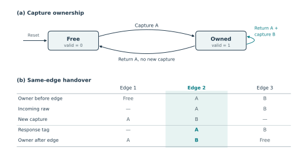

最后应用 post 后计算权重和。顶层形成沿前 arm，公共沿发生且有余差捕获才登记 owner。owner 保存 tag、qid、G、Wp、Wm、epoch；raw 返回时读取沿前的 owner。 [捕获 RTL](../../rtl/v21/adc2_capture.sv) · [顶层门禁](../../rtl/v21/adc_digital_ip_v21.sv) · [延迟返回测试](../../tb/v21/tb_i3_full.sv)


查看可编辑图源（Mermaid）

~~~text
flowchart TD
 A["final post、wsum 有效、准备捕获"] --> B["公共沿登记 owner"]
 B --> C{"raw 到达且原 owner 有效？"}
 C -->|是| D["同笔 raw、tag、权重及 epoch 响应"]
 C -->|无 owner 却收到 raw| E["late_err 锁存"]
 D --> F["若同沿登记新 capture，装入新 owner"]
~~~


查看可编辑图源（Mermaid）

~~~text
stateDiagram-v2
 direction LR
 [*] --> Free
 Free --> Owned: reg_req
 Owned --> Free: 仅 take_raw
 Owned --> Owned: take_raw 与 reg_req
~~~

`hold_done_q` 和 owner 有效位是两条独立状态。hold 可先于 raw，物理片能在满足释放条件时先释放。复位清 owner 和粘滞错误；同沿的新登记不会夺取旧 raw 的身份。

## D5　归一化、查初值与两次 Newton 倒数

**优势。** 以固定时延算法提供定点重构所需的精确舍入倒数。

**效果与验证。** 向量与逐值整数参考比对，超过合同域有独立 err。

输入 G 为 Q30 正数；合同输入域传给倒数核时取 [2³⁴, 2³⁶]。先按最高有效位归一化，用 64 项种子表近似，做两次整数 Newton 迭代，移回原尺度。下游修正器另按同笔 G 计算乘积和余数，并给出就近的 `RND(2⁶⁰/G)`。种子表是固定算术常量。 [近似倒数 RTL](../../rtl/recip_q60.sv) · [精确修正 RTL](../../rtl/v21/recip_rnd_v21.sv) · [整数镜像](../../src/adi_model/recip_q60.py) · [倒数回归](../../tb/v21/tb_recip_rnd.sv)


查看可编辑图源（Mermaid）

~~~text
flowchart LR
 G["归一化 G"] --> S["64 项初值"]
 S --> N["两次 Newton"]
 N --> Q["移回原尺度"]
 Q --> I["近似倒数与同笔 G"]
~~~

流水能交叠多笔。零 G、越域及叶子错误随有效标志传递，不能用后到的 G 修正旧商。 [底层倒数向量](../../tb/tb_recip_q60.sv)

## 从近似倒数得到精确的舍入商

**优势。** 可以用定长近似通路产生候选，再用同笔 G 做确定性修正。

**效果与验证。** 20,813 行合法输入中，近似倒数有 10,104 行比目标小一个倒数整数单位；修正后全部与 2⁶⁰/G 的就近舍入一致。另有 4 行域外输入正确报错。

先检 qG 是否超 2⁶⁰；若超则 q 减一，再检 (q+1)G 是否仍不大于 2⁶⁰。取地板商后用 2r≥G 决定进位；输出寄存器按同笔 valid、g_ok 和 err 更新。 [精确修正](../../rtl/v21/recip_rnd_v21.sv) · [输入近似](../../rtl/recip_q60.sv) · [取整与域错误测试](../../tb/v21/tb_recip_rnd.sv)


查看可编辑图源（Mermaid）

~~~text
flowchart TD
 A["近似商 q 与同笔 G"] --> B["若 qG 过大，下调"]
 B --> C["若商仍偏小，上调"]
 C --> D["余数 r = 2⁶⁰ − qG"]
 D --> E["按 2r 与 G 舍入"]
~~~

## D5　ADC2 码箱中心与 20 位定点重构

**优势。** 把后级原码和同笔校准系数转换成可退休的 20 位码。

**效果与验证。** 21 笔 RTL 事务逐级核对 Z、N、I、X 和 20 位码，结果全部一致。负数后紧接中点码，以及间隔 1 拍、10 拍再输入中点码，均返回正确标签和结果。

**输入。** 13 位 raw、偏置 b、实际 G/Wp/Wm、捕获时的 epoch 和 tag。顶层固定 α=1；单模块支持合同域内的 α。Y 为 Q24，`Y=−3145728+1536·raw+768`。下图各级用 valid/tag 区分独立交易；空拍仅移动有效位。 [重构 RTL](../../rtl/v21/recon_v21.sv) · [整数 oracle](../../tools/recon_oracle.py) · [连续事务逐级对拍](../../tb/v21/tb_recon_stream.sv)


查看可编辑图源（Mermaid）

~~~text
flowchart TD
 A["S1a 码心减 b"] --> B["S1b 求 Z"]
 B --> C["S2a 求 N"]
 B --> I["求倒数 I"]
 C --> J["S2c 同笔对齐"]
 I --> J
 J --> X["S3 求 X，检查有符号截断"]
 X --> E{"S4 有效笔带错？"}
 E -->|否| O["舍入与限幅"]
 E -->|是| Z["零码与错误标签"]
~~~

S3 用本笔 N 和 I 算出 X，检查其高 64 位是否等于第 31 位的符号扩展，并在同一沿保存 X、错误位和 tag。S4 在 v3 有效时退休。连续输入 raw=2046、2048，在定向用例中依次得到 `0x7FFFF` 和 `0x80000`，两笔 err 均为 0。[生产 RTL](../../rtl/v21/recon_v21.sv) · [实测记录](../audit/todo/README.md#recon-s3)

## 有符号除 96、舍入与输出限幅

**优势。** 常除数的结果可用定长乘移、一次余数判断实现。

**效果与验证。** X=−48 与 +48 分别舍入到 −1 和 +1。两个 32 位有符号端点都能正常进入末级饱和，刚越出端点则携带本笔标签报错。

以 32 位幅度乘常数 ceil(2³⁴/3)，移位求除 96 的地板商。余数达到 48 则进一，恢复符号、加 524,288 中点，夹至 20 位合法范围。 [rnd96_const 与输出级](../../rtl/v21/recon_v21.sv) · [整数恒等式](../../tools/prove_rnd96.py) · [重构测试](../../tb/v21/tb_i4_recon.sv)

查看可编辑图源（Mermaid）

~~~text
flowchart LR
 X["保存符号，取幅度"] --> Q["常乘移位求商"]
 Q --> R["由余数进位"]
 R --> S["恢复符号"]
 S --> O["加中点并限幅"]
~~~

