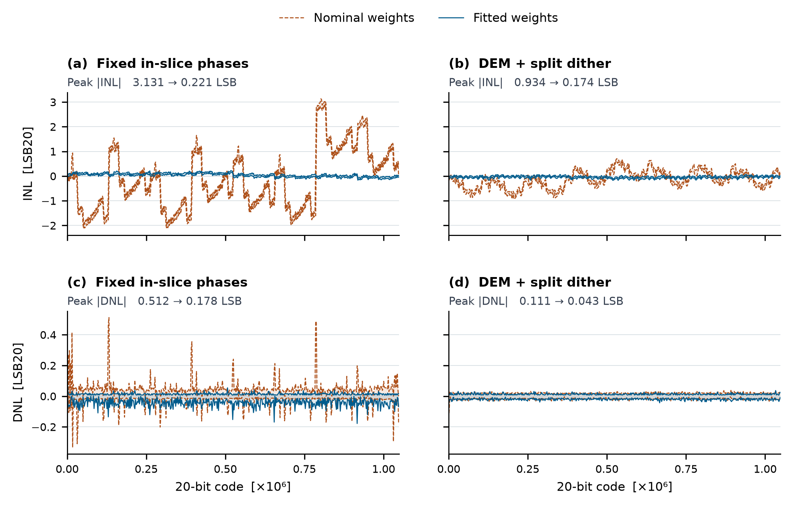
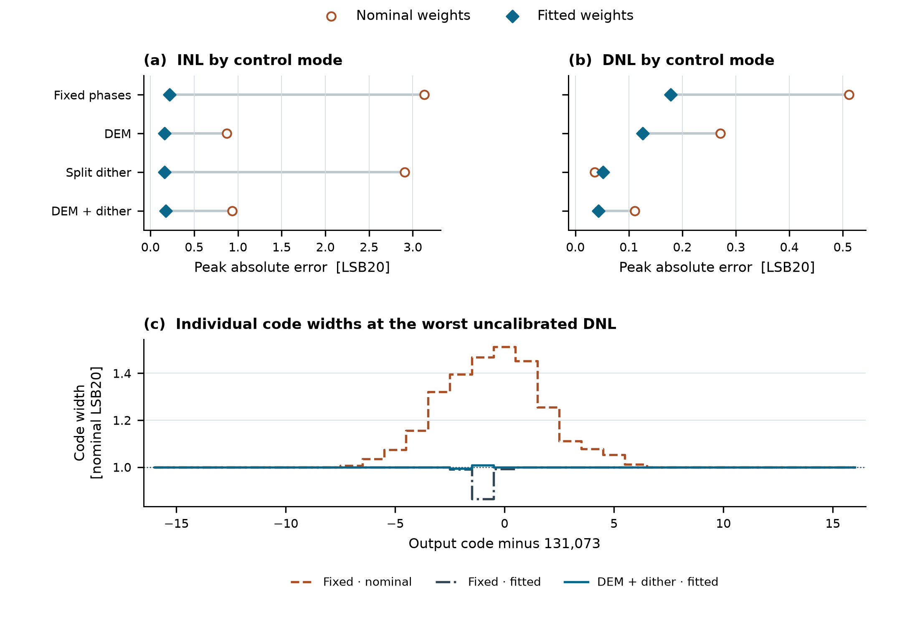

# 20 位 SAR ADC 原文对照、静态线性度与流片就绪性审计

2026-11-18。审查基线为 `merge/adi-repro` 的 `9e4f1fd`，开始时工作树干净。文中的“原件”指实际阅读的论文页图、讲稿和授权专利；“实测”指本次文件、代码或实验检查；“估算”列出假设。11 月 18 日的静态实验运行 Python。11 月 19 日补充的顶层与重构功能对照使用本地 Verilator。VCS、DC、FC 和 Formality 的既有结果按其原运行记录引用。命令编号对应文末复核步骤。旧审查可按其提交直接打开。 [上一次审查原件](https://github.com/defineiocc02/20bit_SAR_ADC_Behaviour_Verification/blob/9e4f1fd5907c67ddf6e35406aec7bc0d1e7bf6b1/docs/audit/TREE_AUDIT_REPORT.md)

## 结论摘要

1. **论文样片已实现。** ISSCC Fig.9.8.7 给出 40 nm 芯片显微照片，Fig.9.8.4–6 给出线性度、频谱和功耗。对本仓库的裁定是**可开展同架构原型，尚不具备整芯片交付流片的证据**。E1、E2、E6、E8。
2. **线性化的目的明确。** 片间选择和片内 DEM 分散固定失配，扰动扩展线性化范围，片上用外部求得的 DAC 系数修正。论文没有披露按 512 个粗码各减一个平均误差的校准表。E2、E3、E4。
3. **完整 20 位静态行为实验已完成。** 同一颗器件、固定阵内相位时，只换成拟合物理权重，峰值绝对 INL/DNL 从 3.131/0.512 降到 0.221/0.178 LSB20。再开启 DEM 与扰动后为 0.174/0.043。E4、E5。
4. **片组选取有原文根据。** 18 片中的 8 片采集、8 片转换、2 片备用，以及 3 位横向和 3 位纵向 DEM 都有直接依据。具体门控、桥电容比、保护码和 13 位 ADC2 窗口属于工程定义。E2、E3、E6。
5. **重构错码已修，持续吞吐仍待解决。** 当前生产重构通过 8,209 笔冻结向量和 21 笔逐标签 Verilator 对拍。普通事件路径在现有 25 ns 时钟下至少需 200 ns/笔，快时钟与理想宏握手下，整核已完成 192 笔 40 MS/s 连续交付。实际宏时序与物理实现待核验。E6、E7。
6. **11 月 19 日本地复核。** 根目录有 9 个目录和 4 个文件；`docs/` 有 9 个目录和 3 份入口说明。源清单与历史记录各自归位，审计首页指向当前 13 位合同和顶层实测。E1、E7、E9 中关于 GitHub 的描述保留原检查时点。[目录与复现命令](../meta/REPOSITORY_LAYOUT.md)

## 全码静态线性度

**DNL 看每个码占多宽，INL 看过渡点累积偏了多远。** 输入从 −3 V 扫到 +3 V，理想 20 位码宽为 5.722 µV。例如固定相位、名义权重下，输出码 131,073 占 **1.512 个名义码宽**。只换成本片拟合的权重后，这同一个码宽为 **0.9916**。再加入 DEM 与扰动为 **0.99997**。用户看到的旧 F03 每个电平只取 8 笔，512 个电平的间距跨过约两千个输出码，难以看见这样的宽码。E4、E5。



**图 1　全码域。** 橙色虚线为名义 DAC 权重，蓝色实线为本片拟合权重。左列固定阵内开关相位，右列启用 DEM、桥交换和分路扰动。两列始终使用相同的 18 片调度样本。同一行共用纵轴；图上每个横向码段保留最小值和最大值，统计使用完整数组。条件为本次 v21 静态电荷模型、器件相对失配参数 0.01%、评估时关闭随机 RA 噪声。 [可编辑 SVG](../figures/static_linearity/linearity-0.0001.svg) · [两档失配的完整数值摘要](../figures/static_linearity/summary.json)

| 同一器件上的控制 | 名义权重 INL 最小 / 最大 | 拟合权重 INL 最小 / 最大 | 名义权重 DNL 最小 / 最大 | 拟合权重 DNL 最小 / 最大 |
| --- | ---: | ---: | ---: | ---: |
| 固定阵内相位，无扰动 | −2.135 / +3.131 | −0.163 / +0.221 | −0.334 / +0.512 | −0.178 / +0.079 |
| 仅阵内 DEM（含桥交换） | −0.839 / +0.872 | −0.160 / +0.158 | −0.128 / +0.271 | −0.126 / +0.079 |
| 仅分路扰动 | −2.027 / +2.909 | −0.162 / +0.151 | −0.021 / +0.036 | −0.051 / +0.034 |
| DEM 与分路扰动 | −0.934 / +0.708 | −0.174 / +0.064 | −0.111 / +0.038 | −0.043 / +0.037 |

**图中的变化有不同来源。** 固定失配在某些粗码交界集中成较宽或较窄的输出码。改变选中的电容和预置，把这些误差分散到不同输入位置；加载按物理片号和支路拟合的权重，又能扣除实际选通量与名义选通量之间的系统误差。第一行到第四行拟合结果的总改善，相对第一行名义基线为 INL 94.4%、DNL 91.5%。只看第四行、只换权重，两项峰值分别从 0.934 降到 0.174、从 0.111 降到 0.043。**各项收益不相加**；第三行只加权重时，DNL 绝对峰值由 0.036 变为 0.051。E4、E5。



**图 2　机制与局部。** 上排的圆圈、菱形共享同一批输入和 ADC2 原码；越靠左，峰值误差越小。下排的窗口按未校准基线的最坏 DNL 码自动选择，随后固定窗口比较全部方法。宽度为 1 的虚线给出理想值。 [可编辑 SVG](../figures/static_linearity/effects-0.0001.svg)

### 为什么旧 LUT 图的改善不明显

LUT 是查找表（look-up table）。例如训练发现“前级判为 200 时，最终估计平均偏高 6 µV”，就把 6 µV 存入第 200 项，遇到这个粗码时从输出减去它。**这是仓库的输出域对照算法。** 对同样的粗码，实际片号、物理开关和剩余的模拟噪声仍可不同。ISSCC 正文只明确 DAC 权重校正在片上、系数在片外求得。六件专利的相应图、实施例和可检索授权文本中，未找到把这张 512 项剩余误差表定为该芯片校准方案的依据。专利中的扰动分路、列控制或可选数字积分器各有自己的用途。E2–E5。

| 对象 | 索引及实际用途 | 本次裁定 |
| --- | --- | --- |
| 旧图标作 Frozen LUT 的表 | Python 用已知斜坡，按 512 个粗码分别求 `mean(估计−已知输入)`，在解码后减去浮点偏差 | F03 的 3.069→2.413 是稀疏电平的拟合残差峰值。开启 DEM 时 1.484→2.154，反而增大。F04 同片无 DEM 的 SNDR 为 94.46→94.63 dB，SFDR 为 114.29→118.97 dB。基线输出由整数码换成伏特，校准曲线还含浮点后处理。F03 循环在各电平重用默认 run_id，F04 的训练/评估也未另选 run_id。 |
| 同一 v21 模型中的逐粗码表对照 | 本次独立训练后重新量化到最终 20 位，在固定相位和关闭扰动时比较 | 峰值绝对 INL **3.131→2.859**，DNL **0.512→0.563**。按粗码减均值可改变相邻粗码段的端点关系。旧图不能直接判定片上物理权重方案优劣。 |
| v21 权重寄存器 | `wsum_v21` 按 18 个物理片号与每片 16 主、4 子支路存 **360 个 40 位字**。根据本笔 pre/post 算 `G/Wm/Wp` | “片外求系数、片上校正”有论文依据。360 字、Q30、接口协议和本次片外拟合器是工程实现。不得把仿真器的器件真值作为测得的校准系数。 |
| 倒数器中的 64 项表 | `recip_q60` 用归一化增益的高位查整数倒数迭代初值 | 数学加速常量，与上述两种校准表用途不同。 |

旧 F11 有更强的对照：五个制造种子、本片训练和独立留出记录，同一接收片应用不同的表。稀疏峰值 INL 中位数从 **56.02** 降到本片表的 **30.51**，换用异片表为 **71.34 LSB20**。旧图确实测到了可重复的片间差异；它没有测每个 20 位码的宽度。E4。

### 激励、系数与结果边界

- **完整性。** 斜坡覆盖全部 1,048,576 个输出码，每个理想码宽 512 个等距输入点，每个工况 **536,870,912 点**。在每个粗码区间内，将 ADC2 的实际箱边界映回输入端，再按半开区间计数，同时积分获得连续均匀输入下的等效宽度。首末饱和码计入总质量。以 `T₁` 和 `T₁₀₄₈₅₇₅` 定端点直线，DNL 报 1,048,574 个内部码，INL 报 1,048,575 个过渡。混合多开关状态时，这里的过渡是累积码密度意义下的过渡。E5。
- **独立性。** 复用 v21 已有开关参考、实际片组调度、器件权重生成和 D5 整数 oracle。SADC 用独立的名义门限和正向扰动合同，RDAC 主单元、片增益、桥与子单元按指定失配制造。失配参数作用于片增益和单元，桥衰减由实际桥与子电容重新计算；0.01% 是敏感度假设。训练输入为已知电压，观测为量化后的 13 位 raw。65,536 笔、1,024 个训练状态，RA 节点加 1 mV RMS 零均值噪声。测试使用另外的种子及 64 个冻结状态。64 个字和 64 个横纵相位对各自平衡，二者独立置换，未穷举全部联合排列。训练系数写成 Q30 后冻结。E5。
- **量化与自检。** 名义理想器件的内部 INL、DNL 均为零。每颗测试器件用 192 笔标量参考核对，再以 1,048,576 个直接前向转换输入，逐码核对一个冻结状态的区间计数，直方图一致。主样例“全开＋拟合”的 512 点/码斜坡实数计数范围为 **490–530**，计数法与连续积分的 DNL/INL 最大偏差为 **0.008/0.018 LSB20**。静态 ADC2 原码范围 2020–6180，无越窗。随后又对固定相位、全开两种工况各逐点解码完整的 536,870,912 笔，独立重做名义/拟合两种直方图。四组各 1,048,576 个码的命中数逐项完全相等。对所有种子与工况的 50 份逐码档案另以累加 DNL 的方式重算 INL，两种算法的最大指标差为 3.4×10⁻¹⁰ LSB20。E5。
- **可辨识性与单调性。** 主种子训练矩阵秩为 **357/360**，可观测子空间条件数约 222。未辨识方向沿用名义先验。“全开＋拟合”混合直方图内部缺码为 0，但逐个冻结状态检查粗码交界，有 **2,389/32,760 次倒退，最大 3 个输出码**；已知真权重控制同项为 0。不能据平均 DNL 推出每一笔都单调，也不能宣称已唯一辨识全部 360 个系数。E5。
- **噪声与两轨。** 同一留出条件另计算了 1 mV RMS 高斯 RA 节点噪声下的期望码密度。全开拟合、斜坡严格止于 ±3 V 时，峰值绝对 INL/DNL 为 **1.993/0.427 LSB20**。最小宽度出现在码 1，靠近两轨可得到的输入质量是不对称的。另列两轨各剔除 64 码、重新定端点的诊断，结果为 **0.154/0.016**。公开数据同时保留这两种口径。器件动态建立、采样时差、时钟串扰、真实底板寄生和驱动噪声需要相应模型或测量。E5。
- **与硅片对表。** ISSCC Fig.9.8.4 的纵轴为 LSB（20-bit），论文正文以 ppm 报典型 INL +2.2/−1.8、DNL ±0.27；讲稿第 32 页把相近数值标为 LSB，注明最少约 250 次命中/码。1 ppm FS = 1.048576 LSB20。本实验采用均匀斜坡和端点直线；原件未给齐拟合、激励和片组条件。新图证明选定静态机制的效果，不能用其较小的理想化误差宣称超过硅片。 [原始图 9.8.4](../../references/ISSCC2024_PAPER.pdf#page=2) · [讲稿第 32 页](../../references/ISSCC2024_SLIDES.pdf#page=32)

| 制造种子、失配与状态数 | 固定相位和名义权重的峰值 INL / DNL | 全开、拟合权重的峰值 INL / DNL |
| --- | ---: | ---: |
| 20261105，0.01%，64 | 3.131 / 0.512 | 0.174 / 0.043 |
| 20261106，0.01%，64 | 4.374 / 0.585 | 0.193 / 0.047 |
| 20261107，0.01%，64 | 4.332 / 0.459 | 0.137 / 0.038 |
| 20261105，0.01%，更换评估种子并加至 128 状态 | 3.373 / 0.515 | 0.093 / 0.033 |
| 20261105，压力试验 0.1%，64 | 33.214 / 0.615 | 0.231 / 0.046 |

三颗器件上的组合改善方向一致，具体峰值受状态采样影响。第二颗器件只比较“全开”行内的名义/拟合，DNL 峰值是 **0.034→0.047**，不能保证每颗器件每个单项都改善。三颗模拟器件也不足以估计工艺良率。 [复核种子结果](../figures/static_linearity/sensitivity.json) · [可复现实验](../../tools/run_static_linearity.py)


## 原文、原图和实现逐项对照

下表把作者画出的信号或器件对应到工程入口。论文实测、专利实施例、工程选择分别标为 A、P、E。图号中的 Fig.19 须同时注明专利号，两件专利各自的 Fig.19 画的是不同的电路。E2–E6。

| 原件定位 | 原图与正文给出的信息 | 工作树中的对应与差距 |
| --- | --- | --- |
| **A　ISSCC Fig.9.8.1、Fig.9.8.7，讲稿 9–12、40** | 输入分别送入两个独立的前级量化器和 RDAC；18 片中 8 采、8 转、2 备用，多路选择后共用 ×32 RA 和 ADC2。图下两条相位带交替；芯片照片能定位量化器、RDAC、RA、ADC2 及参考缓冲。 | `sched18`、`acq_conv_ctx` 实现片组交接，顶层接收已决结果。默认行为模型从名义 RDAC 码本构造 SADC 阈值；它能做名义对齐，尚不能证明两套独立实体量化器和 RDAC 在失配下的匹配。 [架构原图](../../references/ISSCC2024_PAPER.pdf#page=2) · [芯片照片](../../references/ISSCC2024_PAPER.pdf#page=3) |
| **A　Fig.9.8.2，讲稿 19–22** | 共置顶板采样开关共享 TP clock 的关键下降沿，EN 控制返回采集，hold-low 器件负责保持。正文给出残余片间时差约 0.6 ps 的估计。 | `sample_event`、片组 ID 和 ready/valid 能记录哪一笔已采。时钟驱动器、栅极保持、电平转换、共置走线和实际孔径偏差仍要在模拟集成层验证。 [采样开关与相位](../../references/ISSCC2024_PAPER.pdf#page=2) |
| **A　Fig.9.8.3 上半，讲稿 23–27、33–35** | SAR 转换时从粗预充通路供电荷，RA 相位切到精确 REF_IN；正文说明 RA 开始时参考约到 15 位，约用 RA 相位的 65% 达到 20 位建立。讲稿展示 GₘR＋OTA、C_DAC/32 反馈、S1 自零、S2/S3 与 R_BW 切换 ADC2 的宽/窄带跟踪。 | 文档定义 `ref_fine/ra_az/ra_phase`；集成顶层未导出该组命令。F07 的指定极点和采样时刻是行为假设。Fig.9.8.3 测的是 **REF_IN 引脚电流**，Fig.9.8.5 是**差分信号输入电流**；F09 的 `C·abs(ΔV)·fs` 是第三种量。 [参考与 DEM 原图](../../references/ISSCC2024_PAPER.pdf#page=2) · [RA 原图](../../references/ISSCC2024_SLIDES.pdf#page=35) |
| **A　Fig.9.8.3 下半，讲稿 17–18、29–31** | 片选、3 位横向 RR 打乱、3 位纵向分段，以及二进制到一元桥接均有图。第 31 页在名义权重边界标 `P=50%`；正文给打乱逻辑约 1 ns 预算，披露扰动范围增强 2 位。 | v21 的 `dem_mask_v3` 给出 8 宏列、每片 16 主半单元＋4 子支路。h、v、coin、half 为外部相位控制，采样扰动字默认在片内产生。选择哪半单元、哪个物理槽、精确 β、guard 命令及随机源是 E。默认 Python Fig.11 映射用 17 主位／5 子位，15 个 2C 位置只按横向相位轮转。 [三维选择与桥接原图](../../references/ISSCC2024_SLIDES.pdf#page=31) |
| **A　Fig.9.8.4–6，讲稿 32、36–42** | 正文 94.2 dB DR、9.3 nV/√Hz；图 9.8.5 的 1.05 MHz 案例标 SNR 92 dB、THD −107 dB。讲稿第 37 页为 94.6 dB、8.8 nV/√Hz，第 38 页同标 1.05 MHz 的 SNR 为 93.5 dB。第 40 页区分 0.77 mm² 核心与含参考缓冲的 0.9 mm²；正文给 die 2.25 mm²。 | 保留各原件、条件和单位。不能把高 SNR 的讲稿频谱、论文 DR、模型 SNDR 拼成同一测量。论文 Fig.9.8.6 脚注将接口排除在系统功耗外，讲稿第 41 页的系统清单列 LVDS；即使两处都给 69 mW，迁移预算也要重新定义接口边界。 [实测图表](../../references/ISSCC2024_PAPER.pdf#page=2) · [讲稿功耗表](../../references/ISSCC2024_SLIDES.pdf#page=41) |
| **P　US10516408B2 Fig.12、16、17、19** | Fig.12 展开量化器到各 DAC 的数据控制；Fig.16 有双快量化器、两组 8×DAC 和 2×备用，Fig.17 展开采集、试探、RA、自零；Fig.19 画差分余差输出。 | 支持独立量化器和跟随结构。普通路径的七次数字提交、保护分支和本仓库握手来自工程合同。 [专利文本与原图](https://patents.google.com/patent/US10516408B2/en) |
| **P　US10505561B2 Fig.19、20，PDF 第 22–23 页** | Fig.19 的 300 接 D5/D3/D2/D1，222 接完整字，224 接 D6/D4。正文七片示例的小数单位为 1/7，上段 `0/1/4/5` 从粗码中减去；Fig.20 省去 224，在后级用 241 去扰。须结合正文和差分极性读求和节点。 | 为隔离两种坐标，固定 `c=200, U=4`：选定的 Python 专利静态算例发 196，v21 采用正向预置与 `c+U` 发 204。六位字拆分是实施例，八片的 1/8、前向电荷与重构的符号须在同一端到端约定内配套。 [专利与说明书](https://patents.google.com/patent/US10505561B2/en) · [图 19](../mechanisms/figures/US10505561B2_FIG19_dither_injection.jpg) |
| **P　US10511316B2 Fig.19–21，PDF 第 19–21 页** | 图 19 有 15×2C、B4/S4、两级 shuffler；图 20 的 352 留一个零输入，353 用 MUX 分配保留列，350 向该列给出跨片选择；图 21 示意 370 所指的移动列。 | 支持横纵打乱和保留列原理。专利的 15 列例、论文的 3b 横向分段和 v21 的 8 宏列几何要逐项注明，不能互作同一套物理位宽的证据。 [专利正文](https://patents.google.com/patent/US10511316B2/en) · [MUX 原图](../mechanisms/figures/US10511316B2_FIG20_reserved_column_mux.jpg) |
| **P　US10707889B1 Fig.5、8** | 多通道可在 ACQ/CONV 以外进入空闲或跟踪相位，控制器可用先前的转换信息辅助下一次采集。ISSCC 续页参考文献 [12] 印成 **10,797,889**；按标题和作者核对，对应授权文献为 **10,707,889**。 | 论文的备用片确有依据；采用历史加权预测、介质吸收补偿等选项仍需单独证明。核对文献时同时给出标题和正确公开号。 [论文参考文献原图](../../references/ISSCC2024_PAPER.pdf#page=3) · [交织专利](https://patents.google.com/patent/US10707889B1/en) |
| **P　US10541702B1 Fig.1–2、10；US10826519B1 Fig.5、8–10** | 前者使 VIN_AUX 绕过输入 RC，为开关寄生或预充供电荷。后者的差分检测、INV 和输出管调节内部参考，阈值可随试探更新。 | 两者分别影响输入负载与参考瞬态。仓库有组件级模型；芯片是否照搬这些电路、器件尺寸和环路带宽，当前材料未定。 [辅助输入专利](https://patents.google.com/patent/US10541702B1/en) · [低功耗参考专利](https://patents.google.com/patent/US10826519B1/en) |

其余两篇作为独立比较。VLSI 2025 C32-1 Fig.5–6 在偶数周期采 AZ 噪声、次周期反号，通过配对降低残差，原样片为 6 MS/s、88.8 dB SNDR。本仓库有单独的 CAAZ 实验；若给 40 MS/s 原始流作互不重叠的两笔配对，输出只有 20 M 对/秒。CICC 2026 13-6 Fig.1–3 的 180 nm 样片使用连续时间后级、8 次 LSB 重复、SINC² 及反冲抵消，5 MS/s、3.6 mW、在最高 100 kHz 的给定条件下约 100 dB SNDR。本次 v21 评估采用单次 13 位 raw 接口，未借用任一外部方案的性能数。 [VLSI 原图](../../references/PKU_VLSI2025_C32_1_PAPER.pdf#page=2) · [CICC 原图](../../references/CICC2026_13_6_PAPER.pdf#page=2)

<a id="dither-word-audit"></a>
## 扰动字从哪里来，最后怎样扣回

**当前生产顶层逐笔产生六位扰动字，同时驱动所选 SADC 的低段开关和八片 RDAC 的完整预置。** 后续重构按同笔实际权重扣回一次。以下为 2026-11-19 本地 Verilator 端口实测和标明条件的整数计算。

### 发生器、输入字和开关译码

ISSCC 论文第 182 页披露两端的扰动范围可以不同，并报告从量化器转到 RDAC 时扩展两位。讲稿第 17 页画出了扰动发生器、蓝色低段通向 SADC，蓝、红两线通向 RDAC 采样端，也画到 SAR 与 DEM 之间的求和节点。方框图没有定义 各数字端口的代数符号。授权专利 US10505561B2 的图 3 举出伪随机发生器，图 19 的发生器 400 输出已知数字字。该图正文用六位字、七片 DAC 举例，低段取 D5、D3、D2、D1，上段取 D6、D4。上述原件不能确定样片所用的反馈多项式、种子和逐笔字序列。[论文原文](../../references/ISSCC2024_PAPER.pdf) · [作者讲稿，第 17 页](../../references/ISSCC2024_SLIDES.pdf) · [授权专利图 3、5、19](https://patents.google.com/patent/US10505561B2/en)

| 来源 | 查到的行为 |
| --- | --- |
| 当前生产 RTL | `dither_force_i=0` 时片内生字，`prepare_word/U` 可固定为零。每个受理沿写入一组 SADC 寄存器，并在 RDAC 描述符中保存同一字的预置。片选与扰动各用独立随机状态。[顶层接线](../../rtl/v21/adc_digital_ip_v21.sv) · [采样描述符](../../rtl/v21/acq_conv_ctx.sv) |
| 工程约定 | 独立 xorshift32（13、17、5），复位种子 `0xC001D00D`，选取下一状态的低六位。只在 `prepare_valid && prepare_ready` 的上升沿推进，强制字也消耗一笔。该序列是本工程可重放的实现。[B8](../v21/SWITCHING_RULES.md) |
| 软件参考与测试 | Python 的 `DitherWordGenerator` 使用同一递推。生产顶层前八字为 45、7、17、40、26、24、2、32。1,024 次按真实引脚闭环的受理覆盖全部 64 个字。强制遍历 0…63 和切换强制/自动另有定向测试。[参考实现](../../src/adi_model/control/dither_word.py) · [端口检查](../../tb/v21/sample_cadence.cpp) |

生产忽略外部测试字和 U。显式强制时，字 53 要求 U=4；外报 5 的有效请求实测 ready=0、err_o=1。上一次接受 qid0 后，再次要求 qid0 也被拒收。两种拒收和停收均不消耗随机状态或发出 SADC 写门，修正后重试仍使用原本应得的字。[受理门控](../../rtl/v21/adc_digital_ip_v21.sv)

### 一个六位字分成哪几部分

以下数值以一级粗码的一个 LSB 为单位，当前工程用八片并行分配小数权重。字从高到低为 D6…D1。

| 用途 | D6 | D5 | D4 | D3 | D2 | D1 |
| --- | ---: | ---: | ---: | ---: | ---: | ---: |
| SADC 采样引脚给出的低段 L | 0 | 2 | 0 | 1/2 | 1/4 | 1/8 |
| 加到已决粗码的上段 U | 4 | 0 | 1 | 0 | 0 | 0 |
| RDAC 采样预置总量 T | 4 | 2 | 1 | 1/2 | 1/4 | 1/8 |

整数形式为 `f=word&7`，`U=4D6+D4`，`L=2D5+f/8`，`T=U+L=word/8`。低段有 16 个不同取值，全字有 64 个。总预置的峰值为 7.875，低段峰值为 2.875，两种取值数不能替代同一电压口径下的峰峰值比较。八片先各置为 `J=U+2D5`，从纵向相位 v 开始循环选 f 片各加一档。每片用 4、2、1、1 的子支路编码，档位 8 对应四支路全选。[实际译码](../../rtl/dither_pre.sv)

例如 `110101` 是十进制 53，U=4、L=2.625、T=6.625。v=3 时，实际八槽的档位依次为 6、6、6、7、7、7、7、7，对应三个十六进制 C 和五个 E。八槽平均为 53/8。SADC 端同时给该 qid 写入 0x2A。低七位对应 SADC0，高七位对应 SADC1，另一个 bank 保持。实际 RDAC 片号和预置随采样描述符冻结。[采样写门与寄存](../../rtl/v21/acq_conv_ctx.sv) · [扰动预置的全域测试](../../tb/tb_dem_dither.sv)

### 为什么扣一次恰好还原

设 c 为前级已经受到低段扰动后的粗码。当前 SAR 控制器给 RDAC 的命令是 `k=c+U`。Wm 为八个实际片按最终转换开关 post 求出的权重和，Wp 为同八片按采样时开关 pre 求出的子支路权重和。两者均通过物理片号查已装载的 Q30 系数。G 为八片的全部主权重和。捕获时锁存 G、Wm、Wp 和 tag，ADC2 返回原码时取回该笔的数据。[转换命令](../../rtl/v21/sar_evt_v21.sv) · [权重查表和求和](../../rtl/v21/wsum_v21.sv) · [捕获与返回](../../rtl/v21/adc2_capture.sv)

工程正向坐标下，理想残差为 `y=α(Gx+3G−6Wm+6Wp)+b`。反解输入要加回 Wm 的贡献、扣去 Wp 的贡献。生产 RTL 将 ADC2 原码转换成 Q24 码箱中心，处理偏置和增益后得到 Z（顶层固定 α=1）。重构分子按整数计算：

```text
N = 64·Z + 6·Wm − 3·G − 6·Wp
```

64 把 Z 的 Q24 尺度对齐到权重的 Q30。随后按本笔 G 归一、舍入到 20 位。名义系数下 Wm=k/16、Wp=T/16，因此 `16(Wm−Wp)=(c+U)−(U+L)=c−L`。上段 U 已经同时进入转换命令和采样预置，两项相抵。寄存器里真正扣的是一次按物理开关加权的 Wp。芯片存在单元失配时仍应查实际系数。[生产重构](../../rtl/v21/recon_v21.sv) · [独立整数参考](../../tools/recon_oracle.py)

### 固定输入与故意错扣的结果

固定理想输入 −0.6522216796875 V，对应 20 位码 410304。测试端读所选 SADC bank 的七根引脚以确定粗码，使用真实 RDAC 采样与转换开关计算理想余差和 ADC2 原码。表中数字出码来自生产顶层 Verilator 运行。

| 扰动字 | U | L | T | 已决粗码 c | RDAC 命令 k | ADC2 原码 | 20 位输出 |
| --- | ---: | ---: | ---: | ---: | ---: | ---: | ---: |
| 000000 | 0 | 0 | 0 | 200 | 200 | 3456 | 410304 |
| 100000 | 4 | 0 | 4 | 200 | 204 | 3456 | 410304 |
| 010101 | 0 | 2.625 | 2.625 | 202 | 202 | 6016 | 410304 |
| 110101 | 4 | 2.625 | 6.625 | 202 | 206 | 6016 | 410304 |

名义 G=32 时，一个粗码 LSB 等于 2,048 个最终码，一个 ADC2 原码步折合 0.5 个最终码。从第一行到最后一行，转换命令贡献增加 `6×2048=12288` 码，细码贡献增加 `(6016−3456)×0.5=1280` 码。采样预置恰扣 `6.625×2048=13568` 码，三项之和为零。

独立的 D5 回归读取冻结的片号、pre、post、原码和系数，在同一生产重构模块的 Wp 输入口单独做负对照。7 组共 1,344 笔均逐笔核对了标签、延迟、出码和标志。下表对应同一笔字 53、k=206、raw=6016，Wm 和 G 均固定。

| 在重构输入传给 Wp 的值 | 实际 20 位码 | 相对正确码 |
| --- | ---: | ---: |
| 完整实际预置权重 | 410304 | 0 |
| 0，相当于漏扣 | 423872 | +13568 |
| 两倍实际预置权重 | 396736 | −13568 |
| 只传名义低段权重 | 418496 | +8192 |
| 只传名义上段权重 | 415680 | +5376 |

另给物理片 0 的子单元 18 一个已知权重偏差（Q30 整数增加 2²⁰），沿用顶层测得的同批原码和开关，并固定正确的 Wm。用名义预置总量代替实际 Wp 时，192 笔中 50 笔多算 32 码；改回实际 Wp 后，192 笔均为 410304。所有错扣对照都在重构模块的端口改变输入，生产 RTL 保持同一份。

同一处偏差还在**整个数字顶层**做了两次运行。两次运行的标签、相位、受测单元的采样和转换开关、13 位原码逐笔相同。改变写入顶层的权重表会同时改变 Wm 和 Wp。名义表的 192 笔中有 10 笔少 32 码、14 笔多 32 码、168 笔正确。写入已知系数后 192 笔全为 410304。上段的 50 笔统计只改变 Wp；这里的 24 笔统计取决于同一单元的 post 和 pre 是否相异。[同批输入与两次出码的交叉检查](../../tools/run_open_rtl.py) · [物理开关与余差激励](../../tb/v21/sample_cadence.cpp)

**解析核查。** 在名义权重、α=1、b=0、正确前级判决、无越窗条件下，令 `u=(x+3)/Δ`，Δ=6/512 V。则 `c=floor(u+L)`，名义残差为 `(6/16)(u−c+L)`，理想细码为 `raw=2048+floor(4096(u+L−c))`。因为 4096L 为整数，量化后的 `k−T+(raw−2048+1/2)/4096` 恰等于 `(floor(4096u)+1/2)/4096`，与字无关。另对 `u=m/2048`、m 取全部 1,048,576 个输出码，每个输入遍历 64 个字。67,108,864 个整数方程组合中，相对零扰动的分子变化、错码和越窗均为 0。这一数量属于整数复核。

**与专利的边界。** 图 19 的正文明确写的是 7 片分摊、对粗码减上段。剩余低段按比例从后级数字结果中去除。工程采用 8 片分摊、`c+U`、正向采样预置和 `−Wp` 成套配合。同样的 c 和 U，两者发出的命令方向不同。字 1 的分数步在专利七片示例为 1/7，在本工程为 1/8，单换一个符号不能让两个实施例的每个数值相等。若只把工程加号改为减号且保留其余极性，以字 53 这笔为例，命令会从 206 变成 198，名义残差从 0.36328125 V 升到 3.36328125 V，超过本工程 ADC2 窗口。工程的 SADC 引脚与正向位序现已定义并逐位核对。实际模拟宏的差分参考轨和注入电压仍需集成实测。固定输入时刻意断开低段，32/64 个字使理想余差越窗，三轮共有 96/192 笔回传范围标志。[授权专利图 19 及其正文](https://patents.google.com/patent/US10505561B2/en) · [工程正向采样约定](../v21/SWITCHING_RULES.md)

从仓库根可复算下方名义例子，并运行生产顶层闭环。输出的 `samples.csv` 保留每笔的实际两端注入、Flash、原码、最终码和范围标志。测得的数字电平与理想宏计算不替代模拟宏的电荷与极性验收。

~~~bash
dither_run="$(mktemp -d)"
bash tools/pyenv.sh --run tools/run_open_rtl.py --simulator verilator --tops v21_sample_cadence --out "$dither_run/results"
rg -n 'dither_next|dither_force_i|sadc_pre_wr_o|prepare_error' rtl/v21/adc_digital_ip_v21.sv
rg -n 'U_o =|f_o =|assign J|val =|pre_o\[' rtl/dither_pre.sv
rg -n 'f_Wp|cur_sub\[s\]|Wm1b_q|Wp1b_q' rtl/v21/{wsum_v21,recon_v21}.sv
python3 -B - <<'PY'
from tools.recon_oracle import Q30, oracle
for w in (0, 32, 21, 53):
    U = 4 * ((w >> 5) & 1) + ((w >> 3) & 1)
    low8 = 16 * ((w >> 4) & 1) + (w & 7)
    c = (200 * 32 + 11 + 4 * low8) // 32
    k = c + U
    raw = 2048 + 128 * (200 * 32 + 11 - 32 * c + 4 * low8)
    print(w, c, k, raw, [oracle(raw, 0, Q30, 32*Q30, k*(Q30//16), n*w*(Q30//128))['code']
                         for n in (1, 0, 2)])
PY
~~~

## 按论文架构评估可流片方案

**候选通路**为一个共享 3 位 Flash、两套独立前级量化器、动态交接的 18 片 RDAC、粗/精参考选择、共享 ×32 差分 RA 与 ADC2，以及携带实际开关记录的数字重构。采集 A 时转换上一笔 B；B 的已决位推进 RDAC，转换结束转精参考并建立余差；共同的安静孔径捕获 A 的输入和 B 的放大残差。后级返回 raw 时要配对 B 的权重、预置与身份。名义前级增益和这一相序有原图依据；以下绝对电容的映射、时钟实现和误差分配是本次工程估算。E2、E6、E8。

| 设计问题 | 一阶复算和工程判断 | 下一份有裁定力的证据 |
| --- | --- | --- |
| **事件吞吐** | 40 MS/s 对应 25 ns/样本。普通转换从 Flash 提交到第六个 SAR 结果至少跨 6 个间隔。启动沿与提交互斥，每笔合计至少占 8 拍。当前时钟约束为 25 ns，仅事件级持续上限为 **5 MS/s**。 | 原端口已保留并新增 SADC 扰动控制。宏的逐位时序待定，同版生产顶层已通过理想宏条件的 192 笔连续测试，仍需用真实宏时限和同版 STA 验收。[顶层实测](../STATUS.md#持续采样率) |
| **采样电容与驱动** | 讲稿给 RDAC 20.5 pF。**仅若**它与合同 512Cu 是相同的有效电容口径，Cu≈40.04 fF，Cf=16Cu≈0.641 pF，桥 Cb=8Cu/7≈45.76 fF。满幅阶跃降至半个 20 位 LSB 需 ln(2²¹)=14.56 个时间常数。若有完整 25 ns、单极点，τ≤1.72 ns、BW≥92.7 MHz，对 20.5 pF 折算 R≤83.8 Ω。讲稿的片内 DAC 带宽 15×Nyquist（约 300 MHz）约束的是另一个对象。 | 在目标 PDK 确认单端/差分、活动片和寄生口径，分别提取外部驱动/RC 与片内开关网络。按最坏输入阶跃、码型和失配检查建立、信号相关 Ron、泄漏及注入。 |
| **噪声预算** | 单边白噪声 9.3 nV/√Hz 积至 20 MHz 得 **41.59 µV RMS**；以满幅正弦 2.121 V RMS 折算为 **94.15 dB DR**。300 K、20.5 pF 单支路 √(kT/C)=14.21 µV；若每个独立差分支路各为此电容，差分为 20.10 µV。按模型 RA 输出 1 mV RMS、增益 32，加上 ADC2 输入折算量化噪声 0.826 µV RMS，独立方和为 37.17 µV，其余预算约 **18.67 µV RMS**。 | 折回同一输入端，分列采样、RA/AZ、ADC2、参考与驱动的积分噪声及相关项。在测量中分开空载 DR、满幅 SNR、SNDR；用 DR/NSD 同量级拟合一个失配 σ 无法唯一识别工艺电容失配。 |
| **残差与后级窗口** | 6 Vpp/512 得前级 Δ=11.71875 mV。v21 名义 floor 残差放大 32 倍为 [0,0.375) V。选定 ADC2 窗口 [−0.1875,+0.5625) V，两端对额外输入折算误差各有 **5.859 mV** 名义余量；实际需留严格余量。13 位步长 91.55 µV，折回输入为 2.861 µV = **0.5 LSB20**；理想箱中心误差上限为 0.25 LSB20。 | 使用同一组物理片、三处扰动符号及真实 pre/post，扫满幅和 guard，加入 SADC 独立失配、实际 G/α/b。记录每个超窗样本。F03 的 62.3% 属另一种静态扰动绑定，不能据此决定增加后级位数。 |
| **参考与 RA** | 正文举例 1.8 mA 经 0.1 Ω 可产生 180 µV，量级约 31.5 LSB20，说明在试探期隔离粗参考的必要性。举例取 25−7≈18 ns 为可分配 RA 时段，65%≈11.7 ns。从约 15 位再收敛 5 位即误差再降 32 倍，若单极点则 τ≤3.38 ns。这里没有扣除非交叠、开关注入或大信号恢复。 | 按 Fig.9.8.3、讲稿 35 建立粗缓冲、精参考 MUX、共模、AZ 与 ADC2 宽/窄带联调波形。逐时刻查 REF_IN 电流、RA 摆幅和捕获误差。 |
| **时差、线性度与功耗** | 仅以正弦随机孔径抖动限制 SNR=93.7 dB，1/5/20 MHz 的 RMS 上限是 **3.29/0.657/0.164 ps**。若只分配总噪声功率的 10% 给随机时钟，在 5 MHz 约 0.197 ps。论文的约 0.6 ps 是片间残余失配估计，须另算经片选扩展的杂散。50/69 mW 在 40 MS/s 对应每次转换 1.25/1.725 nJ。 | 共置顶板开关和时钟树须做时差/寄生提取，关注 1.1 V 采样器、3.3 V 前级与电平转换在所有相位的应力。量产静态测试应明确 DNL/INL 口径、码密度、温度和跨片样本；以每码 250 笔作均匀计数的量级估算，单次最少约 2.62 亿次转换。 |

**投片判定。** 继续做行为架构和数字模块原型有明确依据。申请整芯片流片前，还需完成所选工艺的合法器件/参考摆幅确认，给出可独立测权的激励与读出方法，给出高速事件与采样的时序证据，取得模拟宏同版原理图/PEX、整核网表等价、多角 STA、PG、foundry DRC/LVS 与 IR/EM。当前 Git 树只有已归档的单模块网表等原件；公开材料不足以给本设计签署 40 MS/s、逐状态单调或面积/功耗达标。 [工程合同](../CONTRACT_CURRENT.md) · [后端原件说明](artifacts/README.md) · [状态与待办](../STATUS.md)


## 问题清单

严重度按对流片决策、原文复现或读者实际操作的影响排序。下列证据命令均只读，E5 的行为复跑把结果写到新目录。

| 问题 | 严重度 | 证据命令 | 建议 |
| --- | --- | --- | --- |
| 25 ns 的单时钟事件路径不能承接论文的约 7 ns 前级转换。“单时钟 40 MS/s 符合”的审计结论过强。合同列出采样使能、粗精参考和 RA/AZ 相位，生产顶层未提供完整同名接口或已验证的适配宏。 | 高，吞吐与模拟集成 | E2、E6。`rg -n 'exp_evt_q|posedge clk' rtl/v21/sar_evt_v21.sv` | 现阶段保留既有端口。[需仓主决策] 宏时序确定后冻结逐位握手与非交叠条件，再验证连续转换。 |
| 重构曾将上一笔的负号记为本笔溢出，导致合法中点出零。工作树已让同一笔的 X、错误和标签一起寄存。本地 Verilator 确认两笔分别输出 `0x7FFFF`、`0x80000`。 | 高，已修并完成模块回归 | E7。[逐笔对照与复现](todo/README.md#recon-s3) | 保留有符号事务、空拍和截断边界回归。 |
| 默认 Python 与集成 RTL 共用 13 位窗口，但 SADC 码域、RDAC 几何、bridge、扰动方向和数字舍入口径不同。CLI 仍报告 `INFERRED_STATIC_DEFAULT_V1`，且 `base_decoder` 写旧的除余映射。 | 高，模型归属 | E4、E6。`rg -n 'main=k//Nsub|main_code = coarse >> 4|mask_binding=fig11_masks|INFERRED_STATIC_DEFAULT_V1' src/adi_model/defaults.py` | 根入口用一个同字例子列出两条命令与适用输出。修正导出的码本元数据。跨模型比较须说明两端的电荷、极性、guard 和舍入转换。 |
| 将粗码修正表称为论文“片外求系数”步骤的实现，容易让人误以为 F04 已验证片上 360 权重。以 DR、NSD 反解唯一电容失配也缺乏辨识依据。 | 高，性能归因 | E2、E4、E5。`rg -n 'coefficients derived externally|fit_code_correction' tools/run_p4_ablation.py` | 图例写清“逐粗码输出修正”。物理权重另列训练、秩、独立留出及整数出码。对物理 σ 保留假设或 PDK 统计身份。 |
| 混合码密度改善与逐状态单调是两项验收。训练秩小于 360，若干条件传递跨粗码时仍倒退。 | 高，校准可实现性 | E5。发布摘要中的 `training.rank`、`coarse_boundary_checks`、`missing_interior` | [需仓主决策] 确定量产训练时可访问的 raw、物理 ID、pre/post、独立精密输入和测试开关。设计额外激励或对未辨识方向给出有物理依据的约束，并复查最坏状态。 |
| 旧算法审计把 8/8/2 写作未披露，又将 13 位输入折算步长写成 0.60 LSB20。状态表、合同、实码和原文均给出不同结论。 | 高，来源判定 | E2、E6、E8。`rg -n '8/8/2|0\.60|14 bit' docs/audit/AUDIT_ALGO_VS_SOURCE.md` | 给快照结论加醒目勘误并连到对应原图。保留正文与讲稿的单位、频率、带宽、功耗边界。 |
| GitHub 默认入口是 `main@bc9a16a`，展示旧 README 和旧整链。当前详细 README 的 9/4 只针对 `merge/adi-repro`。 | 中，首访读者 | E1。`gh api repos/defineiocc02/20bit_SAR_ADC_Behaviour_Verification --jq .default_branch` | [需仓主决策] 决定正式发布分支或默认页指向，防止新用户从旧首页复现。 |
| 可点击文档路径通过 C3，正文中的代码路径仍会失效。例如后端环境页给出缺失的 `docs/v21/I5_PORTS.md` 及 79 端口；现行有 90 个。根目录树称 Makefile 有向量生成入口，实际只含帮助、v21、D3/D4 与调度统计。 | 中，复现操作 | E6、E9。`make -f flow/Makefile help` | 用可执行目标或稳定文件链接代替旧路径。事件启动由 commit 驱动，晚到 Flash 数据与 valid 已按 qid 接入首提交。 |
| 部分叶子/后端包装脚本不满足工作目录规则。D3/D4 默认使用 `.`，远端运行时相对目录取决于 SSH 登陆位置；Formality 包装器会以调用方给定的目录作递归清理，且用文件清单文本含 `.svf` 判断存在。 | 高，运行目录与证据 | E9。`rg -n 'WORKDIR=|WORK=|mkdir -p|rm -rf|缺 SVF' tools/{verify_d3d4,check_formal}.sh` | 使用现有 v21 包装器的专用目录方式、独占创建，明确检查网表与 SVF 的文件身份和退出码。审计未执行这些脚本。 |

## 工作树、版本与阅读路径

**文件与顶层。** 审计基线跟踪 **869 个文件**，其中 Markdown 277 份、各目录的 `README.md` 28 份。生产清单有 11 份 SV，构成一个集成顶层、8 个直接实例类型、2 个传递依赖。直接实例为 `sched18`、`acq_conv_ctx`、`sar_evt_v21`、`dither_pre`、`dem_mask_v3`、`adc2_capture`、`wsum_v21`、`recon_v21`。最后一项经 `recip_rnd_v21` 调用 `recip_q60`。全树 RTL 清单为 29 份 SV，另 18 份中一份为 ADC2 仿真宏，余下 17 份是部件源码。综合、FC、Formality 的 v21 Tcl 与生产清单列出的源集合相符。E1、E6。

**同名与归档。** 对全部跟踪 `.sv/.svh/.v/.vh/.py/.md` 的文件名折叠大小写后，重复组只有下表七组。按模块声明检查还会发现单元网表的同名设计。E1、E6、E9。

| 重名组 | 来源与使用情况 |
| --- | --- |
| `README.md` ×28，`__init__.py` ×16 | 前者由各目录或索引导航，后者限定不同 Python 包。它们的路径和读者对象不同。 |
| `STATUS.md` ×2，`architecture.md` / `ARCHITECTURE.md` | 根 README 走 `docs/STATUS.md`，Python 指南走 `docs/guide/ARCHITECTURE.md`，另一份均在 `docs/_history/archive/`。 |
| `conftest.py` ×2 | `flow/tests` 与 `subsys/extensions/caaz/tests` 有各自的 pytest 夹具作用域。 |
| `fixed_point.py` ×2 | `src/adi_model/contracts` 提供模型格式；`flow/verification/reference` 提供独立整数参考。 |
| `scheduler.py` ×2 | `control.scheduler` 服务控制部件，`simulation.scheduler` 服务流水装配，各有独立导入路径。 |
| 同一个 HDL `module sched18` | `rtl/sched18.sv` 是生产源，`docs/audit/artifacts/sched18_final.v` 是历史单模块网表。生产清单只取前者。 |

追查之前三个归档区，`rtl/_legacy/` 和 `tools/_legacy/` 在 Git 树中已无文件。`docs/_history/` 仍有 **134 个跟踪文件**。在 `tb/tools/src/flow/formal` 对应的现行路径和 CI 中，未发现直接运行该归档树源码的入口；维护脚本中用于排除归档的字符串按过滤规则解释。旧 12 位 Fig.19 独立整链已移出。`source_control_component` 仍被包装格式测试引用，其清单明确是 **2+1 单元、6 位**的合成夹具。它不能登记为另一个受支持的 ADC。E1、E9。

### 孤儿模块与死链

后端环境页把端口表写作代码路径，现树只保留带 superseded 后缀的历史原件，见 E9。

**物理证据。** 归档的七个 Formality 通过模块中，四个仍是 v21 直接实例；其余 `dem_phase_rr/follower_rt/dem_phase_gen` 已退役，在历史 Git 中保留。就这七个有记录的模块，未发现“RTL 仍在当前树、通过记录仍在、却无当前顶层使用”的对象。2,189 是七行历史通过点之和，其中 **295** 属于三个已退役模块。库内有 `sched18_final.v`、对应 SVF 与 DC 汇总，未跟踪整核心同版 GDS/DEF/SPEF、整芯片 LVS 或 foundry DRC 结果。E6、E7。

**六份导航的交叉核对。** 基线中六份文件最后一次修改均为 `b878f58`。`v21` 是集成实现标识，`v2 + v2.1` 是合同正文及补充，`9.0.0` 是 Python 发行元数据；CLI 的结果身份和图集的运行 SHA 又有不同含义。E1、E4、E9。

| 读者要找什么 | 实际路径和结论 |
| --- | --- |
| 从零读懂一次转换 | `README.md` 的样本交接、预置、判决、重构顺序清楚，根 9 目录/4 文件可直接复数。首页的例子 `200+4=204` 对应 v21，紧邻的 Python 演示需显式说明其扰动坐标。 |
| 当前规格与当前覆盖 | `docs/CONTRACT_CURRENT.md` 给出 ADC2 半开窗口及正向合同，`docs/STATUS.md` 记录重构实测与吞吐上限。`docs/INDEX.md` 能直接到合同、图或仿真入口。三者对位宽一致。 |
| 当前连接与后端结果 | `rtl/README.md` 所列 8 个直接模块与源码一致。`docs/audit/README.md` 提醒历史范围，但链接标题仍把读者带到前述错判。环境页的过期端口路径是代码字体，链接门禁不会拦。 |
| 从图回溯到输入 | 旧图册实测有 16 对图，32 个资产哈希、7 个登记源文件哈希均与当前工作树匹配。清单的 Git **base** 为 `2224d30`，在该提交直接取这七个源文件时只有两项匹配。出图还导入未列入这七项的 `dem_dither.py/sched18_rtl.py/recon_oracle.py`。复现应绑定实际输入与依赖，不能只 checkout base。 |
| 从 GitHub 首页找当前工程 | 实取默认分支 `main` 的根有 10 个目录、18 个文件，首页仍介绍旧 Fig.19 闭环。PR #9 指向 `main`，核查时为 open、未合并。分支发布属于仓主决策。 |

**相近功能的脚本。** `dem_dither.py` 的 `post_mask/bridge_swap` 和 `tools/contract_v2.py` 的 `base_post/apply_bridge` 分别服务共享叶子参考与独立合同枚举。`algo_chain.py` 的浮点输出包含半码偏移及 Python `round`；`recon_oracle.py` 按 v21 定点规则舍入。本实验复用了前者的器件制造和电荷函数，最终出码逐笔对后者核查，避免把同名“20 位”误当成同一码箱。E4–E6。

**版本控制卫生。** 基线未跟踪 `*.log/*.vcd/*.fsdb/*.pyc` 或 `__pycache__` 下的文件，探针日志、波形和缓存命中忽略规则。按十进制 1 MB 门槛，共 7 个大文件，包括 5 份选定资料 PDF、1 份历史报告 PDF 和 1 份历史 HTML。对已跟踪文本按 E9 的规则查到 42 个带本机用户目录或绝对主目录前缀的文件；该数是文件数，含示例、报告和工具默认值。此处不重复其中的账号。E1、E9。

## 核查过且没有发现问题的项

核查通过的有六份论文/讲稿 PDF 共 158 页的文件身份、六件本机授权专利的哈希与登记页数、v21 唯一集成源闭包、公开 13 位量化合同与 Q24 常数，以及新实验的全输入质量守恒和整数参考对照。审计基线 GitHub CI 10/10 成功，工程自检 7/7。来源登记实跑 `static_refs_pass=true`，同时 `source_conformance=SOURCE_CONFORMANCE_NOT_ASSESSED`；在本机 30 项必需状态中 13 项登记 PASS，17 项 BLOCKED，命令返回 2。CI 显式接受这种尚有开放项的来源状态。E1、E2、E5–E7。

## 不确定项与仓主决策

仍待确认的有 ADI 实际 ADC2 的精确位数/窗口、器件逐项电容、最终开关极性、片外校准激励与辨识算法、适用 PDK 及 PVT/失配统计；论文没有给出这些完整输入。本实验演示一个可执行的片外估计过程。片上重构已完成本地定向回归。动态噪声与串扰、逐状态单调及量产良率仍需分别验收。[需仓主决策] 原型采用何种工艺与可观测测试端口，以及哪一分支向读者承诺当前实现。 [论文原件](../../references/ISSCC2024_PAPER.pdf) · [工程状态](../STATUS.md) · [流片流程证据](ALL_13_MODULES_FINAL.md)


## 复核命令

在仓库根运行。Git 计数固定在本次审查基线；新图使用本次交付的工作树和摘要中的源文件哈希。下列命令只生成临时文件或读取原件，E5 另行给出完整 Python 行为实验的复跑方式。

### E1　Git 基线、根目录与重复名

~~~bash
git status --short --branch
git merge-base --is-ancestor ebc9a8c 9e4f1fd && git rev-list --count ebc9a8c..9e4f1fd
git ls-tree 9e4f1fd --format='%(objecttype) %(path)'
git ls-tree bc9a16a --format='%(objecttype)' | sort | uniq -c
gh api repos/defineiocc02/20bit_SAR_ADC_Behaviour_Verification --jq .default_branch
gh api repos/defineiocc02/20bit_SAR_ADC_Behaviour_Verification/pulls/9 --jq '[.head.ref,.base.ref,.state,.merged]'
gh api repos/defineiocc02/20bit_SAR_ADC_Behaviour_Verification/git/ref/heads/merge/adi-repro --jq .object.sha
git show bc9a16a:README.md | head -14
python3 - <<'PY'
from collections import defaultdict
from pathlib import Path
import subprocess
files = [Path(x.decode()) for x in subprocess.check_output(
    ["git","ls-tree","-rz","--name-only","9e4f1fd"]).split(b"\0") if x]
groups = defaultdict(list)
for p in files:
    if p.suffix.lower() in (".v",".sv",".vh",".svh",".py",".md"):
        groups[p.name.casefold()].append(str(p))
print("files, Markdown:", len(files), sum(p.suffix.lower()==".md" for p in files))
for name, paths in sorted(groups.items()):
    if len(paths)>1: print(name, len(paths), *paths)
PY
~~~

### E2　核对论文页图与文件身份

读页码使用 PDF 的一基页号。论文 PDF 第 1/2/3 页分别为正文、Fig.9.8.1–6、芯片照片与补充文献。文本检查需带 `pypdf` 的 Python，图像命令用 Poppler。

~~~bash
python3 - <<'PY'
import hashlib,json
from pathlib import Path
from pypdf import PdfReader
docs=json.loads(Path("references/source_manifest.json").read_text())["documents"]
for d in docs:
    f=Path(d["target_relative_path"]); pdf=PdfReader(f)
    assert (len(pdf.pages),f.stat().st_size,hashlib.sha256(f.read_bytes()).hexdigest()) == (d["pages"],d["bytes"],d["sha256"])
    print(d["source_id"],len(pdf.pages))
p=PdfReader("references/ISSCC2024_PAPER.pdf")
for page in (0,2):
    text=p.pages[page].extract_text()
    for line in text.splitlines():
        if any(s in line for s in ("sDACs acquiring","spare sDACs","weight correction","derived externally","10,797,889")):
            print(page+1,line)
PY
figdir="$(mktemp -d)"
pdftoppm -f 2 -l 2 -r 150 -png -singlefile references/ISSCC2024_PAPER.pdf "$figdir/fig9-8"
pdftoppm -f 3 -l 3 -r 135 -png -singlefile references/ISSCC2024_PAPER.pdf "$figdir/die-and-references"
for n in 12 18 20 27 31 32 35 37 38 40 41; do
  pdftoppm -f "$n" -l "$n" -r 100 -png -singlefile references/ISSCC2024_SLIDES.pdf "$figdir/slides-$n"
done
printf '%s\n' "$figdir"
~~~

### E3　六件授权专利

下例使用源清单登记的本地材料目录，可用 `ADC_SOURCES_DIR` 指定。若读者只拿到公开 Git 树，可从上文六个授权公开号链接查看原图和说明书。检索术语覆盖 `lookup table`、`look-up table`、`look up table` 和 `LUT`；本结论的范围是具体按粗码校正的机制，单一关键词缺失不足以确定一颗芯片的内部实现。

~~~bash
python3 - <<'PY'
import json,hashlib,os
from pathlib import Path
from pypdf import PdfReader
src=json.loads(Path("flow/verification/manifests/sources_manifest.json").read_text())
base=Path(os.environ.get("ADC_SOURCES_DIR",src["meta"]["location_rule"]["default_dir"])).expanduser()
for entry in src["sources"]:
    if entry["id"] not in ("09","10","11","12","13","14"): continue
    path=base/entry["file"]
    assert hashlib.sha256(path.read_bytes()).hexdigest()==entry["sha256"]
    assert len(PdfReader(path).pages)==entry["pages"]
    print(entry["id"],entry["file"],entry["pages"])
PY
rg -n '七片|七个|224|352|保留列|VIN_AUX|Threshold_adjust' docs/mechanisms
~~~

重点翻页为 [09] PDF 16、17、19 页，[10] 22–23 页，[11] 19–21 页，[12] 5–7 页，[13] 3、9 页，[14] 6、8–9 页。原件为图像时，按图号手读。说明书正文还可在授权文本的 Fig.19 实施例中核对七片分数和上段减码的叙述。 [分路扰动授权文本](https://patents.google.com/patent/US10505561B2/en) · [DEM 授权文本](https://patents.google.com/patent/US10511316B2/en)

### E4　区分图里的三类表和历史效果

~~~bash
rg -n 'def _train_calibration|DEFAULT_TRAINING_POINTS|calibration.apply|run_id: int' tools/run_p4_ablation.py
rg -n 'def fit_code_correction|error = estimated - known|table = total / counts|values - self.table_v' src/adi_model/calibration/mask_calibration.py
rg -n 'wt_main\\[|wt_sub\\[|f_Wm|f_Wp' rtl/v21/wsum_v21.sv
rg -n 'def (base_post|apply_bridge|post_mask|bridge_swap|rounded)|round\(\(xh' tools/{contract_v2,algo_chain,recon_oracle}.py src/adi_model/dem_dither.py
rg -n 'function.*f_lut|case \(i\)' rtl/recip_q60.sv
rg -n 'main_code = coarse >> 4|base_decoder|main=k//Nsub|mask_binding=fig11_masks|INFERRED_STATIC_DEFAULT_V1' src/adi_model/defaults.py
rg -n 'k = c - self.upper_code|rdac_codes =|k_wide =' src/adi_model/control/dither.py src/adi_model/simulation/pipeline_engine.py rtl/v21/sar_evt_v21.sv
jq '.figures[] | select(.figure|startswith("F03")) | .configs[] | [.label,.fit_residual_peak_lsb20,.flag_counts.adc2_over,.sample_count,.sigma_e_lsb20,.output_domain]' docs/figures/behavioral/figures.json
jq '.figures[] | select(.figure|startswith("F04")) | .configs[] | [.sndr_db,.sfdr_db,.output_domain]' docs/figures/behavioral/figures.json
jq '.figures[] | select(.figure|startswith("F11")) | [.medians,.per_seed,.validation_run_id]' docs/figures/behavioral/figures.json
rg -n 'NSD_V_rtHz=|NSD_V_rtHz.*r_n|small_metrics|dr_db =' src/adi_model/metrics/metrics.py flow/tests/verification/test_paper_metrics_end_to_end.py
~~~

以 F03 已存数据为例，未校工况每电平的条件标准差均值约 6.77 LSB20。即使暂按八笔独立计算，均值标准误的量级也有 6.77/√8≈2.39 LSB20，已经与图上几 LSB 的变化相近。这是对旧图分辨能力的量级说明，不是对相关采样的置信区间估计。

### E5　完整行为实验与数据自检

~~~bash
sar_runs="$(mktemp -d)"
bash tools/pyenv.sh --run tools/run_static_linearity.py --out "$sar_runs/primary"
for sar_seed in 20261106 20261107; do
  bash tools/pyenv.sh --run tools/run_static_linearity.py --sigma 0.0001 --seed "$sar_seed" --out "$sar_runs/chip-$sar_seed"
done
bash tools/pyenv.sh --run tools/run_static_linearity.py --sigma 0.0001 --states 128 --evaluation-seed 317012 --out "$sar_runs/states-128"
printf '%s\n' "$sar_runs"
~~~

直接复读已发布的结果，无须重跑。

~~~bash
jq '.cases[0] | {training,ideal,figures:[.modes | to_entries[] | [.key,.value.decoders.nominal.exact,.value.decoders.fitted.exact]]}' docs/figures/static_linearity/summary.json
jq '.cases[0].modes.both.decoders.fitted | {exact,counted,count_total,min_count_interior,max_count_interior,coarse_boundary_checks,ra_noise_expected,ra_noise_excluding_64_rail_codes}' docs/figures/static_linearity/summary.json
jq '.replicates[] | [.chip_seed,.states,.evaluation_seed,.modes.both.fitted]' docs/figures/static_linearity/sensitivity.json
jq '.direct_replay,.independent_checks' docs/figures/static_linearity/sensitivity.json
~~~

上述复跑的输出中，每个 `sigma-*/模式-解码器.npz` 含逐码数组。按序重算其中一组即可检查图的来源。

~~~bash
bash tools/pyenv.sh --run - "$sar_runs/primary" <<'PY'
from pathlib import Path
import numpy as np, sys
root=Path(sys.argv[1])
with np.load(root/"sigma-0.0001"/"both-fitted.npz") as f:
    width=f["input_width_lsb20_by_code"]; hits=f["ramp_hits_by_code"]
    assert len(width)==len(hits)==2**20 and hits.sum()==512*2**20
    interior=width[1:-1]; step=interior.mean()
    dnl=interior/step-1
    inl=np.r_[0.,np.cumsum(interior)]/step-np.arange(len(interior)+1)
    print(dnl.min(),dnl.max(),inl.min(),inl.max(),int((interior==0).sum()))
PY
~~~

<details>
<summary>逐笔生成全部斜坡输入，独立复核两种开关状态的四张直方图</summary>

这段代码不使用原码区间积分，直接生成每个输入点。命令需先完成上面的主运行；验证收据也随完整数据目录交付。

~~~bash
bash tools/pyenv.sh --run - . "$sar_runs/primary" "$sar_runs/direct-replay.json" <<'PYTHON'
"""Validate two published ramp conditions by decoding every individual input sample."""
import json
import sys
from pathlib import Path
import numpy as np
root, data, destination = map(Path, sys.argv[1:])
sys.path.insert(0, str(root.resolve() / "tools"))
import run_static_linearity as sim

document = json.loads((data / "summary.json").read_text())
n = document["states"]
per = document["hits_per_ideal_code"] // n
sigma = document["cases"][0]["relative_mismatch_sigma"]
chip = np.asarray(sim.make_w(sigma, document["seed"])) / sim.CF
folder = data / f"sigma-{sigma:g}"
with np.load(folder / "coefficients.npz") as f:
    weights = {t: f[t+"_q30"] for t in ("nominal","fitted")}
receipt = {}
for mode in ("fixed","both"):
    hist = {t: np.zeros(sim.CODES, np.int64) for t in weights}
    for si, setup in enumerate(sim.states(n,document["evaluation_seed"])):
        setup = setup.select(mode)
        masks, pre, upper, lower = sim.wiring(setup)
        gain, wm, wp = sim.sums(chip,setup.ids,masks,pre)
        digital = {t: sim.sums(table,setup.ids,masks,pre) for t,table in weights.items()}
        for start in range(0,sim.CODES*per,262144):
            u = (np.arange(start,min(start+262144,sim.CODES*per))+(si+.5)/n) / per
            coarse = np.floor(u/2048+lower).astype(np.int64)
            command = coarse + upper
            raw = np.floor((gain*sim.LSB20*u - 6*(wm[command]-wp) - sim.YMIN)/sim.Q2).astype(np.int64)
            assert raw.min()>=0 and raw.max()<sim.N2
            for t,(g,m,p) in digital.items():
                out = sim.decode(raw,g,m[command],p)
                first = int(out.min())
                counts = np.bincount(out-first)
                hist[t][first:first+len(counts)] += counts
    receipt[mode] = {}
    for t,h in hist.items():
        with np.load(folder / f"{mode}-{t}.npz") as f:
            diff = h - f["ramp_hits_by_code"]
        receipt[mode][t]={"total":int(h.sum()), "compared_bins":len(h),
                          "different_bins":int(np.count_nonzero(diff)), "max_hit_difference":int(np.max(np.abs(diff)))}
        print(mode,t,receipt[mode][t],flush=True)
destination.write_text(json.dumps(receipt, indent=2)+"\n")
assert all(r["different_bins"]==0 for m in receipt.values() for r in m.values())
PYTHON
~~~

</details>

### E6　顶层、时间与版本

~~~bash
bash tools/verify_v21.sh --check-sources
rg -n 'set PERIOD|create_clock' flow/synth/v21/{dc_synth_v21,fc_rtl_to_gds,sta_budget}.tcl
rg -n 'exp_evt_q|start_i|posedge clk|k_wide|last_evt =' rtl/v21/sar_evt_v21.sv
rg -n 'prepare_(word|h|v|half|coin)|ev_(start|flash)|ref_fine|ra_phase|alpha_q30|w_cfg_reload' rtl/v21/adc_digital_ip_v21.sv
rg -n 'ref_fine|tp_enable|7ns|高速|clock' docs/v21/PHYSICAL_INTERFACE.md
python3 - <<'PY'
import re
from pathlib import Path
top=Path("rtl/v21/adc_digital_ip_v21.sv").read_text()
s=re.sub(r"//[^\n]*|/\*[\s\S]*?\*/","",top)
ports=re.findall(r"\b(input|output)\s+logic\s+(?:signed\s+)?(?:\[(\d+):0\]\s+)?(\w+)",s.split(");",1)[0])
print("inputs, outputs, bits:",*[sum(p[0]==k for p in ports) for k in ("input","output")],sum(1+int(p[1] or 0) for p in ports))
print("instances:",re.findall(r"\b(\w+)\s+(u_\w+)\s*\(",s))
listed=set(Path("rtl/rtl_sources.f").read_text().splitlines())
assert listed=={str(p) for p in Path("rtl").rglob("*.sv")}
prod={p for p in Path("flow/build/filelists/files_adc_v21.f").read_text().splitlines() if p.startswith("rtl/")}
for name in ("dc_synth_v21","fc_rtl_to_gds","fm_equiv"):
    text=(Path("flow/synth/v21")/(name+".tcl")).read_text()
    assert prod==set(re.findall(r"rtl/(?:v21/)?[a-z0-9_]+\.sv\b",text))
print("all SV, production:",len(listed),len(prod))
PY
~~~

### E7　重构实测、门禁与已有物理证据

~~~bash
recon_run="$(mktemp -d)"
bash tools/pyenv.sh --run tools/run_open_rtl.py --simulator verilator --tops tb_i4_recon tb_recon_stream --out "$recon_run/results"
cat "$recon_run/results/tb_recon_stream/compare.log"
rg -n 'x3_d|x3_overflow|err3_q <= err2_q' rtl/v21/recon_v21.sv
python3 -B tools/check_engineering.py
sar_gate="$(mktemp -d)"
bash tools/pyenv.sh --run -m adi_model.inventory_gate --repo-root . --summary "$sar_gate/index.json"
jq '{static_refs_pass,static_inputs_complete,required_states_ready,source_conformance,states:(.records|group_by([.scope,.level])|map([.[0].scope,.[0].level,length]))}' "$sar_gate/index.json"
gh run view 44091206552 --json headSha,status,conclusion,jobs --jq '{headSha,status,conclusion,jobs:(.jobs|length)}'
rg -n '2,189|router DRC|foundry DRC|PG 布线|LVS' docs/audit/ALL_13_MODULES_FINAL.md
git ls-tree -r --name-only 9e4f1fd | rg -i '\.(gds|gdsii|oas|spef|def|cdl|scs|spice|lib|db|svf)$|sched18_final\.v$'
~~~

### E8　独立复算一阶预算

~~~bash
python3 - <<'PY'
from math import sqrt,log,log10,pi
fs=40e6; vpp=6.; cap=20.5e-12; gain=32.; k=1.380649e-23
full_rms=vpp/(2*sqrt(2)); lsb=vpp/2**20; delta=vpp/512
total=9.3e-9*sqrt(fs/2); kt=sqrt(k*300/cap); q2=.75/8192
used=sqrt(2*kt**2+(.001/gain)**2+(q2/gain/sqrt(12))**2)
tau=1/(fs*log(2**21)); cu=cap/512
print("LSB20 uV; coarse mV; ADC2 input LSB20; headroom mV:",lsb*1e6,delta*1e3,q2/gain/lsb,1000*.1875/gain)
print("noise: total / single kT/C / RSS / remaining uVrms:",*[1e6*n for n in (total,kt,used,sqrt(total**2-used**2))])
print("DR dB:",20*log10(full_rms/total))
print("Cu, Cf, Cbridge fF:",*[1e15*x for x in (cu,16*cu,8*cu/7)])
print("track tau ns, BW MHz, R ohm:",tau*1e9,1/(2*pi*tau)/1e6,tau/cap)
print("RA tau ns:",18*.65/log(32))
print("jitter-only ps at 1,5,20 MHz:",*[1e12/(2*pi*f*10**(93.7/20)) for f in (1e6,5e6,20e6)])
print("energy per conversion nJ:",*[p/fs*1e9 for p in (.050,.069)])
PY
~~~

### E9　读者能否从说明走到正确文件

~~~bash
for sar_doc in README.md docs/STATUS.md docs/INDEX.md docs/audit/README.md rtl/README.md docs/CONTRACT_CURRENT.md; do
  git log -1 --format='%h' 9e4f1fd -- "$sar_doc" | tr '\n' ' '; echo "$sar_doc"
done
make -f flow/Makefile help
rg -n 'I5_PORTS|79 端口' docs/v21/I5_ENVIRONMENT.md
git ls-files '*I5_PORTS*'
rg -n '8/8/2|0\.60|14 bit|单时钟' docs/audit/{AUDIT_ALGO_VS_SOURCE,PORT_AND_ONCHIP_AUDIT}.md
rg -n 'WORKDIR=|WORK=|rm -rf|缺 SVF' tools/{verify_d3d4,check_formal}.sh
git ls-tree -r --name-only 9e4f1fd -- rtl/_legacy tools/_legacy docs/_history | cut -d/ -f1,2 | sort | uniq -c
rg -n '(_legacy/|docs/_history|"_history")' tb tools src flow .github -g '*.py' -g '*.sh' -g '*.sv' -g '*.tcl' -g '*.f' -g '*.yml'
rg -n 'source_control_component|from .*scheduler import|from .*fixed_point import' flow src tools --glob '*.py' | head -36
git ls-files '*.log' '*.vcd' '*.fsdb' '*.pyc' '*/__pycache__/*'
git check-ignore -v -- adc-test.log scratch/run.vcd scratch/__pycache__/a.pyc
git ls-tree -r -l 9e4f1fd | awk '$4+0>1000000 {print $4,$5}'
git grep -IlE '/(Users|home)/[[:alnum:]_.-]+/|/root/' 9e4f1fd -- | wc -l
python3 - <<'PY'
from pathlib import Path
import hashlib,json,subprocess
root=Path("docs/figures/behavioral")
d=json.loads((root/"figures.json").read_text())
sha=lambda b:hashlib.sha256(b).hexdigest()
assets=d["figure_files_sha256"]; sources=d["source_files_sha256"]; base=d["git_base_sha"]
print("matching assets, current sources, base sources:",
      sum(sha((root/n).read_bytes())==v for n,v in assets.items()),
      sum(sha(Path(n).read_bytes())==v for n,v in sources.items()),
      sum(sha(subprocess.check_output(["git","show",base+":"+n]))==v for n,v in sources.items()))
PY
~~~
