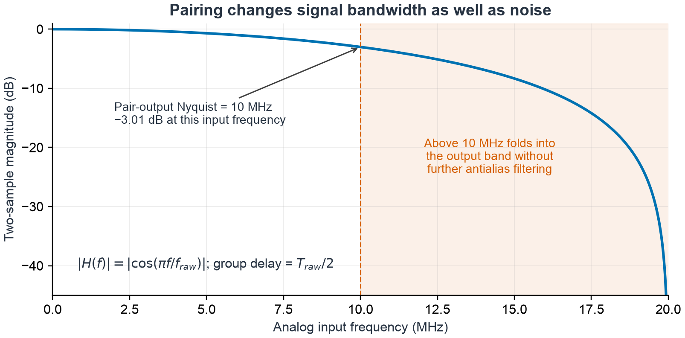
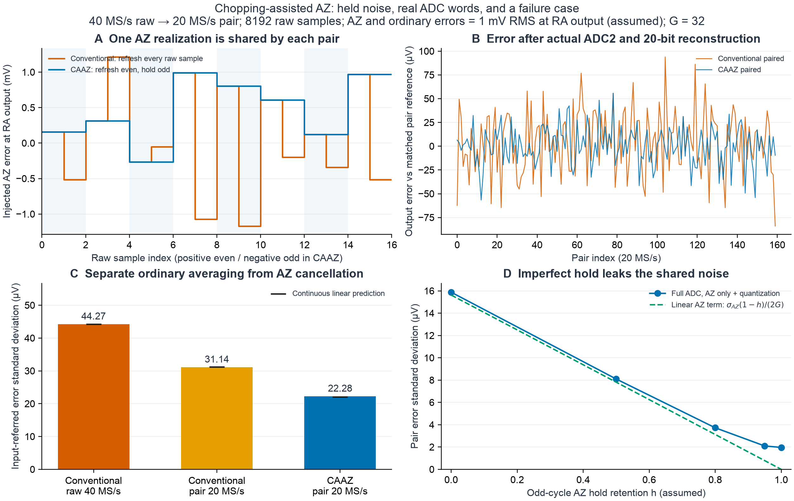
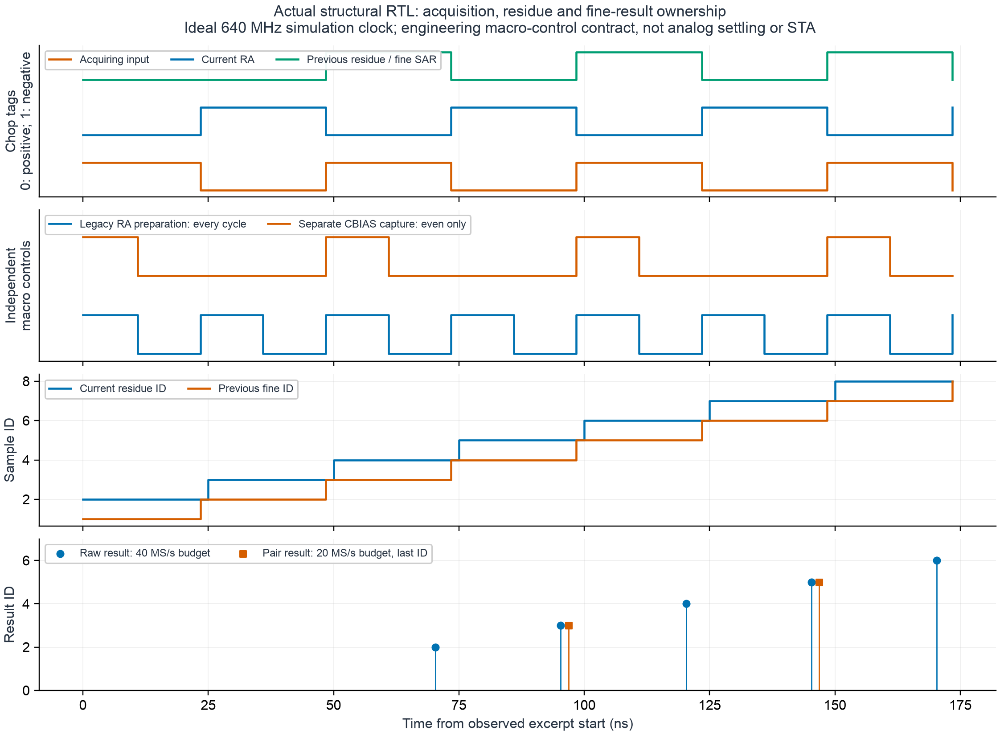

# 系统级斩波辅助自归零：原文机制与本工程接入合同

> **af8／9bdf历史专题。** 本页原正文、数据、图和命令按原字节保留；其中“当前”“本轮”和通过数量仅描述原记录，不表示新主线实现。旧SID／bridge、sampling／range／固定4倍扰动及旧748位接口已退出当前运行，正文命令须在对应完整Git历史下解释。现行来源与未实现项见[A表](../archive/current_digital_source_map.md)，实际状态与证据见[B表](../archive/digital_status_matrix.md)，接口见[ABI2合同](../rtl/CURRENT_INTERFACE_AND_ARITHMETIC.md)。[原专题固定快照](https://github.com/defineiocc02/20bit_SAR_ADC_Behaviour_Verification/blob/9bdf7708f42733896d7ead89935be41b4258fb6f/docs/caaz/README.md)保留旧链接语境；此横幅不改变旧结论或数值。

CAAZ（chopping-assisted auto-zero）在偶数次原始转换时更新自归零，奇数次保持同一个自归零噪声样本并反转输入，最后对两笔已校准结果做“偶减奇、除以二”。本工程采用 **40 MS/s 原始转换、20 MS/s 成对输出**作为候选合同。该速率是工程选择；原型的“6 MS/s”没有在现有资料中明确拆成内部原始转换率和成对有效输出率。

该机制登记为 `X02 / OPTIONAL_SOURCE_EXTENSION`；本合同要求扩展默认关闭。本文给出来源、模拟状态和数字接口。来源已逐页核读；候选模型、RTL、模拟电路及目标工艺时序应分别验收，具体实现结果由各自证据记录补充。

## 来源与阅读定位

论文是 Wang 等的 [*An 88.8dB-SNDR 6-MS/s Pipelined SAR ADC with A Closed-Loop Dynamic Amplifier Featuring Highly-Linear Full-Scale Output Swing*](https://doi.org/10.23919/VLSITechnologyandCir65189.2025.11075015)，2025 Symposium on VLSI Technology and Circuits，C32-1。作者为 Zongnan Wang、Haoyang Luo、Rongjia Bao、Lu Jie、Xiyuan Tang；Lu Jie 来自清华大学，其余作者来自北京大学。

| 逻辑来源 ID | 唯一原件 | 主要定位 |
|---|---|---|
| `PKU_VLSI2025_C32_1_PAPER` | 3 页会议论文 | p.1 正文；p.2 Figs.2–6；p.3 测量、比较与参考文献 |
| `PKU_VLSI2025_C32_1_SLIDES` | 42 页讲稿 | PDF pp.28–35，对应页脚 Slide 27–34；PDF pp.37–41 为测量与比较 |

完整哈希、规范文件名和逐页记录由[来源清单](../../sources_manifest.json)与[CAAZ来源覆盖记录](../reviews/20261105-caaz-source-coverage.json)管理。`C32_C32-1.pdf` 与规范讲稿是同 SHA 的别名，不是另一篇论文。讲稿 PDF 页码比其页脚 Slide 编号大一；下文标明两者以免错页。本次维护者选定的原件另见[资料目录](../../references/README.md)，保留其原版权与内嵌声明；本专题的结果图仍由本工程独立生成。

## 电路中保存的是什么

原型是 180 nm、6 bit 前级 SAR、12 bit 后级 SAR及 **32 倍闭环 RA**。RA 内部第一放大级是浮动跨导比放大器 FGA，第二级是电荷泵辅助共源共栅 FIA（CP-FIA）。FGA 的跨导比增益约为 8，与整个 RA 的闭环增益 32 不同。

论文 Fig.2 给出 $C_{R1}=10\,\mathrm{pF}$、$C_{R2}=2\,\mathrm{pF}$、$C_{BIAS}=4C_B=2\,\mathrm{pF}$。模拟／数字供电为 1.8／1.2 V，输出共模为 0.9 V。这些是原型参数，不能直接当成本工程的噪声、速度或 PDK 参数。

CP-FIA 在复位相给两个储能电容充电，放大相串联它们，使供电域起始约为 2.7 V／−0.9 V并围绕 0.9 V 共模浮动。储能逐渐释放，放大器带宽随之衰减。超轨复位开关还需要动态 gate／bulk 连接来抑制沟道和结漏电。上述电路、THD 与相位裕量是独立的模拟实现内容；仅增加数字 `caaz_mode` 不会形成这些器件行为。

CAAZ 的系统原理可以用于其他 RA，但模拟宏必须提供一个**可在两次转换之间保持、且不被奇数次复位改写的 AZ 状态**。原型复用 $C_{BIAS}$ 做 FGA 输出端 AZ，其右端在采样／AZ相接偏置 $V_B$。按论文 Fig.6 的记号，偶数相存下

$$
V_{AZ}[k]=A_1\bigl(V_{OS}(t_{AZ})+e_k\bigr),
$$

其中 $e_k$ 是这一次 AZ 引入的热噪声，折算到 FGA 输入端。奇数相没有再次抽取独立 $e_{k+1}$，而是继续使用同一个 $e_k$。普通每样本自归零与 CAAZ 的区别就在这个相关状态，不能把任意 `ra_az` 脉冲解释为 CAAZ。

## 采样、AZ、SAR 与残差的顺序

论文 Fig.5 和讲稿 PDF pp.28–32（Slide 27–31）给出以下功能顺序；它们没有给出可直接照搬的数字 tick 宽度。

| 原始周期与阶段 | 模拟／数字动作 | 必须保留的关系 |
|---|---|---|
| 偶数 $2k$：Sample + AZ | 前级采样；FGA 输出 AZ；$C_{BIAS}$ 右端接 $V_B$ | 在采样窗口前设好输入极性，完成本对的 AZ 状态采样 |
| 偶数：前级转换 | 6 bit 异步 SAR；RA 为 IDLE | 前级码、物理开关状态和本次采样 ID 对齐 |
| 偶数：RA | FGA 与 CP-FIA 放大；ADC2获取残差 | 使用 $e_k$；反馈、参考与 ADC2 必须在截止前建立 |
| 奇数 $2k+1$：Sample／前级转换 | 输入极性反转；跳过 AZ；后级转换前笔残差 | 保持同一 AZ 样本 ID；不能被当前全局奇偶位覆盖在途上下文 |
| 奇数：RA与后级完成 | 再放大并量化；完整重构后组成一对 | 待偶、奇两笔对应结果都有效，才产生一个成对结果 |

原图的 `Stage-2 RA` 表示后级对放大残差的获取阶段，不是第二个额外残差放大器。原图同时显示前后级流水重叠，因此 `pair_valid` 不能直接绑在“奇数前级开始”或“奇数 RA 开始”。

差分输入 chopper 位于 ADC 前端，前级量化器、采样 DAC 和残差形成必须看到一致的换向输入。只对 RA residue 或 ADC2 raw 单独取负，会让粗码与残差不再描述同一笔输入。输入换向还需与当前 acquisition 所有权、SADC／RDAC 和辅助预充电路径协调，不能在关键采样边沿后补翻一个软件变量。

## 原文方程与数字处理顺序

论文 Fig.6 和讲稿 PDF pp.34–35（Slide 33–34）直接给出同号 AZ 噪声、异号信号的关系：

$$
\begin{aligned}
D_2[2k]&=\cdots+G\bigl(r[2k]+e_k\bigr),\\
D_2[2k+1]&=\cdots+G\bigl(-r[2k+1]+e_k\bigr),\\
D_{2,\mathrm{pair}}[k]
&=\frac{D_2[2k]-D_2[2k+1]}{2}
 =\cdots+G\frac{r[2k]+r[2k+1]}{2}.
\end{aligned}
$$

这里的省略号不是可以忽略的完整 ADC 粗码。论文 Fig.5 的处理顺序是数据组合、位权校正、输出处理；本工程应先重构一整笔粗／细结果，再进行配对。

原图打印的输出算子是 **$(1-z^{-1})/2$**，旁有 $\Phi_{RST}$，时序标题是 **One-shot Data Readout**。原图没有明确单独画出“先乘 $(-1)^n$ 再做正号滑动平均”的模块。后者可以是等价工程实现，但必须带相同配对／复位合同。

为本工程定义 $c_{2k}=+1$、$c_{2k+1}=-1$。在正确单位与增益归一化后，整笔重构可写成

$$
u_n=c_nx_n+a_ne_{\lfloor n/2\rfloor}+b_n+\eta_n,
$$

其中 $a_n$ 为 AZ 噪声到输出的实际传递系数，$b_n$ 是剩余慢变失调，$\eta_n$ 是其余转换噪声。配对后

$$
\begin{aligned}
y_k&=\frac{u_{2k}-u_{2k+1}}2\\
&=\frac{x_{2k}+x_{2k+1}}2
 +\frac{a_{2k}-a_{2k+1}}2e_k
 +\frac{b_{2k}-b_{2k+1}}2
 +\frac{\eta_{2k}-\eta_{2k+1}}2.
\end{aligned}
$$

因此，准确抵消需要同一 AZ 状态、匹配的传递系数和正确的样本配对。若奇数相保持为 $e_{odd}=h e_{even}+\delta e$，AZ 残项为

$$
\frac{a_{even}-a_{odd}h}{2}e_k-\frac{a_{odd}}2\delta e.
$$

本工程动态选择不同 slice，可能改变 RA 有效增益和归一化。噪声应从 FGA／RA 的物理域穿过 ADC2 与数字重构，再判断是否抵消；在最终输出直接加上 $+e_k/-e_k$ 后平均，会把希望证明的结论预先写进生成器。

## 为什么不能每个 raw tick 都输出并称完全抵消

若先数字解调 $v_n=c_nu_n$，相同 pair 内做 $(v_{2k}+v_{2k+1})/2$，与偶减奇等价。但若在每个 raw tick 都做全速滑动两点平均：

- 以奇数样本结束的窗口使用同一 $e_k$，该 AZ 项可以抵消。
- 以偶数样本结束的窗口跨过两个 AZ pair，残留 $(e_k-e_{k-1})/2$；一般不为零。

因此本候选合同仅让合法的非重叠 pair 输出有效。复位、无效数据、丢帧、重复旧码或配置 epoch 改变后，不能随意把下一笔相反极性的结果拼上；需要重新从偶数采样／AZ开始，并显式报告被丢弃的 pair。

## 速率、带宽和时间戳

目前原件只反复给出“Conversion Speed = 6 MS/s”、频谱到 3 MHz，以及 64k-points／10× averaging。没有独立定义内部 raw clock、pair ODR、连续模式和 one-shot 模式的关系。10× averaging 也没有被定义为时域样本抽取，不能用它反推输出率。FOM 与 3 MHz 带宽相符，仍不足以证明内部一定以 12 MS/s 转换。

本工程明确选择：

| 合同场景 | 原始转换率 | 成对输出率 | 若每 raw 需16个时钟的必要预算 |
|---|---:|---:|---:|
| 当前候选 | 40 MS/s | 20 MS/s | 640 MHz |
| 若要求40 MS/s成对输出 | 80 MS/s | 40 MS/s | 1.28 GHz |

这些乘法是预算，不是 STA 或模拟建立通过。CAAZ也不会自动为原有16相位安排提供新的 AZ／参考／RA时间余量。

成对输出参考应为 $(x_{2k}+x_{2k+1})/2$，采样时间戳是两个原始采样时刻的中点。它等效于两点平均后抽二，平均滤波的响应为

$$
H_2(e^{j\omega})=e^{-j\omega/2}\cos(\omega/2),\qquad
|H_2(f)|=\left|\cos\!\left(\pi f/f_{raw}\right)\right|.
$$

滤波本身的群延迟为 $T_{raw}/2$，不含流水、配对等待、定点运算和串行输出的额外延迟。40 MS/s raw时，该群延迟为12.5 ns；1 MHz信号约衰减0.027 dB，在新的10 MHz Nyquist边界约衰减3.01 dB。两点滤波也不是充分的抗混叠滤波器。FFT、误差和有效样本数应使用20 MS/s pair时基、配对后的理想参考及明确的通带／谐波合同。



*按上述公开公式独立绘制的原创分析图，非原文图复制。12.5 ns 是滤波群延迟，不是端到端 RTL 延迟。*

## 噪声收益怎样核算

原文报告总热噪声降低4.3 dB，其中 **1.3 dB来自AZ采样噪声取消，3 dB来自普通两点平均**。3 dB只在相应噪声独立、同方差等条件下成立；它伴随两笔数据合成一笔及带宽变化。

采样噪声、RA持续热噪声、AZ采样噪声、1/f噪声、后级量化和参考扰动应分别建模。$C_{BIAS}=2$ pF本身不能唯一给出输入参考的AZ噪声：还需采样路径、FGA增益、噪声带宽／折叠及相应系数。不能把所有噪声乘一个经验系数，使总结果恰好改善4.3 dB后称为机制复现。

优先比较相同原始激励、量化和输出带宽下的三种情形：每raw独立AZ、仅配对平均、保持同一AZ状态的CAAZ。随后加入hold泄漏、增益差、噪声相关性及失调漂移，报告各分量和总体误差。常规平均造成的改善与CAAZ独有的抵消需要分别归因。



*本工程原创实验图，非原文图复制。8192 次 raw／4096 个 pair，输入约 1.001 MHz、2 V 峰值；AZ 与独立普通误差均为假设的 RA 输出端 1 mV RMS，G=32，电容失配及旧拟合噪声关闭。D 图仅保留 AZ 与量化。*

这组完整行为 ADC 输出的误差标准差为：普通 AZ 原始码 **44.27 µV**、普通 AZ 配对平均 **31.14 µV**、CAAZ 配对 **22.28 µV**。对应普通平均收益约 **3.05 dB**，在本组假设下共享 AZ 相消的额外收益约 **2.91 dB**。这些是机制实验，未将原型的 4.3 dB 当作拟合目标。最终码、误差均值、RMS、标准差和无效样本数量分别保留；理想保持也仍有实际 ADC2 与最终码再量化误差。D 图的线性预测只包含 AZ 残项，蓝线包含这些量化影响。

轻量数据见 [data/summary.json](data/summary.json)，完整 raw 捕获由以下命令在新目录重建。第一条重跑 ADC，第二条只从冻结数据重绘原创图：

```bash
PYTHONPATH=src OPENBLAS_NUM_THREADS=1 python tools/reproduce_caaz.py \
  --out "${TMPDIR:-/tmp}/sar-caaz-new-run"
MPLBACKEND=Agg PYTHONPATH=src python docs/caaz/make_figures.py \
  --out "${TMPDIR:-/tmp}/sar-caaz-figures"
```

首个命令的输出目录必须尚不存在；输入噪声和保持参数是公开的独立假设，未从论文 DR 或提升值反推。

共享 Python／RTL 逐周期向量可以独立重生；其固定种子、完整模型捕获和状态合同参照均保留在公开工具中：

```bash
PYTHONPATH=src python tools/export_caaz_vectors.py \
  --out "${TMPDIR:-/tmp}/sar-caaz-vectors-new"
```

该输出目录同样必须是新路径。15 种场景共 468 周期、206 个有效输出，其中 64 对来自完整 Python ADC；现有 TXT 的逐字节摘要在随库 manifest 中登记。新生成的 manifest 另记当前源码摘要，不把历史 fixture 标签当成当前 Git 提交。

## 当前实现与接口边界

| 入口 | 当前职责与边界 |
|---|---|
| [`chopping_az.py`](../../extensions/caaz/model/chopping_az.py) | `ChoppingAZParameters()` 默认 `off`；显式选择 `baseline`、`conventional_az` 或 `chopping_assisted`。输入极性同时进入前级 SADC／RDAC，显式误差在 RA 原有钳位和 ADC2 前注入；完整位权重构后再整数配对。只支持从偶数相开始的独立样本域记录。 |
| [`caaz_cycle_ctrl.sv`](../../extensions/caaz/rtl/caaz_cycle_ctrl.sv) | 根据真实 acquisition priming 保存输入极性及 AZ 存储代；独立输出 capture／hold，保留原有每周期 RA 准备及储能复位。现有 phase 1–8 为工程接口窗口，phase 8 接受模拟 `az_capture_ok`；其建立时间仍须模拟宏确认。 |
| [`sar20_digital_core.sv`](../../rtl/sar20_digital_core.sv) 与 [`cal_sample_context.sv`](../../rtl/cal_sample_context.sv) | `P_CAAZ_ENABLE=0` 默认旁路；开启仅支持结构配置。极性／AZ 代随残差上下文和重构事务一起保存；原 748 位校准包保留，新增 34 位 CAAZ sideband 和 92 位 raw 观测包。 |
| [`caaz_pair_processor.sv`](../../extensions/caaz/rtl/caaz_pair_processor.sv) | 完整 20 位 offset-binary 码先扩为 21 位有符号差 $d=c_e-c_o$，保留精确差，最终 20 位用 $\lfloor(2^{20}+d)/2\rfloor$。ID、实际极性、AZ 代不匹配或任一 raw 异常使配对停止，直到同步 clear／reset。 |

34 位校准 sideband 为 `{chop_neg, az_pair_id[31:0], az_valid}`，与原 `cal_obs_valid` 同笔。92 位 raw 包为 `{sample_id[31:0], code[19:0], chop_neg, az_pair_id[31:0], az_valid, flags[4:0], analog_bad}`，由 `caaz_raw_valid` 限定。普通时钟空洞允许，样本 ID 的空洞不允许自动拼接。运行中系数被冻结；撤销配置／epoch clear 会丢弃未完成配对，重新预热。模拟状态本身的保持仍由外部电路保证，数字标签不能代替电气确认。

各位域、同沿优先级、故障码、固定参数启用方法和实际时钟预算见 [RTL 接口合同](RTL_INTERFACE.md)。



*由实际数字 RTL 的逐周期 CSV 独立绘制，非原文图复制。这里只展示正常 scenario 2 的窗口；丢 valid 与 AZ 确认失败的两个场景也保留在 [完整 CSV](data/rtl_context_trace.csv) 中。三种极性分别属于下一笔采样、当前 RA 和上一笔残差；普通 RA 准备每周期执行，独立 CBIAS 更新隔周期执行。640 MHz 为理想功能仿真时钟，宏建立与目标工艺 STA 未因此通过。[数据来源和重建命令](data/rtl_context_summary.json)。*

Python 在保留全部输出的同时显式标记无效 pair；RTL 的实时接口采用拒收并锁存故障，两者分别用于离线诊断与在线停流，不能仅比较过滤后的曲线声称错误策略相同。Python 独立记录要求数值偶数 ID 起始且连续；独立 RTL 配对模块认实际极性与存储代，结构核的首次有效 ID 为 2／3，与该约定一致。顶层尚无拒收／丢 pair 计数器和故障后的自动恢复，CAAZ-17 的这些要求仍待补齐。

默认关闭路径已有独立逐码回归。DSP 的 `sar20_system_top` 本轮只显式连接默认关闭端口，**尚未暴露 CAAZ 模拟控制与配置**；要把配对流接入整机，仍需透传接口并重新验收 DSP 的采样率、FIFO、模式切换及错误合同。

旧 `ra_autozero` 是折叠噪声预算与闪烁噪声抑制的现象模型；新入口对它及尚未定义的连续斩波动态组合会明确拒绝，避免双重计入。完整输入开关、CBIAS 存储与隔离、FGA／CP-FIA 器件噪声及开关注入、Spectre／PEX／可靠性与目标工艺 STA 均未由这些数字和样本域结果证明。

## 本轮已执行的验证

| 验证层级 | 结果与范围 |
|---|---|
| Python 回归 | 1167 项通过，含 30 项 CAAZ 专项；3 项依赖远程 VCS 的 slow 测试未运行。专项包含输入整体换向、真实 RA／ADC2 饱和、定点边界、保持失配、真实 slice 增益泄漏、跨代滑动反例及频率／时间戳。 |
| 数字 RTL | 34 个标准 testbench、8 个 lint profile 通过；新三项分别执行 7980／6824／6553 个检查，含实际结构上下文和 Python 共享向量。首次旧测试台接线失败保留日志；修复后，14 个独立已过测试在所消费输入 SHA 不变的条件下复用，另外 20 项重新编译运行，记录分批谱系。 |
| 原有默认路径 | 52 条完整验收通过；两颗静态失配芯片和 48 µV 输入等效噪声的训练／留出闭环重新运行，数值、观测与冻结系数摘要均与维护阶段相同。 |
| 维护与再生 | Ruff、50 模块 Mypy 通过；共享向量独立重生字节一致；来源、要求和全量生产代码并集覆盖可检查，原有历史账本保留。 |

共享向量测试台另将文件解析与 DUT 输入显式驱动分开，保持原来的下降沿驱动、上升沿后检查及全部断言；修订版本在本机 5.30／5.49 对同一 468 周期重新通过。公开生成器再生 fixture 的逐字节检查也已纳入 Python 回归。

机器可读的范围、版本、输入摘要、分批回归说明和未运行事项见 [verification.json](verification.json)。这些结果证明所建模的机理和数字合同；CAAZ-17 未完成项、模拟电路、DSP 系统接入及目标工艺验证仍按上文登记。

## 模拟接口与现有四项数字工作的关系

系统原则可以在现有架构上研究；模拟宏至少需给出输入换向、`az_refresh`、保持状态／标识、RA及ADC2就绪、有效范围、异常和采样时间。建议随每笔结果携带 `raw_sample_id`、`pair_id`、`chop_sign`、`az_sample_id`、`epoch` 与错误标志。它们是工程接口建议，不是原论文给出的端口名。

| 现有工作 | CAAZ增加的责任 |
|---|---|
| 转换控制与样本管理 | 在获取开始前设定换向；偶数刷新AZ、奇数保持；ADC2后台结果沿原始ID对齐。确认上一笔残差已采住，才允许下一对重写AZ状态。 |
| DEM、dither与交织失配 | 换向输入需一致送给SADC／RDAC；AUX／pretracking也要明确所在极性域。已知dither仍按逐raw物理合同补偿，不能因解调重复加减。共享AZ状态不等于消除不同slice的增益／时序误差。 |
| 电容校准与数字重构 | 先完成整笔位权重构再pair。训练参考、dither和元数据的极性域要一致，两笔应使用同一合法系数epoch；CAAZ不替代物理位权学习。 |
| 系统校正、DSP与数据输出 | `pair_valid`及中点时间戳进入后处理；滤波采样率改用pair ODR，切换模式需处理滤波／FIFO状态；输出带宽、错误策略及外部帧协议另验。 |

更完整的当前工作范围见[总README](../../README.md)、[结构合同](../adr/0021-structural-contract-calibration.md)、[RTL算术合同](../rtl/RTL_ARITHMETIC_CONTRACT.md)和[DSP接口](../../ad4080_dsp/docs/SAR20_INTERFACE.md)。CAAZ是新增系统合同，不据本说明改写现有路径的验收结果。

## 最优先的验证

1. 用真实采样ID证明只在even更新AZ、odd使用同一个模拟AZ状态；在ADC2采住上一笔残差后才允许重写。
2. 用无随机噪声的正弦／斜坡检查整体输入换向、粗细码重构、偶减奇符号、中点参考及输出率，覆盖满幅和模式切换。
3. 分别注入AZ共享噪声和独立转换噪声，验证pair内抵消、跨pair滑动反例、增益差与保持失效；不借用验证真值补偿输出。
4. 对定点差分先扩一位，再明确除二、舍入和饱和；覆盖最小负码、奇数LSB、overflow及无效pair。
5. 定向检查reset／clear／invalid／stall／重复旧码与epoch变更；统计拒收及丢pair数量，不靠过滤异常样本抬高指标。
6. 最后用相同捕获和量化作噪声消融、FFT与多种子对照，按pair采样率报告通带、噪声密度、SNR／SNDR／SFDR及延迟；模拟建立、PDK可靠性与目标工艺STA保留独立证据。
