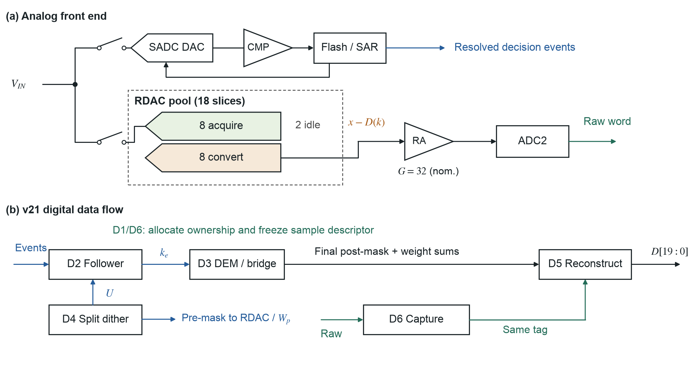
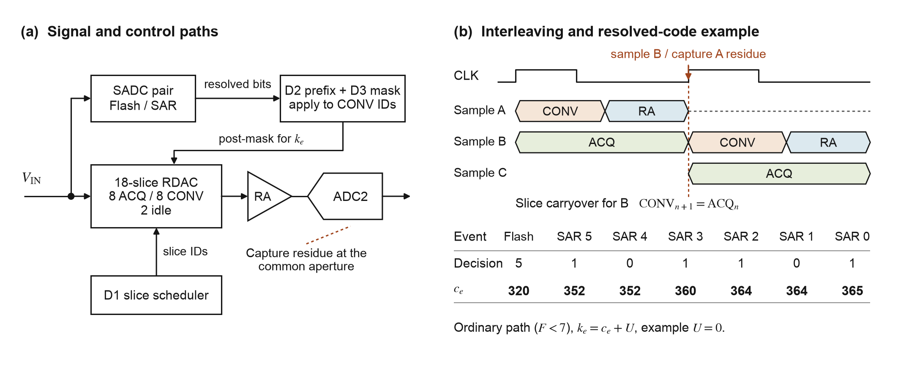
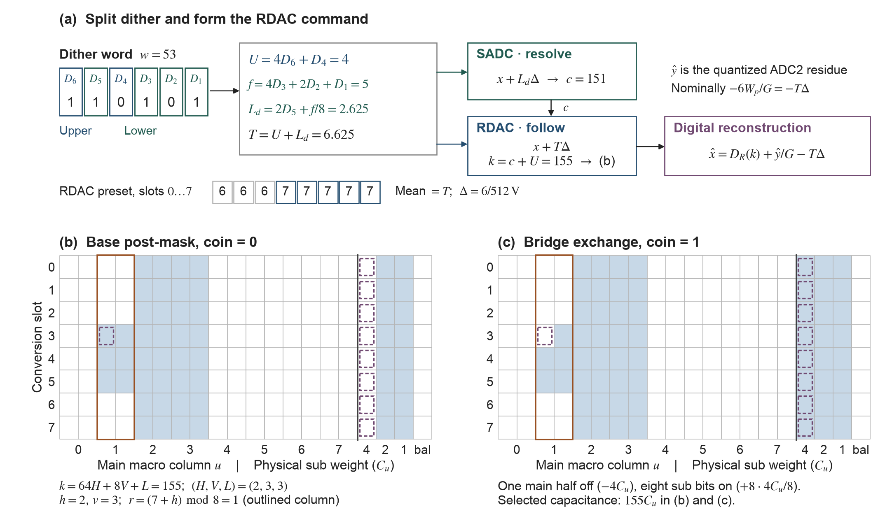
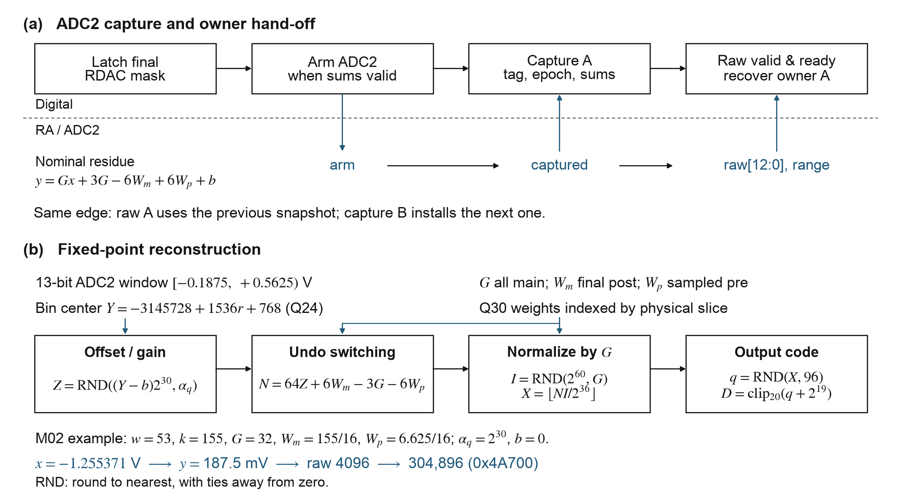

# 两级 SAR ADC 的工作机理与行为验证

从 M00 的模拟与数字接口读起。M01–M03 解释片组交织、开关阵列和定点重构。F01–F12 给出各环节的模型证据与工作区间。图面参考 ISSCC 2024 图 9.8.1、9.8.3–9.8.5 的电路符号、相位条和结果轴，以及 VLSI 2025 C32.1 图 5–6 的时序与功能分图。排版约为 180 mm 双栏宽，图注位于图框外。每张图有 300 dpi PNG 和可编辑 SVG。 [ISSCC 原文](../../../references/ISSCC2024_PAPER.pdf) · [VLSI 原文](../../../references/PKU_VLSI2025_C32_1_PAPER.pdf)

## 机理图

**M00. 两级转换的信号与控制边界。** 粗量化器 SADC 逐次送出已决结果，18 片 RDAC 池在采集、转换和空闲间交接。进入转换的片组随判决更新底板。残差经 RA 放大后交 ADC2。数字端把 ADC2 原码和同笔开关、权重状态配对，输出 20 位码。 [SVG](M00_signal_flow.svg) · [v21 顶层](../../../rtl/v21/adc_digital_ip_v21.sv)

**M01. 采集、转换和残差读取的交织。** 公共孔径捕获新样本 B 的输入以及前一笔 A 的残差。换手后 B 的 8 片由采集转入转换，从其余 10 片选择新的 8 片采集并留 2 片空闲。普通区示例中 Flash 先确定前缀 320，随后的六次判决将其更新到 365。时序条给出事件先后关系。 [SVG](M01_interleaving_follower.svg) · [片归属与前缀 F01](F01_ownership_events.png) · [开关电荷 F06](F06_follower_charge.png)

**M02. 同一字如何驱动扰动预置、DEM 和桥接。** 字 `110101` 拆出 `U=4`、`Ld=2.625`。SADC 端的输入折算偏移是 `Ld·Δ`，RDAC 采样预置是 `T·Δ`，其中 `T=U+Ld`。粗码 `c=151` 转成 `k=155`，即 `H=2、V=3、L=3`。相位 `(h,v)=(2,3)` 下，横向选宏列 2、3，纵向在保留列 1 内选槽 3–5。桥接关闭一个名义 `4Cu` 主半单元，打开八片各折算为 `4Cu/8` 的子支路，选通名义总量前后均为 `155Cu`。加权重构读取交换后的 `post` 和采样 `pre`。 [SVG](M02_dem_dither_mechanism.svg) · [掩码覆盖 F02](F02_dem_usage.png) · [命令域 F05](F05_dither_margin.png) · [v2.1 合同](../../ISSCC2024_ONCHIP_CONTRACT_v2_1_ADDENDUM.md)

**M03. ADC2 原码如何变成带标签的 20 位码。** 最终 `post` 生效、权重和有效后，事务控制允许残差捕获。`raw` 返回时取该笔冻结的 tag、epoch 和权重和。若当前沿同时接收 A 的 `raw` 与 B 的捕获，A 仍使用旧快照。重构先把 13 位 `raw` 转为码箱中心，再代入 `G、Wm、Wp`，扣除采样预置贡献，按实际增益归一，最后舍入及限幅。延续 M02 的名义算例，整数参考给出 `raw=4096` 和 `0x4A700`。 [SVG](M03_capture_reconstruction.svg) · [定点误差 F12](F12_fixed_vs_float.png) · [整数 oracle](../../../tools/recon_oracle.py)

## 定量图及读法

| 图 | 控制量、结果及证据边界 |
| --- | --- |
| [F01 片归属和事件前缀](F01_ownership_events.png) · [SVG](F01_ownership_events.svg) | 左图取 `sched18` Python 镜像的前 8 个有效推进。4,096 行与冻结向量逐行相同。右图是以给定末码查固定表生成的三份前缀示例。 |
| [F02 DEM 掩码](F02_dem_usage.png) · [SVG](F02_dem_usage.svg) | 左、中两幅固定 `k=155`，只改外供相位。右幅等权枚举 64 个相位对，点及横线是各逻辑槽中半单元选通率的均值及范围。名义电荷检查覆盖 133,376 个码、相位、coin、half 组合。 |
| [F03 静态传输残差](F03_inl_dnl.png) · [SVG](F03_inl_dnl.svg) | 512 电平 × 8 次，逐电平平均后去最佳拟合直线。正常和越界工况分面显示。稀疏电平间距不支持逐码 DNL。 三组扰动工况的 ADC2 越界数为 2,550–2,551/4,096，约 62.3%，不登记为有效 INL。 |
| [F04 相干残余频谱](F04_psd.png) · [SVG](F04_psd.svg) | 40 MS/s、8,192 点、相干约 1.001 MHz。用基波积分功率归一残余 PSD，绘图去 DC 和基波。加 LUT 的输出经过浮点后处理。 本次三组 SNDR 为 94.46、94.13、94.63 dB。 |
| [F05 扰动与码域](F05_dither_margin.png) · [SVG](F05_dither_margin.svg) | Fig.19 减法等效模型与 v2.1 加法合同各有命令域。合同全组合枚举中 112/33,280 组超出 `k≤520`，属于无约束组合的边界检查。 |
| [F06 跟随与试探开关账目](F06_follower_charge.png) · [SVG](F06_follower_charge.svg) | 同一最终码和片组，逐次跟随、一次加载、试探撤销的平均累计电荷约为 59.52、59.52、179.02 pC。横轴为各自更新次序。对照使用理想参考轨。 |
| [F07 参考建立和 ADC2 跟踪](F07_reference_ra_adc2.png) · [SVG](F07_reference_ra_adc2.svg) | 假设极点下的相位样本。参考切换、RA 起点、带宽切换、ADC2 读取分别为 5、6、16、18 ns。以 32 笔分位带及配对节点差显示趋势。 |
| [F08 AZ 残余敏感度](F08_az.png) · [SVG](F08_az.svg) | 同一记录注入 1 mV 偏移和 50 µV RMS 残余噪声。保持曲线另行给定 1 kV/s，展示 `ΔV=droop·t_hold`。实际 AZ 抑制量需电路验证。 |
| [F09 输入充电电流](F09_input_current.png) · [SVG](F09_input_current.svg) | 等效负载 20.5 pF、40 MS/s 下扫 0%、85%、95% 三个预充档位，按 `C·abs(ΔV)·fs` 算平均充电电流。论文的峰峰值与此计算使用不同测量口径。 |
| [F10 片选策略与杂散](F10_interleaving.png) · [SVG](F10_interleaving.svg) | 同一制造种子、DEM 打开，逐频点配对比较从剩余 10 片随机选与 18 片内轮转。对照限于三个相干频点。 |
| [F11 校准表能否跨片](F11_calibration_generalization.png) · [SVG](F11_calibration_generalization.svg) | 五个模型制造种子。每片 60,000 笔训练，独立噪声和片选流进行 512×8 留出评估。本片与异片 LUT 在同一接收片的同一无 DEM 记录上比较。 峰值采样 INL 中位数为未校 56.02、本片 LUT 30.51、异片 LUT 71.34 LSB20。 |
| [F12 定点与浮点反解](F12_fixed_vs_float.png) · [SVG](F12_fixed_vs_float.svg) | 对同一组行为级 ADC2 记录重构，量化参考是 ±0.5 LSB20，统计实际越线。 8,192 笔的 RMS 为 0.283 LSB20，峰值 0.4995 LSB20，越线 0 笔。 |

## Python 验证可以覆盖到哪一层

- **D1–D4。** 调度可核对冻结向量与片归属不变量。给定序列后，D2 可检查已决前缀与掩码推进。D3/D4 适合枚举相位、码域、掩码和名义支路权重。RTL 的门禁、guard 和端口打包继续由对应 testbench 验收。
- **D5–D6。** 整数 oracle 可逐值验证位宽、符号、舍入和饱和。D6 的样本归属与生命周期可用事件模型预检。RTL 的 backpressure、同沿 A 返回/B 捕获、权重提交与复位需要事务级对拍。 [现行状态](../../STATUS.md)
- **模拟与系统性能。** F03–F12 使用记录的几何、噪声、失配和参考假设。模型的 ADC2 窗口为 **13 位，−0.1875 至 +0.5625 V**。与 v21 合同同码制有助于比对数字接口。dither 的行为电荷口仍走减法命令，v21 开关合同走加法。参考瞬态、AZ 残余、RA 摆幅和输入电流需要对应的电路或实测证据。

## 重绘

在仓库根目录运行。默认 512 电平 × 8 次、动态记录 8,192 点。完整重画包含校准训练。快速重画机理图可追加 `--mechanisms-only`。

~~~bash
bash tools/pyenv.sh --run tools/run_review_figures.py --out /tmp/sar-review-redraw
~~~

[figures.json](figures.json) 记录源文件与图文件的 SHA-256、运行参数、逐图数值和异常计数。`F03_inl_dnl` 沿用原文件名以兼容引用，图面展示本次电平扫描支持的量。
