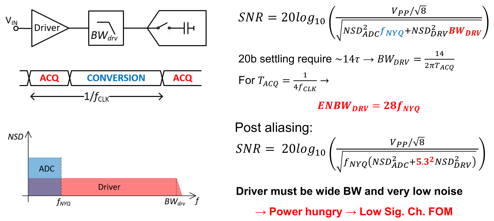
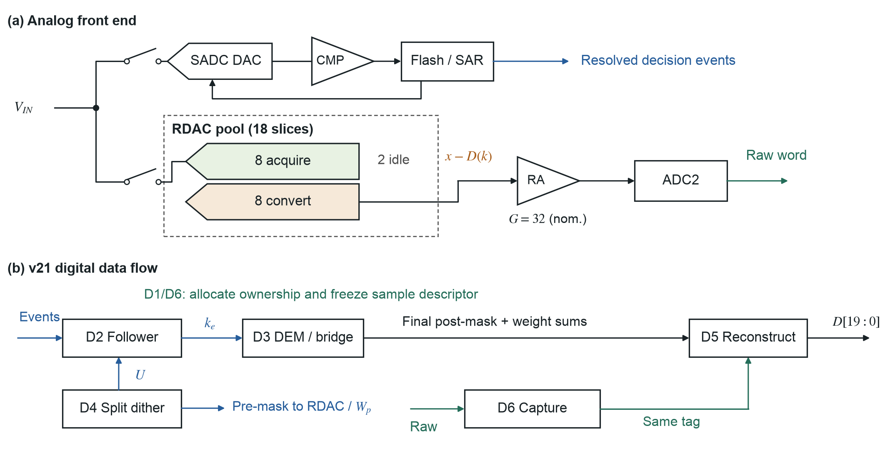
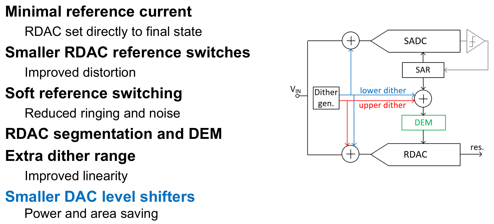
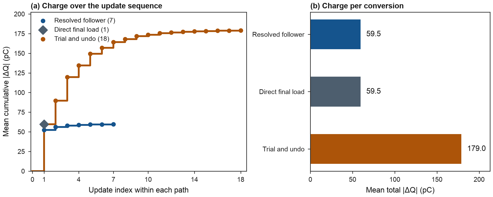
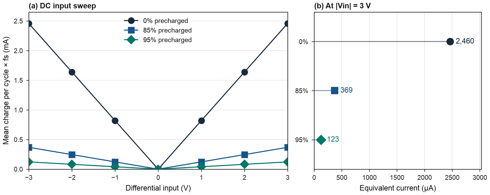
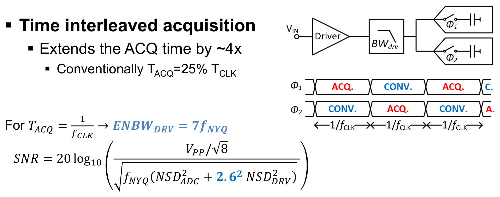
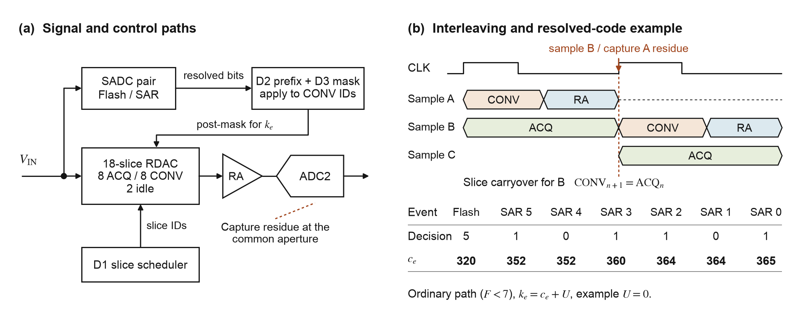
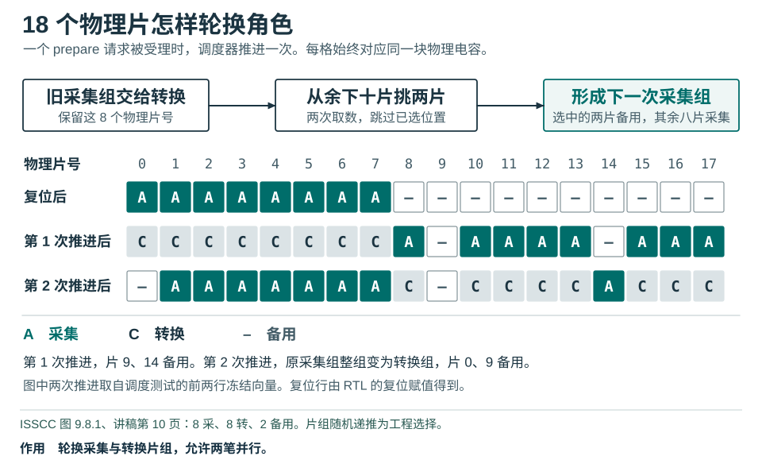
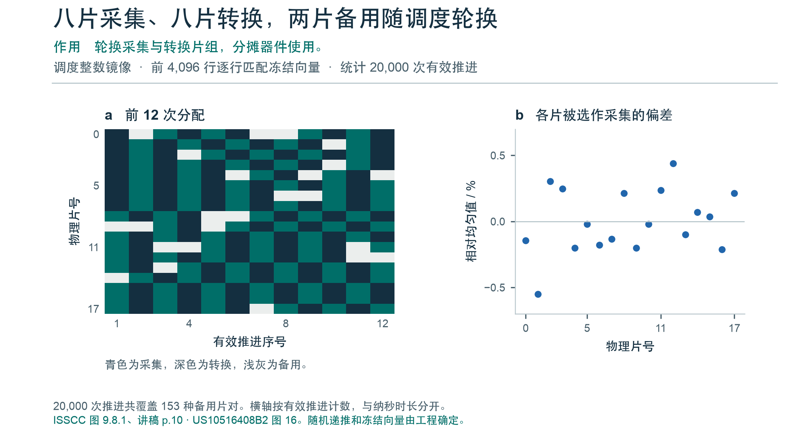
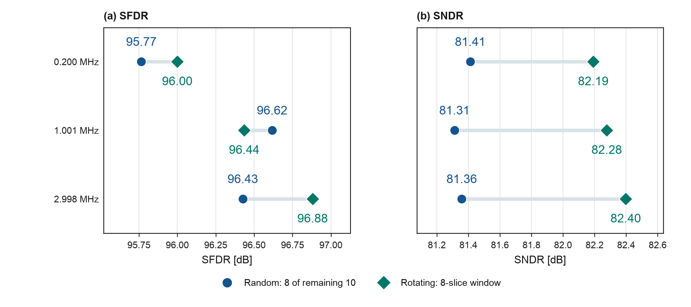

# 01 · RDAC 分离架构与 18 选 8 模拟域交织精讲

> **一句话核心**：传统 SAR 是让同一个大电容阵列既当“精密天平”又当“快速试探工”，累得气喘吁吁还互相掣肘；AD4080 把它拆成了 **小而快的 SADC** + **大而稳的 18 片 RDAC 池**，一口气吃下了全周期采样、省参考电流、小开关降失真、环路外 DEM 和额外 Dither 六大红利。

---

## 一、传统单核高速精密 SAR 到底死在哪？

当你要在 **40 MSPS（周期 $T_\mathrm{CLK}=25\text{ ns}$）** 下做出 **20 位精度** 时，单核 SAR 会同时撞上两堵死墙：

1. **驱动带宽墙（信号链级瓶颈）**
   20 位建立约需要 $14\tau$ 的 RC 建立时间。传统 SAR 每个周期得留出 3/4 时间做逐位比较，真正用来采样（ACQ）的时间只有 $T_\mathrm{ACQ} = \tfrac{1}{4} T_\mathrm{CLK} = 6.25\text{ ns}$！算下来前端抗混叠滤波和驱动器的等效噪声带宽高达：
   $$\mathrm{ENBW}_\mathrm{DRV} \approx 28 f_\mathrm{NYQ}$$
   混叠后驱动器热噪声功率被放大 $5.3^2$ 倍，逼得系统必须用极高功耗的宽带超低噪驱动器，整条信号链能效（Signal-Chain FOM）直接崩盘。



2. **电容规模与速度死锁**
   为了把 20 位 $kT/C$ 噪声压到 8.8 nV/√Hz，采样电容高达 **20.5 pF**。让 20.5 pF 这么大一坨电容在 1–2 ns 内反复做 9–10 轮“二分试错”，参考端会狂抽大电流，大开关会引入严重非线性电荷注入。

---

## 二、破局第一招：把量化器（SADC）和余差 DAC（RDAC）彻底拆开



看上图 (a) 模拟前端的上下两条路：
- **上面是 SADC（小量化器）**：电容只有 RDAC 的 **1/8**，专门负责配合 3-bit Flash 飞快地做逐位试错（耗时仅约 7 ns），算出 9-bit 粗码。
- **下面是 RDAC（精密余差 DAC）**：它**绝不参与试错**，只等 SADC 每确定一位（已决位），就一步切到最终位置，专门负责给出超高精度的残差电压 $x - D(k)$。

### 这一“拆”带来的 6 大连环红利（对应 ISSCC 2024 讲稿 p.13–18）



这 6 条好处不是孤立的，而是**一环扣一环**的物理因果链：

1. **参考电流最小化（Minimal reference current）**
   传统 SAR 试错时 MSB 试 `1` 错了退回 `0`，大电容来回充放电白烧参考电流。现在试错全交给极小的 SADC，大电容 RDAC 一步切到位，参考电荷消耗降到理论最低。看本仓行为模型实测——传统试探回撤（Trial and undo，18 步）每周期狂抽 **179.0 pC**，而已决跟随（Resolved follower，7 步）每周期仅需 **59.5 pC**，电荷直接砍掉 **3 倍**！


2. **更小的 RDAC 参考开关 → 改善失真（Smaller switches → Improved distortion）**
   传统 SAR 每次试探只有 1–2 ns 稳定，开关必须画得很宽大（低 $R_\mathrm{on}$），但大开关带来巨大的非线性结电容和沟道电荷注入，直接毁掉 20 位 THD。RDAC 有整段转换+余差窗口慢慢建立，开关可以大幅缩水，失真显著改善。
3. **软参考切换 → 降低振铃与噪声（Soft switching → Reduced ringing and noise）**
   大开关猛合产生极大 $\mathrm{d}i/\mathrm{d}t$，在封装键合线和电源寄生电感 $L$ 上激起剧烈的 $V=L\frac{\mathrm{d}i}{\mathrm{d}t}$ 振铃。小开关+分步温柔切换把电流斜率拉平，参考网络和地弹噪声大幅下降。
4. **环路外从容做分段与 DEM（RDAC segmentation and DEM）**
   因为 RDAC 已经被搬出 SADC 高速比较环路，在 SADC 输出到 RDAC 输入的路上，可以毫无压力地插入温度计分段和复杂的三维 DEM，**完全不增加比较器环路延迟**。
5. **白嫖额外 Dither 范围（Extra dither range → Improved linearity）**
   可以在 RDAC 侧额外叠加大幅度 `upper dither`（详解见 [02 篇](02_split_dither.md)），大幅打散大电容失配，而完全不增加 SADC 的动态范围负担。
6. **更小的 3.3 V 电平移位器 → 省功耗省面积（Smaller DAC level shifters）**
   40 nm 下数字逻辑用 1.1 V，而驱动 ±3 V 摆幅的 RDAC 开关用 3.3 V 高压管，每一路都要插 Level Shifter。开关变小了、每周期最多只翻一次、边沿要求放宽了，所有 Level Shifter 都能大幅瘦身，面积和 3.3 V 动态功耗双双大降。

顺带一提，前端输入级还配合了 **预充 / AUXIN 辅助自举**（对应专利 `US10541702B1`）：由独立辅助引脚给采样开关自举电容和背栅供电，大幅压缩主输入回踢电流。看本仓行为模型实测，95% 预充下 ±3 V 满摆幅等效输入电流直接从 **2,460 µA 压到 123 µA**：



---

## 三、破局第二招：18 选 8 模拟域交织切片池

为了把采样时间 $T_\mathrm{ACQ}$ 从 1/4 周期拉满到 **整个 25 ns 周期（扩展 4 倍）**，最直觉的办法是做两套前级乒乓交替（A 采 B 转、B 采 A 转，对应专利 `US10516408B2` Fig.17）。这样前端等效噪声带宽直接从 $28f_\mathrm{NYQ}$ 降到 $7f_\mathrm{NYQ}$，抗混叠滤波带宽放宽 3–4 倍，信号链 FOM 额外赚到约 4 dB：



**但死板的“两路固定乒乓”有个致命坑**：只要 A 组和 B 组有哪怕几 ppm 的增益/电容失配，就会在频谱的 $f_s/2$ 处长出一根刺眼的交织杂散（interleaving spur）！

**AD4080 的神来之笔（对应专利 `US10707889B1` Fig.5A/5B）**：
把大 RDAC 切成 **18 块完全相同的小切片（`sDAC0`–`sDAC17`）**，组成一个共享切片池：
- **8 片正在全周期采集（`ACQ`）**
- **8 片正在转换并送往共享 RA（`CONV`）**
- **多出来的 2 片轮空备用（`IDLE` / `SPARE`）**



每当采样边沿到来：
1. 上一拍的 8 片 `ACQ` **原封不动整组晋升**为本拍的 `CONV`（绝不能重新挑已采样的片！）；
2. 刚才刚做完转换释放出来的旧 `CONV`（8 片）加上旧 `IDLE`（2 片），一共 **10 片可用候选**；
3. 从这 10 片里**随机挑 2 片进新 `IDLE`**，剩下 8 片组成新 `ACQ`！

靠这 2 片备用砖不停洗牌，每次参与采样的 8 片组合千变万化，固定交织杂散被彻底打散成极低白噪声！

---

## 四、看看咱们 RTL 代码里是怎么硬核落地的（`sched18.sv`）

打开生产代码 [rtl/sar_core/sched18.sv](../../../rtl/sar_core/sched18.sv)，里面藏着三个非常漂亮的工程细节：

1. **为什么不用普通 LFSR，而用 32 位 `xorshift(13,17,5)`？（第 20–23、48–54 行）**
   传统 Fibonacci LFSR 的相邻位是同一条序列的移位，低 16 位高度相关——团队实测 4,000 拍下用 LFSR 选 IDLE 对会出现 `min=1 / max=181` 的严重偏斜！换成 `xorshift32` 每拍整体混合后，实测 18 片使用不平衡度压到了 **0.24%**。
2. **不重复挑 2 片 IDLE 的部分 Fisher-Yates 算法（第 8–14 行）**
   从 10 片候选列表 `cand[0..9]` 中抽 2 片，用两步随机输出 `r1, r2`：
   ```systemverilog
   i1 = (r1 * 10) >> 16;          // 在 0..9 里均匀抽第 1 个
   j0 = (r2 * 9)  >> 16;          // 在剩下的 9 个里抽第 2 个
   i2 = j0 + (j0 >= i1);          // 跳过已选的 i1，保证严格不重复
   ```
   不用循环、不用重试，单拍组合逻辑均匀覆盖 $\binom{10}{2}=45$ 种空出对（长序列涵盖全部 $\binom{18}{2}=153$ 种备用片对）。
3. **三张共享前缀表砍掉 88% 加法树（第 67–90 行）**
   如果直接用 `always_comb` 写变量下标循环压入候选表，综合器（DC）会在子模块内联时推断出 50 个未时钟驱动的锁存器；若用朴素 popcount 展开又会冒出 468 级加法树跑 20 分钟综合。最终代码改成了 `avail / acq_q / acq_next` **三张共享前缀表**（总计仅 54 级加 1），既零锁存器又极速综合！

看 `sched18.sv` 的 RTL 数据流与实测效果——20,000 次推进覆盖全部 153 种备用片对，18 片被选作采集的偏差全部稳稳落在 ±0.5% 之内，同时在不同频点上与固定轮转窗做了 SFDR/SNDR 对照：







---

*下一篇：[02 · 整数 + 小数 Split Dither 精讲 →](02_split_dither.md)*
