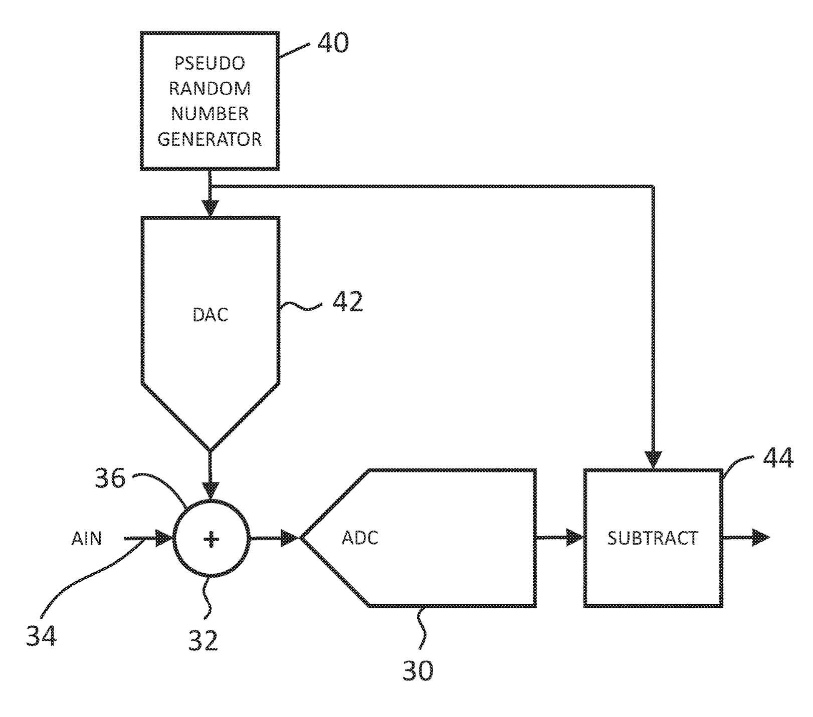
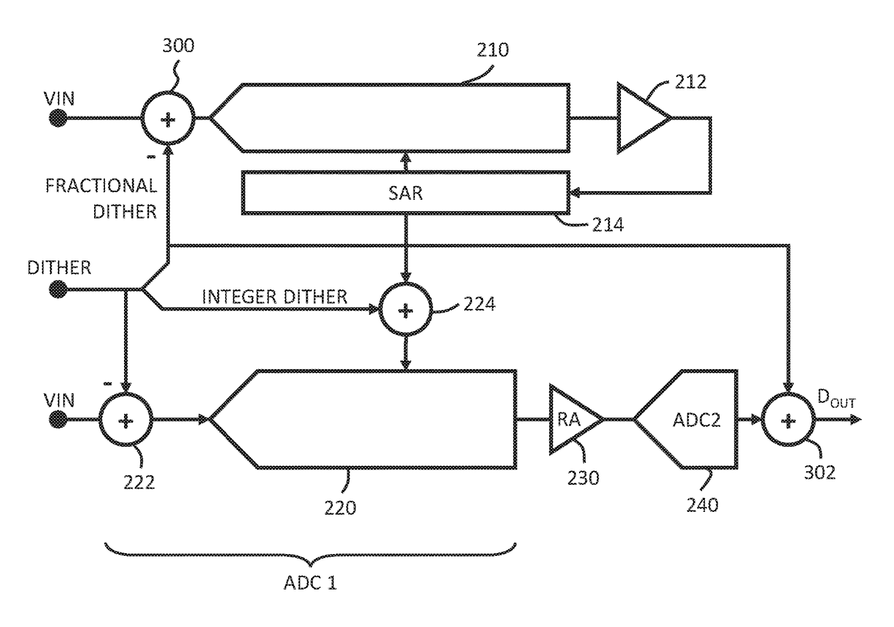
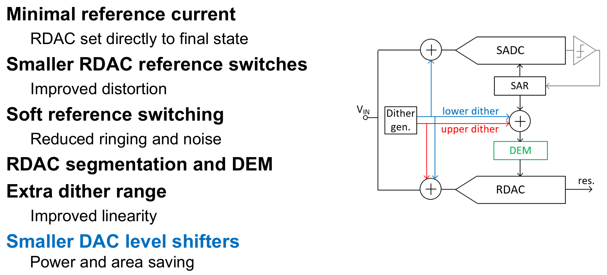
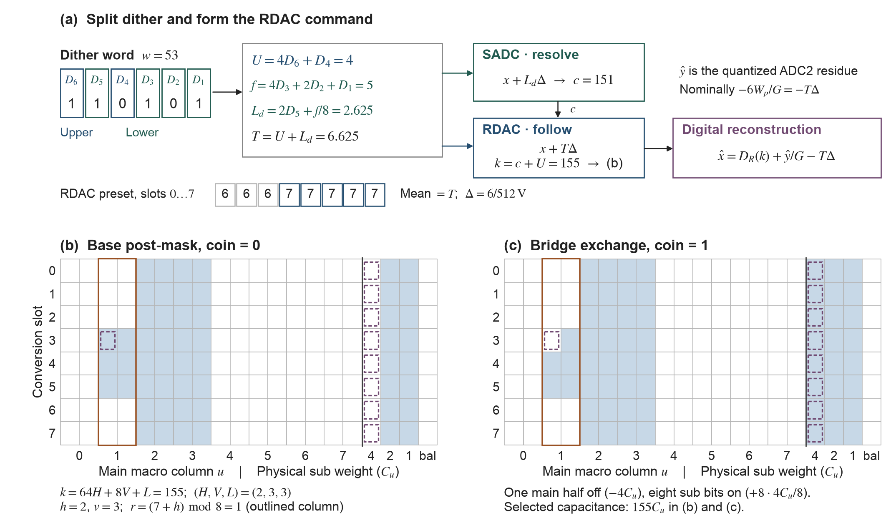
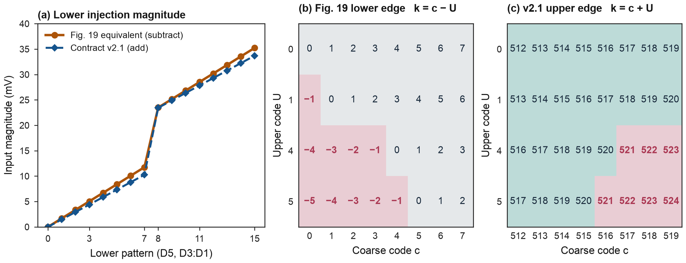
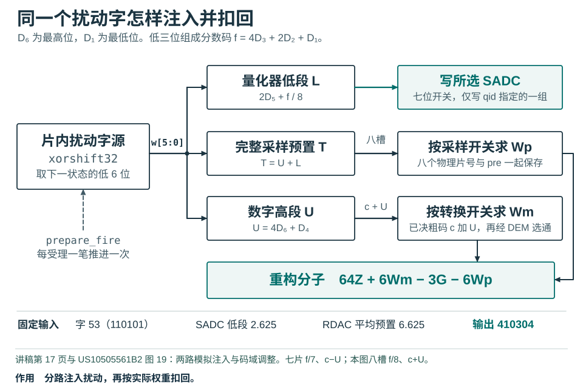
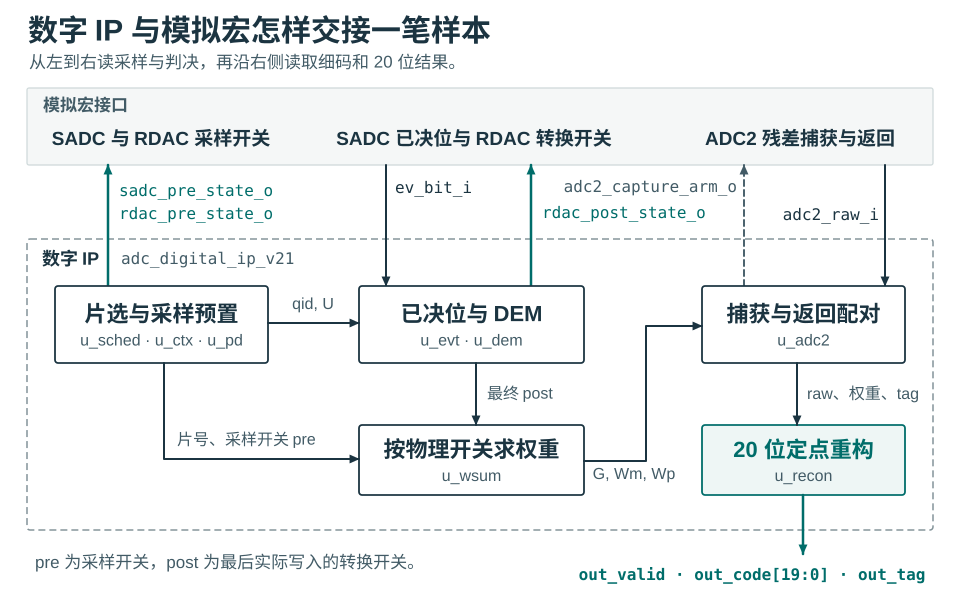
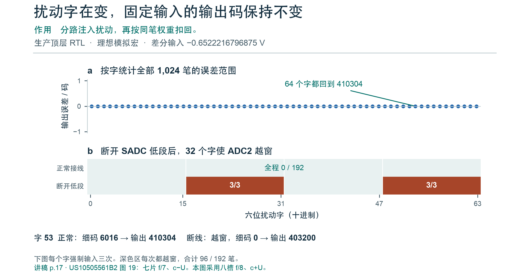

# 02 · 整数 + 小数 Split Dither 精讲：为什么两手都要？硬件怎么造出 $f/8$？

> **一句话核心**：两级 SAR 就像先用一把“粗米尺”（RDAC）量整格，再把零头放大 32 倍交给“精密游标”（RA + ADC2）量细节。**整数 Dither 专门晃“粗米尺”且在余差里就地抵消不撑爆后级，小数 Dither 专门晃“精密游标”打散后级非线性**——两手一起抓，全链路无死角。

---

## 一、先从最基础讲起：Dither（减法抖动）到底在干嘛？

任何实际 ADC 都有和输入码绑死的固定非线性（电容失配、台阶不均、比较器偏移）。如果输入是一个干净正弦波或平稳直流，每次电压落到同一个区间，就会**死磕同一批电容和同一段非线性曲线**——结果频谱上长出高高的谐波/杂散（SFDR 暴跌），直流上鼓出 INL 凸起。

**减法 Dither（Subtractive Dither）的思路非常直白**（专利 `US10505561B2` Fig.3）：
1. **注入**：在采样前由伪随机数发生器（`40`）经 DAC（`42`）往模拟端注入一个**已知的、与输入无关的随机扰动 $d$**，让电路内部的落点每次都随机“晃”到不同的电容组合和不同的 ADC2 电压区间；
2. **抵消**：量化完后，在数字输出端（`44 SUBTRACT`）把同一个已知的 $d$ **精确减回来**。



信号本身纹丝不动（$(v_\mathrm{in}+d)-d = v_\mathrm{in}$），而原本锁死在特定码型上的非线性误差被随机落点打散成了平坦的宽带白噪声——用几乎可以忽略的噪底代价，换来了 **118 dB+ 的 SFDR**！

---

## 二、为什么必须拆成“整数 + 小数”两段？（米尺 + 游标类比）

这里的“整数”和“小数”，是以 **第一级（9-bit 粗级）的 1 LSB（$\Delta_1 = 6\text{ V}/512$）** 为单位来划分的：

$$d = d_\mathrm{int}\cdot \Delta_1 + d_\mathrm{frac}, \qquad d_\mathrm{int}\in\mathbb{Z},\quad |d_\mathrm{frac}| < \Delta_1$$

看看三种方案对比，你瞬间就明白为什么缺一不可：

| 方案 | 第一级 RDAC 失配 | 第二级 RA / ADC2 非线性 | RA / ADC2 会不会顶饱和？ | 动态范围（DR）损失 |
| --- | --- | --- | --- | --- |
| **只加传统大 dither** | 能打散 | 能打散 | **极易饱和**（被迫降 RA 增益，噪底恶化） | 较大 |
| **只加小数 dither（$<1\Delta_1$）** | **打不散**（米尺几乎不动） | 能打散 | 不饱和 | 极小 |
| **整数 + 小数（Split Dither）** | **整数部分负责打散** | **小数部分负责打散** | **绝不饱和（整数就地抵消）** | **极小（配少量 guard 码）** |

对照专利 `US10505561B2` Fig.5 完整架构图和 ISSCC 2024 讲稿第 18 页红蓝线框图，一步步看清整数与小数是怎么“各走各的道”的：





1. **上路（小量化器 SADC）—— 只吃“低段 / 小数”（蓝线 `lower dither`），不吃红线 `upper`**
   SADC 量化的是 $V_\mathrm{in} + d_\mathrm{lower}$。红线大范围 `upper` 压根不进 SADC，所以 SADC 保持又小又快，不用为大 dither 扩大动态范围。
2. **下路（精密 RDAC 模拟端）—— 红蓝全吃**
   RDAC 模拟采样节点存的是 $V_\mathrm{in} + d_\mathrm{lower} + d_\mathrm{upper}$。
3. **数字中枢（SAR → RDAC）—— 把红线 `upper` 补回数字码！**
   SADC 吐出粗码 $c \approx V_\mathrm{in} + d_\mathrm{lower}$ 后，数字端把红线 `upper` 直接加到粗码上，得到 $k = c + U$ 再送进 DEM 驱动 RDAC！
   算一下 RDAC 送给 ×32 倍余差放大器（RA）的余差：
   $$\text{res.} = \underbrace{(V_\mathrm{in} + d_\mathrm{lower} + U\Delta_1)}_{\text{RDAC 模拟端}} - \underbrace{D(c + U)}_{\text{RDAC 数字端}}$$
   **红线 `upper` 在余差里完美抵消了！**
   - RDAC 切换的电容码被大幅晃开了（白嫖“额外 dither 范围”打散高位电容）；
   - 送进 ×32 倍 RA 和 ADC2 的余差并没有变大，稳稳保住了 ×32 高增益和超低噪底；
   - 而没被粗码完全吸收的**小数部分**留在余差里，专门负责把后端 RA 和 ADC2 的非线性也晃散（小信号 −60 dBFS 时照样线性）！

---

## 三、硬件上怎么生成？怎么知道谁是整数、谁是小数？

硬件里既不用模拟噪声源，也不做浮点取整——它就是一个 **纯数字伪随机数发生器（`xorshift32`）每周期吐出一个 6-bit 随机字 `D6 D5 D4 D3 D2 D1`**，然后**按固定小数点直接硬连线切片**！

看本工程合同（参考专利 `US10505561B2` Fig.19 并适配 8 片）的精确切位公式：
- **上段整数 `U`（只调 RDAC 粗码）**：$U = 4 D_6 + D_4 \in \{0, 1, 4, 5\}$
- **进 SADC 的低段 `Ld`**：$L_d = 2 D_5 + \dfrac{4D_3 + 2D_2 + D_1}{8}$
- **总整数部分 `J`** $= U + 2 D_5 \in \{0..7\}$，**小数分子 `f`** $= 4D_3 + 2D_2 + D_1 \in \{0..7\}$
- **总扰动 `T`** $= U + L_d = J + \dfrac{f}{8}$

### 最巧妙的一招：8 片并联凭空造出 $f/8$ 小数，根本不用超小电容！

怎么把这些 0/1 比特变成模拟电荷注入进去？**不是外接模拟加法器，而是在采样（ACQ）开始前，提前把子阵列电容预置（pre-charge）到参考电压上**！

- **RDAC 怎么造 $f/8$？**
  每片 RDAC 子阵列只有整数位的 `4Cu, 2Cu, 1Cu, 1Cu(bal)`，压根没有 $1/8$ 小电容！但因为 RDAC 本来就是 **8 片并联** 的，只要让 8 片中的 **$f$ 片预置 `J + 1`**、剩下 **$(8-f)$ 片预置 `J`**，8 片平均下来总有效电荷就**精确等于 $J + f/8 = T$**！
- **SADC 怎么造 $f/8$？**
  SADC 只有 1 片，所以用它自己子阵列里专门细分的 `1/2, 1/4, 1/8 Cu` 小电容支路来接 `D3, D2, D1` 即可。

看下面这张具体的数字演练图（以 **`w = 53` = `110101`** 为例）：`U = 4`，`f = 5`，`Ld = 2.625`，`T = 6.625`；于是 RDAC 的 8 个槽位被预置成 **`[6, 6, 6, 7, 7, 7, 7, 7]`**（3 片填 6、5 片填 7），均值精准等于 **6.625**！



同时要注意正向 dither 的满量程边界：当输入逼近满量程（$c \ge 512$）且叠加 $U \in \{0,1,4,5\}$ 时，命令码 $k = c + U$ 最高推到 `520`（绿色合法保护区），超过 `520`（粉色区）则立即报错不静默回绕：



---

## 四、逐行看咱们 RTL 代码（`dither_pre.sv`）和真实 64 字闭环实测



打开生产文件 [rtl/sar_core/dither_pre.sv](../../../rtl/sar_core/dither_pre.sv)（仅 78 行，极其优雅）：

```systemverilog
// 第 36-42 行：同一 6-bit 随机字硬连线切出 U、J、f 和 SADC 7 路子开关
assign U_o        = {1'b0, word_i[5]} * 3'd4 + {2'b0, word_i[3]};
assign d5         = {2'b0, word_i[4]};
assign f_o        = {1'b0, word_i[2], word_i[1], word_i[0]};
assign J          = U_o + 3'({d5, 1'b0});                       // U + 2*D5 最大为 7
assign sadc_pre_o = {1'b0, word_i[4], 1'b0, word_i[2:0], 1'b0}; // 只给 SADC 2*D5 + f/8

// 第 47-65 行：8 片轮转分配，f 片预置 J+1、其余片预置 J（值 8 用 4'b1111 全选）
for (int s = 0; s < 8; s++) begin
    logic [2:0] relative_slot;
    relative_slot = 3'(s) - v_phase_i; // 三位模减法先回绕，再与四位 f 比较
    val = {1'b0, J} + ({1'b0, relative_slot} < f_o ? 4'd1 : 4'd0);
    pre_v[s][3] = val[2];   // b2 (4Cu)
    pre_v[s][2] = val[1];   // b1 (2Cu)
    pre_v[s][1] = val[0];   // b0 (1Cu)
    pre_v[s][0] = 1'b0;     // bal
    if (val >= 4'd8) pre_v[s] = 4'b1111;
end
```

### 真实芯片有电容失配时，数字端怎么扣干净？
如果简单粗暴地在输出端减去名义值 $T\cdot\Delta_1$，那预置电容本身的失配就会漏网。咱们代码里的做法是：**冻结本笔 8 片实际的采样预置开关 `pre`，去扰时直接拿 `pre × 片外标定好的真实电容权重` 算出实际注入电荷 `Wp`，在最终重构器里精准减一次 `Wp`**——连 dither 电容自身的失配也一起消得干干净净！

### 看两张实测图验证闭环：
1. **单笔追踪（`tag 54`，强制字 53，固定输入 −0.6522216796875 V）**：从 SADC 预置、RDAC 预置、粗码 202 → RDAC 命令 206 → ADC2 原码 6016 → 扣除 `Wp` 精准还码 `410304`：



2. **全 64 字闭环 + 故意断线对照**：本地 Verilator 连续跑 1,024 笔覆盖全部 64 个片内字，全部精准还原 `410304`（误差恒为 0）；一旦故意断开 SADC 的低段预置线，立即有 32 个字（96/192 笔）把 ADC2 顶越窗——证明两路配平真实生效！



---

*上一篇：[← 01 · RDAC 与 18 选 8 交织](01_rdac_and_interleaving.md) · 下一篇：[03 · 三维 DEM 与 50% 半格桥接精讲 →](03_3d_dem_and_bridge.md)*
