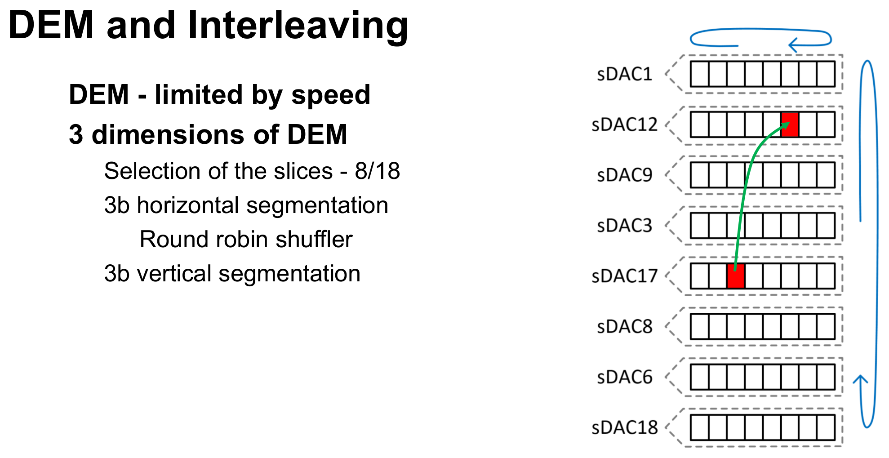
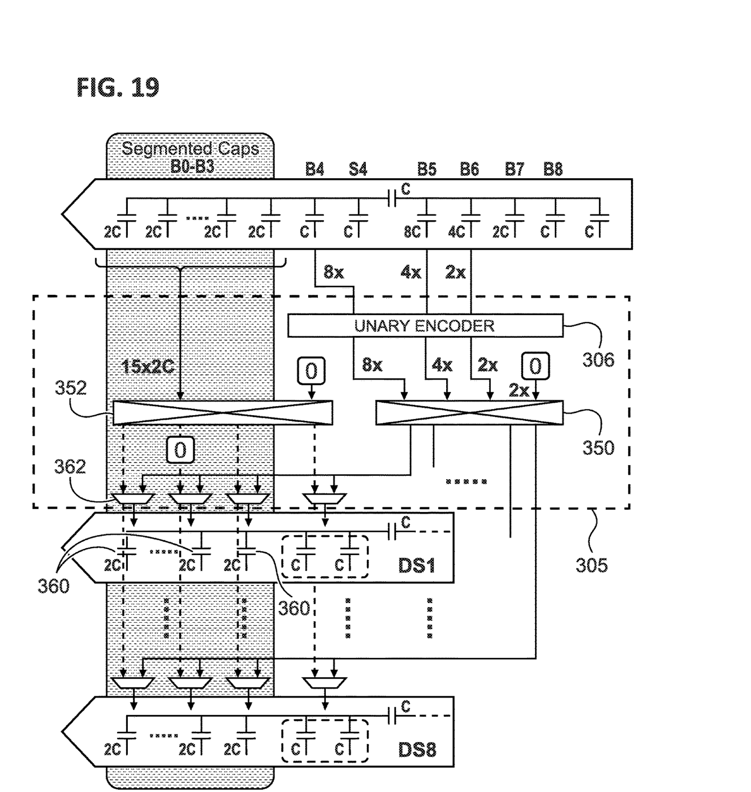
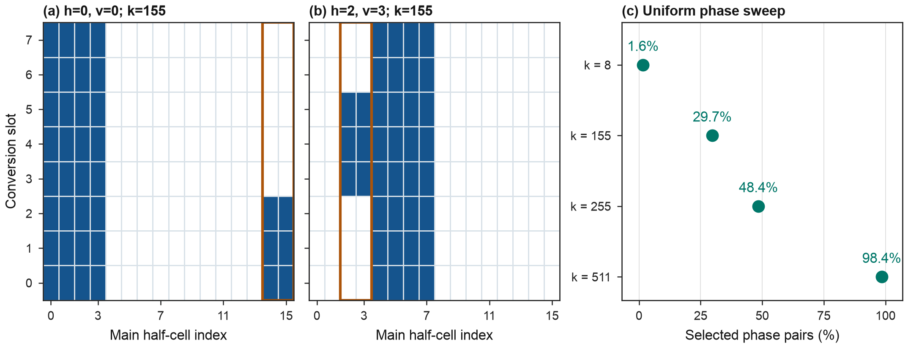
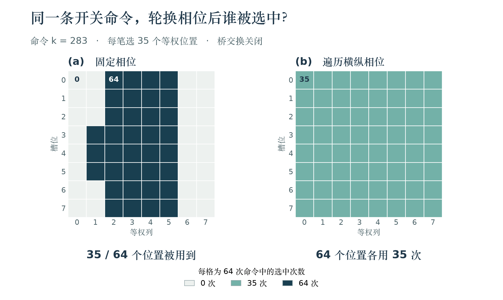
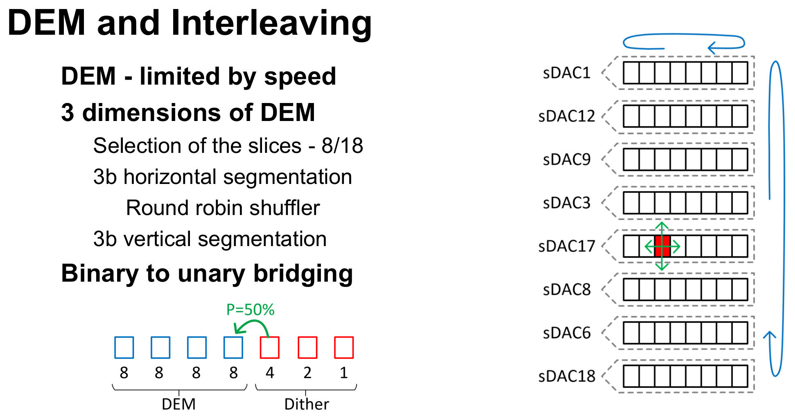
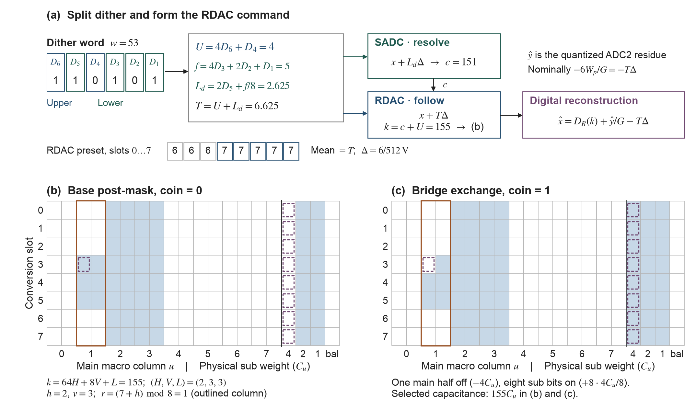
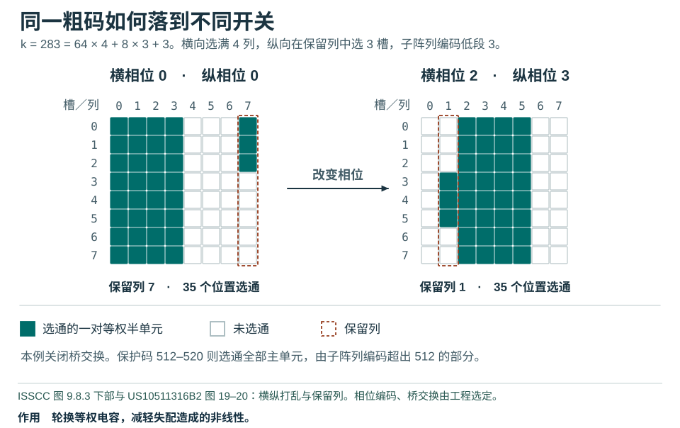
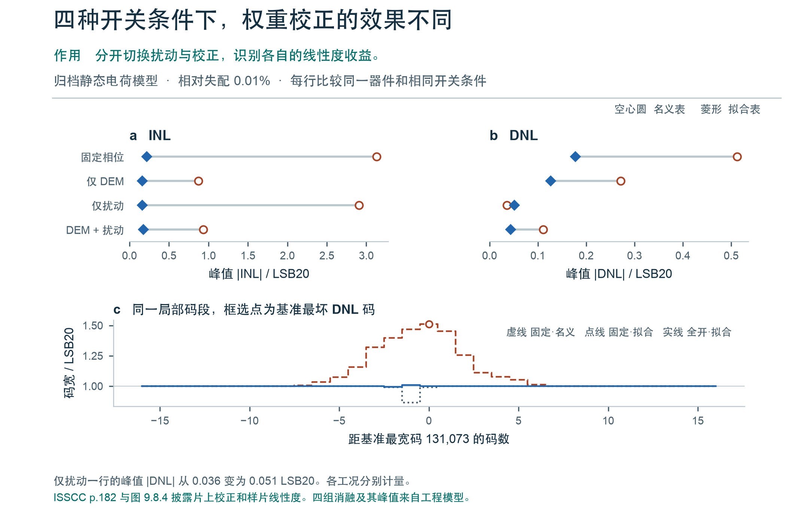

# 03 · 三维 DEM 与 50% 半格跨界桥接精讲：用 $k=213$ 手绘棋盘彻底看穿

> **一句话核心**：512 路传统 DEM 在 40 MSPS 根本跑不动。AD4080 把 9-bit 码拆成 **`3H + 3V + 3L`**，只用“18 选 8 切片轮换 + 横向 8 路移位 + 纵向 8 路移位”三个极快的小齿轮，就把电容满场洗牌；再把每个 `8Cu` 大格画成两个 `4Cu` 半格，抛硬币 50% 和二进制最高位互换，抹平最后一道跨界死缝！

---

## 一、为什么不能做传统全一元 DEM？（`DEM - limited by speed`）

第一级粗码有 **9 bit（512 级）**。如果把 512 个电容全做成一样大的单元，再接一个 512 路蝴蝶随机洗牌网络，面积和组合延迟直接爆炸，25 ns 周期根本来不及。

作者的破局思路（对应 ISSCC 2024 讲稿 p.29–31 与专利 `US10511316B2`）：把 9-bit 码 $k \in \{0..511\}$ 拆成 **`3 + 3 + 3`**：
$$k = 64 H + 8 V + L \qquad (H, V, L \in \{0..7\})$$
- **高 6 位（$H, V$）** 共有 64 个大格（每格权重 `8`），天然铺在 **8 片正在转换的 sDAC（8 行）× 每片 8 个主电容（8 列）** 的 8×8 棋盘上！
- **低 3 位（$L$）** 权重为 `4, 2, 1`，留在各片的二进制子阵列里。





---

## 二、拿具体粗码 $k = 213$，画出 8×8 棋盘手算演一遍！

把 $k = 213$ 按 $k = 64H + 8V + L$ 拆开：
- **$H = 3$**（$3 \times 64 = 192$）：需要点亮 **3 整列**；
- **$V = 2$**（$2 \times 8 = 16$）：需要在剩下的 1 列（**保留列**）里纵向点亮 **2 个单格**；
- **$L = 5$**（二进制 `101` = `4 + 1`）：子阵列点亮 `4` 和 `1`。

核对总数：$192 + 16 + 5 = 213$，分毫不差！下面用 `■` 表示接正参考、`·` 表示不亮，看看连续两笔**完全相同输入（都是 $k=213$）**，三维 DEM 怎么洗牌：

### 第 1 笔采样（横向移位 $h=0$，纵向移位 $v=0$）
- **第 1 维（18 选 8 切片池）**：挑出 8 片 `[1, 12, 9, 3, 17, 8, 6, 18]`；
- **第 2 维（横向 $H=3$）**：点亮第 `0, 1, 2` 整列，第 `7` 列自动空出做**保留列**（因为 $H \le 7$，永远至少留出 1 整列！）；
- **第 3 维（纵向 $V=2$）**：在保留列（第 `7` 列）里点亮第 `0, 1` 行。

```text
          列: 0  1  2  3  4  5  6  7(保留列)
行0 (sDAC1) : ■  ■  ■  ·  ·  ·  ·  ■   ← V=2 点亮
行1 (sDAC12): ■  ■  ■  ·  ·  ·  ·  ■   ← V=2 点亮
行2 (sDAC9) : ■  ■  ■  ·  ·  ·  ·  ·
行3 (sDAC3) : ■  ■  ■  ·  ·  ·  ·  ·
行4 (sDAC17): ■  ■  ■  ·  ·  ·  ·  ·
行5 (sDAC8) : ■  ■  ■  ·  ·  ·  ·  ·
行6 (sDAC6) : ■  ■  ■  ·  ·  ·  ·  ·
行7 (sDAC18): ■  ■  ■  ·  ·  ·  ·  ·
              ▲  ▲  ▲
              H=3 点亮这3整列
```

### 第 2 笔采样（输入一模一样，还是 $k=213$！）
- **第 1 维（18 选 8 换血）**：换上另一批 8 片 `[2, 5, 11, 4, 15, 7, 10, 14]`；
- **第 2 维（横向 Round-robin 右移 1 格，$h=1$）**：3 整列循环右移到 `1, 2, 3`，保留列跟着循环到第 `0` 列；
- **第 3 维（纵向移位 $v=4$）**：保留列里的 2 个单格挪到第 `4, 5` 行！

```text
          列: 0(保留) 1  2  3  4  5  6  7
行0 (sDAC2) :   ·     ■  ■  ■  ·  ·  ·  ·
行1 (sDAC5) :   ·     ■  ■  ■  ·  ·  ·  ·
行2 (sDAC11):   ·     ■  ■  ■  ·  ·  ·  ·
行3 (sDAC4) :   ·     ■  ■  ■  ·  ·  ·  ·
行4 (sDAC15):   ■     ■  ■  ■  ·  ·  ·  ·   ← V=2 挪到这里
行5 (sDAC7) :   ■     ■  ■  ■  ·  ·  ·  ·   ← V=2 挪到这里
行6 (sDAC10):   ·     ■  ■  ■  ·  ·  ·  ·
行7 (sDAC14):   ·     ■  ■  ■  ·  ·  ·  ·
                      ▲  ▲  ▲
                      H=3 整块右移
```

**妙处一眼看穿**：
- **极快**：硬件只需要两个 8 位小移位器（横向 8 路 + 纵向 8 路），组合延迟仅几百皮秒；
- **直观对比相位轮转**：看下面本仓行为图（$k=155$）：当 $(h,v)$ 从 `(0,0)` 切到 `(2,3)` 时，棕色框标注的**保留列**和蓝色点亮大格整体平移，遍扫相位后每个单元被选概率高度一致；
- **全棋盘 100% 均匀覆盖**：固定命令 `283`（每次亮 35 格），固定相位时 29 格永远躺平，遍历 64 对相位后，**全部 64 个位置精确各被选中 35 次**，一个都不偏心！





---

## 三、最玄妙的 50% 半格跨界桥接：`Binary to unary bridging` 怎么落地？

先看 ISSCC 2024 讲稿第 31 页原图左下角那排蓝红方块（`8 8 8 8` 归 DEM，`4 2 1` 归 Dither，跨界绿色弯箭头 `P=50%`）：



高 6 位一元主阵列（每格 `8Cu`，归 DEM 管）和低 3 位二进制子阵列（`4, 2, 1`，归 Dither 管）之间隔着一个**桥电容 $C_b$**。一旦桥电容偏了哪怕 0.5%，每次跨 8 进位（从 `7` 到 `8`）都会产生一道固定的边界台阶误差——DEM 管不着子阵列，Dither 跨不过这道鸿沟！

### 硬件上“半格子”是怎么实现的？
根本不是把一块电容硬劈成两半，而是**版图上一开始就把每个 `8Cu` 主大格画成两个并排的 `4Cu` 电容**（平时接同一根控制线，表现得像一个完整的 `8Cu`）！

看看电荷账有多严丝合缝：
- **主阵列这边**：1 片上的半个大格 = **`4Cu`**；
- **子阵列那边**：每片子阵列的最高位 `L[2]` 也是 `4Cu`，但经过桥电容衰减 $\beta = 1/8$，每片有效值是 $0.5\text{Cu}$；**8 片并联加起来的总有效电容**刚好也是：
  $$8 \times \frac{4\text{Cu}}{8} = 4\text{Cu}$$

两边名义电荷**严格相等**！于是数字逻辑只需要加一个 1-bit 抛硬币随机数 `coin_i`（50% 为 0、50% 为 1）：
- `coin_i == 0`：主半格接主控制位 `m`，8 片子阵列 `4Cu` 接 `L[2]`；
- `coin_i == 1`：**直接把这两根控制线交叉互换！** 主半格改接 `L[2]`，8 片子阵列 `4Cu` 改接 `m`！

不论 `m` 和 `L[2]` 是 0 还是 1，名义总电荷 $4\text{Cu}\cdot m + 4\text{Cu}\cdot L[2]$ 严格守恒，却把子阵列最高位 `4` 扯进了主阵列 DEM 里满场乱飞，**一元区和二进制区之间的死边界瞬间被抹平**！

看下面 `(b) coin = 0` 与 `(c) coin = 1` 的 8×20 物理开关实拍对照——紫色虚线框标出的位置清清楚楚：`(c)` 中保留列里的 **1 个主半格关断（`-4Cu`）**，同时全部 8 片子阵列的 `4Cu` 支路全部点亮（`+8 × 4Cu/8 = +4Cu`），两边选中电容严格保持 `155 Cu`！



---

## 四、逐行看咱们 RTL 代码（`dem_mask_v3.sv`）和消融实测图





打开生产文件 [rtl/sar_core/dem_mask_v3.sv](../../../rtl/sar_core/dem_mask_v3.sv)（仅 108 行纯组合逻辑）：

```systemverilog
// 第 45-62 行：拆 H/V/L、计算保留列与横纵 8 路循环移位
assign guard = (k_i >= 10'd512);              // 512..520 满量程保护区
assign H     = guard ? 3'd0 : k_i[8:6];
assign V     = guard ? 3'd0 : k_i[5:3];
assign L     = k_i[2:0];
assign res   = (3'd7 + h_phase_i);            // 保留列随 h_phase 自然回绕
assign j_sel = {1'b0, res, acq_seq_i[3]};     // 5 位物理索引：选中保留列的哪一个半单元

for (i = 0; i < 8; i++) begin : g_h
    assign hw[i] = ((3'(i) - h_phase_i) < H); // 3 位模减环绕，同宽比较
    assign yw[i] = ((3'(i) - v_phase_i) < V);
end

// 第 75-77 行：每个主大格展开成两个 4Cu 半单元
b = guard ? 1'b1 : ((u[2:0] == res) ? yw[s] : hw[u[2:0]]);
mask_v[s][2*u]   = b;
mask_v[s][2*u+1] = b;

// 第 89-95 行：50% 跨界桥接，直接交叉换线！
if (coin_i) begin
    sw_a  = mask_v[v_phase_i][j_sel];         // 选中的主半单元 (4Cu)
    sw_b4 = mask_v[0][16];                    // 8 片子阵列最高位 (8 × 0.5Cu = 4Cu)
    mask_v[v_phase_i][j_sel] = sw_b4;
    for (int s = 0; s < 8; s++)
        mask_v[s][16] = sw_a;
end
```

### DEM、Dither 与片外权重校准各自贡献了什么？（四组消融实测）
看下面这张消融对照图，三者的分工一目了然：
- **仅开 DEM**：立刻把名义 INL 从 **>3.1 LSB20** 砍到 **<1.0 LSB20**；
- **加上 Dither**：大幅压平局部码宽跳变（DNL 骤降）；
- **再加上片外拟合权重校准（全开·拟合）**：把全码 |INL| 压到 **0.174 LSB20**、|DNL| 压到 **0.043 LSB20**，最差码宽曲线几乎拉成 `1.00` 的笔直水平线！



---

*上一篇：[← 02 · Split Dither 精讲](02_split_dither.md) · 下一篇：[04 · 两段式动态参考精讲 →](04_dynamic_reference.md)*
