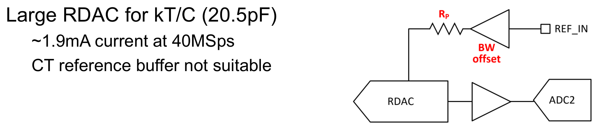
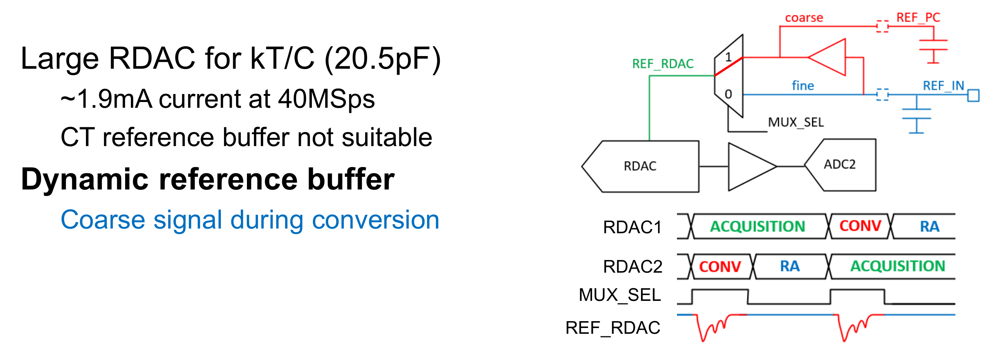
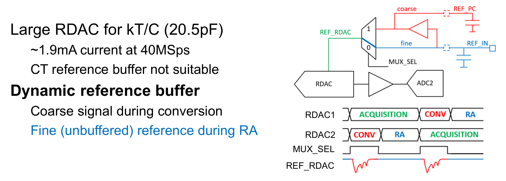
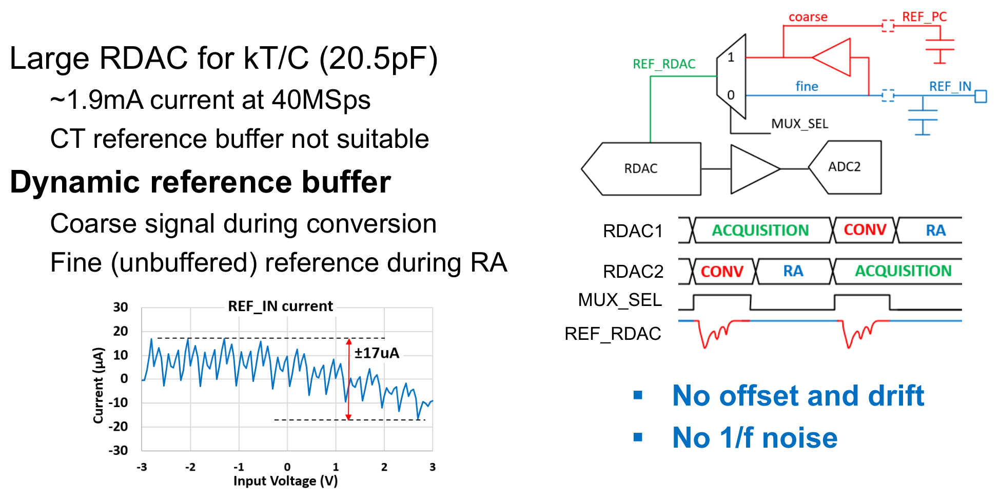
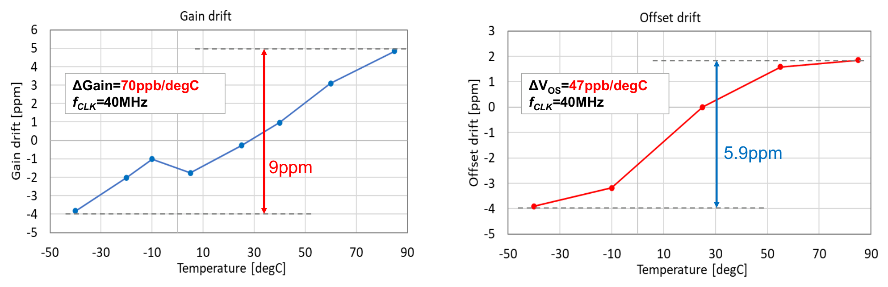
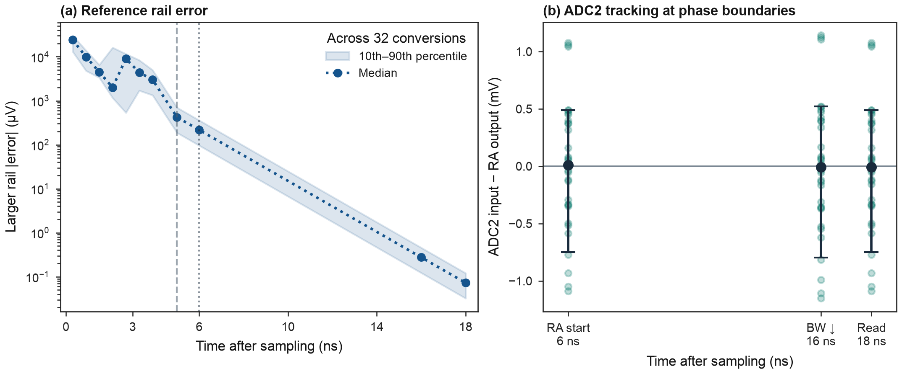

# 04 · 两段式动态参考（Coarse → Fine）精讲：如何把 1.9 mA 压到 ±17 µA 且零温漂？

> **一句话核心**：传统片上参考缓冲器又要扛大电流、又要微伏级低噪低漂，属于物理上的“不可能三角”。AD4080 把参考切成红蓝两路——**转换期红路缓冲器扛下 99% 体力活，余差期蓝路甩掉运放直接连通外部 `REF_IN`**，一招把外部基准电流压低 100 倍，还白嫖了 70 ppb/°C 的超低增益温漂！

---

## 一、为什么传统连续时间参考缓冲器（CT Buffer）行不通？

对照 ISSCC 2024 讲稿第 23 页：
- 为了把 20 位的 $kT/C$ 噪声压下来，RDAC 总采样电容高达 **20.5 pF**；
- 在 **40 MSPS** 下高速切换，平均要从参考端抽走 **~1.9 mA** 的码相关动态电流。

如果在外部基准引脚 `REF_IN` 和 `RDAC` 之间放一个常规的连续时间运放缓冲器，会立刻撞上三个死结（图中标红的 `R_P`、`BW`、`offset`）：

1. **寄生/输出电阻压降（`R_P`）**：1.9 mA 的信号相关电流流过哪怕几欧姆的输出阻抗或走线电阻，都会产生毫伏级码相关压降，直接毁掉 20 位 INL/THD。
2. **带宽与功耗死锁（`BW`）**：要在几纳秒内把 20.5 pF 建立到 20 位微伏精度，运放带宽和静态功耗直接爆炸。
3. **运放自身的失调、温漂与 1/f 噪声（`offset`）**：参考缓冲器在精密 ADC 里是“标尺”——运放自己哪怕漂了 10 µV 或带一点 1/f 噪声，都会 1:1 乘到全芯片的增益误差、增益温漂和低频噪声上！

---

## 二、破局核心：红蓝两路动态切换（Coarse Precharge → Fine Unbuffered）

对照 ISSCC 2024 讲稿第 24–27 页和专利 `US10826519B1` Fig.2，AD4080 用一个 2 选 1 模拟开关 `MUX` 把参考分成两条职责截然不同的支路：

| 支路 | 生效阶段 | 硬件组成 | 核心职责 | 对失调/1/f 噪声的要求 |
| --- | --- | --- | --- | --- |
| **红路 `Coarse`**（`MUX=1`） | `CONV` 粗转换期 | 片上预充缓冲器 + 封装/片外大退耦电容（`REF_PC`） | **干重体力活**：扛下 RDAC 大电容剧烈切换时 99%+ 的电荷冲击 | **很宽松！**（反正后面会切掉） |
| **蓝路 `Fine`**（`MUX=0`） | `RA` 余差放大期 | **无有源运放（`unbuffered`）**，开关直连外部精密 `REF_IN` | **做精密收尾**：补齐最后几毫伏以内的残余电荷，精密收敛到真实 `REF_IN` | **零缓冲器失调、零温漂、零 1/f 噪声！** |

### 一步一步看两阶段怎么接力（注意盯住 `MUX` 里那根切换线！）：

1. **第一步 · 粗转换期（`CONV`，`MUX_SEL = 1` 接红路）**：RDAC 根据 SADC 粗码猛切大电容，节点 `REF_RDAC` 被瞬间拉出明显跌落与震荡（波形里的红色下冲）——**完全没关系！** 此时蓝路 `REF_IN` 被 `MUX` 断开保护得严严实实，99% 以上的电荷全由红路缓冲器和 `REF_PC` 掏腰包：

2. **第二步 · 余差放大期（`RA`，`MUX_SEL = 0` 切蓝路）**：大电容已经充到离目标电压只有最后一点点残差时，`MUX` 切到蓝路直连无缓冲 `REF_IN`。因为电荷大头已经由红路搬完了，蓝路只需补一丝残余电流，在 RA 结束、ADC2 锁存（$t_A$）前稳稳收敛到微伏精度：

---

## 三、这一招带来了多恐怖的实测收益？

1. **外部基准电流暴降 100 倍**：从原本的 **1.9 mA（1,900 µA）** 压到仅 **`±17 µA`**（见左下实测曲线），普通外部精密基准芯片不用再配昂贵的高速大电流外置运放，直驱即可，彻底实现“信号链友好”：

2. **甩掉运放失调、温漂和 1/f 噪声**：因为最终锁存余差那一刻，RDAC 电容底板直接挂在无缓冲的 `REF_IN` 上，红路缓冲器自身的失调、温漂和 1/f 噪声被彻底隔离在精密信号路径之外！
3. **计量表级全温区温漂**：讲稿 p.28 实测在 −40°C 至 +85°C 全温区、40 MHz 满速下，整片增益温漂仅 **`70 ppb/°C`**（全温区变化 9 ppm），失调温漂仅 **`47 ppb/°C`**（全温区 5.9 ppm）：

---

## 四、本仓行为模型怎么建模与验收？

在咱们仓库里，这一动态切换和电荷建立过程由以下模块建模：
- [src/adi_model/behavioral/reference_mux.py](../../../src/adi_model/behavioral/reference_mux.py)：建模 `Coarse → Fine` 切换时序、开关导通电阻及外部 `REF_IN` 退耦网络；
- [src/adi_model/behavioral/reference_charge.py](../../../src/adi_model/behavioral/reference_charge.py) 与 [reference.py](../../../src/adi_model/behavioral/reference.py)：按 RDAC 实际码型抽取动态电荷、追踪参考轨瞬态压降与指数恢复。

看本仓实测行为图 (a) `Reference rail error`：采样后 0–5 ns 粗切换期间参考轨跌落高达数毫伏至十余毫伏；在约 5–6 ns 切入 `Fine` 精密参考并进入 RA 阶段后，参考误差沿指数直线飞速收敛，到 **18 ns 读出时刻压到 0.1 µV 以下（亚微伏级）**，完全满足 20 位精度预算！

> **工程设计踩坑提醒（片上基准岗核心关注）**：切到 `Fine` 路之后，RDAC 的精密参考在 RA 阶段前半段**仍在继续建立**——这正是下一篇为什么 RA 不能用开环动态积分放大器、必须用闭环 `gmR + OTA` 的根本原因！

---

*上一篇：[← 03 · 三维 DEM 与半格桥接](03_3d_dem_and_bridge.md) · 下一篇：[05 · 共享 ×32 余差放大器（RA）精讲 →](05_residue_amplifier.md)*
