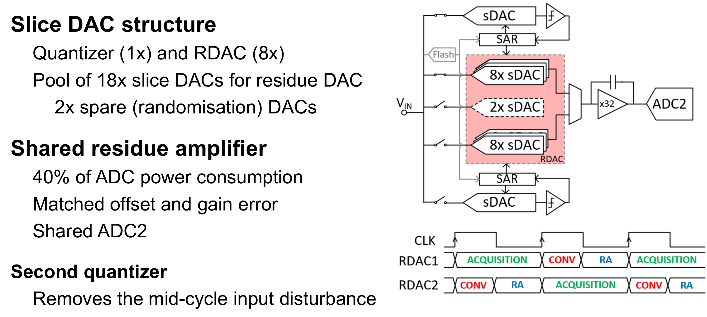
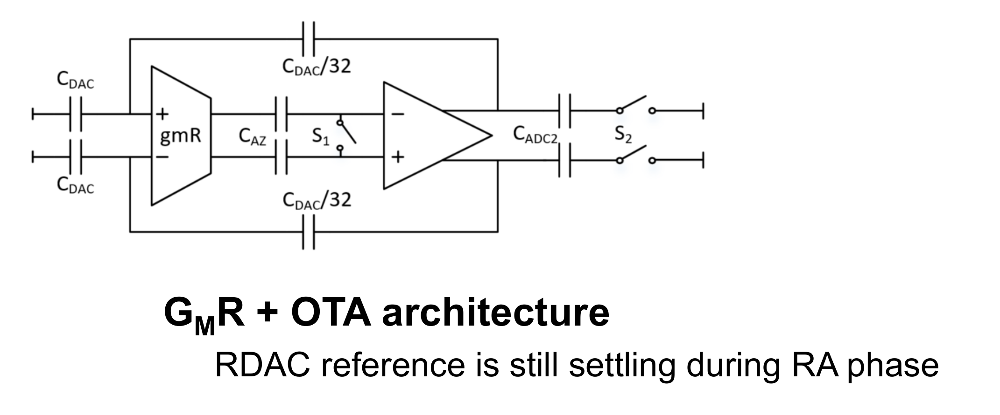
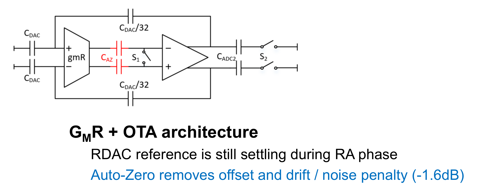
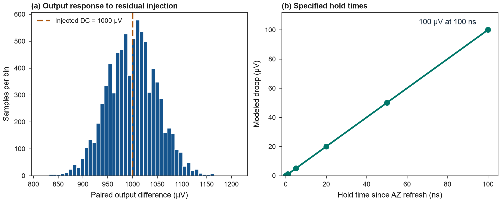
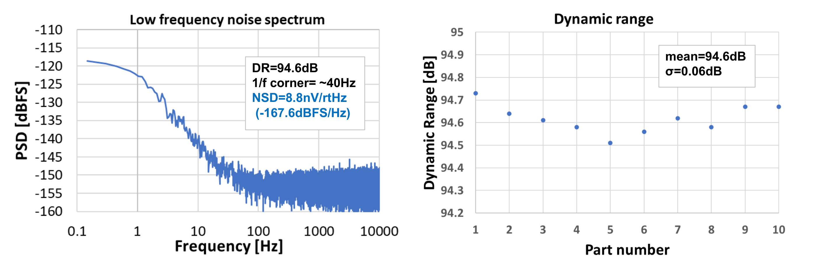
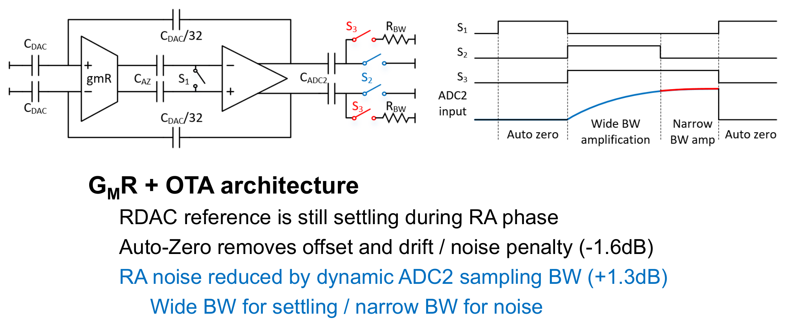
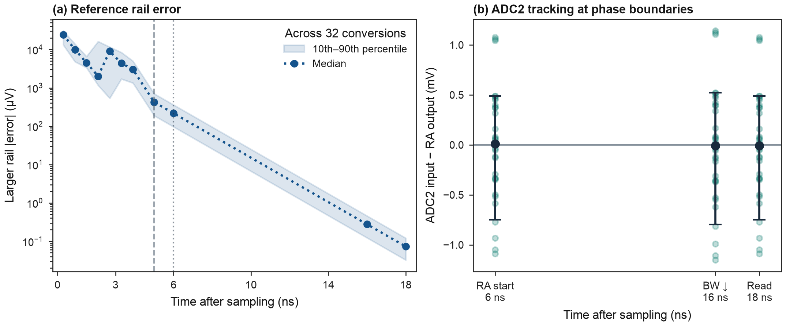
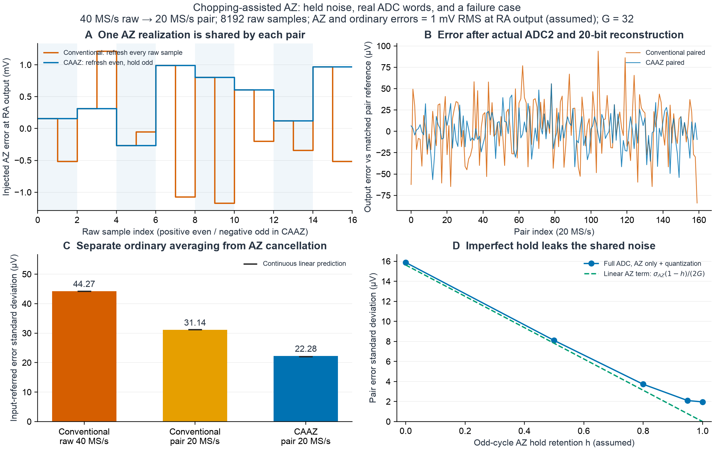

# 05 · 共享 ×32 余差放大器（RA）精讲：Auto-Zero 亏 −1.6 dB，怎么靠宽切窄带赢回 +1.3 dB？

> **一句话核心**：全部 18 片 RDAC 共享这一套 **×32 闭环 `gmR + OTA` 余差放大器**，它一家就吃掉了 ADC 核心 **40% 的功耗**。它靠闭环容忍 `Fine` 参考继续建立，靠 `Auto-Zero` 清失调和 1/f 噪声，再靠“宽带快充 → 窄带滤噪”两段采样把自动调零亏掉的热噪声几乎全部捞了回来！

---

## 一、为什么不用流行的动态积分放大器（Ring Amp / FIA），偏要用闭环 `gmR + OTA`？

先看 ISSCC 2024 讲稿第 12 页的整体架构与时序——18 片 RDAC（8 采 + 8 转 + 2 备）通过模拟多路开关，全部汇聚到这一只共享 **×32 闭环余差放大器**（独揽 ADC 核 **40% 功耗**，同时消除多通道失调与增益失配）再送往共享 `ADC2`：

读懂 AD4080 RA 设计的**第一把钥匙**是讲稿 p.33 的原话：
> **`RDAC reference is still settling during RA phase`（在余差放大阶段，RDAC 的精密参考仍在建立！）**

- 如 [04 篇](04_dynamic_reference.md) 所讲，进入 RA 阶段时 `MUX` 刚把 RDAC 切到蓝路 `Fine REF_IN`，前半段参考电压还在从几毫伏往亚微伏收敛。
- 如果采用开环动态积分放大器（如 FIA），参考电压一边晃、放大器一边对电流做时间积分，整个建立过程里的误差会被不可逆地积进输出；
- 而采用 **电容反馈闭环架构**（输入电容 $C_\mathrm{DAC}$、反馈电容 $C_\mathrm{DAC}/32$，名义闭环增益精确等于 **32**），只要在最终 ADC2 锁存那一瞬间（$t_A$），参考电压和运放闭环都已稳定到位，中间过程怎么抖动都不会影响最终稳态结果！

### 第一步：先搭好 `gmR + OTA` 两级闭环主体（讲稿 p.33）

- **第一级 `gmR`（电阻负载预放大级）**：宽带、超低噪声、增益适中，先把微弱余差拉大，把后面第二级 OTA 的噪声压下去；
- **第二级 `OTA`（高直流增益运放）**：提供超高开环直流增益，和 `gmR` 级联后形成极高环路增益，把闭环增益非线性压到 20 位以下。

---

## 二、第二步：加入自动调零（Auto-Zero），清失调、温漂、1/f 噪声与前周期记忆

由于 18 片 RDAC 共享同一套 RA，不仅 RA 自身的失调和 1/f 噪声会恶化 20 位直流精度，上一周期残留在大电容上的电荷如果清不干净，还会造成严重的**周期记忆效应（码间串扰）**。

**怎么解决（讲稿 p.34，图中标红的耦合电容 `C_AZ` 与短接开关 `S1`）**：

1. **`Auto zero` 相位（趁 SADC 粗转换时，闭合 `S1`）**：把 `OTA` 输入短接，将 `gmR` 第一级的失调电压和低频 1/f 噪声实时采样存在电容 `C_AZ` 上，同时把前一周期残留清空；
2. **放大相位（断开 `S1`）**：`C_AZ` 上存着的失调电压与 `gmR` 自身失调正负相消，低频 1/f 噪声被高通抑制（整片 1/f 拐点压到约 **40 Hz**，失调温漂压到 **47 ppb/°C**）。

**代价在哪？** 讲稿 p.34 诚实标出了代价：**`noise penalty (-1.6 dB)`**——因为 `S1` 断开瞬间会把自动调零相位采样到的宽带热噪声也叠加进信号路径，导致总热噪声略微变差 1.6 dB。

先看本仓行为模型对 Auto-Zero 残余直流注入响应（左图：1,000 µV 注入时的配对输出分布）与保持电容随刷新后保持时间的跌落建模（右图：100 ns 处 100 µV，25 ns 满速刷新下保持误差极小），再看 ISSCC 2024 实测低频噪声谱（左图 `1/f corner ≈ 40 Hz`、`NSD = 8.8 nV/√Hz`、右图 10 颗芯片 `DR = 94.6 dB` 均值）：

---

## 三、第三步（最神的一招）：动态切换 ADC2 采样带宽（宽带快充 → 窄带滤噪）

模拟电路里有个百年难题：
- **采样带宽越宽**：建立越快，但把运放输出的高频热噪声全放进采样电容里了（噪声大）；
- **采样带宽越窄**：高频热噪声被狠狠滤掉（噪声小），但 RC 太慢根本建立不完！

AD4080 在 RA 输出和 ADC2 采样电容 `C_ADC2` 之间放了**两副开关**（讲稿 p.35，图中标红的 **`S3 + R_BW`** 支路与下方完整三相位时序）：

- **蓝色开关 `S2`**：直接短接，极低导通电阻；
- **红色开关 `S3` + 串联电阻 `R_BW`**：故意串入一颗限带电阻！

看看一个 RA 周期内，三枚开关 `S1 / S2 / S3` 怎么默契配合：

1. **阶段 ① `Auto zero`**：`S1 = 1`、`S2 = 0`、`S3 = 0` —— 清零调偏，准备放大。
2. **阶段 ② `Wide BW amplification`（宽带快充）**：`S1 = 0`、**`S2 = 1` 且 `S3 = 1`** —— 蓝开关 `S2` 把电阻 `R_BW` 直接旁路短接，回路带宽极宽，ADC2 采样电容电压飞快爬升，迅速完成 **99% 的大摆幅建立**！
3. **阶段 ③ `Narrow BW amp`（窄带滤噪收尾）**：`S1 = 0`、**先断开 `S2 = 0`，只留 `S3 = 1`** —— 瞬间把 `R_BW` 串进采样回路，变成一个窄带低通滤波器！此时电压已经到位 99%，最后 1% 的微小残差靠窄带稳稳收敛完，同时把 `gmR + OTA` 送出来的高频宽带热噪声**砍掉一大截**！
4. **最终锁存**：断开 `S3`，`C_ADC2` 锁定干净的放大余差送给 ADC2 量化；紧接着闭合 `S1` 进入下一轮 `Auto zero`。

**算一笔总账**：Auto-Zero 亏了 **−1.6 dB** 热噪声，宽切窄带动态采样带宽硬生生赢回了 **`+1.3 dB`**！净代价仅 0.3 dB，却换来了“零失调、零温漂、零 1/f 噪声、零周期记忆”四重收益！

看本仓行为模型在 **RA 启动（6 ns）→ 切窄带（16 ns）→ 读出锁存（18 ns）** 三个关键相位边界上的 ADC2 跟踪分布（右图 (b)）：

---

## 四、本仓建模入口、延伸研究（CAAZ）与 RA 岗验收要点

仓库里对应 RA 与自动调零的行为模型位于：
- [src/adi_model/behavioral/ra.py](../../../src/adi_model/behavioral/ra.py)：闭环增益、有限带宽建立、宽/窄带两段切换及饱和窗口建模；
- [src/adi_model/behavioral/ra_az.py](../../../src/adi_model/behavioral/ra_az.py)：Auto-Zero 失调/1/f 抑制与采样热噪声折算。
- **延伸研究 · 斩波辅助自动调零（CAAZ，非 AD4080 原厂特性）**：本仓 [docs/caaz/](../../caaz/README.md) 另基于 VLSI 2025 C32-1（Wang et al.）机制进行了可选延伸研究——把偶数周期的 Auto-Zero 采样噪声保持到奇数周期并在配对求和中正负相消（40 MS/s 原始 → 20 MS/s 配对输出，A–D 四子图展示噪声保持、重构对比与保持系数敏感度，详见 [NOTICE](../../meta/NOTICE)）：

> **给 RA 设计岗的实操要点**：仿真时必须同时带上 **`C_DAC` 等效源阻抗**、**参考正在建立的动态波形**和 **`C_ADC2` + `S2/S3/R_BW` 真实开关负载**，重点扫描 **`S2` 切窄带的时刻**（切早了建立残差超标，切晚了高频噪声滤不干净）与 **`S3` 最终锁存时刻 $t_A$**。

---

*上一篇：[← 04 · 两段式动态参考精讲](04_dynamic_reference.md) · 下一篇：[06 · 事件跟随、片外校准与 7 级流水重构精讲 →](06_events_calib_recon.md)*
