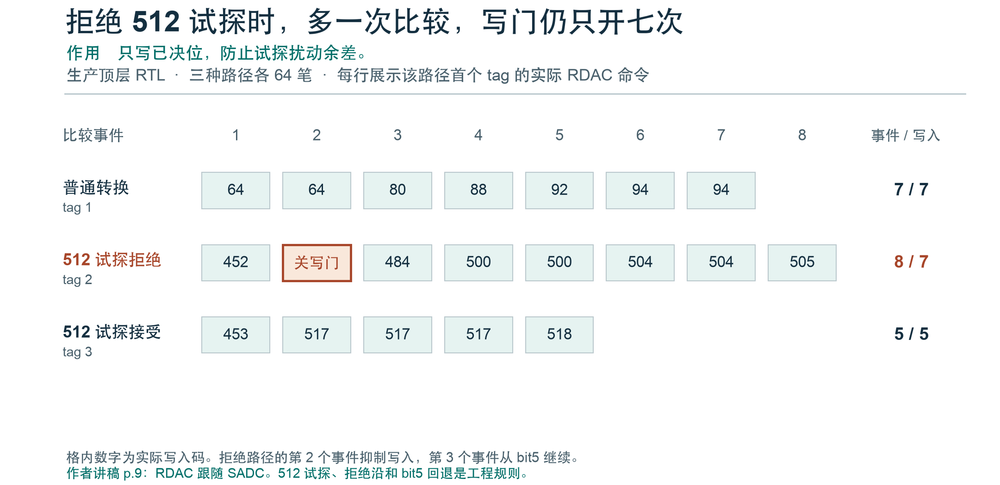
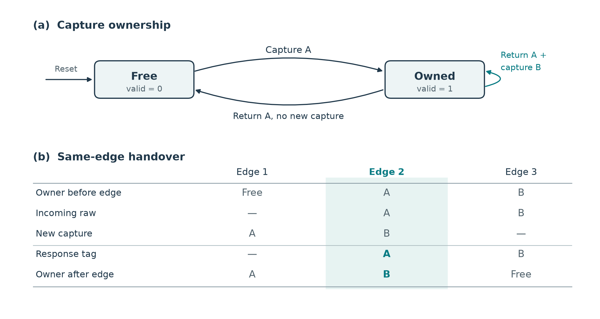
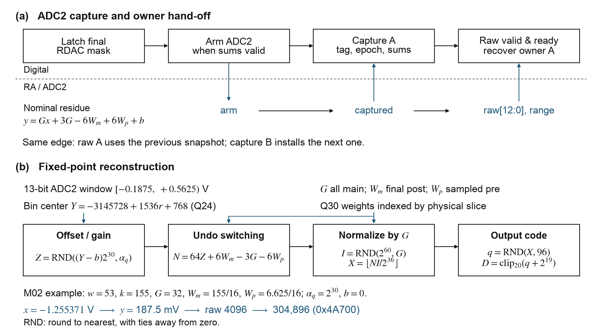
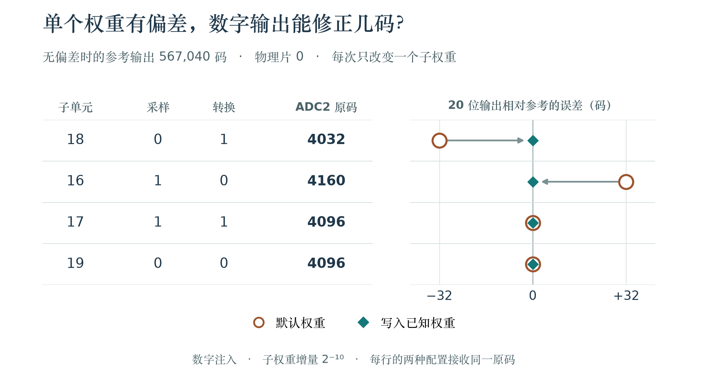
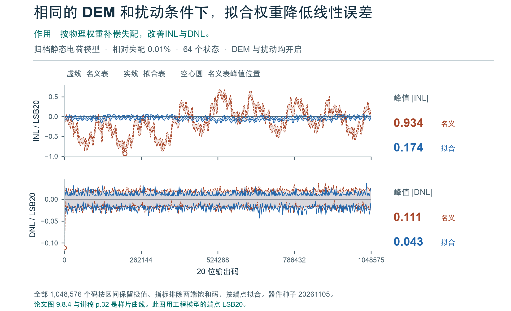
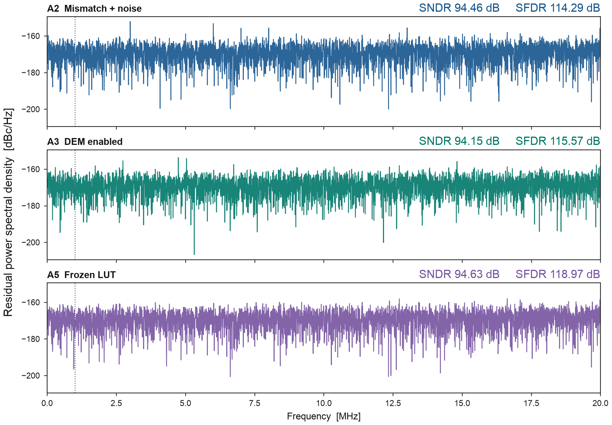
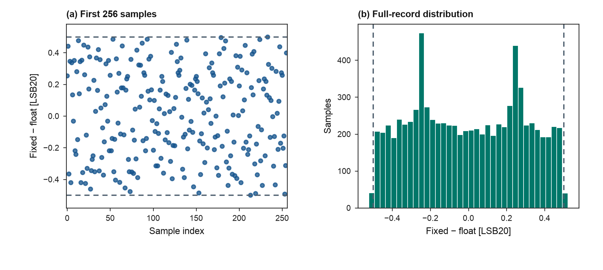
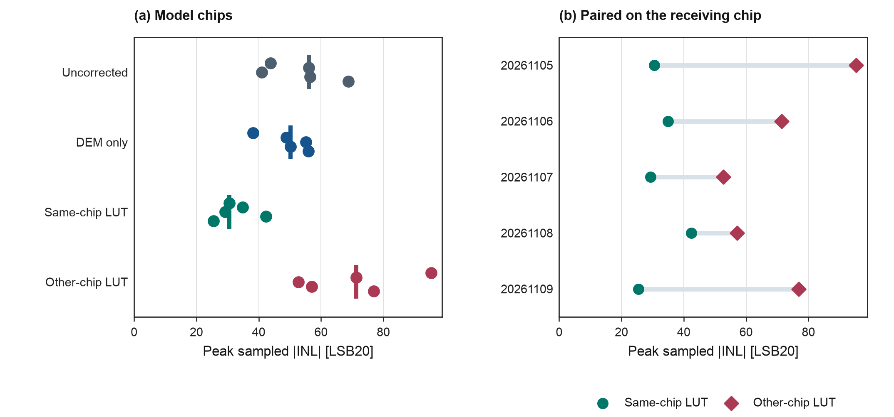

# 06 · 事件跟随、片外位权校准与 7 级流水定点重构精讲

> **一句话核心**：前面把模拟端和开关洗牌全都安排明白了，最后怎么把 **SADC 粗判决、实际用过的 8 片开关记录、片外标定的 360 个电容权重、ADC2 的 13-bit 细码** 严丝合缝拼成一个 20-bit 干净输出？这一篇带你把 `sar_evt_v21 → wsum_v21 → recon_v21` 整条数字中枢彻底摸透。

---

## 一、实时事件跟随（`sar_evt_v21.sv`）：为什么只写“已决位”？512 保护门限干嘛用？

### 1. 绝不向 RDAC 传递“试探位”
SADC 自己做二分搜索时会有试探和反悔，但数字跟随器（[rtl/sar_core/sar_evt_v21.sv](../../../rtl/sar_core/sar_evt_v21.sv)）**只消费已经判决确定的位（已决事件）**，再经 `dem_mask_v3` 去更新 RDAC 物理开关：


- 普通区：1 次 3-bit Flash 提交（初始化 `prefix = F << 6`）+ 6 次逐位 SAR 提交（`bit5..bit0`），共 **7 次写入**。
- 代码特意把 `event_index`（提交序号）和 `bit_index`（物理位号）彻底拆开检查，防止协议错乱；同时用 **11 位中间加法**计算 `k = prefix + U` 并校验 `0..520`，只要协议错或越界，立即拉低 `apply_fire_o` **关闭物理写门**，绝不让脏数据误切模拟电容！

### 2. 满量程保护（512 Guard 门限）怎么防正向 Dither 溢出？
正向 Split Dither 会把满量程附近的等效输入往上推（名义 9-bit 最大码是 `511`，加上 dither 后粗码 $c$ 最高会顶到 `514`、RDAC 命令 $k = c+U$ 最高顶到 `519`，再留 1 码余量到 `520`）。
如果直接按 9-bit 无符号回绕，`512` 会瞬间翻成 `0` 把整笔输出炸飞！

所以代码在 Flash 最高区间（`F = 7`，`prefix = 448`）增加了一次 **512 门限试探**：
- **若接受 512（走 guard 路径）**：直接置 `prefix = 512`（RDAC 主阵列 8×8 全亮），再解析低 3 位，共 **5 次事件 / 5 次写入**；
- **若拒绝 512（回退普通路径）**：**本拍关闭写门（不扰动 RDAC）**，紧接着从 `bit5` 继续往下比，共 **8 次比较事件，但物理写门仍只开 7 次**！

看 Verilator 实测的三条路径对照图，清清楚楚：



---

## 二、多笔交错流水怎么做到 25 ns 连续不打架？（`acq_conv_ctx.sv` + `adc2_capture.sv`）

在 40 MSPS（25 ns）连续运行时，芯片里同一瞬间同时飘着 **3 笔不同阶段的样本**！看下面 640 MHz 理想时钟实测图的 **第 32 个时钟沿**：
- **`tag 1`**：正在从 ADC2 **返回 13-bit 细码**；
- **`tag 2`**：正在做 **余差捕获**（锁进 ADC2）；
- **`tag 3`**：正在 **采集输入**！



为了绝不串笔：
- [rtl/sar_core/acq_conv_ctx.sv](../../../rtl/sar_core/acq_conv_ctx.sv) 给每笔受理的样本打上唯一 32 位 `tag`，把该笔用过的 **8 片物理 ID、采样预置 `pre`、dither 上段 `U`、系数版本号 `epoch`** 打包成不可变描述符随样本一路流动；
- [rtl/sar_core/adc2_capture.sv](../../../rtl/sar_core/adc2_capture.sv) 收到 ADC2 返回的 13-bit 原码（窗口 `[-0.1875, +0.5625) V`，每步折合 0.50 LSB20）后，按 `owner/tag` 精准认领回原主，绝不错配。

---

## 三、片外怎么求 18×20（360 个）电容权重？片内 7 级流水怎么算？

### 1. 片外最小二乘辨识权重（`src/adi_model/calibration/`）
18 片 RDAC，每片 20 个物理单元（16 个 `4Cu` 主半单元 + 4 个子阵列单元），全芯片共 **360 个物理电容权重 `W[s][j]`**（Q30 定点存储，表示 `round((C_eff/C_f) * 2^30)`）。

在片外施加已知校准激励 $x_\mathrm{cal}[n]$，采集对应的粗码、细级余差和当次实际开关矩阵 $\mathbf a_n$，构建线性方程：
$$e[n] = x_\mathrm{cal}[n] - \bigl(D_0(c[n]) + r_f[n]\bigr) \approx b + \mathbf a_n^\mathsf{T}\Delta\mathbf w$$
通过 QR / SVD 最小二乘一次解出全部 360 个真实电容权重（具体见 [weight_calibration.py](../../../src/adi_model/calibration/weight_calibration.py) 与 [mask_calibration.py](../../../src/adi_model/calibration/mask_calibration.py)），定点量化后经配置口装入片内权重表，并递增 `cfg_epoch` 版本号。

### 2. 片内权重累加（`wsum_v21.sv`）+ 7 级整数流水重构（`recon_v21.sv`）
先看下面两张全景图——第一张把 ADC2 捕获握手与 4 步整数重构公式（含 `w=53, k=155 → 304,896` 手算算例）串在一起，第二张画出 `recon_v21.sv` 的实际流水线数据流：





收到 ADC2 的 13-bit `adc2_raw` 后，[rtl/sar_core/wsum_v21.sv](../../../rtl/sar_core/wsum_v21.sv) 按本笔真实的 8 片物理 ID 查权重表，算出三个量：
- **`Wm`**：本笔最终转换开关 `post` 的加权和；
- **`Wp`**：本笔采样预置开关 `pre` 的加权和；
- **`G`**：本笔 8 片主阵列的实际总权重和（名义值 `32 * 2^30`）。

接着进入 [rtl/sar_core/recon_v21.sv](../../../rtl/sar_core/recon_v21.sv) 的 **7 级流水线（S1a → S1b → S2a → S2b → S2c → S3 → S4，共 7 个寄存级，`t` 沿受理 → `t+6` 沿出码）**，逐字执行合同规定的纯整数公式（无任何浮点）：

```text
Y = -3145728 + 1536 * adc2_raw + 768          // 13-bit 细码转 Q24 码箱中心
Z = RND((Y - b) * 2^30, alpha_q30)            // 偏置与增益校正（alpha=2^30 时旁路）
N = Z * 64 + 6 * Wm - 3 * G - 6 * Wp          // 合码 + 只扣一次真实 Wp 完成非理想去扰！
I = RND(2^60, G)                              // recip_rnd_v21 + recip_q60 求 G 的倒数
X = floor((N * I) / 2^36)                     // 乘倒数归一（S3 严格检查 32 位符号扩展防溢出）
Q = RND(X, 96)                                // 对称最近舍入到 20-bit LSB
code = sat_20(Q + 524288)                     // 限幅到 [0, 1048575] 输出 20-bit 码
```

> **代码里的防呆设计**：`recon_v21` 随每笔样本检查 `in_epoch == cfg_epoch`（防止后台更新校准表时新旧系数混用）；旁路标志 `alpha_bypass` 必须读锁存寄存器 `alpha1a_q` 而非实时端口（修复过连续多笔时的跨笔串扰 Bug）；S3 用本笔 `X` 单独校验 32 位有符号截断，修复过“负数后紧接中点码误报错误”的缺陷。

---

## 四、看看整套闭环的 4 张硬核实测效果图

1. **单单元失配注入 → 装入权重全部归零**：给物理片 0 的子单元 18 注入 1/1024 权重差，名义表下 192 笔里 10 笔低 32 码、14 笔高 32 码；装入权重后 **192 笔全部精确归零**：



2. **全码 20-bit（1,048,576 码）静态 INL / DNL**：峰值 |INL| 从 `0.934` 压到 **`0.174 LSB20`**，峰值 |DNL| 从 `0.111` 压到 **`0.043 LSB20`**：



3. **动态频谱 PSD 实测**：从 Mismatch+noise → 开启 DEM → 加上冻结校准表（Frozen LUT），动态性能达到 **SNDR 94.63 dB / SFDR 118.97 dB**：



4. **定点整数 RTL vs 浮点数学参考对照 + 单芯片权重表泛化检验**：前者确认整条 7 级定点流水线与浮点参考之差严格落在 **`±0.5 LSB20`** 舍入包络内（无系统漂移），后者验证了每颗芯片的权重 LUT 必须匹配其自身真实失配（Same-chip LUT 大幅收敛 INL，不能拿别片芯片的 LUT 混用）：





---

*上一篇：[← 05 · 余差放大器 RA 精讲](05_residue_amplifier.md) · 下一篇：[07 · 单芯片顶层与 AD4080 数字外围精讲 →](07_peripherals_and_chip_top.md)*
