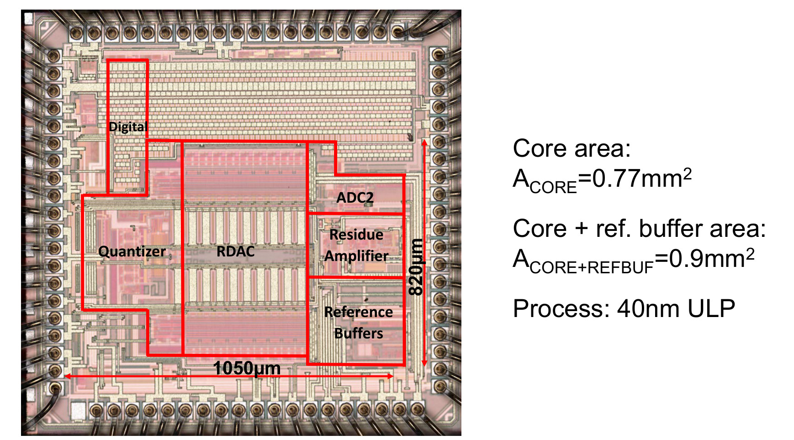
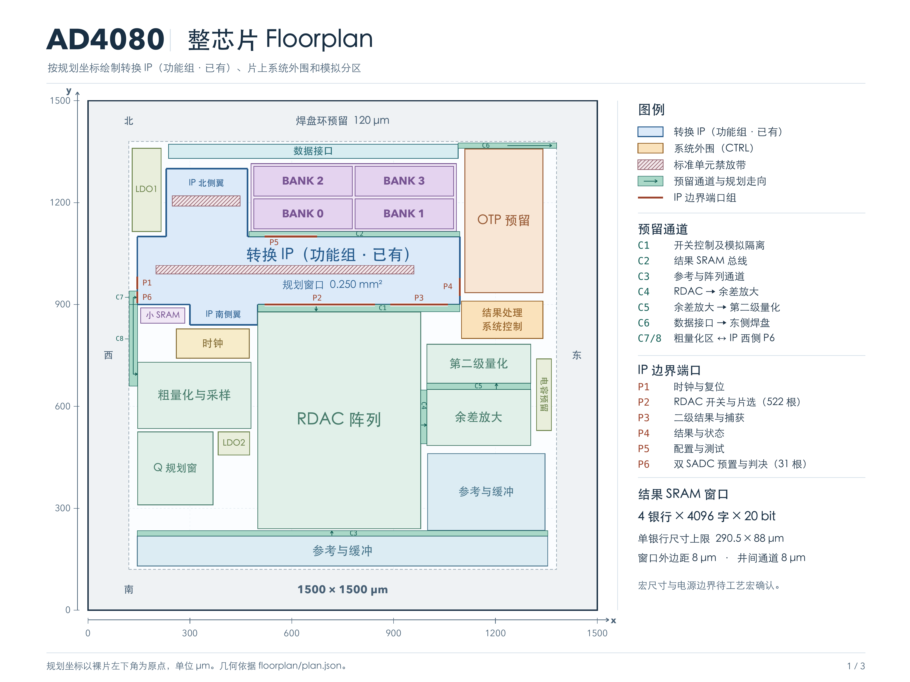
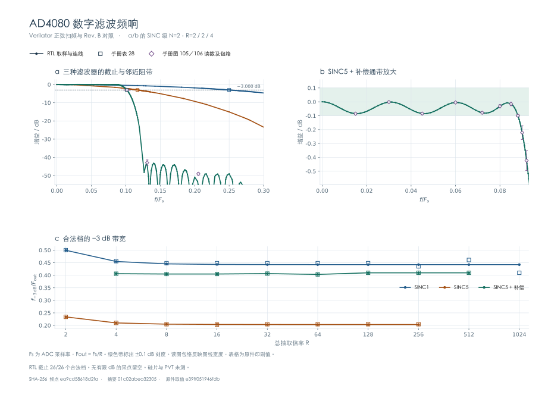
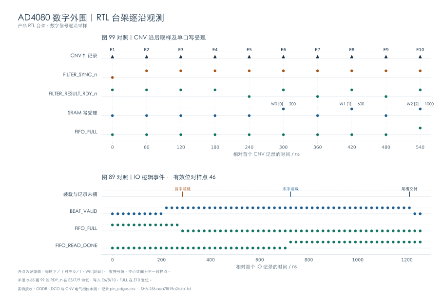
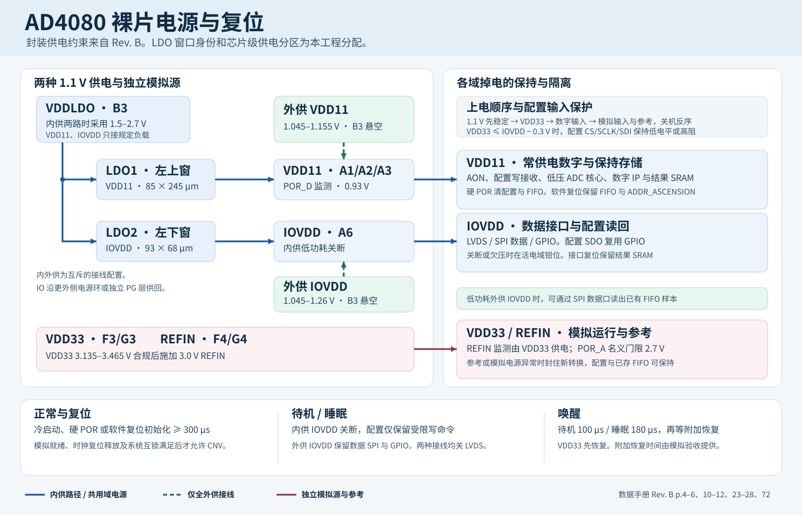
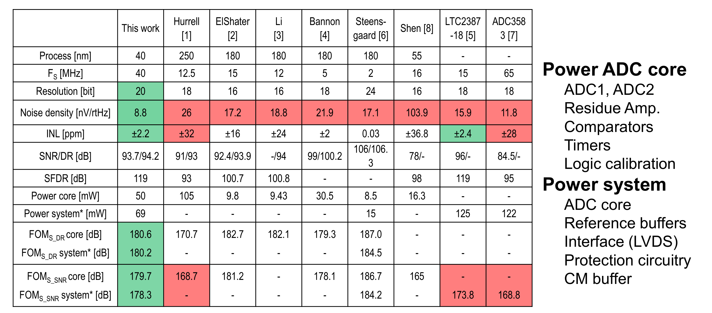

# 07 · 单芯片顶层与 AD4080 数字外围精讲（DSP 滤波 · 16K FIFO · SPI/LVDS · 电源域）

> **一句话核心**：一颗好用的商品级 ADC 绝不只是“把电压变成码”就完事了。转换核 `adc_digital_ip_v21` 吐出 20-bit 码之后，还需要在总顶层 [ad4080_chip_top.sv](../../../rtl/top/ad4080_chip_top.sv) 里经过**系统零点/增益校正、26 档可编程数字滤波、触发与 16K×20 结果存储、AON 电源与 OTP 管理，最后通过 50 MHz SPI 或 400 MHz DDR LVDS 稳稳送出芯片**。

---

## 一、从 ISSCC 核心裸片到商品级整芯片 Floorplan：转换核和外围各占多大地方？

先对照两张物理规划图——第一张是 ISSCC 2024 的 **40 nm ULP 真实核心裸片显微照**（仅 ADC 核 `0.77 mm²`，含参考缓冲器 `0.90 mm²`，一眼看清 `Quantizer / RDAC / ADC2 / Residue Amplifier / Reference Buffers / Digital` 的真实面积占比）：

再把商品级 AD4080 所需的全套数字外围（16K FIFO、OTP、DSP/CTRL、高速 LVDS/SPI DIO）加进来，就构成了本仓 `ad4080_chip_top` 的 **1500 × 1500 µm 整芯片 Floorplan**：

- **转换核 IP（蓝色区，规划窗口 `0.250 mm²`）**：就是前 6 篇讲的 `adc_digital_ip_v21`（11 个生产 `.sv`），通过 P2（522 根 RDAC 开关线）和 P6（31 根双 SADC 线）往下控整个模拟阵列，通过 P4 把重构好的 20-bit 码交出去。
- **产品数字外围（五窗合计 `0.286 mm²`）**：
  - `FIFO`（4 Bank × 4096 × 20 bit = 16K×20 结果 SRAM，紫色区）：`0.121 mm²`
  - `OTP 预留`（出厂校准参数存储）：`0.097 mm²`
  - `DIO`（高速 LVDS / SPI 数据接口边界）：`0.036 mm²`
  - `CTRL`（DSP 后处理、寄存器、触发与管理逻辑）：`0.026 mm²`
  - `小 SRAM`：`0.006 mm²`

---

## 二、20-bit 码出核后的“后半生”：四大外围子系统

### 1. DSP 数据面：系统校正 + 26 档数字滤波（`rtl/ad4080_dsp/`）
- **用户系统 `OFFSET / GAIN` 校正**（[sys_error_corr.sv](../../../rtl/ad4080_dsp/sys_error_corr.sv)）：严格按 AD4080 手册顺序“**先加 OFFSET、再乘 GAIN**”，用于修正整条板级前端的直流偏置与增益误差（手册图 96 定向输入实测输出 `1032`，与原厂一致）。
- **三条可编程滤波抽取通路**（[ad4080_dsp_chain.sv](../../../rtl/ad4080_dsp/ad4080_dsp_chain.sv)）：通过 8 位寄存器 `0x29` 选通直通、`SINC1` 平均、`SINC5` 以及 **`SINC5 + 35 抽头对称补偿 FIR`**（普通与补偿共享同一条五阶 CIC 省面积）。
- 看 Verilator 正弦扫频与 AD4080 Rev. B 手册表 28 / 图 105–106 的 26 档全合法频响对拍——曲线和手册标称点几乎完全重合：

### 2. 事件触发、全片唯一 16K×20 结果存储与 MBIST（`rtl/ad4080_periph/memory/`）
- 在光谱分析、细胞分选等科学仪器里，主机不需要 24 小时硬吞 40 MSPS 码流——外围提供**阈值比较 / 外部 GPIO 事件触发**，只在感兴趣事件发生时把前后波形存进全片共享的 **16,384 × 20 bit 四银行 SRAM**（[result_store.sv](../../../rtl/ad4080_periph/rtl/result_store.sv)），写满置位 `FIFO_FULL` 后再从容读出。
- 内置破坏性 **MBIST 存储自测**（[result_store_mbist.sv](../../../rtl/ad4080_periph/memory/result_store_mbist.sv)）：进入测试前必须先排空功能读写、取得独占授权，测试完后需显式清旧指针并重建元数据后才恢复采样。

### 3. 三类对外接口与台架逐沿实测（`io/`、`transport/`）
- **50 MHz 4 线配置 SPI**（[spi_slave.sv](../../../rtl/ad4080_dsp/spi_slave.sv)）：读写全部控制寄存器、校正系数、滤波与触发阈值（已过 1 ps 保持数字复验）。
- **4 线结果 SPI（A/B/C/D）**：用于从 16K FIFO 读回完整捕获记录。
- **40 MS/s 连续 DDR LVDS**（[ad4080_result_transport.sv](../../../rtl/ad4080_periph/transport/ad4080_result_transport.sv)）：支持 **单路 400 MHz DDR（800 Mbit/s）** 和 **双路 200 MHz DDR**，三组模式 384 笔逐位核对全部通过。

看下面 RTL 台架逐沿观测图（直接对拍 AD4080 手册图 99 的 CNV/SRAM 写入和图 89 的 46 对连续 LVDS/FIFO 读回）：

### 4. 三时钟域、AON 常开电源监管与 OTP 影加载（`power/`、`otp/`）
全芯片明确划分三个时钟域（CDC 统一由外围管理）：
- **`clk_aon_i`（常开控制域）**：[ad4080_pwr_supervisor.sv](../../../rtl/ad4080_periph/power/ad4080_pwr_supervisor.sv) 监测核心 `VDD11`、`IOVDD`、`VDD33`、`REFIN` 与 `POR_D` 状态，管控正常 / 待机 / 睡眠、软件复位及 LDO 安全关断；[otp_shadow_loader.sv](../../../rtl/ad4080_periph/otp/otp_shadow_loader.sv) 负责冷启动读取并全表校验 OTP 镜像后一次性发布。
- **`clk_core_i`（核心与 DSP 域）**：驱动 SAR 转换、DSP 滤波、事件触发与 SRAM 读写。
- **`clk_io_i`（高速 IO 域）**：驱动结果打包、CRC 会话与 DDR LVDS 发射。

---

## 三、整片功耗组成与行业横评（Core 50 mW vs System 69 mW）

把外围（参考缓冲器、LVDS 接口、保护电路、共模缓冲器）全部算进来，AD4080 整片系统功耗也仅 **69 mW**（核心 **50 mW**），以 **8.8 nV/√Hz** 的噪底和 **±2.2 ppm** 的线性度在 40 MS/s 档位拿下 **180.6 dB 核心 / 180.2 dB 系统级 `FoM_S_DR`**：

---

## 四、清楚区分边界：数字外围已齐全，哪些物理硬宏留成公开端口？

为了保证综合干净且架构解耦，[ad4080_chip_top.sv](../../../rtl/top/ad4080_chip_top.sv) 将所有模拟与工艺厂硬宏都以清晰端口留在芯片边界之外，后续流片接入时需要补齐：
1. **片上模拟硬宏**：LDO1/LDO2、POR 与参考掉压检测器、400 MHz LVDS PHY 模拟收发器（含 100 Ω 端接与 Pad/ESD），以及 40 nm ADC 模拟核心（前端/AUXIN、双 SADC + Flash、18 片 RDAC、共享 RA、动态参考）。
2. **工艺厂存储硬宏**：将 16K×20 结果存储与 OTP 替换为目标工艺厂 Compiler 生成的真实 SRAM / OTP 硬宏（附真实 LEF/Liberty）。
3. **评估板实测对齐项**：商用 CRC24 参数、真实 `DCLK/DCO` 与 `CNV` 首发相位、`CTRL` 分区（0.0264 mm²）在目标工艺库下的最终综合面积复核。

---

*上一篇：[← 06 · 事件跟随、校准与重构精讲](06_events_calib_recon.md) · [返回精讲总目录](README.md) · [返回项目首页 README](../../../README.md)*
