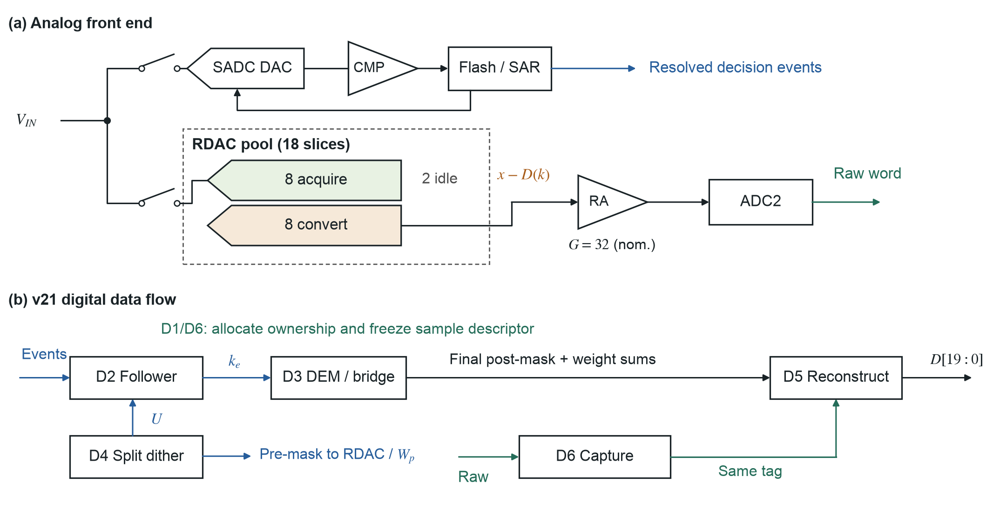
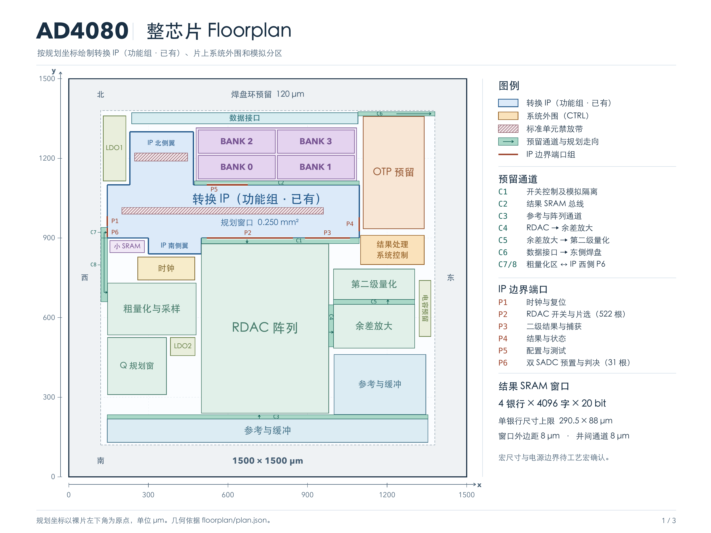

# AD4080 核心原理与代码实现精讲系列

> 如果你想把这颗 **20-bit / 40 MSPS 精密两级 SAR ADC** 的每一块积木都彻底吃透——不仅知道“它叫什么名字”，更知道“为什么非要这么设计、传统方案死在哪、硬件电路和 RTL 每一行是怎么落地的”，这套精讲就是为你准备的。

---

## 一笔电压信号从引脚进来到 20-bit 出码的“完整一生”

要在一颗 40 nm 芯片上同时做到 **20 位线性度（±2 ppm）、40 MSPS（每周期仅 25 ns）、8.8 nV/√Hz 超低噪底、69 mW 整片功耗**，而且让外部驱动电路轻松好推，传统单核 SAR 会同时撞上 **四堵墙**：驱动带宽墙、参考电流墙、电容失配墙、速度与噪声墙。

AD4080 把这四堵墙拆解成了 **7 步接力**。先看整条模拟→数字完整信号流（从输入采样到 20-bit 重构出码），再逐篇拆透每一站：

| 章节 | 专题文档 | 一句话看懂核心妙招 | 对应核心代码 / 模型 |
| --- | --- | --- | --- |
| **01** | [RDAC 分离与 18 选 8 交织精讲](01_rdac_and_interleaving.md) | 摘出大电容不做试错，白嫖 6 大红利；18 片池留 2 片备用轮换打散交织杂散 | [sched18.sv](../../../rtl/sar_core/sched18.sv) |
| **02** | [整数 + 小数 Split Dither 精讲](02_split_dither.md) | “米尺 + 游标”分开晃：整数打散 RDAC 且就地抵消不撑爆 RA，8 片平均凭空造出 $f/8$ 小数 | [dither_pre.sv](../../../rtl/sar_core/dither_pre.sv) |
| **03** | [三维 DEM 与 50% 半格桥接精讲](03_3d_dem_and_bridge.md) | 拿 $k=213$ 手绘 8×8 棋盘；把 `8Cu` 拆成两个 `4Cu` 抹平一元区与二进制区的跨界死缝 | [dem_mask_v3.sv](../../../rtl/sar_core/dem_mask_v3.sv) |
| **04** | [两段式动态参考（Coarse → Fine）精讲](04_dynamic_reference.md) | 转换期红路缓冲器扛 99% 重活，余差期蓝路无缓冲直连 `REF_IN`，电流暴降 100 倍且零温漂 | [reference_mux.py](../../../src/adi_model/behavioral/reference_mux.py) |
| **05** | [共享 ×32 余差放大器（RA）精讲](05_residue_amplifier.md) | 闭环 `gmR+OTA` 容忍参考继续建立；Auto-Zero 亏 −1.6 dB，宽切窄带赢回 +1.3 dB | [ra.py](../../../src/adi_model/behavioral/ra.py) · [ra_az.py](../../../src/adi_model/behavioral/ra_az.py) |
| **06** | [事件跟随、片外校准与 7 级流水重构精讲](06_events_calib_recon.md) | 512 保护门限防溢出；片外求 18×20 权重表；7 级整数流水线只扣一次实际 `Wp` 精准还码 | [sar_evt_v21.sv](../../../rtl/sar_core/sar_evt_v21.sv) · [wsum_v21.sv](../../../rtl/sar_core/wsum_v21.sv) · [recon_v21.sv](../../../rtl/sar_core/recon_v21.sv) |
| **07** | [单芯片顶层与 AD4080 数字外围精讲](07_peripherals_and_chip_top.md) | 20-bit 码出核后的后半生：OFFSET/GAIN 校正、26 档滤波、16K SRAM/MBIST、SPI/LVDS 与电源域 | [ad4080_chip_top.sv](../../../rtl/top/ad4080_chip_top.sv) · [ad4080_periph](../../../rtl/ad4080_periph/README.md) |

---

*延伸查阅：[回到项目首页 README](../../../README.md) · [现行数字接口合同](../../CONTRACT_CURRENT.md) · [算法与状态机图册](../../algorithms/README.md)*
