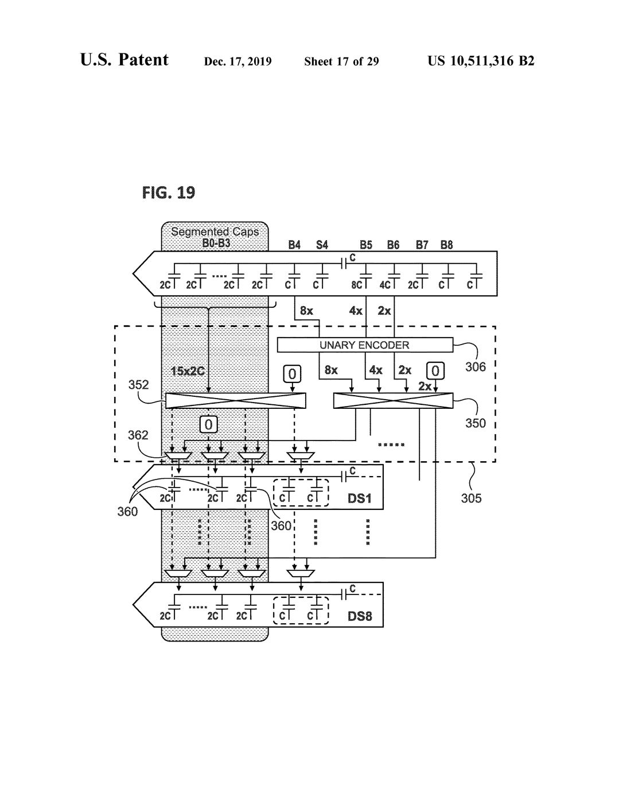
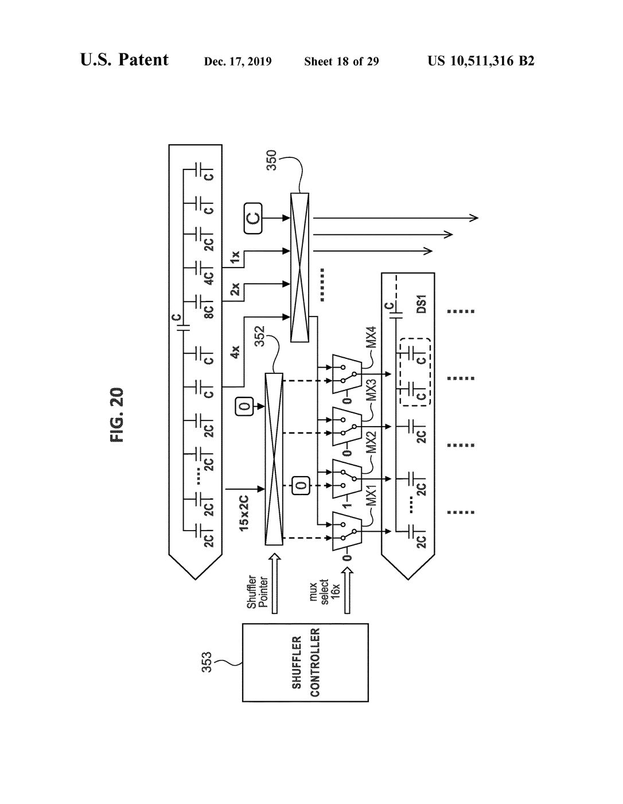
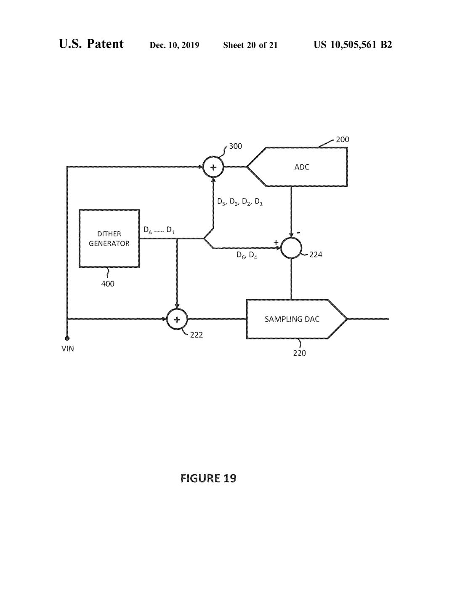

# T01–T10 关键技术自查（原件对照版）

受测版本：`02c3676`；本文件首次取得**专利原件页图**并逐项核对。

> 资料身份：`PAPER` = ISSCC 2024 §9.8 论文；`SLIDES` = 同篇 44 页 PPT；
> `PAT-STAGE` = US10516408B2；`PAT-DITHER` = US10505561B2；
> `PAT-DEM` = US10511316B2；`PAT-TRACK` = US10707889B1；
> `PAT-AUX` = US10541702B1；`PAT-REF` = US10826519B1。

**本轮的方法学限制（必须先说）**：六份专利中五份是**扫描图像 PDF**，文本层只有页码
（提取 25–46 字符）。因此本轮能核对的是**图**，核对不了**说明书正文**。
凡依赖正文的数值（如 dither 的 4:2:1/7 权重、参考时间常数）仍标
「正文未核对」。任何拿图推断正文数值的做法都在下文单独标注。

---

## 原件索引（已核对）

| 标识 | 文件 | 页数 | 文本层 | 本轮核对到的图 |
|:---|:---|---:|:---|:---|
| PAT-DITHER | `[10]_US10505561B2_Dither_Method_and_ADC.pdf` | 36 | 无（扫描） | **FIG.19**（Sheet 20/21）、FIG.4（Sheet 4/21） |
| PAT-DEM | `[11]_US10511316B2_Dynamic_Element_Matching.pdf` | 47 | 无（扫描） | **FIG.19**（Sheet 17/29）、**FIG.20**（Sheet 18/29）、FIG.12/13（Sheet 11/29） |
| PAT-STAGE | `[09]_US10516408B2` | 33 | 无 | 未逐图核对 |
| PAT-TRACK | `[12]_US10707889B1` | 13 | **有**（45 868 字符） | 可文本检索 |
| PAT-AUX | `[13]_US10541702B1` | 17 | 无 | 未逐图核对 |
| PAT-REF | `[14]_US10826519B1` | 26 | 无 | 未逐图核对 |

原图已存入 `docs/mechanisms/figures/`（美国专利图属公有领域，保留出处）。

---

## T01 电压域、电容网络与电荷方程

| 维度 | 状态 | 依据 |
|:---|:---|:---|
| 来源一致性 | **PARTIAL** | 差分级 ±3 V、40 MS/s、18 片池来自 PAPER；**PPT 第 27 页 20.5 pF 标注本轮未核对**（PPT 为图像版） |
| 实现完整性 | **PARTIAL** | 20.5 pF **已映射**：`defaults.py` 推断表里 `active_capacitance_anchor_f = 2.05e-11`，等级 `DISCLOSED_ANCHOR_WITH_NODE_ASSUMPTION`（"映射到名义 Cnorm，不是提取的输入负载网络"）。节点表仍分散在 `topology/dac_arch.py` 与 `simulation/config.py`，没有单一节点字典 |
| 独立正确性 | **PARTIAL** | β 广播轴有反例测试（`test_beta_expands_along_the_sub_unit_axis`）；**β 闭式 vs 独立节点矩阵求解未做** |
| 效果有效性 | **PARTIAL** | 20.5 pF 的映射有**显式等级**，可以引用"按该假设映射"，但不能声称"复现了论文的采样电容" |

**已确认的**：`split_capacitance_coefficients` 里 β 是 `[sample, active]`，子电容是
`[sample, active, unit]`，展开用 `beta[..., None]`；有测试覆盖"活动片数 == 子单元数 = 8"
的巧合情形（该巧合在这颗芯片上真实存在）。

**已确认的（更正）**：20.5 pF 并非"未映射"。`defaults.py` 的推断表里
`active_capacitance_anchor_f = 2.05e-11`，等级 `DISCLOSED_ANCHOR_WITH_NODE_ASSUMPTION`，
理由写明"映射到名义 Cnorm，不是提取的输入负载网络"。**可以按该假设引用，不能声称是提取值。**

**仍未确认的**：单侧/差分口径；它与 `unit_cap_f = 20.5pF/[8*(63+8/8)]` 的推导链
只在名义条件下自洽。

---

## T02 SADC/RDAC 分离与 RDAC follower

| 维度 | 状态 | 依据 |
|:---|:---|:---|
| 来源一致性 | **PARTIAL** | 分离结构来自 PAPER Fig.9.8.1 与 PAT-STAGE；PAT-STAGE 图未逐图核对 |
| 实现完整性 | **PASS（结构）** | `control/follower.py` 只消费已决前缀；`pipeline_engine` 逐事件调用 |
| 独立正确性 | **PASS** | 前缀截断不变性 28 672 检查 / 0 违约；同码最终电荷 61.3 pC 三条路径闭合 |
| 效果有效性 | **PARTIAL** | 参考电荷 3.01× 的对比成立；但**逐事件建立波形与参考峰值负载未做** |

**因果反例**：改了尚未产生的低位判决，此前 RDAC 事件不变（已由前缀表结构保证并有测试）。

---

## T03 模拟交织、物理切片归属与采样时刻

| 维度 | 状态 | 依据 |
|:---|:---|:---|
| 来源一致性 | **PARTIAL** | 8 采 / 8 转 / 2 空闲来自 PAPER；PPT 19–22 页未核对 |
| 实现完整性 | **PARTIAL** | 18 选 8 轮转 + 采集/转换互斥已实现；**共享 RA 每笔隐式重置为理想初值** |
| 独立正确性 | **PASS（资源）** | `slice_pool_ctrl` 100 拍状态逐字段与参考一致 |
| 效果有效性 | **PARTIAL** | 片选策略 vs 交织杂散有图；**孔径/RA 采样时刻是否对应"安静时刻"未验证** |

**已知不实**：模型没有"RA 初态跨笔保持"，每笔按理想零初态开始。这是
**未建模的共享 RA 状态**，不是论文的实现。

---

## T04 DEM：到实际电容与 shuffler 连接

**原件核对结论（本轮新增，关键）**

FIG.19（Sheet 17/29）显示：

* 顶排 `Segmented Caps B0–B3`（15×2C 一元）+ `B4 S4 B5 B6 B7 B8` 二进制桥接位；
* `UNARY ENCODER 306` 输出 8×/4×/2× 与一个 **`0`**；
* **两个 shuffler**：352（15×2C 那组）与 350（编码器那组）；
* 两个 shuffler 的输出经 **crossbar 362** 分配到 `DS1 … DS8` 八条切片行。

FIG.20（Sheet 18/29）显示保留列的**具体机制**：

* 纵向 shuffler 352 有一个独立的 **`0` 输入**（预留位置）；
* 其输出经 **MX1–MX4** 多路选择器，选择端为 `mux select 16x`；
* **MX1 的一个输入是 `−1`**，其余为 `0`；即真实某一列被接到 `−1` 而不是被丢弃；
* 选中的列落到 `DS1` 的 `C` 与子阵列 `2C` 上。

| 维度 | 状态 | 依据 |
|:---|:---|:---|
| 来源一致性 | **PASS（图）/ PARTIAL（正文）** | FIG.19/20 已核对；正文的编码表未核对 |
| 实现完整性 | **PARTIAL** | 15×2C + 二进制桥接 + 逐片一元旋转已实现；**crossbar 362 与保留列 MUX 未实现** |
| 独立正确性 | **PASS（覆盖类）** | 逐物理片统计、假覆盖反例、相位覆盖审计 |
| 效果有效性 | **PARTIAL** | INL 24.5→6.2 成立；但**"保留列"未被实现，不能声称按 FIG.19/20 复现** |

**必须撤回的说法**：「相位 15 映射到相位 0」**不等于**实现了保留列。
原件的保留列是「预留一个 `0` 输入 → MUX 把 `−1` 送到真实某列」，
与相位别名是两件不同的事。本模型属**工程替代**，应如此命名。

---

## T05 分路 dither：逐位、逐节点核对 FIG.19

FIG.19（Sheet 20/21）实测连接关系：

| 图上元件 | 接的是什么 | 本模型对应 | 是否一致 |
|:---|:---|:---|:---|
| `400` DITHER GENERATOR | 输出 `D_A … D_1` | `Fig19DitherProgram.words`（仅 6 位） | **部分**：原件母线标到 `D_A`，本模型只用 D1–D6 |
| `300` 加法器 → ADC `200` | **`D5, D3, D2, D1`** | `lower_v`（L 组） | **分组一致** |
| `224` 减法器 → sampling DAC `220` 控制 | **`D6, D4`** | `upper_code`（U 组） | **分组一致** |
| `222` 加法器 → sampling DAC 输入 | **全字 `D_A…D_1`** | `x_rdac_input = x − T` | **分组一致，极性相反** |

**关键差异（必须记）**：原件在 300 处是 **`+`**、在 222 处是 **`+`**、在 224 处是 **`−`**；
本模型统一用 `subtract`（`Fig19StaticSpec.equivalent_polarity="subtract"`，
且代码里明确标为 `ASSUMED_SUBTRACTIVE`）。**极性是工程假设，不是原件披露。**

| 维度 | 状态 |
|:---|:---|
| 来源一致性 | **PASS（图）**：分组 {D5,D3,D2,D1} / {D6,D4} 与原件逐位一致 |
| 实现完整性 | **PARTIAL**：v2 电荷口已进主链；物理 dither 电容/开关网络未实现 |
| 独立正确性 | **PASS**：理想 64 字 ptp ≤ 1 LSB20；有 U≠0 的全链样本 |
| 效果有效性 | **PASS（有限）**：INL −16%、DNL −64%；SFDR 变差，已如实记录 |

**仍未核对**：`L = 2D5 + (4D3+2D2+D1)/7` 的 **分母 7** 与 **七片示例**。
图只给分组，不给权重；权重来自说明书正文（扫描件不可读）。
因此本模型的分母 7 是**沿用上一轮转述，未经原件确认**。

---

## T06 动态粗/精参考与 RA 联合建立

| 维度 | 状态 | 依据 |
|:---|:---|:---|
| 来源一致性 | **PARTIAL** | PAPER Fig.9.8.3 描述粗/精分工；PAT-REF 实施例图未核对 |
| 实现完整性 | **PARTIAL** | `behavioral/reference_charge.py` 有逐事件电荷程序；**未接 A7 主循环** |
| 独立正确性 | **PARTIAL** | 参考误差在 RA 入口 15.5 bit；`tau_ref` 由论文 65% 反解 → 属**自洽**，不是独立证据 |
| 效果有效性 | **NOT_RUN** | A7 全动态仍 NOT_RUN，出不了 INL/SNR |

---

## T07 普通 AZ 与动态 ADC2 采样带宽

| 维度 | 状态 | 依据 |
|:---|:---|:---|
| 来源一致性 | **PARTIAL** | PPT 35 页未核对（图像版）；结构来自上一轮转述 |
| 实现完整性 | **PARTIAL** | 普通逐笔 AZ 已实现并进主链；**动态 ADC2 宽/窄带只在 ConversionEngine 内，未出指标** |
| 独立正确性 | **PASS（AZ）** | `test_ra_az`：保持时间从本笔 AZ 时刻算，不随记录增长；N→N |
| 效果有效性 | **NOT_RUN** | 宽窄带降噪未验证（无噪声注入对照） |

**明确不做**：AZ 的"−1.6 dB 代价""+1.3 dB 改善"没有同条件参数支撑，不强行凑。

---

## T08 TRACK 与 AUX

| 维度 | 状态 | 依据 |
|:---|:---|:---|
| 来源一致性 | **PARTIAL** | PAT-TRACK **有文本层**，可检索；AUX 图未核对 |
| 实现完整性 | **PARTIAL** | `control/track_aux.py` 电荷记账 + 时间因果；**AUX 支路未接** |
| 独立正确性 | **PASS（TRACK）** | 最小回看 2 笔由时间判据推出，`lookback=1` 被否；输入电荷 39.05→12.2 pC |
| 效果有效性 | **PARTIAL** | 直流/低频给上界；**高频是否仍改善未验**（未假设全局改善） |

**口径修正**：`lookback=2` 是**本配置的时间判据结果**，不是专利普适要求。
代码里已按 `t_source_ready + t_control + t_precharge ≤ t_deadline` 判定，不是 `id < id`。

---

## T09 校准、增益失调与最终数字重构

| 维度 | 状态 | 依据 |
|:---|:---|:---|
| 来源一致性 | **PASS（口径）** | 论文明确：权重修正在片上、系数在片外取；未公开具体算法 → 本模型自选 SVD 属**工程选择** |
| 实现完整性 | **PARTIAL** | 逐码表可用；逐单元权值秩满但全节点残差 991 µV，未闭环；**RTL 侧校准加载未对拍** |
| 独立正确性 | **PASS（重构）** | `recon_core` 101/101 位真；`a`（信号连接）与 `on`（开关）已分开并有测试 |
| 效果有效性 | **FAIL（组合）** | **逐码校准与 DEM 同开时 INL 从 6.2 恶化到 26.9**，原理性不兼容 |

**这是本轮最重要的负面结论**：校准的特征定义必须从"码 → 标量"改成
"活动 mask × 单元权值"，否则不能与 DEM 共存。

**校准算法身份的澄清（2026-11-12）**：本仓库**没有实现 LMS**。

| 有 | 无 |
|:---|:---|
| `calibration/weight_calibration.fit_unit_weights`：逐单元有效权值，最小二乘/SVD | 任何 LMS / NLMS / sign-LMS / RLS |
| `calibration/mask_calibration.fit_code_correction`：512 项逐码表，已知斜坡平均 | 迭代自适应、步长、漂移跟踪 |

与"片外取系数、片内用系数"这一**类**方案同源；但与 LMS 这个**估计器**不同：
LMS 是流式随机梯度、与数据顺序有关、能跟踪漂移；批量最小二乘是一次性正规方程、
与顺序无关、不跟踪。两者不可互换，后果已经在 C1/C3 上体现——
逐码表与 DEM 同开时 INL 从 6.2 恶化到 26.9。

`behavioral/eight_slice.py` 里"供片外 LMS 使用"的旧注释已改正：
它描述的是一个不存在的消费者。

**外部对照（2026-11-12，adctoolbox 0.9.3 实装核对）**：把 `adctoolbox` 装进环境后
直接读它的源码，结论是——

| 事实 | 证据 |
|:---|:---|
| 核心校准求解器是**最小二乘**，不是 LMS | `calibration/_lstsq_solver.py` 首行 `"""Core least-squares solver..."""`，实现是 `scipy.linalg.lstsq` |
| 公共 API 是正弦加权拟合 | `calibrate_weight_sine` / `calibrate_weight_sine_lite` / `build_calibration_features` |
| 全包只有 2 处出现 "lms" | `aout/decompose_harmonic_error.py:4` 把 least-squares 写成 "(LMS)"，属**文档误标**；`examples/11_calibration/pn_architectures.py:66` 是 PN-dither 示例里的 sign/zero **NLMS**，不在核心校准路径 |

所以"片外取系数"这一类与 adctoolbox 一致，**估计器也一样是最小二乘**；
本仓库的 `fit_unit_weights`（SVD 最小二乘）与它同属一类。
差别在**特征与参数化**：adctoolbox 按 bit 权重建特征并解最小二乘，
本仓库主线用逐码表、另有逐单元权值但未闭环。
这条支持把校准改成"活动 mask × 单元权值"，而不是引入 LMS。

---

## T10 联合机制与论文指标对照

| 组合 | 状态 | 实测 |
|:---|:---|:---|
| DEM＋校准 | **FAIL** | C1 INL 26.9（比单 DEM 6.2 差 4 倍） |
| Dither＋校准 | **FAIL** | C3 INL 20.4（比 C2 3.3 差 6 倍） |
| DEM＋dither | **PASS（机制）** | C2 INL 3.3 / DNL 2.6，全部配置最好 |
| Follower＋动态参考 | **NOT_RUN** | A7 未跑 |
| 普通 AZ＋共享 RA | **PARTIAL** | AZ 进了主链，共享 RA 无跨笔状态 |
| TRACK＋采集网络 | **PARTIAL** | 电荷记账有，AUX 未接 |

**测量边界**：INL 是 256 电平平均传输误差（非逐码）；DNL 是斜坡步长分箱
（每步 16 384 LSB20，非码宽）；SNR 与 SNDR 分开记录；ppm FS 与 LSB20 明确换算。
论文 Fig.9.8.4 的 20 位 INL/DNL **口径未被复现**，不得并列比较。

---

## 汇总

| 项 | 来源一致性 | 实现完整性 | 独立正确性 | 效果有效性 |
|:---|:---|:---|:---|:---|
| T01 电压域/电容/电荷 | PARTIAL | PARTIAL | PARTIAL | NOT_RUN |
| T02 SADC/RDAC follower | PARTIAL | PASS | PASS | PARTIAL |
| T03 交织与切片归属 | PARTIAL | PARTIAL | PASS | PARTIAL |
| T04 DEM/shuffler | PASS(图)/PARTIAL(正文) | PARTIAL | PASS | PARTIAL |
| T05 分路 dither | PASS(图) | PARTIAL | PASS | PASS(有限) |
| T06 动态参考/RA | PARTIAL | PARTIAL | PARTIAL | NOT_RUN |
| T07 AZ/ADC2 带宽 | PARTIAL | PARTIAL | PASS(AZ) | NOT_RUN |
| T08 TRACK/AUX | PARTIAL | PARTIAL | PASS(TRACK) | PARTIAL |
| T09 校准/重构 | PASS(口径) | PARTIAL | PASS(重构) | **FAIL(组合)** |
| T10 联合机制 | — | — | — | **FAIL(校准×DEM)** |

**没有任何一项四项全 PASS。** 最强的是 T02/T05 的独立正确性，最弱的是
T09/T10 的组合有效性（有实测反证）。

---

## 由原件核对直接产生的三条修正

1. **dither 极性**：原件 300/222 是加法、224 是减法；本模型统一 `subtract`。
   代码里标的是 `ASSUMED_SUBTRACTIVE`，本次核对确认它**确实是假设**，不是披露。
2. **保留列**：原件是「shuffler 预留 `0` 输入 + MUX 把 `−1` 送到真实列」（FIG.19/20）。
   「相位 15 = 相位 0」不是该机制，本模型属工程替代。
3. **跨片 crossbar**：原件 362 明确存在；本模型没有，只有逐片旋转。

## 仍未核对（明确列出）

* 六份专利中五份的**说明书正文**（扫描件无文本层）→ 4:2:1/7 权重、参考时间常数、
  DEM 编码表均无法逐字核对。
* PAT-STAGE / PAT-AUX / PAT-REF 的图未逐张核对。
* PAPER 与 SLIDES 的页级内容本轮未重新核对（沿用既有记录）。
