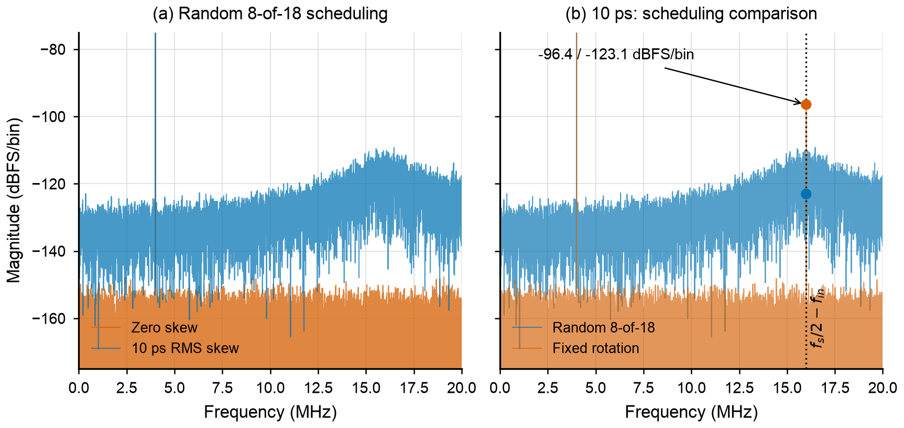
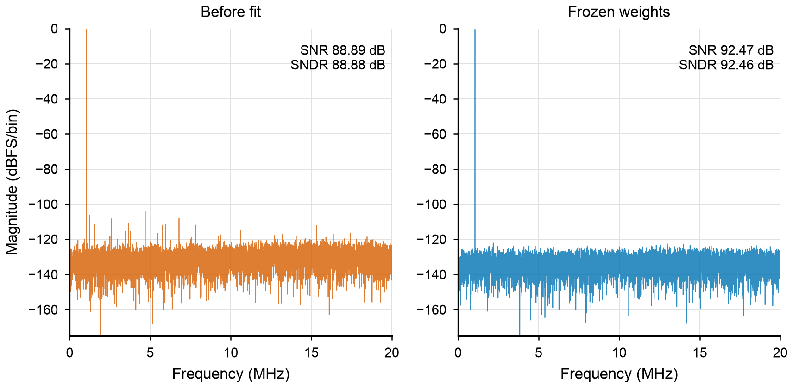
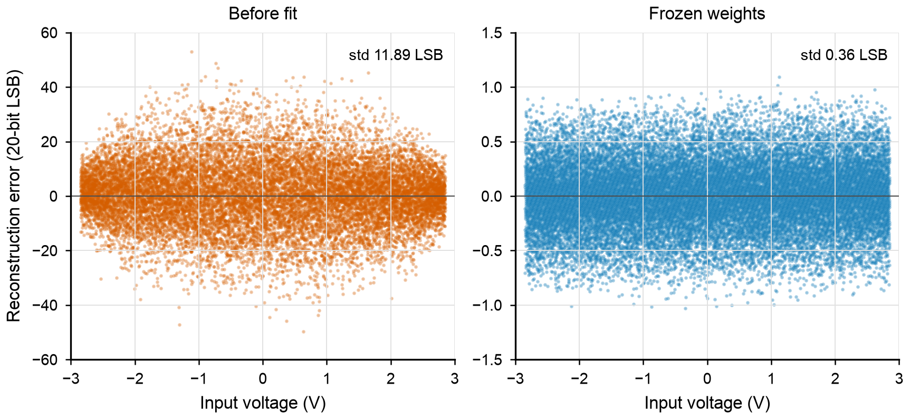
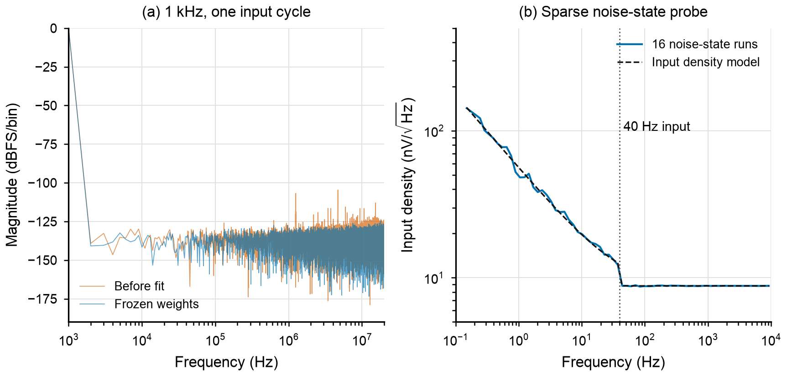
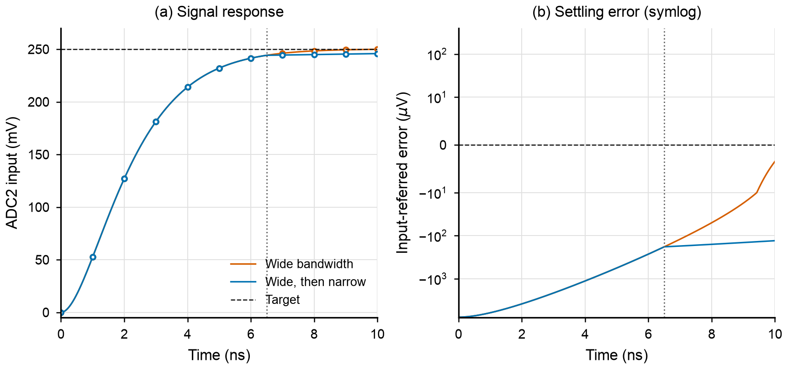
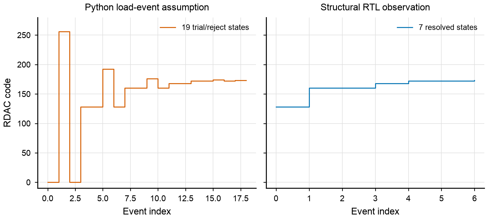

# ISSCC 2024 讲稿实验与本模型：逐项对照

[返回首页](../../README.md) · [English](../../README_EN.md) · [机器可读条件表](slide_matrix.json)

> **历史基线提示：**本页图和矩阵记录 `6863fc3`，其中 bridge 掩码和参考事件差异是当时的发现。当前项目合同已统一，结构 RTL 的新观测及闭环见 [ADR 0021](../adr/0021-structural-contract-calibration.md) 和 [bridge 说明](../archive/binary_unary_bridge.md)；本页图 6 仍展示当时的不一致，不能代表当前配置。

这里的图全部由仓库数据和脚本独立绘制；原论文及讲稿图片不随库分发。模型基线为 `6863fc3`，对照资料是 [ISSCC 2024 Session 9.8 论文](https://doi.org/10.1109/ISSCC49657.2024.10454329)及对应讲稿。40 MS/s 是共同条件，但讲稿没有公开每项实验的全部设置，以下是**条件部分匹配、可复现实验**，不是作者原实验的完全复刻，更不是芯片结果。

| 讲稿页码 | 公开测试和结果 | 本仓库对照 | 边界 |
|---|---|---|---|
| 19–22 | 时序失配仿真标注 10 ps，随机化后的交织分量集中在 `fs/2-fin` 附近 | 图 1；三种随机种子和另一种 10 ps 解释 | 输入频率精确值、幅度、10 ps 统计定义、FFT 和窗函数未公开；不能称相同实验 |
| 23–27 | 20.5 pF RDAC、40 MS/s 约 1.9 mA、粗/细参考相位 | 图 6：历史 Python 试探事件与当时结构 RTL 实际事件不同 | 当前结构事件合同已对拍；仍不计算或声称复现参考电流，缺真实电路 |
| 28 | 40 MS/s；失调/增益漂移 47/70 ppb/°C | 未运行 | 没有温度依赖与 PVT 模型 |
| 29–31 | 8/18 切片、横向及纵向 DEM、二进制到温度计码桥接 | 图 1 覆盖切片随机选择；已有电容单元重排 | 历史基线 bridge mask 有差异；当前项目合同已统一，仍不证明等同原芯片三维 DEM |
| 32 | INL +2.2/−1.8 LSB，DNL ±0.27 LSB，约 ≥250 次/码 | 图 3 为稀疏扫描重构误差 | 不是 INL/DNL；完整 20 位至少约 2.62 亿次观测且需实际测试设置 |
| 33–35 | 宽带建立后缩小 ADC2 带宽；论文提及噪声改善 1.3 dB | 图 5 只比较假设参数下的信号瞬态与独立 ODE | 带宽和切换时间未公开，未独立计算 1.3 dB 噪声改善 |
| 36–37 | 1 kHz、SNR 93.7 dB、DR 94.6 dB；含驱动和信号源噪声；噪声密度 8.8 nV/√Hz、拐点约 40 Hz | 图 4：单周期转换与独立稀疏噪声状态检查 | DR、密度、拐点作为输入或拟合值；无法据此证明芯片低频性能 |
| 38 | 40 MS/s、1.05 MHz、SNR 93.5 dB、THD −107 dB | 图 2：已知频率下比较训练前后 | 输入幅度、FFT 和全部物理噪声未知；94.6 dB 噪声预算经过拟合 |
| 39 | 连续采样与驱动滤波带宽，约 7τ | 未运行 | 缺少完整驱动器噪声谱和带宽扫描模型 |

## 1. 10 ps 时序失配：误差出现在哪里？



*图 1．讲稿第 21–22 页对应实验的原创结果图。40 MS/s，18 个物理 slice、每次 8 个；相干正弦 `fin=4.00146484375 MHz`、峰值 2.85 V、N=16384、矩形窗、seed 42、关闭电容失配和随机噪声。10 ps 是假设的独立 slice 静态高斯偏差标准差，图中该次抽样实现的标准差约 9.21 ps。频谱是未平滑的单边 dBFS/bin，基波峰值超出该纵轴范围。原讲稿没有公开这些附加条件。*

左侧随机调度中，10 ps 偏差产生随频率变化的误差；右侧比较同一组物理偏差的固定轮换和随机选择。`fs/2−fin≈15.9985 MHz` 频点从 **−96.44 降到 −123.05 dBFS/bin**，下降 26.61 dB；本例参考输入的误差 RMS 却从 **127.97 增至 182.15 µV**。随机调度改变频谱形状，**没有估计或补偿逐 slice 时间误差，也不保证总误差下降**。RMS 包括相对理想输入的公共相位偏移；SNDR 的基波拟合/频域排除不计入同一分量，二者不能直接互换。

| 静态时序误差的假设 | 固定轮换该频点 | 随机调度该频点 | 两种调度的误差 RMS |
|---|---:|---:|---:|
| σ=10 ps，seed 42 | −96.44 dBFS/bin | −123.05 dBFS/bin | 127.97 → 182.15 µV |
| σ=10 ps，seed 7 | −88.59 dBFS/bin | −115.73 dBFS/bin | 242.27 → 275.45 µV |
| σ=10 ps，seed 91 | −83.78 dBFS/bin | −124.44 dBFS/bin | 159.03 → 127.52 µV |
| 两组各 −5 / +5 ps，即组间峰峰值 10 ps，seed 42 | −78.46 dBFS/bin | −116.82 dBFS/bin | 253.36 → 65.26 µV |

两种 `10 ps` 定义均是本项目假设。三个 σ=10 ps 例子中，随机调度的 15–17 MHz 平均功率比 1–3 MHz 高约 14.9–15.2 dB；讲稿标注约 13 dB，但没有给出此处采用的两个统计频带，**不能把相近的数值说成同口径复现**。

## 2. 电容失配：独立训练后的留出数据



*图 2．讲稿第 38 页对应频率的行为仿真。40 MS/s、1.05 MHz、2.85 V 峰值、N=16000、矩形窗、σ=1000 ppm；4096 个独立训练样本，训练使用理想精确外部参考和 dither，之后冻结 1278 个权重及 1 个偏移量，在同一物理池的新样本上比较 20 位定点输出。噪声预算取 94.6 dB，与讲稿数据相关，未建模完整驱动器或实测器件噪声。*

含噪情况下，输出 SNDR 为 **88.88 → 92.46 dB**，输入参考误差标准差为 **72.53 → 48.04 µV**；无噪情况下分别为 **90.44 → 119.85 dB**、**60.65 → 2.05 µV**。这证明特定行为模型中，冻结的权重能改善独立数据；它不是论文 93.5 dB SNR 的无参数预测。FFT 指标已按相同窗、基波与二至十次谐波定义，与 ADCToolbox 独立计算核对。



*图 3．图 2 的无噪条件、同一物理池和冻结权重，用不同输入进行 16384 点 −2.85 至 +2.85 V 稀疏扫描。左右图的纵轴范围不同：校准前 ±60 LSB，校准后 ±1.5 LSB。*

重构误差标准差从 **11.89 降至 0.36 个 20-bit LSB**，没有模拟越界或最终码裁剪。这是逐点重构误差，并非图 32 的完整码密度 INL/DNL；模型的 ADC2 使用理想量化器，无法据此推断芯片 20 位线性度。

## 3. 低频测试：1 kHz 波形与噪声状态



*图 4．左：40 MS/s、1 kHz、40000 点，只有 1 个输入周期，频率分辨率 1 kHz；右：16 次低频噪声状态的稀疏时间采样，等效观察采样率 20 kHz、每次 64 秒，白噪声使用理想抗混叠观察。右图不是连续 40 MS/s 的全 ADC 转换。40 Hz、8.8 nV/√Hz 均为模型输入，虚线为其假定频谱。*

左图可检查低频正弦下的路径能否运行，不能观察 40 Hz 拐点。右图检查所配置的噪声状态能否产生预期形状。当前模型将闪烁噪声振荡器的上限设为 40 Hz，因此曲线在该处出现人为截断；真实的 1/f 拐点是闪烁噪声与白噪声功率相等的位置，不代表闪烁分量在更高频率消失。16 次求平均后，2–30 Hz 对数频带平均的闪烁噪声功率斜率为 **−9.98 dB/dec**，这也不能用来证明芯片的 40 Hz 拐点或噪声密度。原始频点功率波动与有限振荡器模型有关，完整数据保存在 `data/lowfreq_40hz_16/`。

## 4. 建立过程与参考负载：可用结果和待补接口



*图 5．宽带建立、切换为窄带的信号瞬态；采样周期 25 ns。RA 建立窗口 10 ns、切换时刻 6.5 ns、RA 带宽 120 MHz、ADC2 宽/窄带宽 150/15 MHz、参考时间常数 3 ns 均为假设。圆点为独立微分方程求解，实线为工程模型；右图为对称对数坐标。*

这些假设下，10 ns 时仅保持宽带的输入参考建立误差为 −3.45 µV，而 6.5 ns 切换到窄带时为 −130.56 µV；说明过早收窄会产生建立误差。两条结果与独立 ODE 数值误差分别小于 3×10⁻¹⁶ V 与 3×10⁻¹² V，验证的是给定方程的实现；**未验证讲稿的 1.3 dB 噪声改善或实际最佳切换时间**。



*图 6．同一个目标码 173，左为 Python 负载模型 19 个试探/回退状态；右为真实结构 RTL 仿真输出的 7 个已决状态。事件定义不同，横轴是各自事件序号，不是同一时间轴。RTL 测试使用理想 640 MHz 时钟，不能证明目标工艺时序。*

图 6 记录历史基线的事件合同差异。当前 `Config.rtl_structural()` 已采用与 RTL 一致的 7 个已决事件并做实引脚对拍，但不能据此声称复现讲稿约 1.9 mA 的参考电流；真实模拟参考网络仍未验证。当前问题见 [RTL 已知限制](../rtl/KNOWN_LIMITS_20261104.md)。

## 重绘与重新运行

需要本仓库的 Python 依赖，以及单独安装的 ADCToolbox（本次为 0.9.1）、NumPy、SciPy、Matplotlib；结构 RTL 重跑还需要 Verilator 和兼容的 C++ 编译器；可用 `--verilator` 指定本机可执行文件。仓库自带 `data/` 是数据证据，原始输入、输出、切片 ID、误差、系数、完整参数与指标均可检查。下列命令从仓库根目录执行，并把重新仿真的输出写到临时目录：

```bash
REPO_DIR="$PWD"
RUN_DIR="$(mktemp -d "${TMPDIR:-/tmp}/sar-paper.XXXXXX")"
mkdir -p "$RUN_DIR/results"
python docs/paper_comparisons/scripts/timing_match.py --out "$RUN_DIR/timing" --seed 42
python docs/paper_comparisons/scripts/reference_behavioral_validation.py calibration \
  --repo "$PWD" --out "$RUN_DIR/ac105" --fs 40000000 --seed 42 \
  --ncal 4096 --nval 16000 --cycles 420 --amplitude 2.85 --mismatch 0.001 --noise --target-dr 94.6
python docs/paper_comparisons/scripts/static_transfer.py --out "$RUN_DIR/static"
python docs/paper_comparisons/scripts/crosscheck_ac.py --out "$RUN_DIR/fft_crosscheck.json"
(cd "$RUN_DIR" && python "$REPO_DIR/docs/paper_comparisons/scripts/ra_response_40m.py")
(cd "$RUN_DIR" && python "$REPO_DIR/docs/paper_comparisons/scripts/lowfreq_match_16.py")
python docs/paper_comparisons/scripts/run_structural_trace_40m.py --out "$RUN_DIR/structural"
MPLBACKEND=Agg python docs/paper_comparisons/scripts/make_paper_figures.py --out "$RUN_DIR/figures"
```

最后一条只读取记录数据并重绘到临时目录，不是重新仿真。生成的 PNG 和 SVG 为原创图；重绘依赖 Arial 字体可用。结果中的随机种子、FFT 窗和参数均是显式假设；改变环境、依赖版本或随机种子可能改变数值。参考电流、温漂、码密度与真实驱动器曲线当前均为未完成项，不能用相近示意图代替。

文件完整性可在 `docs/paper_comparisons` 目录运行 `shasum -a 256 -c evidence.sha256` 检查。该清单覆盖脚本、原始数据、图和条件表。
