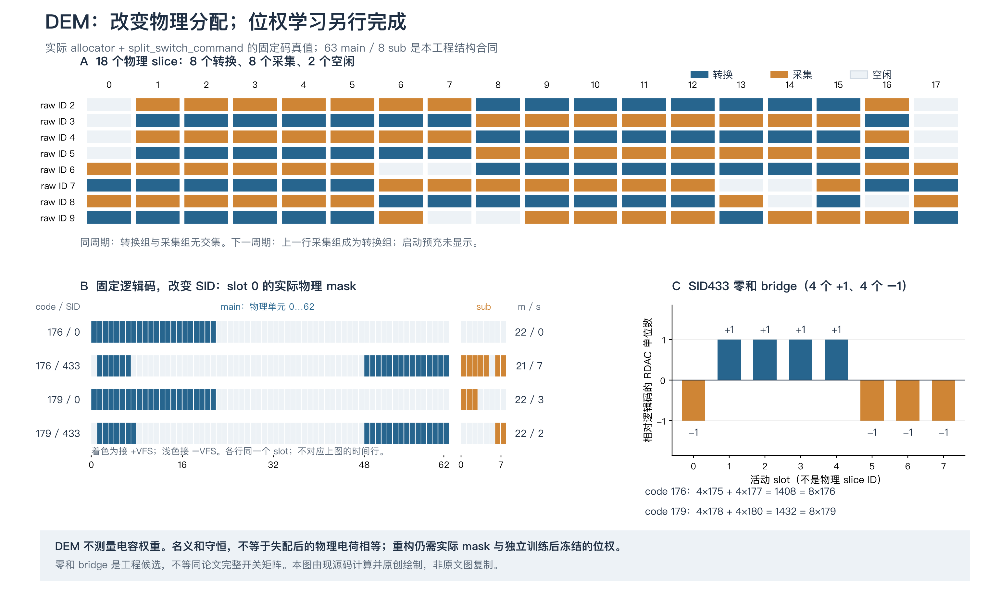
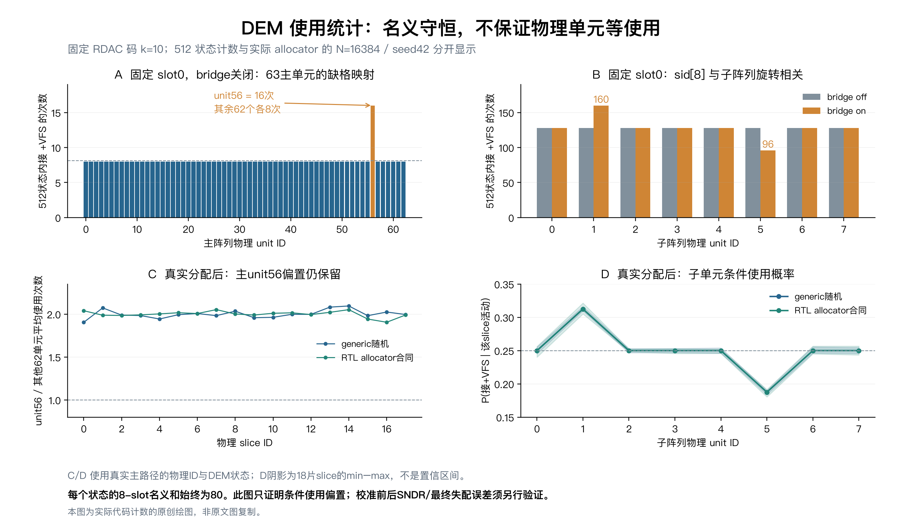
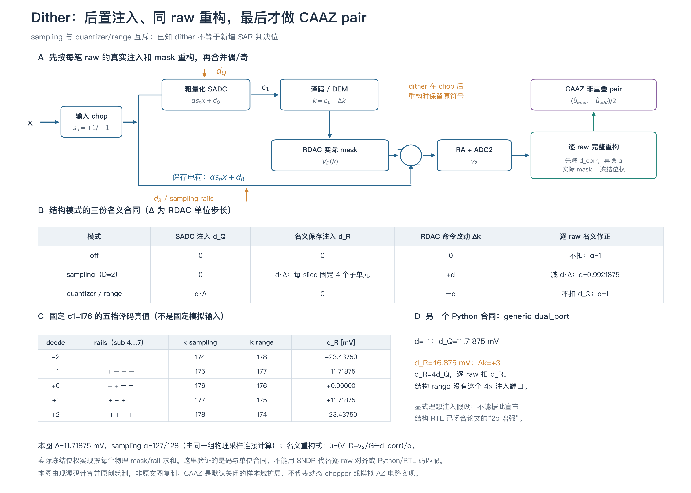

# DEM、dither、slice 选择与 CAAZ 的组合条件

> **af8／9bdf历史专题。** 本页原正文、数据、图和命令按原字节保留；其中“当前”“本轮”和通过数量仅描述原记录，不表示新主线实现。旧SID／bridge、sampling／range／固定4倍扰动及旧748位接口已退出当前运行，正文命令须在对应完整Git历史下解释。现行来源与未实现项见[A表](../current_digital_source_map.md)，实际状态与证据见[B表](../digital_status_matrix.md)，接口见[ABI2合同](../rtl/CURRENT_INTERFACE_AND_ARITHMETIC.md)。[原专题固定快照](https://github.com/defineiocc02/20bit_SAR_ADC_Behaviour_Verification/blob/9bdf7708f42733896d7ead89935be41b4258fb6f/docs/randomization_caaz/README.md)保留旧链接语境；此横幅不改变旧结论或数值。

**它们并非必然互斥，但不能仅凭各自通过就宣称组合成立。** 当前数字实现的逐笔归属与算术可验证；真实组合还要求 AZ 存储不被奇数周期复位破坏、dither 注入点与扣除域一致，以及两笔 AZ 噪声经数字归一化后的传递系数足够匹配。

组合初核以主线 `8238cc3` 为输入；后续注释和有效配置报告维护见[本轮复核](../reviews/20261105-readability-maintenance.md)。组合分析没有改变转换算法或RTL控制行为，邻接数据保留实际生成版本和来源摘要。来源包含 ISSCC 2024 9.8 论文／讲稿、US10511316B2、US10505561B2 和北大 VLSI 2025 C32-1。实验区分数字功能、样本域行为、独立代数反例和仍未获得的模拟证据。

## 四种操作分别改变什么

| 操作 | 实际改变 | 当前实现边界 |
|---|---|---|
| slice 选择 | 每笔实际参加采样和转换的 8 个物理 slice，因而可能改变总信号电容、增益、采样衰减和噪声传递 | 18 个 slice 中安排不相交的采集组与转换组；相邻转换组必不相交 |
| 单元 DEM／bridge 候选 | 同一逻辑 DAC 码由哪些固定物理电容实现 | 行／列／子阵列地址置换；可选跨 slice 零和码交换。名义电荷守恒不等于实际失配消失 |
| dither | 量化器判决或 RDAC 保存电荷中的已知扰动，以及对应的 DAC 码和重构项 | 结构模式分 off、sampling、quantizer/range；两种非零模式互斥。generic 的 dual-port 是另外的工程假设 |
| CAAZ | 整个输入的正负极性、AZ 存储更新节拍，以及两笔完整结果的配对 | 偶数更新、奇数保持；完成逐 raw 位权重构后再偶减奇。当前工程选 raw 40 MS/s、pair 20 MS/s |

DEM 和 dither 有助于减弱误差与输入的相关性，并可配合位权估计提高线性；它们本身没有测出所有电容权重。CAAZ处理相关 AZ 噪声，两者需要共同遵守信号、电荷和样本归属合同。

## DEM 和 dither 在当前工程中怎样实现



*本图为当前 allocator 和 split_switch_command 的真实译码结果独立绘制，非原文图复制。它是机制／名义合同说明，不是最终性能或原芯片完整电路复原。slot 是参与本笔的逻辑位置，不是固定物理 slice ID。*

DEM 的执行顺序是：先取得本笔实际 slice ID，再按该 bank 的状态推进 SID；主阵列行／列与子阵列生成物理顺序；由合法 RDAC unit code 决定主／子单元数量。可选 bridge 在 sid[8] 有效时给活动 slot 做名义零和 ±1 交换，端码不交换。重构读取实际 mask 和对应物理单元的冻结有效权重；不会因为打开 DEM 就自动得到这些权重。

结构候选的名义守恒是对主／子权值加权后的总电荷，不是把不同权重物理电容的个数直接当作一个码。码176的示例满足4×175+4×177=8×176，但真实失配电荷不因此相等。源码入口是 [dem.py](../../src/adi_model/dem.py)、[slice_pool.py](../../src/adi_model/slice_pool.py)和[结构控制](../../rtl/core/sar_structural_ctrl.sv)。

还要分别检查使用统计。本轮固定k=10、遍历512个SID时，某个逻辑slot的主单元56使用16次，其余62个主单元各8次；bridge关时子单元各128次，开启后为128/160/128/128/128/96/128/128。63单元嵌入8×8删除缺失格，以及bridge门控和子阵列轮转的相关性，会造成这种偏置。真实随机调度后的物理统计另以实际被选次数作分母，不能拿固定slot计数替代全芯片概率；它也不直接给出校准后的SNDR结论。



*上半图为固定码／固定slot遍历，分母为512状态；下半图为16384笔实际调度，各物理slice分别以自身被选机会作分母，保留全体单元范围。计数针对mask=1的正轨选择，mask=0仍有负轨电荷项。它只说明选择统计，未将偏置直接换算为性能。原始计数与分母见[数据](data/dem_usage.json)，命令见[复现入口](../REPRODUCING.md#demcaaz及数字组合的详细入口)。*



*本图按当前源码计算并原创绘制，非原文图复制。sampling与quantizer/range是两份互斥合同；已知dither不是新增SAR判决信息。generic dual-port的4×注入是另一工程假设，不冒充结构RTL已实现论文双总线增强。*

dither 在整个输入换向之后注入。结构sampling把每slice固定末4个子电容接到已知正负参考轨，名义信号系数α=127/128，RDAC命令加d；结构quantizer/range把dQ加入粗判决，RDAC命令减d，保存电荷中没有对应dR，最终不再扣一次dQ。逐raw数字重构按实际signal mask、rail和冻结C/Cf求和，去除该笔的已知注入再归一化；然后才允许进入CAAZ配对。

源码入口是 [sampler.py](../../src/adi_model/sampler.py)、[数字电荷项](../../src/adi_model/weight_calibration.py)、[定点重构](../../src/adi_model/fixed_point.py)和[dither_gen](../../rtl/core/dither_gen.sv)。名义扣除不会自动消除真实电容失配，近满幅余量也需单独检查。[重绘与重新仿真入口](../REPRODUCING.md)区分这两类操作。

当前 `rtl16`／RTL 的同一个 `dem_enable` 控制单元置换和 slice shuffle；**现有结构接口不能独立保持单元 DEM、只关闭 slice shuffle**。通用 Python profile 才能通过 `dem_mode` 与 `dem_enable` 分别拆分这两个因素。关 DEM 之后仍有 A/B 两组轮流转换，不能据此认为 pair 两笔使用相同电容。

## 第一处硬前提：AZ 存储与普通复位必须拆开

DEM 专利 US10511316B2 的 Fig.30（PDF p.29，正文说明在 PDF p.43／cols.23–24）示例包含每次转换前的 AZ，时序是 AZ → RA_A → AZ → RA_B。北大论文 Fig.5–6 和讲稿 PDF pp.34–35 则要求偶数 AZ、奇数不更新同一 `CBIAS` 状态。这两个 AZ 存储动作不能原样叠加。

当前 RTL 保留每周期的 `ra_az` 准备窗口，另提供偶数专用的 `caaz_az_capture_en`。这只是数字接口划分：**如果模拟宏仍将旧 `ra_az` 直接接到实际 CBIAS 自归零采集开关，奇数周期就会重新抽取噪声，CAAZ 的共享状态假设随之失效。** 同一个 AZ 代号、数字 `az_capture_ok=1` 和 testbench 通过均不能证明电气存储成立。

模拟宏必须将储能电容／放大器准备与 AZ 存储采集分别控制；奇数周期完成必要复位、偏置和放大，同时隔离并保持 CBIAS。验收需要真实存储节点、两周期相关性、泄漏／注入、非交叠和建立截止的证据。ISSCC 讲稿中的 18 个 RDAC slice 共享 RA／ADC2，不能把它们当成 18 个互相独立的 RA。

还存在采样组交接的宏前提。实际 RTL 的一个边界窗口为：

| phase | TP | acquiring mask | 输入 chop | 含义 |
|---|---:|---|---:|---|
| 0 | 0 | `0ff00` | 0 | TP低，预期关闭旧组采样；未观测模拟保持节点 |
| 1 | 1 | `0ff00` | 1 | 输入已为下一笔翻相，mask尚未换成新组 |
| 2 | 1 | `100fe` | 1 | 旧组转为 converting，新组开始获取 |

如果模拟采样使能仅为组合 `TP AND acquiring_mask`，phase 1 可能重开刚采好的旧组，并让它看到反相输入。本地锁存、close inhibit 或经过验证的非交叠可以避免这一问题，但目前数字 DUT 未实现模拟保持节点。它是原有采样所有权接口风险，CAAZ 翻相会放大其后果；不能把假定宏的重开当成已经观测到的真实模拟故障。

## 第二处条件：比较的是噪声传递与信号增益的比值

令输入换向为 $c_n=+1,-1$，有效信号增益为 $K_n$，同一 AZ 存储样本为 $e_k$，从该存储域到 ADC2 的噪声增益为 $H_n$。在没有饱和的局部线性模型中，

$$
z_n=K_n c_n x_n+q_n(d_Q,d_R,\text{masks})+H_n e_k+\eta_n.
$$

完整逐 raw 重构先扣除对应的已知电荷／注入项，并用冻结系数归一化。理想校正后，

$$
u_n=c_nx_n+a_ne_k+\widetilde\eta_n,\qquad a_n=H_n/K_n.
$$

若奇数周期的保持系数为 $h$，等权 pair 输出的 AZ 残余为

$$
r_{AZ,k}=\frac{a_{2k}-h a_{2k+1}}{2}e_k.
$$

因此相同存储代只证明配对资格，准确相消还要求 $a_{2k}=h a_{2k+1}$。当前数字核没有直接观测真实 $H_n$，也没有检查这个物理条件。

必须区分两种噪声域：

| 假设 | 归一化后的 AZ 系数 | 能得出什么 |
|---|---|---|
| 共享 RA 输出端加性误差 | $H_n$ 固定，$a_n\propto1/K_n$ | 不同实际增益可能留下共有误差；这是当前显式 RA-output 扰动接口的一种研究假设 |
| RA／FGA 输入等效误差，随信号放大 | $H_n=G_n$ | 无采样衰减时，若 $K_n=G_n$，则 $a_n=1$，G 不同也能相消 |
| 上一种假设再叠加 sampling dither | $K_n=G_n\alpha_n$，故 $a_n=1/\alpha_n$ | 若实际保留的信号电容比例不同，即使 G 已归一化，仍可能有很小的残余 |

北大 Fig.6 将 $e_k$ 写成 FGA 输入等效，并给出 $G(\pm r+e_k)$。不能把“固定 RA 输出噪声在不同 G 下泄漏”的实验直接当成该论文电路必然冲突的证据。本工程尚未得到实际移植电路的 $H_n$；两种传递是假设对照，不是两种已完成的晶体管设计。

真实噪声还可能经过不同于信号电荷增益的闭环 noise gain、开关噪声路径及带宽。这里的 $H=G$ 是原文简式所对应的一个对照假设，不能替代实际电路的 $H$ 提取；本轮两个假设也不穷尽可能的噪声传递。

在当前静态模型中，内部 SID 置换改变 DAC 的实际轨电荷，保留的 sampling dither 电容位置则固定，因此 SID 本身不改变总信号电容／alpha；改变实际 slice 集合才会改变这些量。真实开关寄生和动态噪声增益是否也具有该性质，仍须模拟验证。

## 第三处条件：dither 的注入点与数字扣除域

当前 CAAZ 的 chopper 包住真实输入函数；dither 随后由 sampler／模拟宏注入。对应的合同是：**输入先换向，随后施加 dither，逐 raw 完整重构后才配对**。奇数相不能再无条件把全部 dither 元数据翻一次符号。

| 结构模式 | 模拟／数字操作 | 组合时要保持什么 |
|---|---|---|
| off | 没有内部 dither | 外部 `inj_q` 若非零，仍须明确注入点和逐笔值 |
| sampling | 每 slice 固定末 4 个子单元用于 D=2 的正负参考轨；信号名义衰减为 $\alpha=127/128$；RDAC 命令加 $d_u$ | 保存电荷、参考轨码、DEM 后 DAC 掩码及实际有效权重必须属于同一 raw 样本；重构使用对应 signal mask 和轨项 |
| quantizer/range | $d_Q$ 扰动粗判决；RDAC 码调整为 $-d_u$；结构模式没有对应的模拟 $d_R$ 注入 | 不额外在最终码扣一次 $d_Q$。错误转移可能先耗尽 RA／ADC2 余量，即使未限幅时的完整重构恒等式仍成立 |
| generic dual-port | 另外假设 $d_R=4d_Q$ 的模拟电荷注入与扣除 | 与结构 range 合同分别验收；不能将其当成已复现原芯片双总线和增强电路 |

如果实际的保存电荷型 dither 放在 chopper 之前，它进入 ADC 的量就是 $c_n d_n$；仍按未翻相的后置注入去扣除，会产生奇数相残余。纯量化器 $d_Q$ 与实际进入保存电荷的 $d_R$ 不同，不能一概将所有注入点错误都写成同一种输出偏差。

独立代数反例使用结构 range 参数：$x=0.3$ V、奇数相、$d_Q=1$ 个 RDAC 单位（11.71875 mV）。正确的后置注入／转移得到 RA 0.15 V；若 dQ 实际在 chopper 前而码仍按后置合同转移，RA 变成 0.90 V，超过原 RA 0.495 V 和 ADC2 上界 0.4125 V。未限幅的完整重构仍能恢复负相输入，说明此处首先是余量失败，不能盲目多加一个最终码扣除项。该反例是参数化代数检查，不是模拟宏实测。

## 为什么不能简单冻结 slice 或追加两个软件系数

现有资源合同是同拍采集组与转换组不相交，且下一次转换消费本次采集组。因此

$$
\mathrm{conv}[n+1]=\mathrm{acq}[n],\qquad
\mathrm{conv}[n]\cap\mathrm{acq}[n]=\varnothing.
$$

连续两笔必使用不同组。“pair 内锁住相同 8 个 slice”会破坏当前采集与转换的并行资源安排；它需要重新设计保持、采集和吞吐，当前没有这个可用开关。固定 SID 也不等于固定物理 slice 集合或噪声传递。

即使已知两个 $a$，加权差分

$$
y_w=\frac{a_o u_e-a_e u_o}{a_e+a_o}
$$

可以消掉共享 AZ 项，却将信号变为不等权平均，相对原等权参考多出

$$
\Delta x=\frac{a_o-a_e}{2(a_e+a_o)}(x_e-x_o).
$$

独立代数例中，raw 40 MS/s、4 MHz／2 V 峰值、$a_e=1/32$、$a_o=1.005/32$，在最大斜率的一对采样处，加权导致约 1.541 mV（269 LSB20）信号偏差；同例 1 mV RA-output 共有误差在普通等权配对中仅残留 78.125 nV。该压力例说明：应先算预算与信号代价，不能因为能消一个噪声项就追加所谓免费数字修复。实际系数差和噪声幅度仍须测定。

## 本轮组合实验的结果与可分辨范围

行为实验包括 42 格：24 格 generic 因子拆分、12 格结构 profile、3 格 bridge 控制、3 格 DC 压力；另有 2 个普通白噪声控制和 3 个非流水同组对照。它们使用同一固定物理池与独立已知参考训练，数字拟合不读取真实电容、G、alpha 或噪声真值。物理真值仅用于产生两种假设噪声通路及事后分析。

失配池的 slice 标准差 0.5%、unit 标准差 0.02%、bridge／寄生散布 0.02% 都是显式假设，不能当成默认工艺或硅片统计。每颗池用 8192 个独立样本训练并冻结 1279 个有效权重／偏置参数；随后按已知 mask／电压项解释不同模式，复用同几何的物理有效权重。主比较为 2048 raw／1024 pair、40／20 MS/s、约 605.47 kHz／1.6 V 峰值，普通采样和 RA 白噪声关闭以隔离相互作用，另用独立控制核对其随机实现。

对含失配的六个结构组合：

- 冻结校准后的无 AZ 扰动 pair 信号误差 RMS 为 2.256–2.427 µV，未出现原始模拟越界或最终 clip。
- 固定 RA-output 共有源在名义 1 mV RMS 下，连续物理模型预测残余约 0.042–0.046 µV。
- 输入等效 $H=G$ 假设下，off／quantizer 的连续理想残项为零；sampling 的 alpha 差异带来约 0.00029–0.00032 µV。
- 实际 20 位 noisy−quiet 差分约 2.46–2.63 µV，包含两次 ADC2／最终码量化变化。非流水同组对照即使连续理论残余为零，码差也可达到 1 LSB20；不能将这些非零码差直接判成模拟相消失败。

因此当前实验支持的是：**这些静态、后置注入且无饱和的组合没有发现必然的数字算术冲突；连续 AZ 残项在该噪声幅度下低于当前量化差分的分辨底。** 它没有测出真实 CBIAS 的 H，也未覆盖动态输入开关、真实 1/f、参考／RA 建立、时序失配和所有种子／频率。

数字核的独立组合诊断覆盖 8 个健康配置（四种输入／dither情形 × DEM关／开），每组 125 raw／62 pair；并覆盖缺 valid、AZ 确认失败和 pair 中途 clear。逐 tick、原始码及 pair 结果可对拍，但该模拟 plant 只证明数字合同。所有已配对样本的 slice 交集为零，即使权重给出不同有效增益，数字 pair 仍可有效；它没有自动证明 $H_e/K_e=H_o/K_o$。

## CICC tracking averaging与北大CAAZ不是同一实现

桌面CICC2026 13-6论文Fig.1–3采用连续时间第二级SAR，RA输出经CINC持续耦合到后级DAC顶板，避免RA后的离散采样混叠；再用8次LSB重复、7个跟踪单位电容及SINC²处理后级判决。还需要复制路径的kickback抵消。北大Fig.5–6则在两笔完整转换之间保持同一AZ样本，并偶减奇。

当前ADC2行为量化和输出DSP的SINC都没有实现上述CICC连续时间耦合与后级判决反馈；预跟踪历史粗码和CAAZ pair也不等同LSB tracking averaging。这三组资料有相关研究目标，但不能合称同一套已验证实现。原件见[资料目录](../../references/README.md)，全局实现状态以[STATUS](../STATUS.md)为准。

## 接下来的三项优先工作

1. **先闭合模拟接口与传递预算。** 拆分 AZ 存储采集和普通复位，验证 odd 保持；定义 AZ 噪声参考节点，得到随 group／mask／模式变化的 $H/K$、泄漏、注入和建立边界。现有 capture ack 只表示资格，不代表真实噪声传递已知。
2. **再固定随机化和元数据合同。** 保持 dither 注入点、逐 raw 扣除、实际 slice／SID／AZ代／系数 epoch 的一致性；若需要分别控制单元 DEM 与 slice shuffle，应作为明确接口修改单独验收，不能假定已有独立开关。必要的 AZ 测试注入或额外观测通路也应有可辨识模型。
3. **最后按同一芯片、信号带宽和噪声预算验收组合。** 先冻结位权，再评价 CAAZ 的增量收益；同时报告均值、RMS、标准差、饱和与丢 pair，不只比较 SFDR。数字加权、改变配对间隔或暂停采集均需重新验收信号响应、延迟和吞吐。

生产行为和 RTL 在本轮保持不变；这里给出组合成立的条件及已运行的边界实验，不将研究组合直接升级为模拟实现或目标工艺签核。

## 数据与公开复现

[组合标量摘要](data/summary.json)保留42格与5个控制、条件、训练和误差定义；完整raw/NPZ写到命令指定的库外新目录。它区分连续传递预测、量化后noisy−quiet差值、RMS、标准差及无效样本，不把理论零与整数差分底混为一谈。

```bash
PYTHONPATH=src OPENBLAS_NUM_THREADS=1 OMP_NUM_THREADS=1 python tools/reproduce_randomization_caaz.py \
  --out "${TMPDIR:-/tmp}/sar-randomization-caaz-new"
python tools/run_open_rtl.py --tops caaz_randomization_probe_tb
python tools/check_caaz_randomization_trace.py \
  --trace-dir sim/artifacts/open_rtl --out "${TMPDIR:-/tmp}/sar-caaz-digital-check-new"
```

独立数字诊断摘要见[data/rtl_diagnostic.json](data/rtl_diagnostic.json)，实际TP交接三行见[data/tp_chop_mask_boundary.json](data/tp_chop_mask_boundary.json)。这些是digital-only边界证据，既不实现模拟宏，也不检查真实H/K。更完整复现和首页三结果在[复现入口](../REPRODUCING.md)说明。
