# 20位／10 MS/s SAR ADC数字模块：九个月任务书

## 先明确你要完成的任务与spec

**最终目标：面向180 nm BCD、20位／10 MS/s SAR ADC，参考ISSCC 2024 9.8及相关专利，结合北大VLSI 2025的CAAZ机制；本阶段采用SKY130HD完成数字线性化与噪声抑制模块的Python→RTL→GDS，交付效果图、可综合RTL及数字验收报告。**

前7节是执行任务、spec及签核要求；后面的技术说明沿多张原图解释电路动作、误差、数字算法和复现边界。

**速率约定：**10 MS/s指原始转换；当前CAAZ按非重叠两笔合成一笔，正常输出5 MS/s，20位码宽不变。最终配对输出若要求10 MS/s，需另定内部20 MS/s规格。

你接手的是已有工程。每个模块按“行为效果 → RTL逐笔验证 → 本模块GDS与时序”纵向完成并交付，再进入下一模块；最后完成整体集成。先确认已有成果可复现，不重写已经对拍的模块。以下为计划要求，不表示已经完成。

| 阶段 | 要求你完成的任务 | 必交内容 | 截止与通过条件 |
| :--- | :--- | :--- | :--- |
| 模块一 | 切片调度＋DEM：补行为覆盖、复用RTL，完成独立数字宏 | 四组效果图、逐笔对拍、GDS与时序／物理报告 | M2：完成本模块行为、RTL与GDS交付 |
| 模块二 | 八片dither：完成行为对照、RTL验证与数字宏 | 扰动效果及端点图、逐笔对拍、GDS与时序／物理报告 | M5：完成本模块行为、RTL与GDS交付；全幅另列状态 |
| 模块三 | CAAZ：完成样本域效果、RTL验证与独立数字宏 | 同带宽噪声图、错绑对拍、GDS与时序／物理报告 | M7：完成本模块行为、RTL与GDS交付 |
| 整体交付 | 冻结整体RTL，完成SKY130HD数字宏实现与验证 | GDS、网表、SDC、SPEF、综合／时序／物理报告及摘要清单 | M9：按第6节逐项验收；缺少项明确保留未完成 |

**行为级验收边界：**理想开关、电荷守恒、固定失配、理想ADC2和样本域噪声可以验证本课题算法；不以完整器件开关或模拟瞬态为前提。数字接口和行为条件在M1–M2冻结，旧GDS结论另行验收。

| 项目 | 已定基线／尚待冻结 |
| :--- | :--- |
| 速率与调度 | 原始10 MS/s；18片池，8片采集、8片转换、2片空闲；CAAZ非重叠配对5 MS/s |
| 码制与模型 | 前级9位、输出20位二补码；模型ADC2为12位offset-binary、输入折算±100 mV，RA增益／窗口在行为合同中明确，实际电路映射另记；码宽不代表ENOB |
| 时钟与接口 | 16拍／笔时目标160 MHz、6.25 ns；样本ID、8个有序片号、扰动及AZ代必须同笔；IO时序预算待冻结 |
| 随机与配置 | 种子独立、非零；采集按使能推进，stall保持；配置同笔冻结。权重与映射模式匹配，不兼容模式切换先暂停／清空并重载系数 |
| 算术与异常 | 沿用Q28整数重构及既有位宽／舍入合同；$k=c-U$，下溢拒绝；不得静默回绕、限幅或丢样 |
| 工艺与电压 | 当前数字库为SKY130HD；±5 V是模拟差分输入范围，不是标准单元逻辑输入电压；数字电压域单独约束 |
| 性能验收 | 必须报告20位LSB的INL／DNL、SNDR／SFDR及拒绝；约100 dB为讨论目标，条件与数值门槛由预算及模型MC冻结 |

## 接手基础与九个月路线

**工作树快照：**分支20b10mtask，算法基线包含bef5654动态修复，既有物理包另绑定66b2e2e；本次基于aea7d1f接手说明继续核对。以下分别登记能复用的代码／证据及缺口，不要求学生重新实现已有模块。
[直接获取学生交付分支](https://github.com/defineiocc02/20bit_SAR_ADC_Behaviour_Verification/tree/20b10mtask)，在仓库根目录执行说明中的命令。

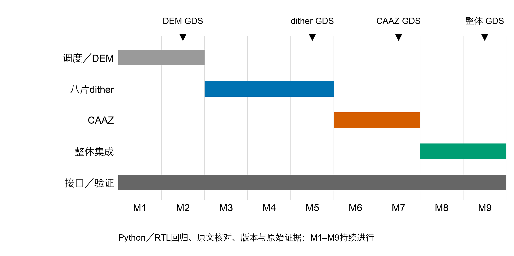{width=146mm}

首周只做“版本／环境检查＋已有数据回放抽查＋接口缺口登记”。已有图先原样引用并注明来源，需理解绘图口径时可重绘；无需重新训练、重新生成全量码密度或重做旧版图。接口、算法、条件或证据摘要改变后，才重跑受影响的完整验证。

| 已有交付 | 证据确认到哪里 | 你还要补什么 |
| :--- | :--- | :--- |
| 调度、受限DEM及跨段候选 | 两份归档对拍零差异、源码匹配；本次20项测试和65,536组名义关系检查通过 | 核心电荷／码机制成立；按物理使用及效果补覆盖，不因逻辑相位分布要求重写DEM |
| 八片dither与重构 | 独立dither 20,000拍零差异；Q28重构已有16,384笔及4,096中点检查，对应记录源码一致 | 已有等效负注入可用于行为验证；补全幅端点和输入覆盖，解释浮点／整数差异 |
| CAAZ与联合结果 | 数字控制／配对及共享AZ样本模型已有同带宽收益 | 补保持／增益、1/f或慢漂移样本场景及数字握手；模拟宏不是行为验收前提 |
| 整体数字路径 | 有归档PASS；两份整体记录的部分输入摘要与当前文件不一致 | 核对RTL／参数／向量，变化时定向重放；本次静态入口已重放一致，不重写模块或旧收据 |
| 动态模型 | 218项Python回归记录，含33项动态检查；结构／数学核及条件输入图已验证 | 作为可选系统敏感性研究；不覆盖或否定当前静态行为结果，局部128码不外推全幅 |
| SKY130后端 | [模块一旧GDS](../task1/physical/README.md)及[八片／整体旧GDS](../task2/physical/README.md)分别绑定各自源码和TT报告；模块一旧包独立DRC／LVS未运行 | 按各自摘要核对当前RTL；模块三独立GDS未找到可直接复用的同版证据。新版本各自交付，多角、等价、电源完整性不能由旧包推定 |

身份核对涉及on_chip记录的experiment.py及joint_noise记录的summary.json摘要。本次行为静态入口、指标和训练均重放一致，未重跑RTL。数字发布前按RTL、参数、向量和约束的实际变化决定复验，不因文档依赖摘要变化无条件重做全部。

当前Python分为map_fig11受限映射与map_fig21_bridge跨段候选，八片实验的fig21_dem支路实际使用后者。其电荷等效及数字机制可进行行为验收，不要求先做MUX器件瞬态。代码复核还纠正了旧说明：Fig.11本来标有8C／4C／2C／C／C；主侧两个1C均可参与DEM，恒低的是子阵列dummy。
本次行为审计复算24组频谱、16组线性度、四组NLMS训练及CAAZ四组，均与原结果一致。结合实际物理组后，逻辑起点分布不均未显示明显的使用劣化，不能判为功能缺陷，也不列为必须先修项。

## 模块一 M1–M2：切片调度、DEM与LMS

**复用：**task1中的调度、DEM候选、RTL和测试，以及现有片外LMS与定点重构工具。**新增：**冻结行为模型中的可交换单元和跨段补偿，补独立统计与覆盖验证。原文依据为ISSCC 2024 9.8 Fig.9.8.1／3及US10511316B2 Fig.11、20、21。
已有DEM＋LMS线性度改善可作为有效行为基线。后续重点为多种子、输入覆盖与整数／RTL维护；逻辑相位、物理使用及最终性能分开评价，不把单一计数当算法缺陷。

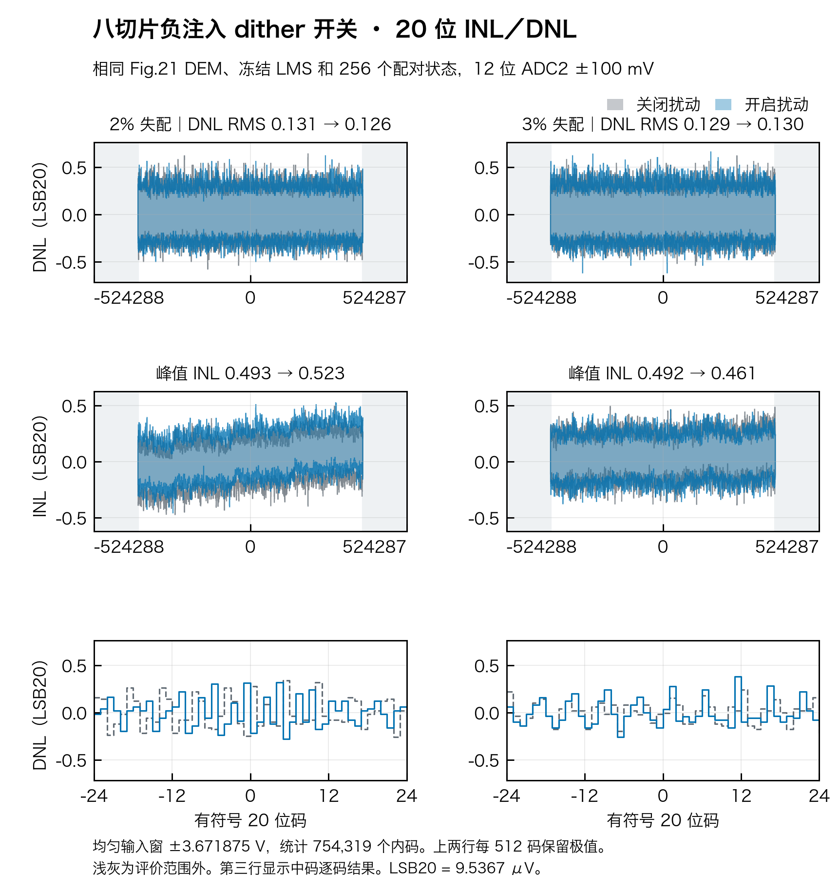{width=125mm}

已有2%失配、dither关闭的峰值端点INL：无DEM／无LMS 655.668、仅LMS 0.788、DEM＋LMS 0.493 LSB20。条件为±3.671875 V共同窗、256个等权配对状态；不等于全幅单次无缺码。

| 必交图 | 怎样比较与验收 |
| :--- | :--- |
| 选片时序＋单元使用分布 | 标出18／8／8／2、样本晋升和stall；转换组等于上一采集组，使用统计注明分母 |
| DEM×LMS四组20位INL／DNL与频谱 | 固定同一电容池、输入与可比控制，2%／3%分别报告；不能只给未校准图 |
| 训练收敛及冻结／留出 | 标明训练结束、冻结点、参考来源和独立验证；禁止用真实电容值充当已知校准系数 |

通过条件：独立电荷关系正确、同笔掩码与配置稳定、Python／RTL整数对拍零差异；以module1_bridge_top为独立宏，交GDS、同版网表与提取后时序／物理报告。历史GDS只在源码、约束及库身份一致时作为证据复用，否则重跑。发生收益不足时报告原因与代价。

## 模块二 M3–M5：八片dither及内部余量

**复用：**六位字发生器、八片注入模型、$k=c-U$命令、conv_sub+sample_sub重构及独立测试。**新增：**完善已声明等效电荷模型的端点与时序，扩大输入／失配覆盖。依据为ISSCC论文1页、讲稿17–18页及US10505561B2 Fig.3／19；专利七片示例与本工程八片分配分开标注。

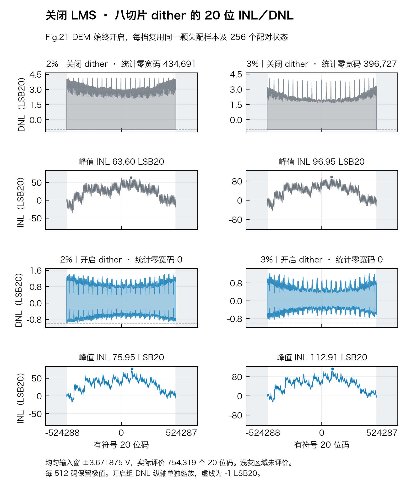{width=119mm}

已有DEM开、LMS关的2%／3%静态例中，零宽内码由434,691／396,727降为0，但峰值INL增大。当前全部字共同名义下限−4.855239 V，目标±5 V端点问题尚未闭合。图是平均码密度，不是实际模拟开关验收。

| 必交图 | 怎样比较与验收 |
| :--- | :--- |
| 注入／去扰＋同笔时序 | 画出lower／upper、孔径、实际开关位图和数字补偿；逐项对照原文与工程选择 |
| 无LMS、冻结LMS各自的dither关／开INL／DNL与频谱 | 固定DEM、输入、失配池及训练合同；保留一个不使用LMS的独立对照 |
| ±5 V输入的拒绝／ADC2超窗与内部节点图 | 分开标前级拒绝、后级越界及最终码；不能靠数字限幅恢复已经过载的样本 |

通过条件：同笔字／片号／掩码／ADC2对齐，独立整数与RTL一致；以dither8_top交GDS及同版网表和时序／物理报告。该顶层包含模块一调度和DEM，不能与模块一宏面积直接相加；如抽成纯dither宏，须冻结新接口并另验。端点若越界，全幅功能标FAIL；数字宏完成不能掩盖该问题。

## 模块三 M6–M7：CAAZ与三技术协作

**复用：**斩波相位、带ID的AZ请求／确认、两笔配对和现有联合噪声实验。**新增：**在样本域扫描保持／两相增益及相关噪声，验证异常和联合数字行为。依据为Wang等VLSI 2025 C32-1 Fig.5／6；不要求学生设计RA或CBIAS模拟宏。

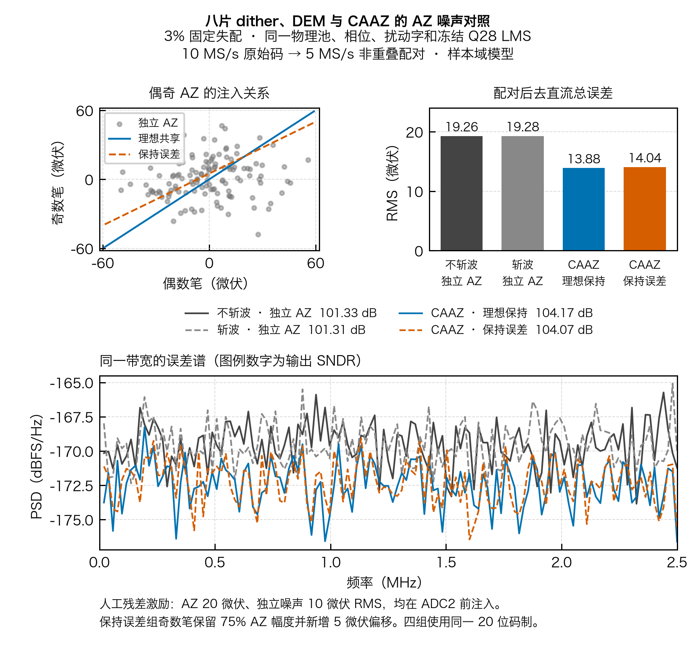{width=125mm}

已有同为5 MS/s输出的交流误差19.264→13.875 μV RMS，加入示例保持误差后14.041 μV RMS。噪声及保持值为工程设置，不是真实电路测量。两点配对改变频响，不能把降低输出速率本身的收益归给CAAZ。

| 必交图 | 怎样比较与验收 |
| :--- | :--- |
| 偶奇AZ更新／保持及数字配对时序 | 明确RA窗口、AZ代、确认和样本号；每笔先重构去扰再配对 |
| 普通配对／斩波但AZ独立／共享AZ／保持误差的同带宽谱与RMS | 同为5 MS/s、同带宽；固定DEM、dither及LMS，分离普通平均和共享AZ贡献 |
| 保持误差扫描＋三技术联合与错绑负例 | 偶奇可用不同片／扰动字；错相、丢笔、坏码、AZ代错配被拒绝，不能输出看似正常结果 |

通过条件：整数／RTL逐笔零差异，AZ请求与行为确认按同笔归属闭合；以caaz20_pair交独立GDS与同版时序／物理报告。现有RTL对拍可复用；当前task2物理脚本不支持此顶层，须新增或适配后端配置及约束，不借用整体顶层GDS。误差假设和带宽条件须可追溯。

## M8–M9：数字签核要求与最终交付

**三个模块分别在M2／M5／M7交付GDS；本节要求同时适用于各模块和M9整体。** 每次先冻结同一个版本的spec、RTL、定点参考、约束及输入向量，再做实现。目标时钟为6.25 ns；所需模式、PVT／RC角、IO延迟、负载和不确定度在M2冻结。当前只有部分归档通过，本表是要求，不是通过声明。

| 检查 | 必交原始证据与通过条件 |
| :--- | :--- |
| Spec与需求覆盖 | 复用各任务verification_plan，关联接口、测试及证据；位序、合法范围、吞吐／延迟、复位、stall、PRNG和配置更新规则明确，无功能性未决项 |
| RTL与定点验证 | 语法／lint、定向及随机对拍、断言／形式结果；逐笔零差异；覆盖边界、复位、清空、反压、运行中配置和非法ID，lint遗留逐项裁定 |
| 时钟／复位与CDC／RDC | 声明所有时钟域和复位释放；单域给结构检查依据，跨域给实现与分析证据；模拟结果提交须满足数字捕获合同 |
| 综合与等价 | 真实库的综合日志、单元／面积、锁存器与未映射项检查；RTL到综合网表的等价证据；ECO或流水修改后重新验证，不以回归替代形式等价 |
| 提取后STA | 交SDC、Liberty／RC／SPEF版本及所有必需角的setup／hold；最差裕量均不小于0，WNS／TNS为0；无未约束有效路径，例外有依据 |
| 物理验证 | 对最终GDS做stream-out／in完整性、DRC、LVS及适用的天线／密度检查；明确规则版本、错误数和任何例外；只验路由器DRC不够 |
| 电源与可靠性 | PG连通、跨层via及逐实例必需电源脚检查；静态／动态IR与EM分别给活动、电流／规则、角和结果，限值按库／工艺冻结 |
| 功耗与发布身份 | 功耗注明实际活动、频率与角；GDS／网表／SDC／SPEF和报告属于同一冻结运行，提供SHA256、工具版本、日志及可重跑脚本 |

**阶段效果图：**数字宏版图全景；关键路径与时序裕量摘要；同约束下的面积／功耗对照（具备有效活动数据时）。这些图帮助评审，验收仍以原始报告为准。

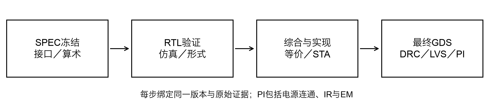{width=146mm}

**签核纪律：**逐项标PASS（通过）、FAIL（失败）、BLOCKED（缺前提）、NOT_RUN（未执行）或PARTIAL（部分完成）。缺工具、规则、角或输入不能标通过；PG／IR／EM、多角STA或等价未完成时，不得宣布完整数字签核。历史控制顶层及含重构顶层GDS分别按其原始身份核对，不自动覆盖当前版本。180 nm BCD另行实现，不能继承SKY130结果。

## 接口、首周动作与提交格式

| 模拟组给出／确认 | 学生负责形成的数字合同 |
| :--- | :--- |
| 电容连接、可交换组、辅助注入与参考轨 | 主136位／子40位及采样40位的实际映射、位序、极性和名义补偿；工程假设与原文分开 |
| SADC／ADC2有效时刻、RA增益与窗口、超窗含义 | 9位粗码、12位ADC2、32位样本ID、8个有序片号及六位字的握手／延迟；错误不静默丢弃 |
| 捕获／保持、斩波及AZ确认、CDC／复位条件 | 偶奇极性、AZ代、状态退出、重启与配置更新；每个有源输入都有时序约束 |
| 可选的采集、参考与耦合预算 | 如开展系统敏感性研究则接入样本／等效响应；不作为三项算法行为验收前提，不承担模拟晶体管设计 |

已有数字时序：八片采集描述符在采集请求受理沿N后N+2发布；重构核在E0受理、E22出结果。16拍一笔是吞吐目标，不是单笔延迟。现有整体合同要求模拟宏在N+15前提交ADC2，必须在接口冻结时与实际孔径、RA时窗核对，不能据数字仿真声称模拟已满足。

**权重模式合同：**当前无DEM与Fig.21模式分别训练系数，dither关／开在同一模式内共用冻结系数。不能把“同一LMS流程”误读为任意模式通用同一组数值。默认固定模式运行；更换不兼容模式时先暂停、清空并重载匹配系数。负例只说明配置必须匹配，不是DEM关闭本身的性能。

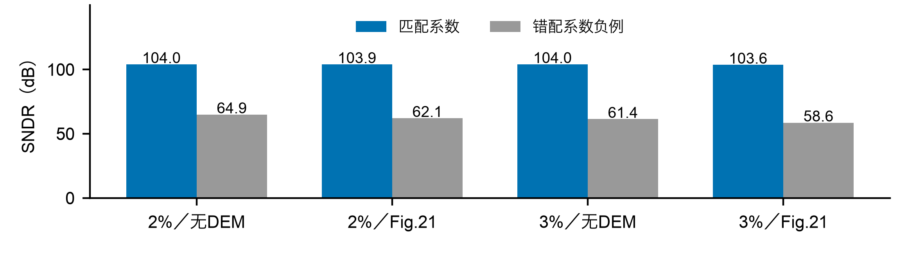{width=146mm}

直接代码起点：task1的module1_bridge_top、task2的dither8_top、task3的caaz20_pair，以及task_reconstruction的sar20_lms_recon。复用其模型、TB和检查脚本；具体端口以各自SPEC为准。

首周：固定提交与工具版本，运行现有Python回归，抽查已有数据／图；查看模块一、dither和重构匹配记录，再核对两份整体记录的物料身份，变化部分才定向重放。已有RTL不重复实现，旧收据不重签。只有相关输入或实现改变时，才重新训练并重跑相应实验。

每个模块均提交“spec／接口＋行为模型与效果图＋RTL与逐笔日志＋综合网表／GDS／SDC／SPEF＋时序／物理报告＋摘要清单”；整体集成再交独立证据包。训练／留出分离，禁止用真实失配作训练答案。LSB20统一为$10/2^{20}$ V，所有图注明码范围、带宽、样本／命中数、LMS状态与适用边界。

项目范围固定：ISSCC的9位前级及18／8架构，三个数字工作包与必要的重构／集成。行为级以电荷／码关系、失配校准、样本噪声及数字对齐为主；复杂动态仅作可选扩展。本期不扩展DSP、CICC后级架构、模拟RA设计或片内LMS训练器。

参考：Bodnar等，ISSCC 2024 9.8，论文1页及Fig.9.8.1／3；US10516408B2（切片转换级）、US10511316B2 Fig.11／20／21（DEM）、US10505561B2 Fig.3／19（dither）；Wang等，VLSI 2025 C32-1 Fig.5／6（CAAZ）。采集前tracking、输入充电辅助及低功耗参考分别另见US10707889B1、US10541702B1、US10826519B1；不因引用而声称已实现。原件和代码入口统一见仓库README与references索引。

原图与短句均按用户要求节选自其提供的原件，版权归原权利人；软件许可不覆盖原图。图页、文字页、裁剪与SHA256分别记录在source_figures.json，不把原图中的电路画成已实现状态。

更新记录：2026-11-08，以aea7d1f工作树及归档记录编制；只新增接手文档、计划图及排版源，不修改算法、RTL或实验数值。任务书定义未来验收，未新增任何数字签核通过结论。

## 技术说明：交织、量化器与残差DAC怎样分工

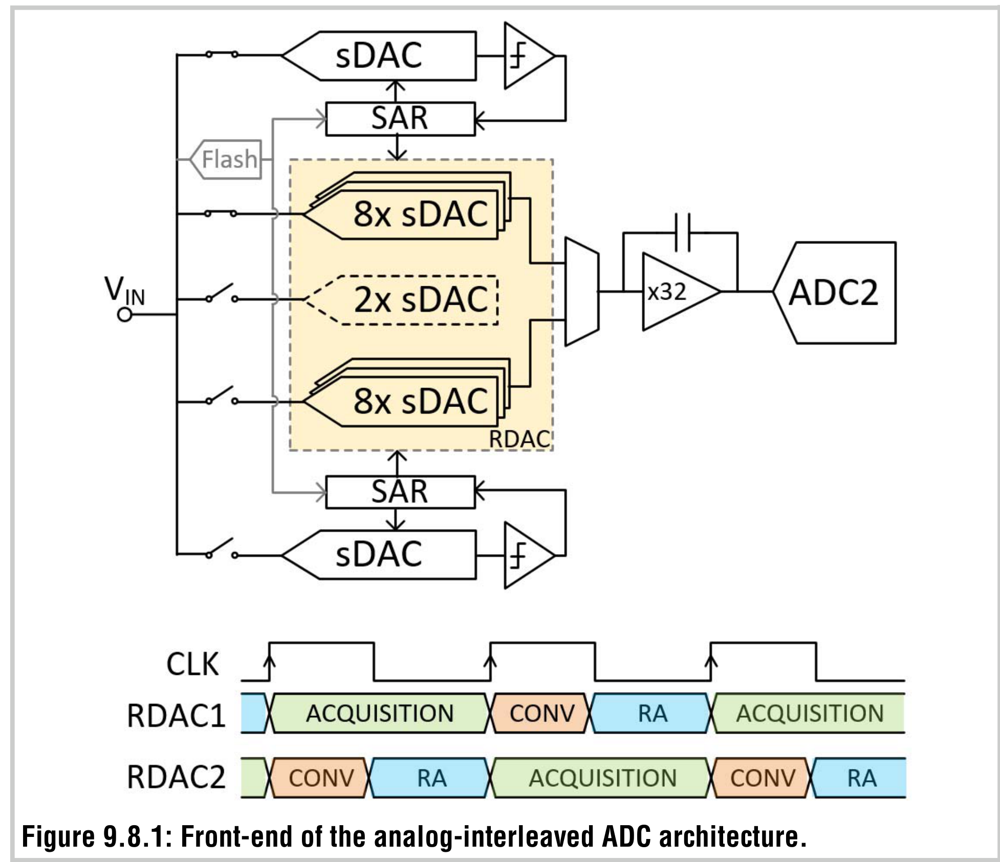{width=132mm}

**沿原图读信号：**VIN同时服务小量化器和大残差DAC。量化器先得到粗码，RDAC按结果建立残差，RA再把残差送ADC2。RDAC的18个切片不是18路独立输出ADC：每笔8片共同采集，另8片共同形成上一笔残差，2片留作重排资源。

**为什么要交织：**当前8片转换时，下一组8片可以跟踪输入；输入采集延长至一个原始周期。项目10 MS/s时T=100 ns。固定的采集／转换两组容易把失配变成周期杂散，随机改变物理组可打散这些杂散，但也可能提高宽带误差。时偏和采样带宽不匹配仍需控制，不能只靠随机调度解决。

**时序关系必须一起成立：**转换组来自上一采集组；采样孔径之前控制字已稳定；本笔ADC2孔径与下一输入孔径对齐。16个数字tick是工程分配，不是原文完整时序。原图的RA倍率和±3 V、40 MS/s条件不能直接搬到本项目的±5 V、10 MS/s。

**复现要求：**学生复用现有调度器，交每片角色与样本ID随时间图，验证无重复占用、stall不推进、同笔配置保持。模拟组给孔径、释放与RA时窗；数字侧冻结受理沿与延迟。资源组随机选择与片内单元DEM分别统计，不能混为同一个开关。

## 技术说明：Fig.11电容网络与桥接权重

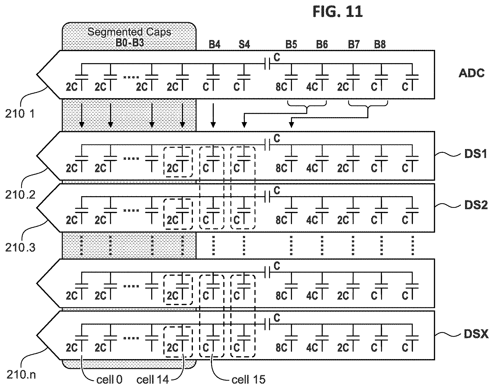{width=140mm}

**结构：**B0～B3由分段的2C单元表达，主侧还有B4与S4两个1C；桥接电容把主节点和B5～B8所在子阵列相连。S4不是看到图就能固定当dummy的无关电容：其可切换用途和底板轨必须与模拟组冻结。

以下为静态线性网络分析，不是论文给出的模型公式。定义主／子总电容为C_M、C_S，桥接为C_B；节点v_M、v_S相对同一参考，右端q_M、q_S为对应电荷激励：

$$
(C_M+C_B)v_M-C_Bv_S=q_M,\qquad -C_Bv_M+(C_S+C_B)v_S=q_S.
$$

消去子节点后：

$$
\beta=\frac{C_B}{C_S+C_B},\qquad v_M=\frac{q_M+\beta q_S}{C_M+\beta C_S}.
$$

所以子电容的作用不能只按名义二进制数相加，桥接与寄生会同时影响权重和增益。Fig.11直接支持C_B=C及子阵列总16C的名义值；β=1/17还依赖零寄生及连接前提，是推导值而非原文承诺的工艺参数。模型使用输入折算电荷域，足以验证静态权重和数字补偿；v_M与ADC2实际电压的硬件映射另记。

**复现要求：**逐单元登记物理连接、采样节点、参考轨、可交换组和dummy状态；用独立两节点求解验证名义与固定失配网络。不能把跨桥的位直接搬到主侧并假设电荷不变，不能用代码当前的1 fF归一单位估计真实kT/C、面积或参考电流。

## 技术说明：Fig.20／21怎样实现两级DEM

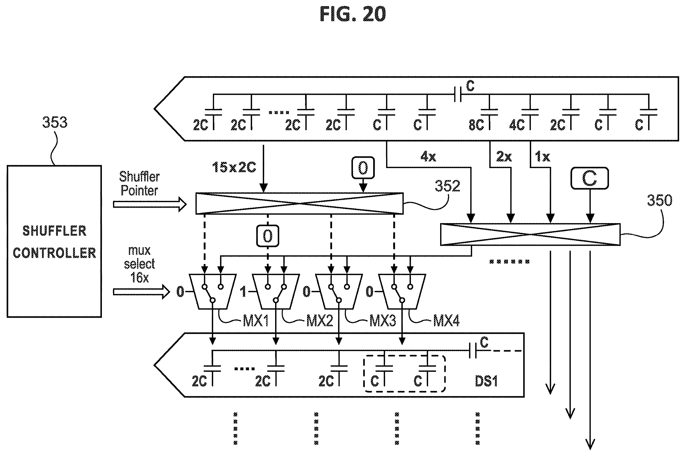{width=118mm}

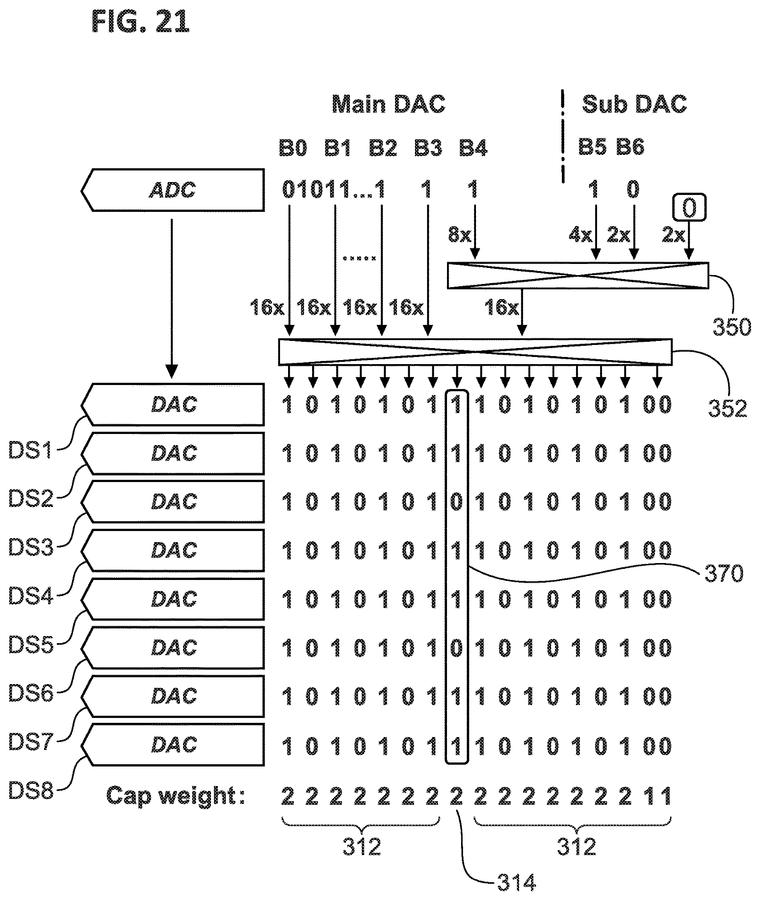{width=80mm}

352把预留输入0和主段一元字重排到物理列；353据该位置控制MUX，选定列改由350驱动，其余列沿352。350负责相应列在八片中的选择。因此必须同时核对“保留了哪一列”及“哪些片用了它”，不能只做一层轮转。

**原句：**同专利PDF第42页、印刷21栏，Fig.21说明末段：

> “This shuffling scheme further reduces the impact of size errors between the cells and gives rise to further improvements in INL errors.”

原文说改善单元尺寸误差与INL，没有给本工程2%／3%池的收益。其对应的控制规则、工程跨段补偿和效果证据继续在下一节推导。

## 技术说明：DEM为何有收益，为什么仍需LMS

对某一固定制造池，设单元误差为δC_i，选择状态为s，输入码为c。将已确认网络的有效灵敏度记为a_i(c,s)，则一阶误差可写为：

$$
e(c,s)\simeq\sum_i a_i(c,s)\delta C_i.
$$

固定映射使误差随码重复，形成INL结构与杂散。DEM改变状态s，使一部分误差从确定性失真转为波动；但条件均值E[e|c]不一定为0。只看到杂散下降，不能据此宣称SNDR、单次精度或使用均匀性同时达标。固定池必须贯穿全部对照，不能每笔重新抽电容。

**跨段不能遗漏补偿：**令H为B0～B3的4位值、m=4B4+2B5+B6。保留列方案的主侧名义量为16H+2m（单位C）。在本工程β=1/17、旧码表和对称参考约定下，迁移B5／B6相对旧网络多出的选择电容为：

$$
\delta C=\frac{4B5+2B6}{17}C.
$$

输入折算补偿最大约10 V×6/(17×256)=13.79 mV。这个数来自工程网络，不是专利规格。沿旧码表重构时补一次；若直接按迁移后的真实位权重构，不能再重复加。数字补偿不能挽救已经超出RA／ADC2窗口的样本。

**LMS做另一件事：**它从可用观测估计固定权重，减小δC_i的重构影响。训练后冻结，再用独立留出评价。论文披露外部系数与片上位权修正，具体LMS、Q28和更新接口是工程选择。动态建立误差并不会因为用了静态LMS就自动消失。

**逻辑相位不能代替物理统计：**当前15态映射八起点不均，但实际18片组也在变化。固定码专项100,000笔中，各物理片选中5432～5668次；当前／独立均匀起点的条件单元使用偏差RMS约5.044%／5.034%。据此不能判为DEM行为缺陷。应结合物理mask、输入条件和INL／频谱裁定，避免把逻辑索引计数当作电容失配效果。

| 复现对象 | 必须看到的证据 |
| :--- | :--- |
| 机制正确 | 全码／合法相位下的独立电荷关系，保留列与物理mask对齐，补偿漏加／双加负例 |
| 统计效果 | 同池DEM×LMS四组INL／DNL、频谱、训练收敛；同时报告均值误差和波动 |
| 原文对齐 | 未实现的开关或可交换关系单列；不能把当前受限候选写成完整原型3D DEM |

## 技术说明：减性dither为什么能平滑码边界

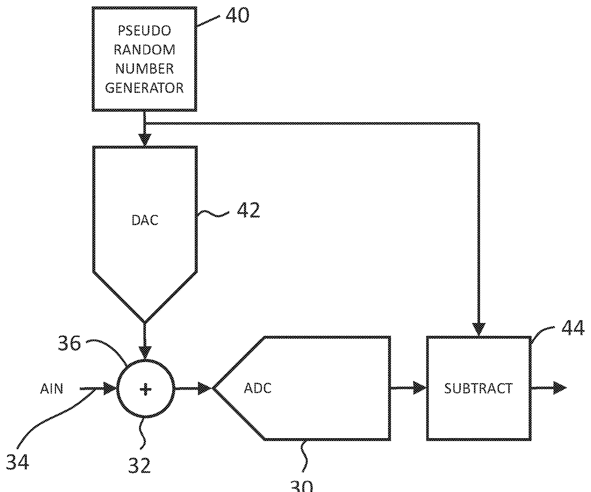{width=112mm}

**原句：**该专利PDF第26页、印刷第5栏，Fig.3说明：

> “The dither signal is formed in the digital domain by a pseudo-random number generator 40.”

随机字d已知，模拟侧转换x+d，数字端去除同一d，得到z=Q(x+d)−d。固定x会落到不同码边界，评价的是E[Q(x+d)−d]。非均匀码宽造成的局部误差因此可能被平滑；这不等于每一笔误差消失，也不保证所有输入、频率和失配下SNDR提高。

原图最关键的不是“加一份噪声”，而是两条支路必须描述同一笔注入。幅度、符号、路径、延迟有误，数字去除就会留下与字相关的误差；ADC过载后再减d也不能恢复丢失的信息。

**复现要求：**先用理想量化器验证符号和延迟，再接含固定电容失配的电荷网络。记录实际注入权重而不只记录PRNG字；保留dither关／开、无LMS／冻结LMS对照。DEM与dither随机状态独立，并明确stall、禁用、重置和种子重载时的行为。

## 技术说明：Fig.19六位字如何拆分和落到切片

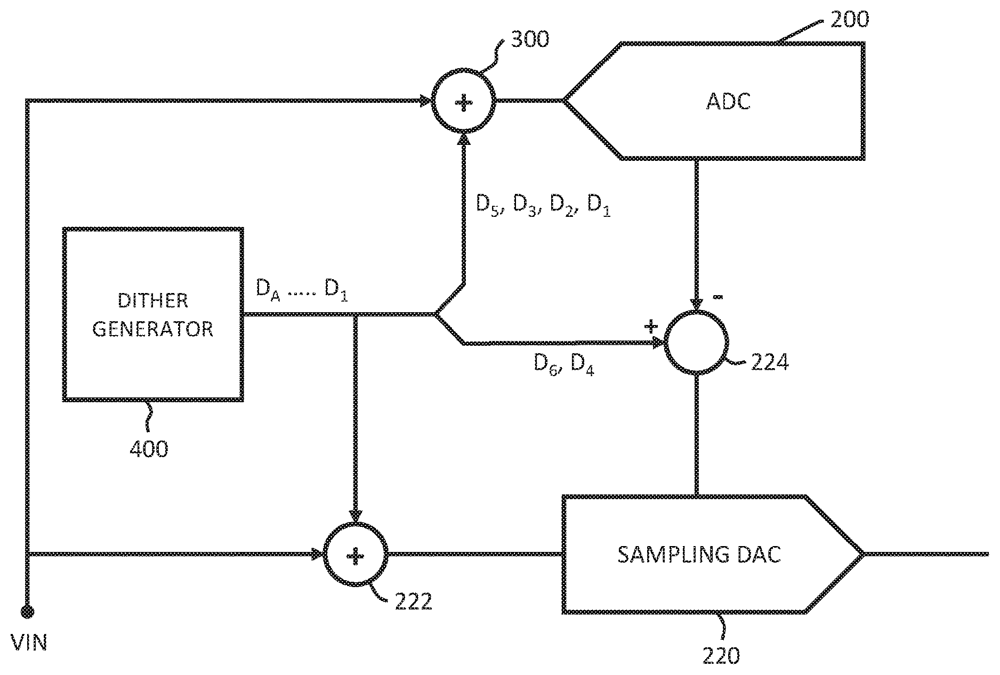{width=132mm}

原文七片示例以一个前级档为单位，令F=4D3+2D2+D1、U=4D6+D4，则L=2D5+F/7、T=L+U。SADC只用D5／D3／D2／D1，RDAC使用全字；PDF第33页、印刷第19–20栏正文规定扣除U，再设置RDAC。图中224符号的方向必须结合码约定和电荷极性阅读。

**本工程八片约定单独验证：**令m=D[2:0]、U=4D[5]+D[3]、I=U+2D[4]。前m个有序槽取I+1，其余取I，因此名义平均档位为I+m/8；L8=16D[4]+m，T8=8U+16D[4]+m。使用哪几个实际电容由物理mask和权重决定，不由平均值自动保证。

**可手算的工程例：**D6=1、D5=D4=0、m=3时，U=4、L=3Δ/8、T=35Δ/8；3个槽取5档，5个槽取4档。粗码c=100时k=96；若c=2则必须拒绝下溢，不能回绕。Δ=10/544 V来自当前工程网络，不是原文工艺参数。

**复现要求：**枚举64个字、全部有序槽和合法相位，检查实际电荷、粗码和去扰。原文/7与工程/8分别记账；确认辅助参考误差是否与转换权重共享。必须把字、逐片电荷、残差及重构连起来核对；当前该行为路径已有独立节点验证，不要求学生先做开关瞬态。

## 技术说明：分路注入、残差与数字去扰如何闭合

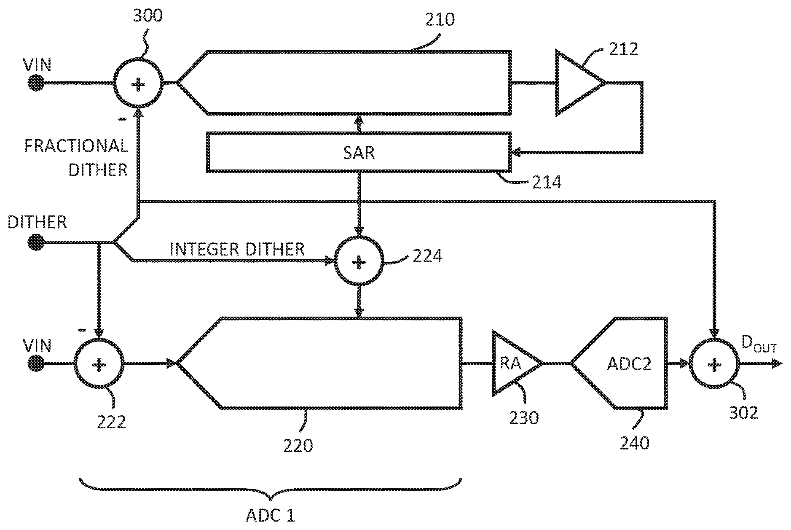{width=120mm}

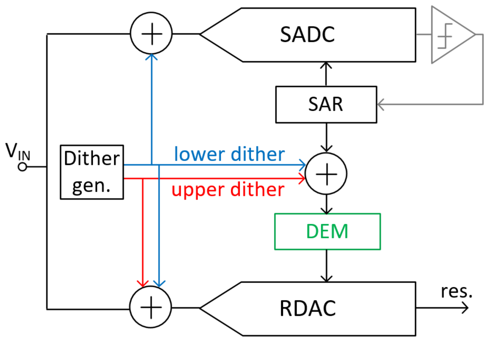{width=100mm}

ISSCC论文PDF第1页、印刷182页原句：

> “Dither is used to complement the DEM linearization of the DAC.”

在当前工程的负注入、输入折算电荷约定下：c=Q(x−L)、k=c−U、r=g(x+5)−VD(k)−T，重构为(r+VD(k)+T)/g−5。T由同笔实际采样mask参与位权重构；不能再按名义T扣／加一遍。conv_sub+sample_sub可为2，这是同权重被两项使用，不是非法二进制位。
Fig.3的加性示意与这里的负注入属于不同符号约定，模拟与数字必须整体一致。受控负电荷源是合法行为模型；需核对完整电荷／码路径，而非要求先实现器件开关。实际电路接法由模拟组另行验证。

**复现要求：**对SADC、RDAC、残差、ADC2和最终码分别画余量；不能只看最终码未clip。全部字下共同名义下限−4.855239 V是尚需处理的目标差距。实际轨、RA增益、采样参考与转换参考不一致时，须更新物理模型及训练合同，而不是调整符号去迎合结果。

## 技术说明：北大Fig.5把斩波放在哪，数字做什么

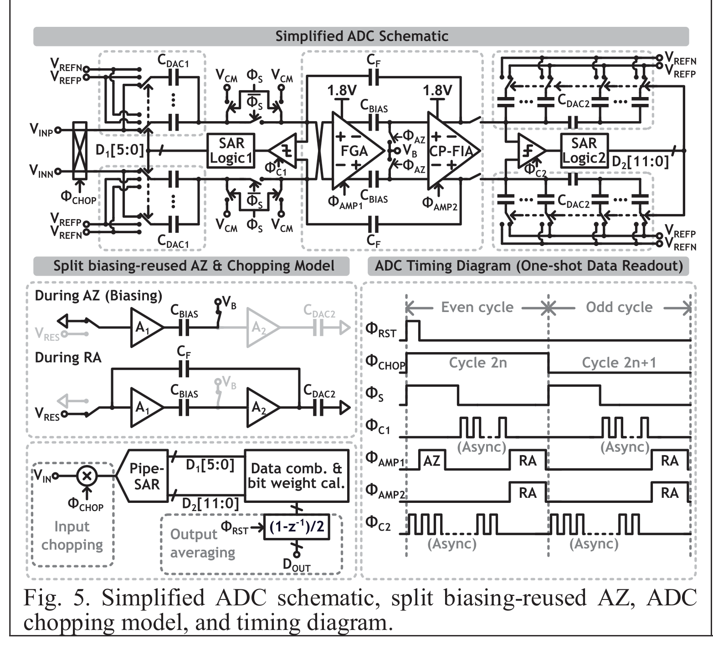{width=125mm}

该原型图的6位前级和FGA／CP-FIA只用于解释CAAZ位置；本项目仍保持ISSCC的9位交织前级。输入差分极性先由ΦCHOP切换，CBIAS位于RA内部。图左下顺序是输入换相→ADC→数据合并与位权校正→输出处理。数字同学实现控制、元数据和重构／配对，不承担FGA、CP-FIA或保持开关的晶体管设计。

**与DEM／dither协作：**先在每笔原始斩波码域中完成该笔的位权重构与去扰，再解调配对。奇偶笔可以选不同物理片、不同DEM相位及不同扰动字，但每笔必须携带自己的实际mask。共享的是AZ代，不是切片、电容误差或扰动字。

**复现要求：**把捕获／保持请求和行为确认随样本ID对齐。样本域模型必须偶笔保存w、奇笔复用同一w或其保持误差版本；不能只发hold标志却每笔重抽AZ噪声。当前联合模型已按此构造。实际电路对接另行落实。本项目把dither定义在斩波后的码域，是需模拟签认的工程位置；若真实注入在斩波前，须重新推导符号与接口。

## 技术说明：共享AZ怎样抵消噪声，哪些噪声不会消失

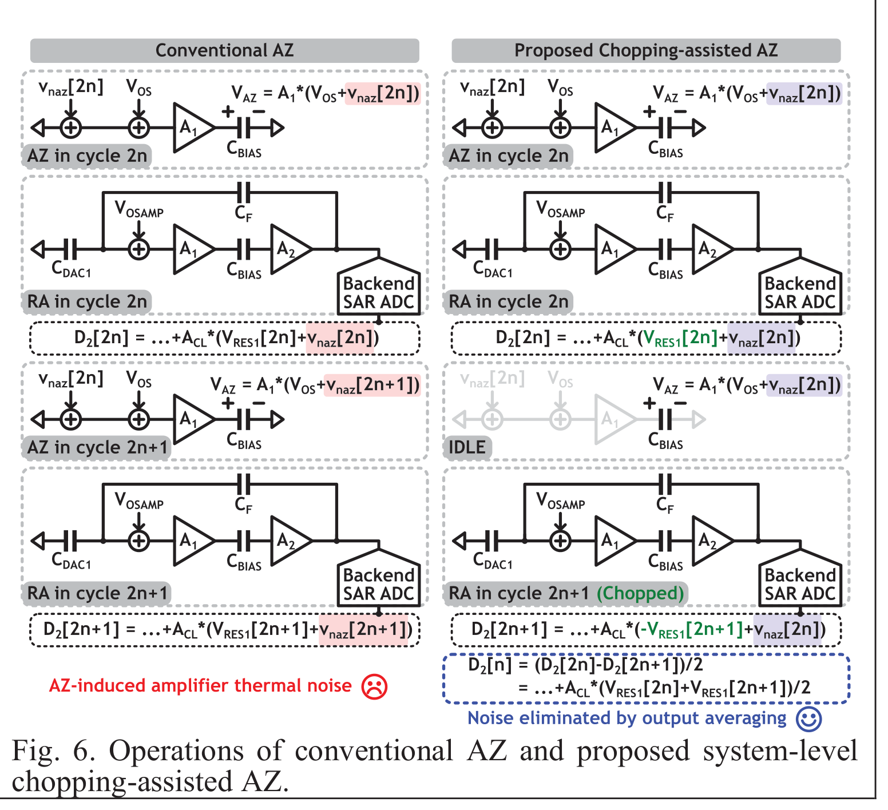{width=120mm}

论文PDF第1页Fig.6说明的原句为：

> “AZ is only performed in the even cycle”

原文还指出：

> “two consecutive conversion results contain the same sampled noise”

用输入等效量说明：z_e=x_e+a_e w+u_e，z_o=−x_o+a_o h w+u_o。其中w是同一份AZ噪声，h为保持比例，a_e、a_o为两相传递，u为独立误差。配对结果：

$$
y=\frac{z_e-z_o}{2}=\frac{x_e+x_o}{2}+\frac{a_e-h a_o}{2}w+\frac{u_e-u_o}{2}.
$$

当h=1且a_e=a_o时，共享项抵消；独立噪声仍有方差$\sigma_u^2/2$。相邻笔相同的残余失调也能相消，时变失调／低频噪声只受到滤波抑制。增益不同、泄漏、重新捕获AZ或错绑代号都会留下残余。残余AZ标准差为|a_e−h a_o|σ_w/2；参数须来自模拟条件或标明敏感性扫描。

**原文提出它的意义：**传统AZ会额外采入CBIAS热噪声；共享AZ配合信号换相，可以抵消这份新增噪声，而普通两笔平均只让独立噪声功率减半。论文第1页报告总热噪声改善4.3 dB，其中3 dB来自普通平均、额外1.3 dB来自AZ采样噪声抵消；应用针对低至中频输入，不是无代价提高任意宽带转换性能。

## 技术说明：配对频响、整数舍入与CAAZ复现要求

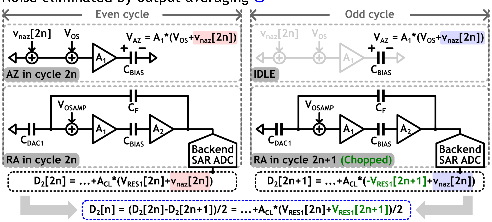{width=146mm}

**数字直觉：**若偶数码1008、奇数码−992，二者包含同一+8误差，则差的一半为1000；若奇数误差只剩+6，结果变为1001。例子只解释共享与保持关系，不代表芯片噪声幅度。

**码宽与舍入：**当前caaz20_pair保留21位有符号差d=e−o，范围±1,048,575，以半LSB解释；20位输出为floor(d/2)。d=−1时输出−1，同时保留精确−0.5 LSB差量。不能把浮点平均无条件当作RTL整数oracle。

**频响与带宽：**10 MS/s原始流的两点信号平均具有|cos(πf/10 MHz)|幅频响应，配对时间戳取两孔径中点，输出5 MS/s。工程例中1 MHz幅度约降0.44 dB，2.5 MHz约降3.01 dB；两点平均也不是完整抗混叠滤波器。因此CAAZ对照必须同输出速率、同带宽，分开报告普通平均与共享AZ的收益。

**速率定义：**原论文及讲稿标称转换速度6 MS/s，但未在已核对文字中单列内部原始码率与对外配对码率，不能擅自写成6→3或12→6。本工程明确采用非重叠10→5，作为可选低噪声模式；旁路保持10。若最终输出必须10且CAAZ开启，需另定内部吞吐与时序，不能把当前5 MS/s结果算作10 MS/s输出目标完成。

**解调、滤波与抽取分开：**逐笔乘斩波极性是数字解调，本身不改变码率；差分／相关处理可以与解调融合。图中$ (1-z^{-1})/2 $的除2是幅度归一化，不是2:1抽取指令。当前代码只在合格奇数笔发布一对结果，才明确形成10→5；不能仅凭原图的除2推断原文ADC码率减半。若研究全速逐笔解调／滤波，应另行验证，不用现有半速数据代替。

**测量的10×平均：**讲稿PDF第38页、幻灯片37的Measured Spectrum写有64k-points, 10x averaging，这是谱测量设置，与CAAZ解调和输出抽取不同。常见功率谱平均可稳定谱底起伏，不等于时域每10码合成一码，也不自动提高ADC的SNDR 10 dB。原文未写明功率／幅度／复数平均类型；复现时须单列FFT点数、窗函数、平均方式及归一化，不能替作者补全或仅比较噪声底高度。

**复现要求：**先固定同一颗2%／3%池和冻结LMS，比较独立AZ、共享AZ、含保持误差，再改变DEM／dither开关验证协作。交保持扫描、误差谱、AZ代／极性时序和错绑负例；独立量化误差、动态建立和未去尽扰动不能算作“被CAAZ消掉”。原型6 MS/s与本项目10／5 MS/s分别记录，不搬用其SNDR数字作验收门槛。

## 月度交付：M1–M3，先接手再补覆盖

**先看现有证据：**[模块一入口](../task1/README.md)、[八片扰动数字入口](../task2/eight_rtl/README.md)、[CAAZ入口](../task3/README.md)、[行为复核表](BEHAVIORAL_STATUS.md)。现有图可标“归档基线”直接引用，不要求为交作业重新造图；新增实验必须另标“新增”，不能冒充原论文实测。

| 月份 | 要交的图和文件 | 具体通过条件与已有工作 |
| :--- | :--- | :--- |
| M1 | 一张18片角色与样本ID时序图；提交接口表、版本与证据索引 | 对照调度合同，8采集／8转换／2空闲，前次采集组有序晋升；stall时ID、掩码及随机状态保持。运行一项代表性回归并留命令和结果。沿用task1已有调度与图，不重写。 |
| M2 | 模块一GDS、时序／物理报告；2%／3% DEM×LMS四组图 | 四组共用失配池、输入和窗口，切片计划相同；两种映射各自训练失配权重、冻结后独立留出。电荷与Python／RTL对拍零差异；GDS及报告同版。已有数组先补画，多种子再新增。 |
| M3 | 六位字到lower／upper及八槽位的注入／去扰示意图，加一张样本ID与mask对齐时序图 | 64字、八槽、合法边界及c<U全部覆盖；补偿符号和同笔归属与独立模型一致；下溢不得回绕。已有独立电荷检查及20,000拍对拍可引用；变更影响行为时才重跑。 |

所有比较图写清坐标单位、输入、速率、固定池与随机种子、模式和参考来源；代码或配置变化时注明版本，重新执行受影响的检查。

## 月度交付：M4–M6，扰动与CAAZ

| 月份 | 要交的图和文件 | 具体通过条件与已有工作 |
| :--- | :--- | :--- |
| M4 | 2%／3%分别交dither关／开的20位INL／DNL和频谱；无LMS、冻结LMS各一套 | 固定DEM、输入、失配池和窗口；报告峰值、零宽码、SNDR／SFDR及代价。每种模式各自训练后固定，同模式内dither开关共用系数；已有四组图先引用，不得把有限状态均值写成单次无缺码。 |
| M5 | 模块二GDS、时序／物理报告；±5 V拒绝与内部余量图 | 逐个区分命令下溢、内部越界、ADC2超窗和最终输出；全幅越界标FAIL，不能以限幅标通过。当前共同窗仅±3.671875 V；GDS及报告与RTL同版。 |
| M6 | 偶奇斩波／AZ捕获保持时序；普通配对、独立AZ、共享AZ及保持误差的频谱和RMS对照 | 比较均为5 MS/s、同输入和带宽；每笔先重构去扰后配对，共享AZ代与样本ID一致。复用已有样本域结果，不把普通平均收益全算作CAAZ；原文谱测量10×平均单列。 |

现有图的数据入口：[线性度与频谱](../task2/evidence/eight_negative/README.md)、[CAAZ联合噪声](../task3/evidence/negative/joint_noise/summary.json)。CAAZ联合归档仅3%单颗，2%与参数扫描尚需新增；这些结果是行为模型，不代表实测或目标工艺签核。

## 月度交付：M7–M9，联合验证与数字后端

| 月份 | 要交的图和文件 | 具体通过条件与已有工作 |
| :--- | :--- | :--- |
| M7 | 模块三GDS、时序／物理报告；保持扫描与错绑负例图 | 字、片号、位图与AZ代按ID对齐；错相、错代、丢笔等进入错误路径。整数参考与RTL逐笔一致；独立宏GDS和报告同版。复用已有配对模型。 |
| M8 | 整体联合效果及接口时序、面积和关键路径图 | 冻结同一RTL、约束与库版本；相关回归、RTL到网表等价通过；报告约束、WNS／TNS和未约束路径。旧模块GDS不能算整体顶层通过。 |
| M9 | 整体数字宏GDS版图全景、最差setup／hold路径图、DRC／LVS／电源结果摘要图 | 交同版GDS、网表、SDC、SPEF、完整报告及哈希；必需角setup／hold裕量≥0、无未约束有效路径；DRC／LVS及适用电源检查按冻结规则验收。未运行、失败或缺条件各自标记，不以示意图代替报告。 |

**统一验收：**M2／M5／M7分别交模块行为、RTL、GDS证据包；M9另交整体包。每月包至少有图、原始数据、命令、配置／种子、代码版本和结果表。算法正确性按以上确定性条件判定；性能门槛未冻结时只报告数值与取舍，不写通过。真实180 nm BCD的模拟接口、约束和后端结果不能由SKY130结果替代。

## 实操一：DEM为什么有效，现有图怎样用

**看原图和现有实现：**第9页的专利US10511316B2 Fig.11给出桥接电容网络；第10页Fig.20／21给出单元重排与跨片选择。第8页ISSCC架构图说明八片采样／转换的位置。图解释的是把不同物理电容分配到等效权重；同一电容误差不再始终对应同一输入码，可能减小固定非线性，也可能提高随机误差，必须同时看INL／DNL和频谱。

**做法：**固定一颗18片失配池、输入、时钟、切片计划、ADC2窗口和dither状态，只改变主／子单元映射；无DEM、仅DEM、仅LMS、DEM＋LMS四组分别记账。代码为[实验入口](../task2/eight/experiment.py)、[映射合同](../task1/BRIDGE_SPEC.md)和[映射器](../task1/model/fig21_bridge.py)。先看[八组指标图与数据](../task2/evidence/eight_negative/README.md)，其中2%／3%各只有制造种子100；两种映射分别训练失配权重，但当前前台增益参考共用，不能称所有训练过程完全独立。

**图与通过：**现有factorial图给四组指标，现有线性度及频谱图主要展开Fig.21；四组完整20位INL／DNL与频谱需从归档data.npz补画，先检查字段，不需为画图重新训练。静态图为256状态等权平均、共同窗±3.671875 V，1 LSB20为9.536743 μV；频谱采用归档中的留出输入与FFT设定。新图附相同种子、相同计划和原始数组哈希；电荷合同与整数对拍零差异为功能通过，性能差异照实报告。真正的多制造种子需新增仿真，不能将2%和3%视为两颗独立芯片。

## 实操二：dither从原图到同笔补偿

**看原图和现有实现：**第12页专利US10505561B2 Fig.3给出伪随机扰动与数字去扰，第13页Fig.19给出lower／upper分路，第14页Fig.5与ISSCC讲稿第17页展示扰动经过前后级的路径。随机扰动让固定输入经历不同码边界，数字端再按同笔实际注入去除；目的在于平滑统计误差，不能恢复已经超窗的样本。

**做法：**使用[八片模型](../task2/eight/model.py)和[数字顶层](../task2/eight_rtl/README.md)。同一制造池、映射、切片计划、输入和窗口，比较dither关／开；分别给无LMS及同模式冻结LMS的结果。两个映射各训练一套权重，每套用混合扰动训练并在该映射下共用于开／关；不得把旧版仅关扰动训练的诊断结果混作同一组。专利七片与本工程八片分配分开说明。

**图与通过：**[已有无LMS曲线](../task2/evidence/eight_negative/eight_native_no_lms_linearity.png)、[有LMS曲线](../task2/evidence/eight_negative/eight_native_linearity.png)及对应频谱可引用。归档显示某些条件下零宽内码减少而峰值INL增大，这两个结果都要报。64个字、八槽、同笔去扰及非法命令按独立电荷和RTL合同检查；±5 V目标中任一被要求支持的样本越界则全幅验收FAIL，除非先正式修改需求。端点扫描需要新增，不能用共同窗图代替。

## 实操三：CAAZ要比较什么，如何复用

**看原图和现有实现：**第15～17页分别对应北大VLSI 2025 Fig.5、Fig.6和讲稿原图。偶笔采集AZ状态，奇笔保持同一状态并反相输入；数字端先逐笔完成重构和dither去扰，再将有效偶奇结果做差及幅度归一。共享误差在匹配情况下相消，独立噪声仍在；现有非重叠配对选择使10 MS/s变为5 MS/s。

**四组相同条件：**普通配对／独立AZ；斩波／独立AZ；斩波／共享AZ；斩波／共享AZ且加入保持误差。比较均用同一输入、失配池、DEM、扰动、系数、采样数与5 MS/s带宽；分析共享AZ增益时对比后两类中的独立与理想共享，避免把普通平均或斩波消失调的贡献混在一起。看[现有3%图](../task3/evidence/negative/joint_noise/caaz_joint_noise.png)、[数值和种子](../task3/evidence/negative/joint_noise/summary.json)、[行为模型入口](../task3/tools/run_joint_noise.py)、[RTL与检查入口](../task3/README.md)。

**图与通过：**现有图已包含四组；行为参数是示例设置，结果不是器件测量。保持扫描、2%联合以及1/f／慢漂移尚未由该图覆盖；固定其余条件，新增参数／种子及原始数据后画RMS与频谱。原脚本的保持比例是固定常量，不能误以为现成命令支持扫描。错代、错相、丢笔等负例必须进入合同定义的错误路径，整数配对与参考逐笔相同；效果指标在未冻结门槛时只报告收益与代价。

## 补充：DEM从原图到可执行控制

**Fig.11→Fig.20→Fig.21：**Fig.11给出主／子电容和桥接关系；Fig.20中的352重排主段一元字，350提供片间选择，353根据保留列控制MUX；Fig.21把这一规则展开到八片。原文位置分别为US10511316B2的PDF第12、20、21页，解释文字在第42页。不要把电容桥C和二进制转一元的数字路由当成同一个模块。

**一笔怎么走：**前级9位粗码进入映射，B0～B3形成主段计数H；桥接候选按B4～B6确定保留列的片间选择数量m。调度器提供8个有序物理ID，映射器为各槽生成主17位、子5位掩码。模式、相位、ID和掩码必须同笔冻结，停顿时不得偷偷推进随机状态。

**怎么核实有效：**先对名义电容验证映射与独立两节点电荷解一致；跨段补偿按当前模型合同只计算一次。再固定一颗失配池，比较无DEM／无LMS、仅DEM、仅LMS、DEM＋LMS四组。LMS由训练观测和参考获得，系数冻结后使用独立留出；不要用真实失配值直接装系数。当前15态到八起点的逻辑分布不均不自动等于物理单元失衡，应检查实际物理ID、单元使用次数及性能。

**代码与边界：**复用task1/model/fig11_dem.py、fig21_bridge.py及对应逐事件检查。两主侧1C在受限DEM中可参与选择，桥接候选把它们同控为一列；子阵列末位dummy恒低。Fig.11的名义电容值可在原图核对；零寄生、底板轨和β=1/17的适用范围写成工程前提。当前代码验证了该前提下的数字／电荷关系，不必为了行为验收先建立晶体管开关瞬态。

## 补充：dither与CAAZ的逐笔合同

**dither从字到结果：**US10505561B2 Fig.3说明伪随机字同时提供模拟注入和数字去扰；Fig.5给出前后级路径；Fig.19给出六位字示例。ISSCC讲稿第17页标出lower进入SADC及RDAC、upper进入RDAC，二者参与DEM前码处理。专利的七片示例与本工程八片分配分别记录，不能简单把分母7替成8就声称原电路相同。

工程八片合同令m=D[2:0]、U=4D[5]+D[3]、I=U+2D[4]；前m槽取I+1，其余取I。粗码按k=c−U处理；c<U必须拒绝。逐笔把字、物理片、采样及转换掩码与ADC2码对齐，按实际权重去扰一次。无DEM／无LMS和冻结LMS对照均保留；端点越界单独报告。

**CAAZ从原理到数字：**北大VLSI 2025 Fig.5／6中，偶周期捕获AZ，奇周期保留该状态并反相输入。每笔先完成自己的重构和去扰，再按极性与AZ代进行数字处理。已有样本域模型已显示共享AZ噪声的抵消；应与同为5 MS/s、同带宽的独立AZ对照比较，不能把普通平均的收益全部算作CAAZ。

**速率和测量分开：**逐笔数字解调本身不要求抽取；当前工程选择非重叠两笔配对，所以10 MS/s原始转换对应5 MS/s输出。原图中除2是幅度归一化，单凭它不能推断码率。讲稿“64k-points, 10x averaging”属于频谱测量设置；原文未说明功率或复数平均类型，复现时须明确自己的选择并保留单次结果。

**验收重点：**固定输入、失配池和系数组；覆盖不同dither字与切片、AZ代错绑、丢笔、复位／stall及溢出。报告INL／DNL、频谱、同带宽噪声和拒绝率。现有两份整体归档的部分输入摘要与当前文件有差异：保留原收据，依据实际RTL、参数和向量变化决定定向重放，不要求重写已完成模块。
