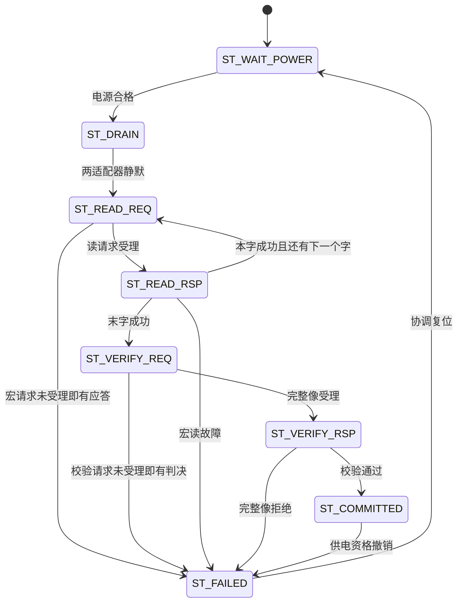

# AD4080 OTP 与小 SRAM 工作包

右上区按 OTP 候选保留 `OTP` 窗口，左侧小 SRAM 按 `SR2` 保留并等待连通性证据。可综合的 [只读加载器](./otp_shadow_loader.sv) 属于独立控制接缝，从宏适配器读回逻辑镜像，经外部校验后一次发布给同域接收端。实际宏、镜像映射、完整性算法、供电域实现和数字功能 IP 绑定均待集成。

## 1. 从公开资料到布置决定

### 裸片候选区域

照片边界使用左上原点的像素坐标，规划边界使用左下原点的微米坐标。照片标注框存在约 ±3 px 的边界不确定度。下面的面积为矩形包络，实际宏边界、阵列面积及位密度需由物理视图确认。[原图读数与规划说明](../floorplan/README.md) · [规划源](../floorplan/plan.json)

| 区域 | 照片框与标注 | 规划窗口与处理 |
| --- | --- | --- |
| 上方大区 | `(358,133)–(811,298)`，标注 `SRAM`，453 × 165 px | `FIFO` `(480,1115)–(1085,1315)`，121,000 µm²。靠数据接口，结合公开单口结果 FIFO 的规模，归为主结果存储的候选宏窗口。 |
| 右上区 | `(827,102)–(1007,435)`，标注 `One Time Programmable`，180 × 333 px | `OTP` `(1110,935)–(1340,1358)`，97,290 µm²，`unbound`。相邻数字外围，预留低速读接口和隔离空间。 |
| 左侧小区 | `(119,425)–(218,470)`，标注 `SRAM`，99 × 45 px | `SR2` `(155,845)–(285,890)`，5,850 µm²，`unbound`。邻近数字和时钟区域，预留宏位，等待时钟、地址、使能和电源归属。 |

Rev. B 第 56 页确认结果 FIFO 为单口，每次采集最多 16,384 个结果，接口读出与转换结果写入互斥。规划中的 `4 × 4096 × 20` 是独立的候选分银行方案，载荷 327,680 bit（40 KiB）。实际物理组织、额外位、冗余、ECC 和小 SRAM 是否与结果通路关联，需等宏清单和连通性。左侧小区也可能承载校准暂存、运算状态或测试数据，各候选目前只有位置和第三方标签可参考。同一张照片上的两个 `SRAM` 标签不足以把左侧区计入主 FIFO 容量。[AD4080 Rev. B，第 56–63 页](https://www.analog.com/media/en/technical-documentation/data-sheets/ad4080.pdf) · [规划源](../floorplan/plan.json)

### 工厂校准、用户寄存器与状态

| 对象 | 可核对的公开行为 | 项目用法 |
| --- | --- | --- |
| 工厂校准 | 第 71 页说明出厂校准了增益与零点误差。第 83 页表 47 定义 `DEVICE_STATUS[1] ROM_CRC_ERR` 为内部 ROM CRC/ECC 的只读故障位。 | 右上 OTP 可作为工厂校准载荷的候选来源。工厂校准存储位置、字段划分、码字、物理读写端和公开故障位与候选区的关系待供应方资料。 |
| 用户 `OFFSET` | `0x25/0x26`，12 位二补码，复位值 `0x000`，用于下游信号链的零点校正。 | 采用第 74 页映射与第 92 页表 60。第 71 页此段文字出现 `0x24/0x25`，其中 `0x24` 在映射中属于低阈值寄存器。 |
| 用户 `GAIN` | `0x27/0x28`，10 位直二进制，复位值 `0x200`，该值对应禁用用户增益修正。 | 采用第 74 页映射与第 93 页表 61。用户系数经配置 SPI 访问，复位默认值单独维护。 |
| POR 与 SPI CRC | 第 24 页图 40 区分 `VDD11` 数字监测与参考模拟监测，整器件 reset/POR 后有 300 µs 初始化窗口。第 28 页说明软件复位保留 FIFO 内容与 `ADDR_ASCENSION`。第 34、81 页说明 SPI 配置接口 CRC。 | 以公开阈值和序列解释可观察的 POR/就绪。宏读时限取自宏与适配器合同，SPI 帧校验独立验收。 |

`ROM_CRC_ERR` 可做器件公开健康检查，状态清零仅说明当前读到无已报告故障。右上位置、掉电保持、缺省字值、厂校镜像算法和 VPP 的工艺条件仍需授权的宏文档或结构证据。[AD4080 Rev. B，第 24、28、34、71、74、81、83、92–93 页](https://www.analog.com/media/en/technical-documentation/data-sheets/ad4080.pdf)

## 2. 只读加载接缝

`otp_shadow_loader` 在 `rst_ni` 释放后等待已合格的本域 `power_good_i`，随后保持 `adapters_cancel_o=1`，直至两个适配器确认冲刷并且两路应答 `valid` 都为低。地址按 `0…IMAGE_WORDS−1` 顺序发出，各读字应答成功后才接受下一笔。完整镜像由校验器在请求受理沿采入。校验通过的应答沿完成原子发布，`shadow_valid_o=1` 时下游可取整像，`shadow_image_o` 在其他时候驱动零。



任一受时限约束的等待阶段超时都会进入 `ST_FAILED`。从 `ST_DRAIN` 开始的供电资格撤销也进入该状态。`rst_ni` 异步拉低，宿主在稳定时钟域同步释放。同沿先裁决复位、供电失效，再裁决无请求可归属的宏应答、校验应答，最后处理已握手结果与超时。发布后若 PG 撤销，组合输出遮蔽镜像并关闭握手，本域下一沿清除暂存并锁存错误码。若控制钟可在失电期间停摆，供电主管须用异步复位与隔离中止旧会话，包括失电后升压时早于时钟恢复的窗口。

| 合同 | 要求 |
| --- | --- |
| 配置参数 | `IMAGE_WORDS`、`WORD_WIDTH`、`TIMEOUT_CYCLES` 均为正整数，由集成方显式覆盖。默认 1 用于最小宽度例化。`ADDR_WIDTH = max(1, clog2(IMAGE_WORDS))`，`IMAGE_WIDTH = IMAGE_WORDS × WORD_WIDTH`，乘积必须能由 32 位无符号整数表达。字 `n` 对应位段 `n × WORD_WIDTH +: WORD_WIDTH`。 |
| 宏读端 | `otp_req_valid_o && otp_req_ready_i` 受理逻辑地址。`otp_rsp_valid_i && otp_rsp_ready_o` 受理该地址的 `otp_rsp_data_i` 与 `otp_rsp_error_i`。每次只允许一笔在途。适配器把宏的本地地址、供电、读延迟与错误语义转换到该接口。 |
| 校验端 | `verify_req_valid_o && verify_req_ready_i` 时采入 `verify_image_o`，该总线仅在请求有效时提供镜像。`verify_rsp_valid_i && verify_rsp_ready_o` 时采入 `verify_rsp_pass_i`。外部判决至少覆盖供应方规定的格式、版本、ECC/CRC 和失效策略。 |
| 取消及晚到响应 | `adapters_cancel_o` 高有效，两个适配器必须撤销旧请求并排空或丢弃未结应答。`adapters_quiescent_i` 是两边静默确认的合取，应保证撤销解除后无旧响应复活。开始读/校验后，任一应答 `valid` 必须已有同类未完成请求或恰在本沿受理该类请求。其他访问期应答以错误 `10`/`11` 中止。 |
| 数据稳定 | 发送器须维持 `valid` 和关联数据直到上升沿握手或取消。受理请求后的下一周期开始拉高应答端 `ready`，如适配器在受理请求的同沿提供应答，须保持到应答受理。跨域适配接口要保持整包数据和握手的对应关系。 |
| 下游放行 | `busy_o` 覆盖等待上电、冲刷、读取和校验，`shadow_valid_o` 才表示已取得完整且通过的镜像。下游先锁存整像，再在安全时点整体应用。失败期间保持目标逻辑空闲或禁用，供应方认可的安全默认策略可由宿主另行定义。 |
| 时限 | 冲刷、逐字请求、逐字应答、校验请求、校验应答分别独立计数。阶段进入后的第 `TIMEOUT_CYCLES` 个等待沿仍可握手。等电期由系统上电监督控制。从采得 PG 的沿到成功提交，上界为 `(2 × IMAGE_WORDS + 3) × TIMEOUT_CYCLES` 个本域周期。 |

实现暂存和已提交影子共用一份寄存器镜像。若正式映射需要更大的逻辑读区，集成时按寄存器成本和校验端带宽评估分块暂存及整像提交协议。实际工厂 trim 到最后消费端的映射应取得版本化合同后定义。

回复端口只携带数据和判决。旧回复若恰与新请求受理同沿出现，或在已有新请求的窗口内到达，须靠真实适配器的冲刷保证来排除。验收时应让旧请求在复位前占有流水，把回复延迟到下一会话启动边界，证明适配器能在静默确认前排空或依据会话身份丢弃它。镜像真实性与完整性仍由实际校验器按版本化格式和校验规则认定。

| `error_code_o` | 粘滞首错 |
| --- | --- |
| `0` | 无故障。等待期间仍须检查 `shadow_valid_o`。 |
| `1` | 会话启动后供电资格撤销。 |
| `2` | 宏读应答故障。 |
| `3` | 整像校验拒绝。 |
| `4` | 适配器冲刷超时。 |
| `5` | 宏读请求受理超时。 |
| `6` | 宏读应答超时。 |
| `7` | 整像校验请求受理超时。 |
| `8` | 整像校验应答超时。 |
| `9` | 状态未匹配的 RTL 兜底。当前八个状态占满三位编码，硬件状态翻转覆盖需另行设计。 |
| `10` | 访问期间收到无法归属到已受理宏读的应答。 |
| `11` | 访问期间收到无法归属到已受理整像校验的判决。 |

## 3. 可复现的非破坏性验证

| 目标 | 观测方法与通过判据 | 证据范围 |
| --- | --- | --- |
| 到货器件的公开初始化 | 用评估板和文档额定供电时序冷启动，待公开初始化时间后读取 `INTERFACE_STATUS_A`、`DEVICE_STATUS` 及两组校正寄存器。记录电源/参考与第一笔 SPI 成功时刻、`NOT_READY_ERR`、`ROM_CRC_ERR`、`POR_FLAG` 和 `POR_ANA_FLAG`。重复冷启动并对比两点测量。 | 确认公开接口与初始化行为。裸片区域归属仍需结构证据。 |
| 用户校正的易失性 | 在专用评估件空闲状态存档原值，对 `OFFSET`、`GAIN` 分别执行文档支持的完整多字节读写和读回，再执行软件复位及全掉电重启。用非饱和固定输入确认用户系数影响转换输出，随后读回默认值。严格多字节模式和地址方向按当前 SPI 设定。 | 验证用户校正影响与复位边界。访问范围限于公开的易失配置寄存器。 |
| 结果 FIFO 与 `SR2` | 独立试验中先禁用滤波，按公开 burst 模式用可识别的模拟输入序列捕获并比较 1、16,383、16,384 个结果的条数、顺序及满、读完标志。用单独试验比较启用滤波或事件检测后的条数与延迟。 | 量到结果 FIFO 的功能容量。要给 `SR2` 归属，需进一步把宏的地址/数据/使能扇出跟到结果控制、算法暂存或 DFT；单靠输出相关性无法唯一识别宏。 |
| 校验和 brownout | 用本目录夹具模拟旧应答、读错、验收拒绝、各分段超时、PG 撤销及异步复位，检查无部分发布、诊断粘滞、重启读回一致。将来在专用集成夹具复核 POR 到 PG 的顺序、跨域隔离和真实最慢读延迟。 | 目前证据是本地 RTL 定向回归。实物 POR 门限、宏上电时间、读角覆盖和隔离需实测。 |

上述评估板操作是后续验证方法。本轮执行的是合成测试字的 RTL 仿真和公开材料审阅。样片若无授权宏读模式，可用公开状态和行为作黑盒验证。

### 量产 ATE 与受控读回

1. 测试程序记录晶圆、批次、器件身份、测试向量版本、宏地址映射版本及 POR 条件。读取操作从供应方批准的隔离只读入口进入，正式产测中的编程权限及工艺条件由宏供应和 ATE 负责人独立管理。
2. 在供应方允许的读条件采集授权的码字或判定签名。把宏读回、校验判决和最终影子采样关联到同一个器件和复位会话，检查有效码字、校验状态及影子与参考摘要的一致性。纠错计数、读边界和分 bin 判据采用宏合同。
3. 应用校准后用实物系统测量增益、零点等相应指标。全掉电重启后重复检查同一载荷签名、加载状态与测量结果，并核对公开用户寄存器恢复默认。读失败、校验失败或超时的工程故障向量用于验收禁用与日志定位。
4. `SR2` 若归为工作 SRAM，在允许扰动数据的专用工程实例验收 MBIST、保持和修复配置。量产程序按供应方授权记录测试合格状态。测试夹具的影子读回或 ATE 入口须实行权限管理。

## 4. 宏与供电交接

| 交付方 | 需要的资料 | 验收点 |
| --- | --- | --- |
| OTP/NVM 宏供应方 | 工艺与宏型号、逻辑读区、原生字与地址组织、掩码与保留位、冗余与有效码字、错误与纠错语义、读角和 startup 约束。工艺正式资料应确认是否有外部 VPP 或内部高压域及其规则。 | 真实容量、VPP 数值和失效条件据正式资料锁定，文中窗口尚未绑定实宏。 |
| 版图与物理实现 | 匹配版本和方向的 LEF、GDS/OASIS、CDL/联机 LVS 视图、尺寸和合法朝向、PG 与信号 pin 的层和 OBS、macro halo、走线与模拟隔离规则。 | 替换 `OTP` / `SR2` 规划窗口后，重查真实坐标、PG 和信号 pin 可达、间距与保护结构。`CFG_TEST` 走向是规划路径，最终端口按宏合同。 |
| 时序与供电集成 | `.lib` 的 PVT 读建立/保持、访问延迟、最小脉宽、PG 与复位时序、电源模型；PG pins 和电压域、功率状态及掉电隔离、必要的 level shifter。 | 确认本域时钟下的阶段时限、宏电源资格确认、先撤销加载端再失电的隔离顺序，以及 `shadow_valid` 到消费者的 CDC 与 reset 释放。 |
| 测试与校准 | 授权读回、完整性算法与错误分级、实际 trim 字段与消费者的映射、量产测试与两点校正验收、SRAM 宏的 MBIST/修复合同。 | 以绑定的实宏与真实工艺模型完成上电、回读、跨域和失效收敛验证。 |

## 5. 本地复跑

运行目录与 Verilator 根目录使用 ASCII 路径。若安装的 Perl 包装器将别名规范成含中文的真实路径，可显式设置 `VERILATOR_ROOT` 并用 `VERILATOR` 指向同一安装的 `verilator_bin`。`--output-split 0` 使测试台生成单个编译单元，绕开本机预编译头规则的兼容问题。

```sh
set -eu
# 从交付根目录运行。自带运行库的 Verilator 可将 VERILATOR 指向其绝对路径。
otp_src="$(pwd)/otp"
otp_vlt="$(command -v "${VERILATOR:-verilator}")"
otp_build=$(mktemp -d /tmp/ad4080-otp-regression-XXXXXXXX)
ln -s "$otp_src/otp_shadow_loader.sv" "$otp_build/otp_shadow_loader.sv"
ln -s "$otp_src/tb_otp_shadow_loader.sv" "$otp_build/tb_otp_shadow_loader.sv"
cd "$otp_build"
"$otp_vlt" --lint-only --timing -Wall --top-module tb_otp_shadow_loader \
  --Mdir "$otp_build/lint" otp_shadow_loader.sv tb_otp_shadow_loader.sv
"$otp_vlt" --binary --timing --compiler clang -CFLAGS '-std=c++20' -Wall --output-split 0 \
  --top-module tb_otp_shadow_loader --Mdir "$otp_build/obj" \
  otp_shadow_loader.sv tb_otp_shadow_loader.sv
"$otp_build/obj/Vtb_otp_shadow_loader"
```

预期最终打印 `OTP SHADOW LOADER REGRESSION PASS`。两组例化为三字 × 八位与一字 × 一位，均为测试构型。单独运行同一测试程序并传入 `+otp_early_read` 或 `+otp_early_verify` 可重放两个新增反例。对比修前时在临时目录用备份控制器替代 DUT，保持测试台和参数相同。用例结果、注释统计和源码 SHA-256 见 [执行回执](./verification.txt)。
