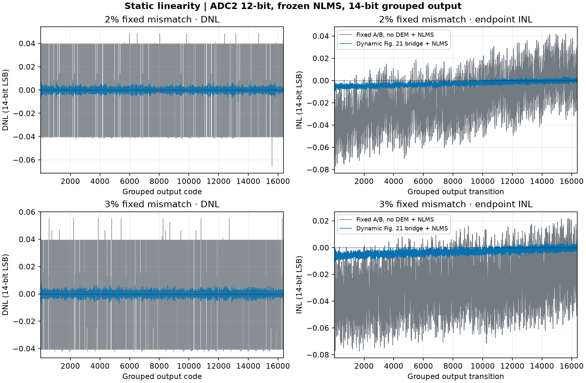
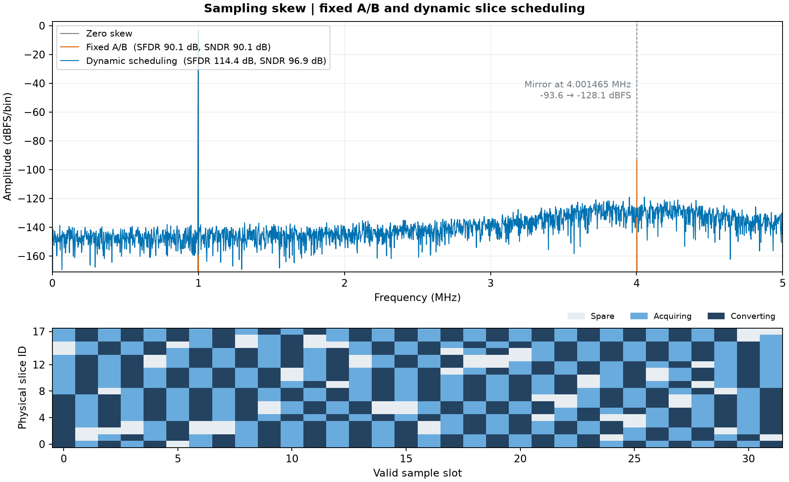
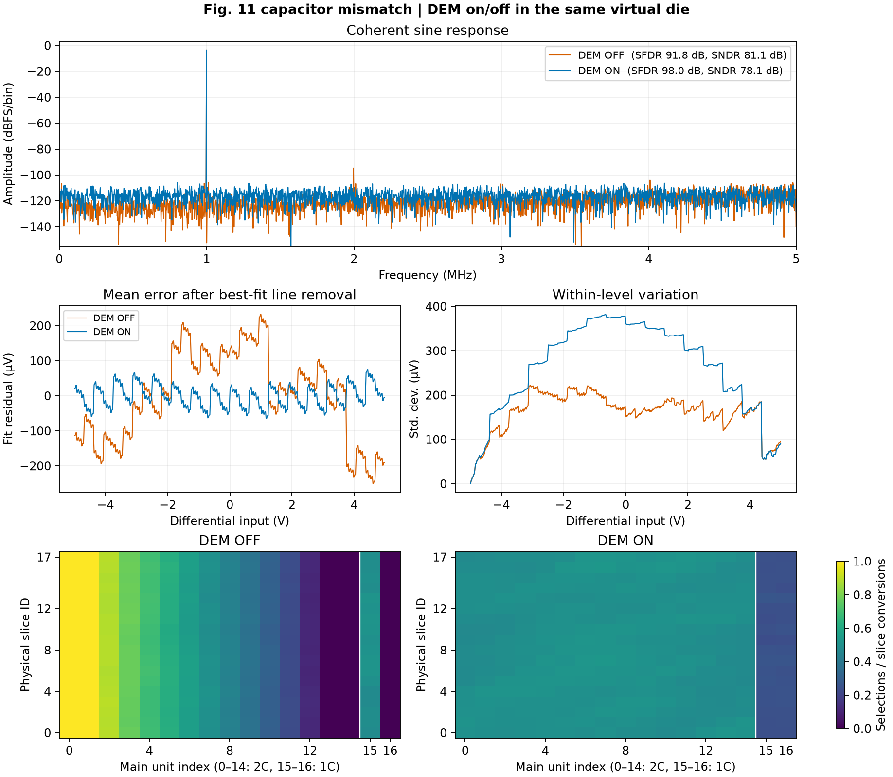

# `20b10mtask`：同学数字任务交付树

本目录是 20 bit／10 MS/s 两级 SAR ADC 的数字任务交付入口。它从仓库 `bc9a16a` 建立，后续 dither、CAAZ 和数字后端工作都在本分支继续。项目任务、模拟／数字接口与九个月安排见 [SPEC.md](SPEC.md)。本阶段先交付模块一：**切片调度与受限 Fig.11 DEM**。[统一实验标准：电容失配必须配合 LMS 校准](EXPERIMENT_STANDARD.md)。

当前 LMS／NLMS 是**片外 Python 训练与行为验证**；模块一 GDS 只包含切片调度和 DEM 数字逻辑，不包含 LMS 训练、完整 ADC 重构或模拟宏。权重训练及重构乘加的最终硬件归属仍待确定。

## 模块一完成了什么

- `rtl/slice_scheduler.sv`：18 片资源池。接受后保持 8 片采样、8 片转换和 2 片备用；上一采集组有序晋升。模拟侧用 `eligible_i` 表示可复用，资格不足时拒绝本槽并保持组、ID 和随机状态。
- `rtl/fig11_dem.sv`：15 个主侧 2C 单元的片内轮转，以及八片共 16 个主侧 1C 单元的 B4 分配；B5～B8 留在子阵列。`rtl/module1_top.sv` 将调度、独立随机状态、冻结相位、样本 ID 和掩码合成同笔事务。另有 `module1_bridge_top` 可选跨段候选，及其 [接口与补偿合同](BRIDGE_SPEC.md)。
- `model/` 是逐拍 Python 模型；`tests/` 和 `tb/` 是边界、两节点电荷和实际 RTL 对拍。图与数据见 [效果与数据](evidence/effects/README.md)。

### 主要验收：固定失配下，只有 LMS 与跨段 DEM＋LMS

同一颗固定失配虚拟芯片，两条路径各自独立训练：基线全程关闭 DEM、固定 A/B 并只用 NLMS；候选使用动态选片和 Fig.21 跨段 DEM，再训练 NLMS。两路使用同等训练预算、同一留出输入；不把使用 DEM 激励训练的系数冒充无 DEM 基线。

理想 12 位 ADC2、输入等效 ±100 mV；按 14 位聚合码密度和固定状态分布统计，2%／3% 各 5 颗虚拟芯片。表中为五颗的峰值指标中位数，**每档均有 5/5 颗改善**。

| 单位电容失配 | 峰值 INL：无 DEM＋LMS → DEM＋LMS | 峰值 DNL：无 DEM＋LMS → DEM＋LMS |
| :--- | :--- | :--- |
| 2% | 0.07501 → 0.01524 LSB14 | 0.06609 → 0.01097 LSB14 |
| 3% | 0.07745 → 0.01486 LSB14 | 0.06231 → 0.01115 LSB14 |



动态路径的图是 512 个预定重排状态的**统计码密度**，不是单次转换完整 20 位 DNL，也不是芯片实测。12 位细级在 ±100 mV 输入等效窗口下，每步 48.83 μV，即 5.12 个 20 位 LSB；当前 20 位码密度仍有零宽码。理想 16 位 ADC2 作为对照时，统计内部码均有正宽，但逐状态粗码边界仍有一码回跳，故逐笔单调性尚未通过。测法、实际代码和逐颗数据见 [INL／DNL 报告](evidence/inl_dnl/README.md)。

同样的严格独立训练口径下，在 2%／3% 失配、理想 12 位 ADC2 的 seed 100，跨段 DEM＋LMS 的 SFDR 相对无 DEM＋LMS 分别变化 −1.02／+0.82 dB，SNDR 分别下降 0.39／0.76 dB。**统计线性度有改善，不等于该条件下 SNDR／SFDR 必然改善。** [LMS 独立训练](evidence/bridge_lms/README.md)

### 第二级 12 位与 dither

本项目 10 V 输入跨度的 20 位 LSB 约 9.54 μV。12 位 ADC2 的输入等效总窗口若不超过 39.06 mV，其理想步长不大于一个 20 位 LSB；该条件还不保证粗码边界单调或模拟噪声达标。当前为了容纳 2%／3% 固定失配所用的候选窗口为 ±100 mV，12 位步长为 48.83 μV，约 5.12 LSB20。

在相同冻结 LMS 系数下，理想细级减性 dither 可显著改善统计码密度；2% 失配固定 A/B 的 20 位零宽码从 678,189 减为 0，DNL 从约 [−1.00, +4.12] 缩到 [−0.25, +0.28] LSB20。单次输入等效误差仍约 14 μV RMS。该实验在理想 ADC2 输入加入已知扰动，**不等于已经实现专利 Fig.19 物理 dither**，也不能消除第二级过载。[量程、噪声与实验数据](evidence/adc2_dither/README.md)

本阶段保留 12 位 ADC2 作为待验证方向；16 位仅作理想分辨率对照。真实 ADC2 量程、RA 摆幅、dither 注入及逐笔单调性仍待系统验证。[12 位量程与 dither 分析](ADC2_DITHER.md)

### 效果一：切片动态选取与时偏杂散



10 MS/s、4096 点、998.535 kHz 相干输入、单组 ±5 ps 时偏；固定 A/B 与本分支动态调度使用相同物理时偏池。该行为观察器是八片采样值平均，镜像由 −93.59 降至 −128.09 dBFS，SFDR 由 90.07 提高到 114.42 dB，SNDR 由 90.07 提高到 96.87 dB。下图展示前 32 个有效槽的片角色。此结果只支持该指定时偏实验。

### 诊断基线：未校准的 DEM 改善与代价



在同一虚拟制造样本、输入和有序选片计划下，DEM 开启时 SFDR 从 91.76 提高到 98.03 dB，静态拟合残差峰值从 250.43 降到 75.16 μV；同时 SNDR 从 81.05 降到 78.09 dB，电平内标准差中位数从 168.59 增到 288.87 μV。它说明这组实验将部分确定性误差转为变化噪声，不代表所有芯片均有同样收益。

### 未校准诊断：为什么 SNDR 约 80 dB？

上面的 DEM 样本使用 **0.1% 单位电容失配**，并且未做电容校准。扫描 12 个虚拟制造样本后，在其他激励和模型条件相同的情况下，失配为 0.01% 时，DEM 开启的 SNDR 中位数为 **98.28 dB**（范围 97.50～100.45 dB）；0.003% 时为 **108.74 dB**（范围 107.96～110.91 dB）。[查看失配扫描图和数据](evidence/effects/sndr_sigma_sweep.png)。

这些结果使用理想余量观察器，未计真实 ADC2、热噪声和模拟宏，失配幅度也不是已验证工艺参数；不能把它们当成整机已达到 100 dB 的证据。实际失配下必须按统一标准给出 LMS 校准与独立留出效果；在四组数据生成前，下面的未校准图不能作为最终性能交付。

以上曲线均为**行为模型实验**，不是模拟晶体管仿真或实测的 20 位精度。名义电荷独立求解、激励、统计分母、FFT 口径、种子与原始数据都在 [效果说明](evidence/effects/README.md) 和 [机器记录](evidence/effects/summary.json) 中。

## 如何验证和复现

从仓库根目录执行，环境需要 Python 3.12、NumPy、SciPy、Matplotlib、pytest 和 Verilator：

```sh
python -m pip install -r task1/requirements.txt
PYTHONPATH=.:src python -m pytest -q task1/tests
PYTHONPATH=.:src python task1/tools/run_rtl_checks.py --out /tmp/task1-rtl-run-001
PYTHONPATH=.:src python task1/tools/run_bridge_checks.py --out /tmp/task1-bridge-run-001
PYTHONPATH=.:src python -m task1.experiments.run_effects --out build/task1/effects
```

校准与 INL／DNL 实验另需固定版本的 ADCToolbox：`python -m pip install -r task1/requirements-calibration.txt`。训练、独立留出与后级分析的具体命令分别见 [LMS 对照](evidence/bridge_lms/README.md)、[INL／DNL](evidence/inl_dnl/README.md) 和 [ADC2／dither](evidence/adc2_dither/README.md)。

RTL 对拍必须真实编译和运行 Verilator；实际完成计数及源码摘要由该命令写入输出目录。`eligible`、两个非零 seed、同步复位和一拍发布接口见代码文件头和 [SPEC.md](SPEC.md)。`module1_top` 输出八个有序 ID 及对应的 8×17／8×5 掩码；外部模拟开关如何映射到 18 片由宏接口签认，不能把它误认为现有完整 SAR 核已经集成。

## 未完成及后端状态

- 本阶段假设桥电容 `C`、子阵列总 `16C`、无寄生，所以 `β=1/17`；两个主侧 1C 能否独立控制、末端子电容接法和释放时序尚待模拟组确认。
- 基线不跨桥迁移 B5／B6；可选 Fig.21 跨段候选已完成独立两节点与数字对拍，包含同笔名义补偿，但真实模拟余量及性能仍需验证，不能宣称论文全部电路或目标 ±5 V／20 位性能已复现。dither、CAAZ 和真实 ADC2／RA 宏集成属于后续任务。
- 用户指定本阶段使用 **SKY130 标准单元**交付 GDS 和时序报告；此前 Nangate45 仅作历史流程代理。SKY130 的结果不是未来 180 nm BCD 的签核；目标工艺库、角落、真实 I/O 约束及后仿仍需另补。后端脚本和实际运行状态见 [physical](physical/README.md)。
