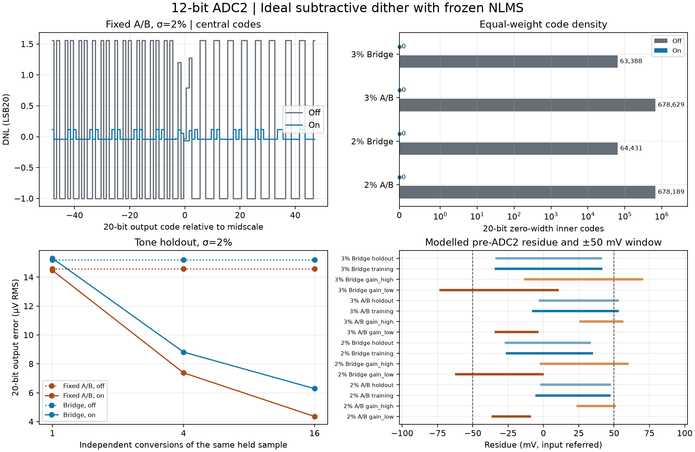

# ADC2 位数、残差量程与减性 dither

10 V 输入跨度的 20 位步长为 9.53674 μV。12 位 ADC2 的步长能压到一个 20 位 LSB，前提是其输入等效总跨度不超过 39.0625 mV。若级间增益为 32，这对应 ADC2 端 1.25 V 的总跨度。理想均匀 9 位粗级的标称步长为 19.53125 mV。粗级实际步长、失配、跨段映射、余量中心和冗余决定需要的窗口。

| ADC2 输入等效窗口 | 12 位步长 | 折算 LSB20 | 步长不超过一 LSB20 所需最低位数 |
| :--- | ---: | ---: | ---: |
| ±19.53125 mV | 9.5367 μV | 1.00 | 12 |
| ±50 mV | 24.4141 μV | 2.56 | 14 |
| ±100 mV | 48.8281 μV | 5.12 | 15 |

这条位数判据约束细级步长，粗码边界、实际增益、失调、噪声和饱和仍需单独验证。当前模型 seed 100 的全幅均匀坡道积分，在 2%／3% 失配下，固定 A/B 的模拟余量总跨度为 53.25／61.49 mV，跨段 DEM 的状态混合跨度为 79.77／101.28 mV。这些跨度均超过 12 位的一 LSB20 预算。对 10/3 V 峰值正弦，±100 mV 的理想 12 位量化单独给出 14.10 μV RMS 和约 104.46 dB SNDR。在量化误差与其它误差不相关的假设下，100 dB 目标给其它误差留下约 18.9 μV RMS 的合计预算。[全幅码密度与余量](../inl_dnl/README.md)

## 理想减性注入对照

读取 2% 和 3% 固定失配 seed 100 的原训练收据，沿用同一颗 CDAC、各自训练并冻结的 NLMS 系数、逐样本开关状态和独立留出正弦。采用输入等效 ±100 mV、12 位理想 ADC2。在细级输入加 16 个等概率已知字之一，字位于一个细级 LSB 宽度内，量化后从同一笔 ADC2 读数减去所加值，再按原系数重构。原固定 A/B 和 Fig.21 训练均保持关闭 dither，量化之前的模拟电荷模型与原对照一致。



| 失配 | 路径 | 20 位零宽内码，关 → 开 | DNL20 范围，关 → 开 | 单次输出误差 RMS，关 → 开 | 开启后 16 次平均误差 RMS |
| :--- | :--- | ---: | :--- | :--- | ---: |
| 2% | 固定 A/B＋LMS | 678,189 → 0 | [−1.000, +4.118] → [−0.250, +0.280] | 14.57 → 14.47 μV | 4.36 μV |
| 2% | Fig.21＋LMS | 64,431 → 0 | [−1.000, +4.120] → [−0.250, +0.180] | 15.20 → 15.31 μV | 6.29 μV |
| 3% | 固定 A/B＋LMS | 678,629 → 0 | [−1.000, +4.577] → [−0.274, +0.283] | 14.54 → 14.46 μV | 4.32 μV |
| 3% | Fig.21＋LMS | 63,388 → 0 | [−1.000, +4.119] → [−0.280, +0.180] | 15.86 → 15.89 μV | 7.63 μV |

零宽码与 DNL 采用等权积分。固定 A/B 使用两个状态，Fig.21 使用独立于训练的四组种子各取四个冻结状态。每个状态应用于每个粗码区间，开启 dither 时对所有 16 个字等权。结果针对这组有限状态分布，Fig.21 的关扰动零宽码数会随状态数量和分布变化。四组 ADC2 全幅积分均未超窗。两端输出码因最终编码裁剪而增厚，裁剪对应的输入宽度单列于 `summary.json`。

另对 2% 固定 A/B 的粗码 257 直接均匀取样。两个状态和 16 个字各取 262,144 个输入点，共 8,388,608 笔。独立算出的逐码宽度与区间积分的最大差为 5.29 nV，小于该采样网格的 70.12 nV 步长。

单次细级量化误差在四组内均约 14.0～14.2 μV RMS，开启 dither 后变化很小。2% 固定 A/B 最终 20 位导出的 SNDR 由 104.18 到 104.24 dB，2% Fig.21 由 103.82 到 103.75 dB。重复平均对同一个保持输入和同一物理状态重做独立字转换，最后平均 20 位导出值，因此额外使用 4 或 16 次转换。它衡量可用额外转换换取的误差下降，单次转换的细级步长仍为 48.8281 μV。

## 窗口越界与专利边界

原两点增益标定、训练和正弦留出的 2%／3% 输入余量都用实际归档样本核算了 ±19.53125、±50、±100 mV 窗口。关闭和开启时共用各阶段原输入。开启列枚举 16 个字，越界记录只用于统计。缩到 ±19.53125 mV 时，2%／3% Fig.21 留出仍分别有 206／439 笔超窗，共 4,096 笔。3% Fig.21 的 ±50 mV 增益参考低点／高点原有 1,758／1,685 笔超窗，其中 1,751／1,681 笔对全部 16 个字仍超窗。±100 mV 在当前留出及前台记录中对全部字有余量。减性 dither 通过改变同一输入落入的量化格填补统计码密度。超过窗口的样本仍由模拟量程决定其有效性。

实验假定细级输入的电压扰动等于已知字，且数字端可以准确消去同一笔电压。US10505561B2 Fig.19 的机制包括采样 DAC 的全字注入、前级 ADC 的子字注入、数字粗码修改和传至后级的剩余补偿。本实验只隔离理想细级的量化与减性扰动机制。专利架构的实际电容注入、RA/ADC2 增益、未抵消残差、模拟 dither 量程和热噪声需要用对应硬件模型验证。[US10505561B2 Fig.19](https://patents.google.com/patent/US10505561B2/en#description)

## 复现

从仓库根目录运行，使用原 NLMS 实验的 ADCToolbox 0.9.1 环境。

```sh
PYTHONPATH=.:src OPENBLAS_NUM_THREADS=1 MPLBACKEND=Agg \
  python -m task1.experiments.adc2_dither_study \
  --training task1/evidence/bridge_lms/sigma_2pct_adc2_100mv \
             task1/evidence/bridge_lms/sigma_3pct_adc2_100mv \
  --out build/task1/adc2_dither
```

`summary.json` 保存每档条件的各阶段范围、ADC2 和最终量化指标、完整码密度摘要和源码 SHA。`traces_sigma_2pct.npz`／`traces_sigma_3pct.npz` 保存实际 dither 字索引、原输入与余量、单次与平均重构结果、14 位聚合码宽及 20 位占码位图。
