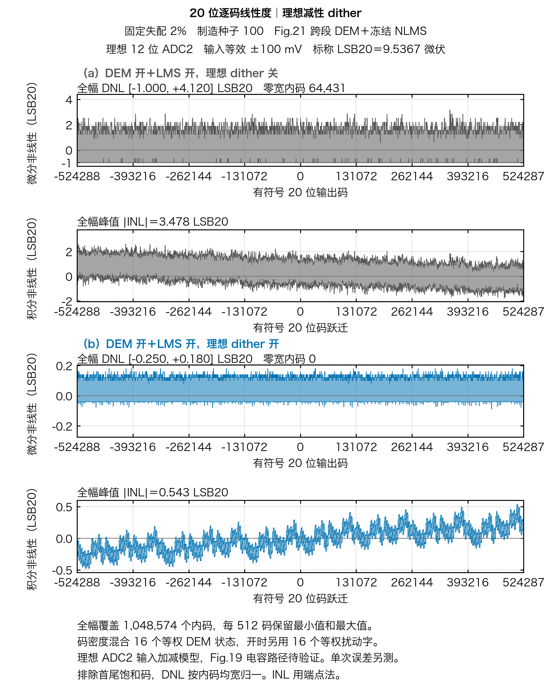

# 12 位 ADC2 理想减性 dither 的 20 位逐码线性度

固定同一颗虚拟芯片（制造种子 100）、同一 Fig.21 跨段 DEM 和同一套冻结 NLMS 系数，比较理想 12 位 ADC2 的减性 dither 关和开。ADC2 输入等效窗口为 ±100 mV。16 个转换状态等权，开启时在每个状态上使用 16 个等权扰动字，量化后逐次减去所加的字。两种条件的 ADC2 超窗输入宽度均为 0。

| 单位电容固定失配 | DNL 范围 (LSB20)，关 → 开 | 峰值端点 INL (LSB20)，关 → 开 | 20 位零宽内码，关 → 开 |
| :--- | :--- | ---: | ---: |
| 2% | [−1.000, +4.120] → [−0.250, +0.180] | 3.478 → 0.543 | 64,431 → 0 |
| 3% | [−1.000, +4.119] → [−0.280, +0.180] | 3.478 → 0.629 | 63,388 → 0 |



[3% 全幅](adc2_12bit_sigma_3pct_dither.png) · [2% 中码逐点放大](adc2_12bit_sigma_2pct_dither_midscale.png) · [3% 中码逐点放大](adc2_12bit_sigma_3pct_dither_midscale.png)

[2% PDF](adc2_12bit_sigma_2pct_dither.pdf) · [3% PDF](adc2_12bit_sigma_3pct_dither.pdf) · [2% SVG](adc2_12bit_sigma_2pct_dither.svg) · [3% SVG](adc2_12bit_sigma_3pct_dither.svg)

横轴为有符号 20 位输出码，满幅 −524,288～524,287。10 V 差分跨度的标称 LSB20 为 9.536743 μV。端点法排除首尾饱和码，先按各臂的内部平均码宽计算 1,048,574 个内码的 DNL，再累计成 INL。图中每个显示段保留该段的逐码最小值和最大值，原始码宽未合并。各面板按各自误差范围绘制，关／开间的量值应按纵轴刻度比较。每个 NPZ 保留关、开两组各 1,048,576 个码宽，包含两个端码，单位 V。

这是理想 ADC2 输入处的减性 dither 诊断。统计零宽码随状态与扰动分布变化。真实采样电容注入、RA/ADC2 增益、未抵消误差及量程需按 Fig.19 对应路径独立验证。单次量化误差和重复平均的原对照见[细级 dither 试验](../README.md)。无 dither 时的严格无 DEM＋LMS 与 Fig.21＋LMS 对照见[20 位主图](../../inl_dnl/full20/README.md)。

从仓库根目录复现，使用项目 ADCToolbox 0.9.1 环境和本机中文字体。脚本优先选用 Hiragino Sans GB，也支持 Noto Sans CJK SC。PNG、SVG、PDF 导出时发现缺字会报错。

```sh
PYTHONPATH=.:src OPENBLAS_NUM_THREADS=1 MPLBACKEND=Agg \
  python -m task1.experiments.full20_dither_plots
```

生成脚本先核对原冻结 LMS 数据和原实验源文件，再独立累积完整 20 位码宽。逐码 INL/DNL 极值、零宽码数和量程与原摘要一致，全部 20 位占码位图和中码附近的码宽也与原归档一致。[源文件与图表 SHA-256 清单](manifest.json) · [2% 原始码宽](adc2_12bit_sigma_2pct_dither_code_widths.npz) · [3% 原始码宽](adc2_12bit_sigma_3pct_dither_code_widths.npz)
