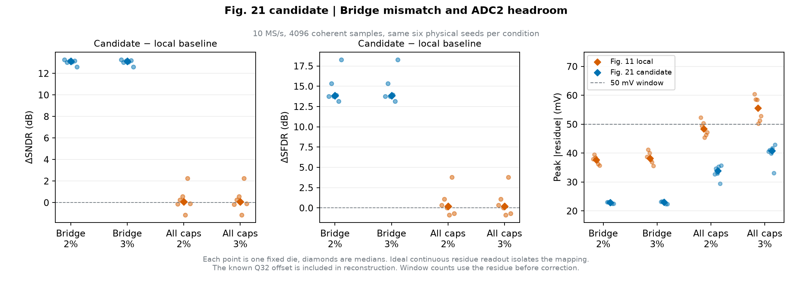

# Fig.21 候选跨段重排的桥失配诊断

> 本页为未校准的跨桥机制隔离诊断，不作为电容失配最终性能结论。按统一标准，需同时查看[独立 LMS 对照](../bridge_lms/README.md)及[INL／DNL](../inl_dnl/README.md)。

仅桥电容失配时，跨段候选让六颗虚拟芯片的配对 SNDR 中位数提高约 13.12 dB。主、子、桥全部失配时，SNDR 改善的中位数约 0.07 dB，各颗有升有降。后一组更直接的改善出现在 ADC2 之前。六颗中的最大余量幅值由 52.33 降至 35.80 mV（2%）和由 60.47 降至 42.95 mV（3%）。



| 失配范围 | 单位电容 σ | 配对 ΔSNDR 中位数（最小～最大），dB | 配对 ΔSFDR 中位数（最小～最大），dB | 六颗最大余量幅值，mV | ±50 mV 越界笔数 |
| :--- | ---: | ---: | ---: | ---: | ---: |
| 仅桥电容 | 2% | +13.12（+12.60～+13.27） | +13.84（+13.16～+18.27） | 39.49 → 23.09 | 0 → 0 |
| 仅桥电容 | 3% | +13.12（+12.60～+13.27） | +13.85（+13.16～+18.27） | 41.23 → 23.31 | 0 → 0 |
| 主、子、桥 | 2% | +0.07（−1.13～+2.25） | +0.19（−0.84～+3.80） | 52.33 → 35.80 | 2 → 0 |
| 主、子、桥 | 3% | +0.07（−1.13～+2.25） | +0.19（−0.84～+3.80） | 60.47 → 42.95 | 11 → 0 |

两种模式共享 10 MS/s、4096 点、998.53515625 kHz、差分峰值 10/3 V 的相干正弦、粗码阈值和动态有序切片计划。制造 seed 固定为 100–105，每颗电容误差在整段观测保持不变。基线使用 Fig.11 同域片内轮转和跨片 B4。候选使用 Fig.21 的随机保留列思路，将 B4–B6 编码到主阵列，B7–B8 保留在子阵列。保留列 R 取同笔冻结纵相位，纵向起点取同笔冻结横相位模 8，与顶层接口一致。[US10511316B2 Fig.20–21](https://patents.google.com/patent/US10511316B2/en#description)

独立两节点求解沿用桥接电容 `C`、子阵列总量 `16C` 和零寄生。跨段搬位后，以 Q32 归一化输入电压加回同笔正偏移一次，四个 `B5:B6` 组合对应 0、4.596、9.191、13.787 mV。穷举 65,536 个码与相位组合，实际 Q32 重构的名义闭合误差最大 0.548 nV。ADC2 窗口检查在补偿前执行，按 `[-50,+50)` mV 或 `[-100,+100)` mV 逐样本判定。两种模式在此六颗、此正弦下均无 ±100 mV 越界。

本组是 ADC2 量化之前的跨桥机制诊断，图中的频谱来自理想连续余量重构。它与前台两点增益采集分开验收，后者仍有独立余量要求。完整 ADC2 和 LMS 四组对照见 [前台校准实验](../calibration/README.md)。

```sh
OPENBLAS_NUM_THREADS=1 MPLBACKEND=Agg PYTHONPATH=.:src \
  python -m task1.experiments.bridge_effects --out build/task1/bridge
```

[每颗配对指标](bridge_samples.csv) · [输入、掩码、冻结相位、补偿与余量轨迹](bridge_traces.npz) · [条件、源文件指纹与汇总](summary.json)
