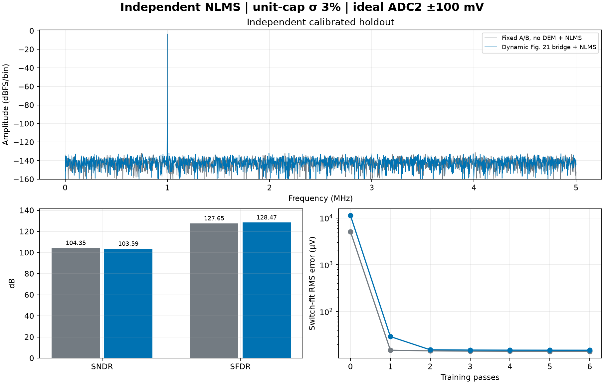

# Fig.21 跨段候选与全程无 DEM 的 LMS

本项目以 INL／DNL 改善作为 DEM 的主要效果判断。2%／3% 固定失配、每档五颗虚拟芯片的 14 位聚合 INL 和 DNL 均有改善，具体统计及 20 位边界见 [INL／DNL 结果](../inl_dnl/README.md)。下表单独报告动态指标：在制造 seed 100、候选输入等效 ±100 mV 的理想 12 位 ADC2 下，Fig.21 候选**没有同时提高 SNDR 和 SFDR**。训练与留出的量程检查均为零越界。

| 单位电容失配 σ | 全程无 DEM 的固定 A/B＋NLMS | 动态选片＋Fig.21＋NLMS | 候选减基线 |
| :---: | ---: | ---: | ---: |
| 2% | 104.365／127.618 dB | 103.976／126.600 dB | −0.389／−1.018 dB |
| 3% | 104.346／127.647 dB | 103.586／128.470 dB | −0.760／+0.823 dB |

数值为 SNDR／SFDR。2% 下两项均降低。3% 下 SFDR 的小幅收益伴随 SNDR 降低。候选与基线均接近该 ADC2 的理想量化底限。步长为 48.828 μV，对应理想均匀量化噪声 14.10 μV RMS。这是静态制造失配与理想量化器的行为实验。时偏、热噪声、实际参考及建立、温漂、真实 RA／ADC2 和硬件定点实现留待独立验证。



[2% 结果图](sigma_2pct_adc2_100mv/bridge_lms_comparison.png) · [2% 摘要](sigma_2pct_adc2_100mv/summary.json) · [3% 摘要](sigma_3pct_adc2_100mv/summary.json)

保持全部参数不变，配对复跑制造种子 100～104。两档都未观察到同一个样本的 SNDR 与 SFDR 同时上升。

| 失配 σ | 平均 ΔSNDR（改善样本） | 平均 ΔSFDR（改善样本） | 两项同时改善 |
| :---: | ---: | ---: | ---: |
| 2% | −0.349 dB（0／5） | +0.425 dB（4／5） | 0／5 |
| 3% | −0.456 dB（0／5） | +0.958 dB（3／5） | 0／5 |

这是五个固定种子的敏感性检查。[逐种子配对值](seed_sweep/paired_summary.csv)和各次摘要保存在同一目录。

## 独立训练和量程

- 基线从前台增益参考、训练到留出全程固定 A/B，单元 DEM 始终关闭。组内对应开关列一起切换，只拟合两组增益和 40 个组开关等效权重。增益秩 2／2，开关秩 40／40，开关矩阵条件数 26.61。
- 候选用实际 `map_fig21_bridge` 生成掩码。每笔冻结 `R=v` 和纵向起点 `h mod 8`，数字重构加回一次 `δV=correction_q32×5 V/2³²`。补偿后的名义独立两节点闭合最大误差 0.548 nV。真实 ADC2 观察仍来自补偿前的模拟残差。若它超出窗口，数字补偿无法恢复该采样。
- 候选的 396 列原始物理位图中，每片有 3 个子列始终关闭、2 个主 1C 列始终同控。保留每片 16 个主逻辑列和 B7／B8 两个子列，合计 324 个等效开关列。选通增益秩 18／18，等效开关秩 324／324，等效开关矩阵条件数 88.24。实现对进一步秩亏的矩阵保留训练 SVD 可观测子空间，拒绝落在训练子空间外的留出位图。
- 两条链路分别采集 32768 对已知两点增益参考，并使用共同 8192 点、bin 613、峰值 4.98 V 的已知正弦训练。两边各训练 6 轮，共 49152 次归一化 LMS 更新。冻结后，用共同的另一组 4096 点、bin 409、峰值 10/3 V 的 10 MS/s 相干正弦留出。候选训练与留出都使用桥接和动态选片，种子与相位按各记录保存。2% 下基线与候选的训练误差分别从 3397.33 和 7524.61 降至 14.18 和 14.12 μV RMS，3% 下从 5099.09 和 11288.38 降至 14.17 和 14.97 μV RMS。
- 真实电容仅进入前向两节点行为模型。拟合只读取独立外部参考、实际开关位图、组选通和 ADC2 码。两边用相同 ADCToolbox 频谱算法。NLMS 系数由本项目逐样本训练。

默认 ±50 mV 是单独保留的失败工况。两条链路的 2% 和 3% 均未通过增益前台量程，命令保存模拟证据后返回退出码 2。

| 失配 σ | 固定 A/B 增益低点／高点越界 | Fig.21 增益低点／高点越界 | 固定 A/B 训练／留出越界 | Fig.21 训练／留出越界 |
| :---: | ---: | ---: | ---: | ---: |
| 2% | 0／347 | 359／324 | 0／0 | 0／0 |
| 3% | 0／4694 | 1758／1685 | 9／8 | 0／0 |

每个前台参考点有 32768 次采集，训练 8192 点，留出 4096 点。候选缩小了这两档正弦的模拟余量峰值。以 3% 留出为例，固定 A/B 的最大正余量为 52.583 mV，Fig.21 为 40.555 mV。当前前台增益参考的真实模拟余量仍需满足 ADC2 窗口。

[2% 默认窗口失败图](sigma_2pct_adc2_50mv/bridge_lms_comparison.png) · [3% 默认窗口失败图](sigma_3pct_adc2_50mv/bridge_lms_comparison.png)

## 复现

从仓库根目录运行。使用装有 ADCToolbox 0.9.1 和项目数值依赖的 Python。结果目录下的 `observations.npz` 保存粗码、物理选通、补偿、前台采集、冻结系数和留出。摘要记录所有阶段的量程检查和逐轮学习曲线。

```sh
PYTHONPATH=.:src MPLBACKEND=Agg python -m task1.experiments.bridge_lms_comparison --sigma 0.02 --adc2-half-range-mv 100 --out build/task1/bridge_lms_2pct
PYTHONPATH=.:src MPLBACKEND=Agg python -m task1.experiments.bridge_lms_comparison --sigma 0.03 --adc2-half-range-mv 100 --out build/task1/bridge_lms_3pct
PYTHONPATH=.:src MPLBACKEND=Agg python -m task1.experiments.bridge_lms_comparison --sigma 0.02 --adc2-half-range-mv 50 --out build/task1/bridge_lms_2pct_50mv
PYTHONPATH=.:src MPLBACKEND=Agg python -m task1.experiments.bridge_lms_comparison --sigma 0.03 --adc2-half-range-mv 50 --out build/task1/bridge_lms_3pct_50mv
```

增加制造种子时传入 `--seed 101` 等参数。仅保存摘要可加 `--summary-only`。
