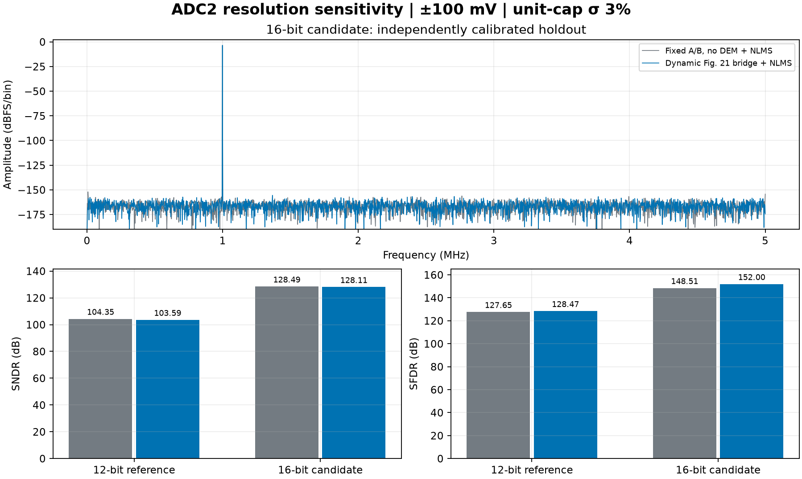

# 后级位数敏感性：候选 16 位理想 ADC2

输入等效窗口保持 ±100 mV，只将理想 ADC2 从 12 位改为 16 位。制造 seed 100 的 2% 和 3% 两档均完成独立训练与留出，各阶段过载为零。候选后级是工程假设，实际后级位数、窗口和精度仍待确认。

| 电容失配 σ | 全程无 DEM 的固定 A/B＋NLMS | 动态选片＋Fig.21＋NLMS | 候选桥接减固定基线 |
| :---: | ---: | ---: | ---: |
| 2% | 128.499／153.313 dB | 127.956／151.338 dB | −0.544／−1.975 dB |
| 3% | 128.495／148.509 dB | 128.110／152.002 dB | −0.385／+3.493 dB |

数值为 SNDR／SFDR，均由最终 20 位编码之前的输入等效校准电压得到。细级量化器变细后，四组 SNDR 均提高约 24 dB。桥接相对无 DEM 基线，2% 下两项下降，3% 下 SFDR 上升而 SNDR 下降。



[2% 结果图](sigma_2pct/bridge_lms_16bit.png) · [2% 摘要](sigma_2pct/summary.json) · [3% 摘要](sigma_3pct/summary.json)

## 20 位输出与线性度

10 V 差分全量程的 20 位 LSB 为 9.536743 μV。±100 mV 的 12 位 ADC2 步长为 48.828125 μV，相当于 5.12 个输出 LSB。在固定粗码和固定切换状态下，细码一次会跨过多个输出码。动态状态混合可让更多码在码密度中出现，仍需分别检查零宽码、DNL 和各状态粗码边界。现有 12 位[静态码密度回执](../inl_dnl/summary.json)中，固定 A/B 的 20 位零宽内码占 64.68%／64.72%，动态 Fig.21 聚合态的 DNL 最小值仍为 −1 LSB。

16 位候选的步长为 3.051758 μV，相当于 0.32 个输出 LSB。在此条件下，理想 ADC2 量化噪声约 0.881 μV RMS，当前相干留出幅度下的理论 SNDR 为 128.55 dB。表内指标接近该数值，因为这里只计算理想量化和静态失配。若最终以 20 位输出编码，理想输出码仓单独对应约 2.753 μV RMS 和 118.65 dB；实际 INL/DNL、量化及状态转换需在完整输出路径评估。

## 同一物理池与独立训练

每档由原 12 位回执复用外部参考波形并重建同一物理池。两条路径分别训练新系数。每档的 50 个粗码、计划、位图、名义 Q32 补偿和 ADC2 前残差数组与原 12 位实验逐元素一致。训练仍是每条 32768 对已知两点增益参考、8192 点相干正弦训练 6 轮、共 49152 次逐笔更新，随后在不同频率的 4096 点相干留出上应用冻结系数。两条路径的等效权重秩为 40／40 和 324／324。

运行条件为理想两节点网络、固定静态失配及理想均匀 ADC2。时偏、热噪声、实际建立、RA／ADC2 非线性和数字实现量化另计。

## 复现

实跑环境的 ADCToolbox 版本为 0.9.1，源码来自干净的 Git 提交 `8d62fb1863e38ffe5c6cc3ac48fa9c24d9df1ae9`。复现时固定源码提交，同名发行版本可以包含不同字节。

```sh
python -m pip install 'adctoolbox @ git+https://github.com/Arcadia-1/ADCToolbox.git@8d62fb1863e38ffe5c6cc3ac48fa9c24d9df1ae9#subdirectory=python'
PYTHONPATH=.:src MPLBACKEND=Agg python -m task1.experiments.bridge_lms_16bit --reference-dir task1/evidence/bridge_lms/sigma_2pct_adc2_100mv --out build/task1/bridge_lms_16bit_2pct
PYTHONPATH=.:src MPLBACKEND=Agg python -m task1.experiments.bridge_lms_16bit --reference-dir task1/evidence/bridge_lms/sigma_3pct_adc2_100mv --out build/task1/bridge_lms_16bit_3pct
```

各档 `observations.npz` 保存外部参考、同笔开关观察、16 位 ADC2 码及两套冻结系数。`summary.json` 保存新旧回执摘要、学习曲线和源文件摘要。
