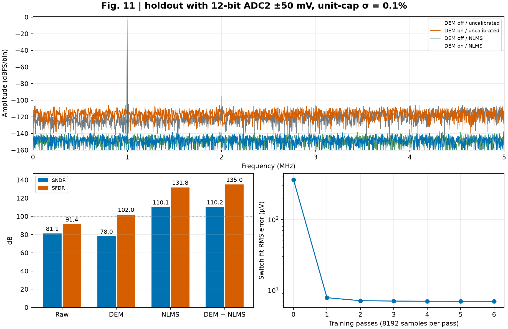
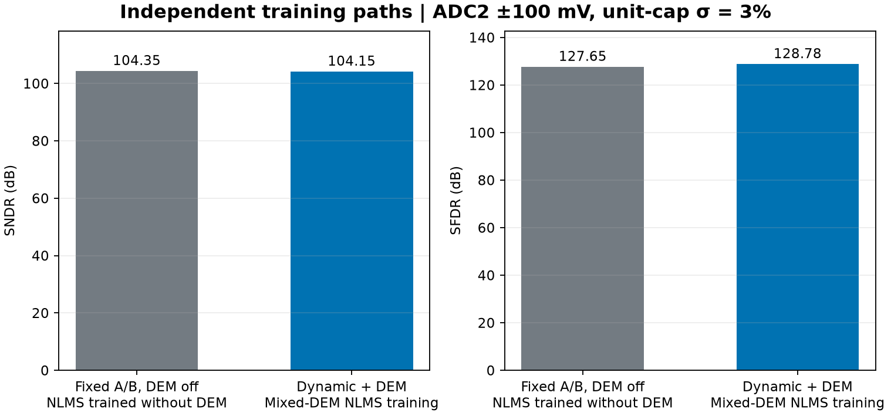
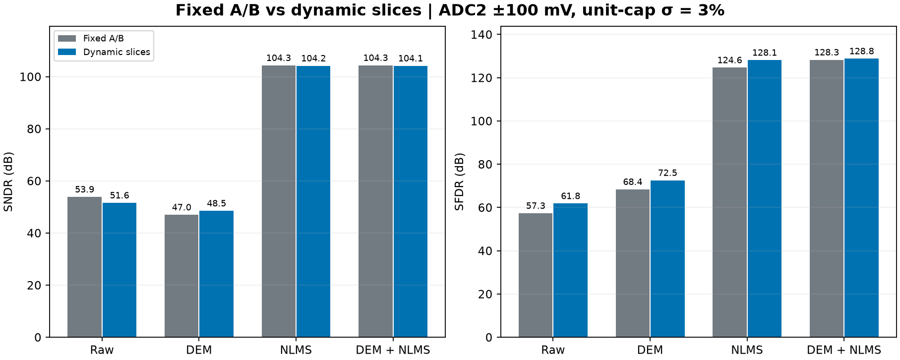

# Fig.11 电容失配与前台 LMS 校准

固定 18 片物理电容池和有序选片计划，在同一留出正弦上比较 DEM 与校准开关。校准算法是项目实现的预条件归一化 LMS（NLMS）。ADCToolbox 0.9.1 用于计算全部留出频谱，并对相同训练数据另做正弦位权拟合。

| 单位电容相对失配 σ | DEM / NLMS | SNDR（dB） | SFDR（dB） |
| :---: | :---: | ---: | ---: |
| 0.1% | 关 / 关 | 81.10 | 91.37 |
| 0.1% | 开 / 关 | 78.04 | 102.04 |
| 0.1% | 关 / 开 | 110.11 | 131.81 |
| 0.1% | 开 / 开 | 110.17 | 134.95 |
| 0.01% | 关 / 关 | 100.61 | 111.55 |
| 0.01% | 开 / 关 | 97.72 | 121.21 |
| 0.01% | 关 / 开 | 110.01 | 133.97 |
| 0.01% | 开 / 开 | 110.12 | 133.25 |



两档失配均使用同一个预先选定的制造 seed 100。留出为 10 MS/s、4096 点、998.53515625 kHz、差分峰值 10/3 V。矩形窗与相干基波单 bin 口径均一致。校准后输入等效误差约 7.3–7.5 μV RMS，接近本实验理想 12 位 ADC2 的码仓量化底限。ADC2 的输入等效窗口为 ±50 mV，步长为 24.414 μV。这是同温度、同静态制造池下的行为代理，涵盖电容失配及理想 ADC2 量化。热噪声、时偏、实际 RA／ADC2、温漂和系数定点化需要另测。该留出正弦的相位、ADC2 量化和指标提取口径与无校准效果实验不同，因此两个实验的原始指标应分别读。

## 训练使用什么

1. **两点增益参考。** 对同一物理切片组和强制粗码 256，读取两次理想 ADC2 码。已知输入相差 60 mV，已知中点变化 ±10 mV。用码仓中点差分估计各组选通片的输入增益和，32768 对测量组成 18 列满秩矩阵。该前台步骤是本项目的观测设计。
2. **校准开关有效权重。** 用另一组 8192 点正弦（相干 bin 613、峰值 4.98 V）采集物理片 ID、实际主／子掩码和 ADC2 码。每四笔关闭 DEM 一笔，其余开启。输入参考与读回码来自同笔采集。对每笔将名义输出误差与已估片增益写成开关位图的线性目标，再更新 NLMS 权重。预条件由训练位图构成，协方差数值底限为 10⁻¹⁰，归一化分母底限为 10⁻⁹，逐笔步长按训练轮 0.25／(轮次＋1)，共六轮。开关校准训练误差从约 364.09 降至 6.93 μV RMS。
3. **冻结后留出。** 留出采用不同相干频率、相位和选片计划。推理读取同笔物理 ID、开关位图和 ADC2 码，系数固定。留出的真实输入只用于算误差。真实电容值只用于前向模拟。
4. **独立工具箱对照。** 对训练位图加上增益修正后残差的二进制重编码，调用 `calibrate_weight_sine`，并以已知训练正弦峰值调用 `scale_calibration_output`。该数据适配包含一阶增益修正和 16 位软件重编码，ADC2 仍为 12 位。工具箱正弦位权法在 0.1% 条件下对 DEM 关／开留出分别得到 110.15／110.22 dB SNDR。它是独立于逐笔 NLMS 的权重拟合对照。

观测矩阵只包括实际切换的 378 个物理单元。末端固定接低参考的单元包含在前向电荷网络。0.1% 实验中，混合训练的开关矩阵秩为 378／378，条件数 108.90。始终关闭 DEM 时，18 个备用 1C 不活动，秩为 360／378。始终开启时，每次 B4 纵向选择在两组 1C 中各选四个，组平均权重差不可辨识，秩为 377／378。若切片计划始终只用一个固定组，两点参考也无法分离各片增益。

## 2% 与 3% 单位电容失配

两档都使用制造 seed 100，物理电容最小值分别为 0.9547 fF 与 0.9320 fF。这里比较的是同一个虚拟制造样本的两档失配强度。

默认 ADC2 输入等效窗口为 `[-50, +50)` mV。前台增益高点首先越界，程序保留原始余量观察并以退出码 2 停止数字校准。动态、固定 A/B 和两种单元 DEM 的留出均在同一物理池上检查。

| 失配 σ | 增益高点越界／32768（最大 mV） | 混合训练越界／8192 | 动态留出越界，DEM 关／开 | 固定 A/B 留出越界，DEM 关／开 |
| :---: | ---: | ---: | ---: | ---: |
| 2% | 770（56.081） | 1 | 1／1 | 0／3 |
| 3% | 4370（64.971） | 10 | 5／2 | 8／10 |

[2% 默认窗口的余量图](sigma_2pct/adc2_headroom.png) · [3% 默认窗口的余量图](sigma_3pct/adc2_headroom.png) · [2% 摘要](sigma_2pct/summary.json) · [3% 摘要](sigma_3pct/summary.json)

作为单独的量程敏感性实验，将理想 12 位 ADC2 的候选输入等效窗口设为 ±100 mV。物理池、刺激、样本顺序及训练方法与默认窗口一致。该条件下所有前台、训练和留出观察均在量程内。步长由 24.414 增至 48.828 μV，理想均匀量化噪声约 14.10 μV RMS。实际硬件的 ADC2 窗口仍需依据模拟链路确定。

### 主对照：全程无 DEM 的 LMS 与动态选片＋DEM＋LMS

两条链路各自训练。无 DEM 路径从增益参考到留出始终固定 A/B，单元 DEM 始终关闭。它只拟合 A/B 两组增益及每组 16 个主阵列和 4 个子阵列的有效组合权重。组增益矩阵秩为 2／2，开关矩阵秩为 40／40、条件数为 26.61。动态路径使用自己的增益参考及混合 DEM 训练，留出开启 DEM。片增益矩阵秩为 18／18，开关矩阵秩为 378／378、条件数为 108.90。

两条链路使用同一物理池、参考电压和训练预算。每条采集 32768 对两点增益参考，同一组 8192 点参考正弦训练 6 轮，共 49152 次逐笔更新。训练结束后分别冻结系数，在相同的另一组 4096 点正弦上评估。2% 与 3% 的候选窗口下，两条链路前台、训练和留出的实际过载计数均为零。

| 失配 σ | 固定 A/B、全程无 DEM 的 NLMS | 动态选片＋DEM＋NLMS | 后者增量 |
| :---: | ---: | ---: | ---: |
| 2% | 104.37／127.62 | 104.11／128.61 | −0.25／+0.99 |
| 3% | 104.35／127.65 | 104.15／128.78 | −0.20／+1.14 |

表中为 SNDR／SFDR（dB），增量按未舍入值计算。独立训练对照中，动态选片与 DEM 的额外收益集中在 SFDR，约为 1 dB。两条链路的 SNDR 都接近当前理想 ADC2 的量化底限。



[2% 独立训练对照图](sigma_2pct_adc2_100mv/strict_lms_comparison.png) · [2% 独立训练原始数据](sigma_2pct_adc2_100mv/observations.npz) · [3% 独立训练原始数据](sigma_3pct_adc2_100mv/observations.npz)

### 运行期开关消融：共用动态混合训练的系数

| 失配 σ | 选片 | 无 DEM／无校准 | DEM 单开 | NLMS 单开 | DEM＋NLMS |
| :---: | :--- | ---: | ---: | ---: | ---: |
| 2% | 固定 A/B | 57.37／60.84 | 50.50／71.90 | 104.08／121.76 | 104.27／127.15 |
| 2% | 动态 | 55.09／65.36 | 52.02／76.05 | 104.02／127.52 | 104.11／128.61 |
| 3% | 固定 A/B | 53.85／57.32 | 46.98／68.38 | 104.31／124.65 | 104.35／128.25 |
| 3% | 动态 | 51.57／61.84 | 48.50／72.54 | 104.16／128.11 | 104.15／128.78 |

每项为 SNDR／SFDR（dB）。固定 A/B 交替启用物理片 0～7、8～15，备用片 16、17 不参与，组选通矩阵秩为 2／18。动态组选通秩为 18／18。两种留出共用逐样本 H/V 轮转相位，并使用同一份动态混合训练得到的冻结系数。固定 A/B 的校准结果衡量这组已标定物理片的应用效果。



在动态选片下，单开 DEM 将 2% 与 3% 的 SFDR 各提高约 10.7 dB，同时使 SNDR 各下降约 3.1 dB。轮转将离散杂散分散到宽带频点，开关失配产生的误差仍需校准。候选窗口中，两档的各 NLMS 校准组合 SNDR 均接近 104 dB，对应约 14.3–14.9 μV RMS 留出误差。ADCToolbox 的独立正弦位权拟合在动态选片下，2% 的 DEM 关／开 SNDR 为 103.82／103.80 dB，3% 为 102.89／102.29 dB，差异包含前述一阶增益修正的近似。

[2% 八组比较](sigma_2pct_adc2_100mv/schedule_dem_lms.png) · [2% 动态频谱与学习曲线](sigma_2pct_adc2_100mv/adctoolbox_calibration.png) · [3% 动态频谱与学习曲线](sigma_3pct_adc2_100mv/adctoolbox_calibration.png) · [2% 候选窗口摘要](sigma_2pct_adc2_100mv/summary.json) · [3% 候选窗口摘要](sigma_3pct_adc2_100mv/summary.json)

## 复现

从仓库根目录，用装有 ADCToolbox 0.9.1 和本项目数值依赖的 Python 运行。

```sh
PYTHONPATH=.:src MPLBACKEND=Agg python -m task1.experiments.adctoolbox_calibration --out build/task1/calibration
PYTHONPATH=.:src MPLBACKEND=Agg python -m task1.experiments.adctoolbox_calibration --sigma 0.0001 --out build/task1/calibration_0p01pct
PYTHONPATH=.:src MPLBACKEND=Agg python -m task1.experiments.adctoolbox_calibration --sigma 0.02 --out build/task1/calibration_2pct
PYTHONPATH=.:src MPLBACKEND=Agg python -m task1.experiments.adctoolbox_calibration --sigma 0.03 --out build/task1/calibration_3pct
PYTHONPATH=.:src MPLBACKEND=Agg python -m task1.experiments.adctoolbox_calibration --sigma 0.02 --adc2-half-range-mv 100 --out build/task1/calibration_2pct_100mv
PYTHONPATH=.:src MPLBACKEND=Agg python -m task1.experiments.adctoolbox_calibration --sigma 0.03 --adc2-half-range-mv 100 --out build/task1/calibration_3pct_100mv
```

默认窗口的 2% 与 3% 命令预期返回退出码 2。以 `adc2_headroom.png` 和 `residue_before_adc2.npz` 检查越界，正常完成的候选窗口另存 `observations.npz` 和 `schedule_dem_lms.png`。

[0.1% 摘要](summary.json) · [0.1% 原始数字观测与冻结系数](observations.npz) · [0.1% 学习曲线](learning.csv) · [0.01% 摘要](sigma_0p01pct/summary.json) · [0.01% 图](sigma_0p01pct/adctoolbox_calibration.png)

以后比较电容失配时，使用同一物理池、测试输入和选片计划，成对报告原始、DEM、校准、DEM＋校准，并保存训练激励、矩阵秩、冻结系数和独立留出。
