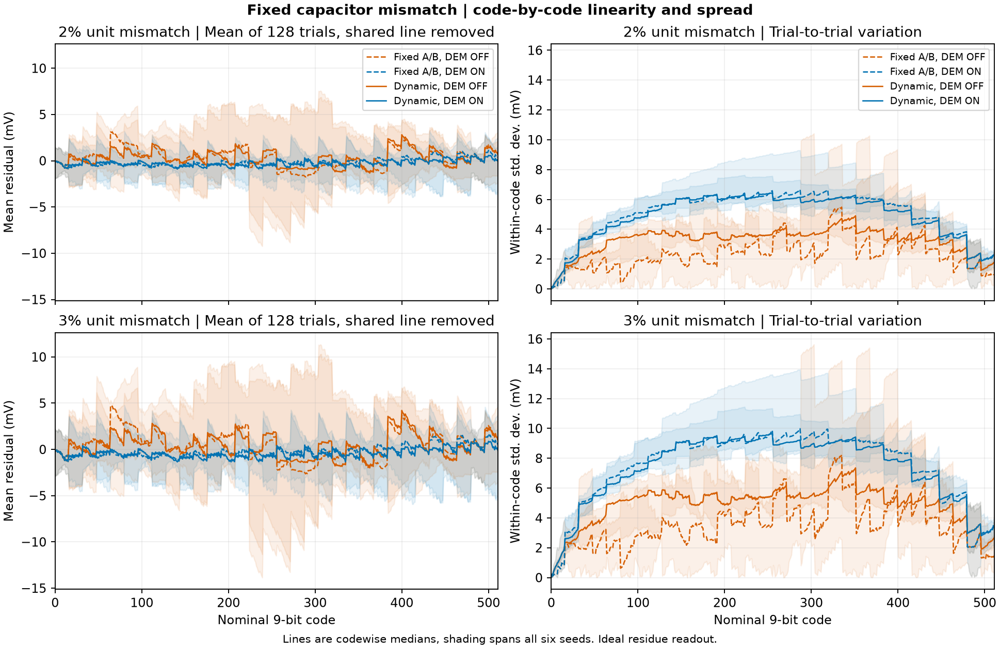
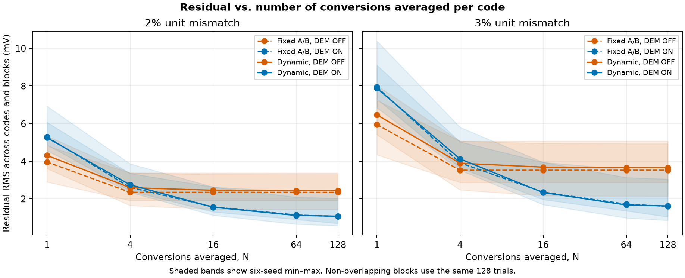
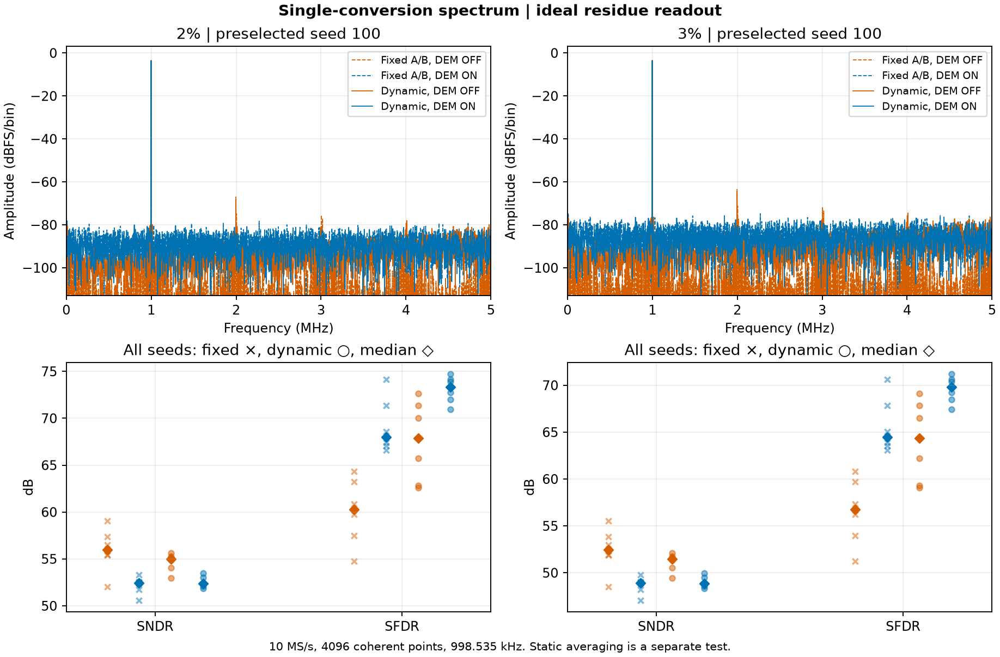

# 2% 和 3% 固定电容失配下的 DEM 对照

> 本页为未校准的固定失配机制诊断，不作为最终性能结论。按统一标准，需同时查看[独立 LMS 对照](../bridge_lms/README.md)及[INL／DNL](../inl_dnl/README.md)。

动态选片保持开启时，打开横向及纵向 DEM 后，128 次平均的逐码残差 RMS 在 2% 失配下由 **2.444 降至 1.082 mV**，在 3% 失配下由 **3.665 降至 1.623 mV**。两档各六颗虚拟样本的配对比较均显示下降。单次转换的波动则变大。2% 组的码内标准差中位数由 3.369 增至 5.477 mV，3% 组由 5.054 增至 8.215 mV。



每码 128 笔按不重叠的块取均值。每颗样本的四组数据共用一条拟合直线，各平均次数也沿用此线。在本次扫点中，保持动态选片并只切换 DEM，平均 1 次和 4 次时开启组的残差 RMS 中位数较高，从 16 次起较低。曲线给出六颗样本的中位数和最小至最大范围。



| 单位电容失配 σ | 选片 | H/V DEM | 128 次平均残差 RMS，mV | 单次 SNDR，dB | 单次 SFDR，dB |
| :--- | :--- | :--- | ---: | ---: | ---: |
| 2% | 固定 A/B | 关 | 2.351 [1.916, 3.382] | 55.98 [52.03, 59.04] | 60.30 [54.74, 64.35] |
| 2% | 固定 A/B | 开 | 1.072 [0.698, 2.037] | 52.44 [50.55, 53.30] | 67.99 [66.58, 74.14] |
| 2% | 动态 | 关 | 2.444 [1.431, 3.291] | 54.96 [52.95, 55.60] | 67.87 [62.59, 72.63] |
| 2% | 动态 | 开 | 1.082 [0.575, 2.370] | 52.37 [51.88, 53.48] | 73.32 [70.97, 74.71] |
| 3% | 固定 A/B | 关 | 3.526 [2.875, 5.073] | 52.45 [48.51, 55.52] | 56.77 [51.22, 60.83] |
| 3% | 固定 A/B | 开 | 1.608 [1.046, 3.056] | 48.92 [47.03, 49.78] | 64.47 [63.06, 70.62] |
| 3% | 动态 | 关 | 3.665 [2.146, 4.937] | 51.44 [49.43, 52.08] | 64.35 [59.07, 69.10] |
| 3% | 动态 | 开 | 1.623 [0.861, 3.556] | 48.85 [48.36, 49.96] | 69.80 [67.44, 71.19] |

表中为中位数 [最小值, 最大值]。频谱上方使用预先指定的种子 100，下方保留全部六颗虚拟样本。静态平均后的误差与单次连续采样的频谱分别计算。动态选片开启时，DEM 在两档的六颗样本中均有五颗 SFDR 提高、五颗 SNDR 降低。



实验使用种子 100–105。每颗的实际电容从制造阶段开始固定，四组共用相同的物理池、输入、粗码和冻结的 H/V 相位。固定 A/B 交替使用片 0–7 和片 8–15，动态组取交付调度器输出。静态扫点采用 512 个 Fig.11 名义码仓中点，每码重复 128 次。参考直线拟合目标为该颗四组逐码均值误差的等权平均。频谱采用 10 MS/s、4096 点和 998.53515625 kHz 相干输入，正弦峰值为 10/3 V。

电压由独立两节点方程和理想余量读出获得。该实验隔离 Fig.11 电容失配下的统计平均机制。真实 ADC2、热噪声及 LMS 校准的效果需要各自的联合实验。

```sh
PYTHONPATH=.:src python -m task1.experiments.run_dem_high_mismatch --out build/task1/dem_stress
```

[每颗指标](dem_high_sigma_samples.csv)、[逐码统计](dem_high_sigma_static.csv)、[分块平均](dem_high_sigma_average.csv)、[正弦波形与物理参数](dem_high_sigma_tone.npz)和[实验配置及源码摘要](dem_high_sigma_summary.json)随图归档。
