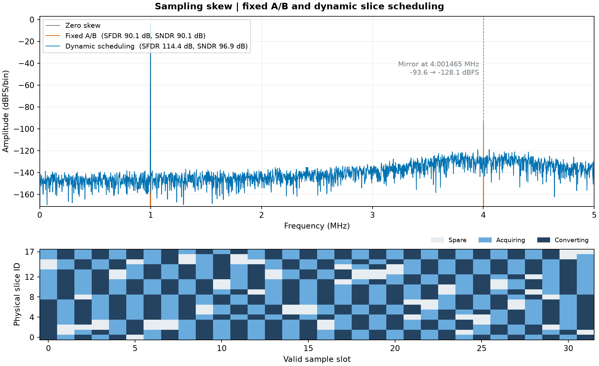
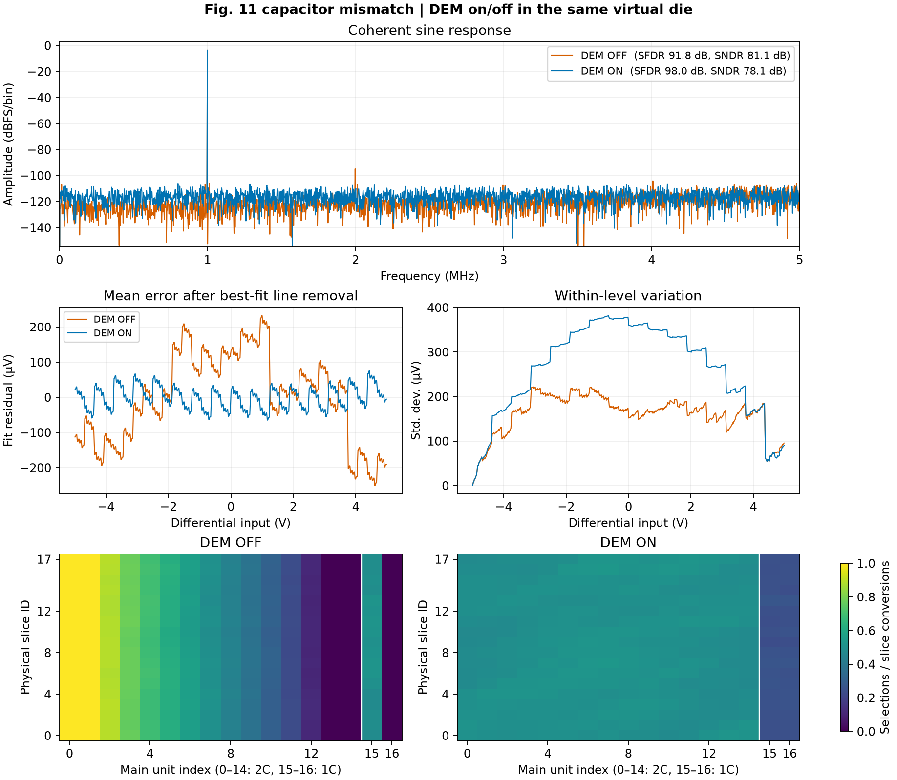
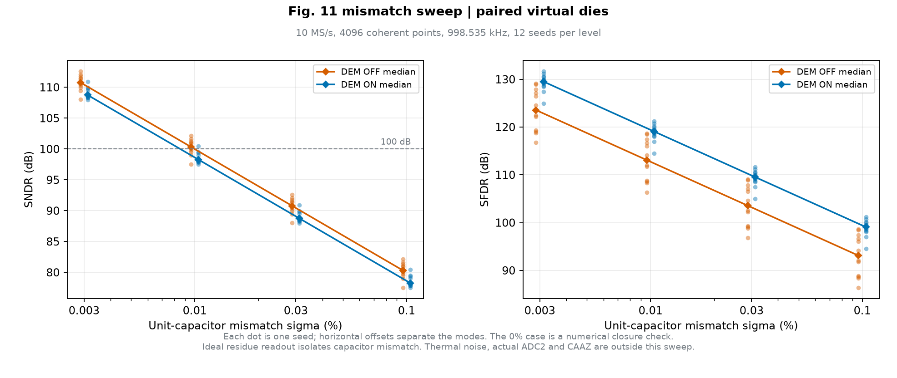

# 模块一效果图与原始数据

**固定 A/B 改为动态选片**后，这组 10 MS/s 行为仿真的 4.001465 MHz 镜像由 −93.59 降至 −128.09 dBFS。SFDR 由 90.07 提高至 114.42 dB，SNDR 由 90.07 提高至 96.87 dB。采样时偏固定为片 0–7 的 +5 ps、片 8–15 的 −5 ps、片 16–17 的 0 ps。固定组交替使用前两组，动态组读取交付模型的实际有序转换组。输出为八片采样电压的算术均值。图下方显示前 32 个有效槽的物理片角色。



**DEM 开启**后，在同一虚拟制造样本中，SFDR 由 91.76 提高至 98.03 dB，静态拟合残差峰值由 250.43 降至 75.16 μV。同时 SNDR 由 81.05 降至 78.09 dB，每电平标准差的中位数由 168.59 增至 288.87 μV。频谱、静态拟合残差、条件标准差和选通热图共同显示这组样本的取舍。热图按每片实际参与转换的次数归一化。



两组频谱采用 4096 点、998.53515625 kHz 相干正弦和 10/3 V 差分峰值。频谱曲线使用矩形窗，SFDR 通过时域扣除基波后的 Blackman–Harris 残余谱计算。DEM 组固定输入、失配电容、有序选片计划和名义 9 位粗码。横纵相位来自模块一采样沿冻结的独立随机状态。失配采用独立高斯偏差，单位电容相对标准差为 0.1%。

名义电荷参考采用主阵列 `15×2C + 2×1C`、子阵列 `8C/4C/2C/1C/1C`、桥接电容 `C` 和零寄生。主阵列采样输入，子阵列采样低参考。实验在此约定下独立求解逐片两节点方程，按八片名义主采样电容折算输入等效电压，并以理想余量读出。静态实验在 512 个名义码仓中点各重复 128 次，去掉均值误差曲线的最佳拟合直线。该残差描述行为模型的静态误差，芯片 INL 和性能验收需要对应模型、工艺和实测证据。

从仓库根目录运行以下命令可重绘。依赖见项目 Python 配置。

```sh
PYTHONPATH=.:src python -m task1.experiments.run_effects --out build/task1/effects
```

| 文件 | 内容 |
| :--- | :--- |
| `summary.json` | 条件、种子、工具版本、输入源码摘要及数值指标 |
| `traces.npz` | 采样时间、输入与输出、18 片实际失配电容、采集与转换组、粗码与相位、正弦实际开关掩码、静态逐次误差 |
| `static_sweep.csv` | 每个输入电平的均值误差、去直线残差及标准差，单位 V |
| `usage.csv` | 正弦实验的物理片与单元编号、名义权重、实际开启次数及所在片转换次数 |

## 接近 100 dB 的失配条件

0.1% 单位电容失配保留作压力案例。另在 0%、0.003%、0.01%、0.03% 和 0.1% 扫描失配，每个失配水平使用相同的 12 个制造种子。每颗虚拟样本的 DEM 开关对照共用失配电容。所有组共用输入、选片计划、粗码与频谱计算方法。0% 组的误差处在双精度舍入量级，保留闭合检查数值，dB 指标留空。



| 单位电容失配 σ | DEM 关 SNDR 中位数 | DEM 开 SNDR 中位数 | DEM 开达到 100 dB 的样本数 |
| :--- | ---: | ---: | ---: |
| 0.003% | 110.79 dB | 108.74 dB | 12/12 |
| 0.01% | 100.33 dB | 98.28 dB | 1/12 |
| 0.03% | 90.79 dB | 88.74 dB | 0/12 |
| 0.1% | 80.33 dB | 78.28 dB | 0/12 |

同一 10/3 V 峰值正弦下，100 dB SNDR 对应总基波拟合残余约 23.57 μV RMS。DEM 开启的 0.01% 组范围为 97.50–100.45 dB，0.003% 组为 107.96–110.91 dB。以上是理想余量读出下的电容失配敏感度。整机指标需要把热噪声、真实 ADC2 及 CAAZ 等因素计入同一误差预算。

```sh
PYTHONPATH=.:src python -m task1.experiments.run_sndr_sweep --out build/task1/effects
```

[每个种子的指标](sndr_sigma_samples.csv)和[统计、参数及源码摘要](sndr_sigma_summary.json)随图归档。
