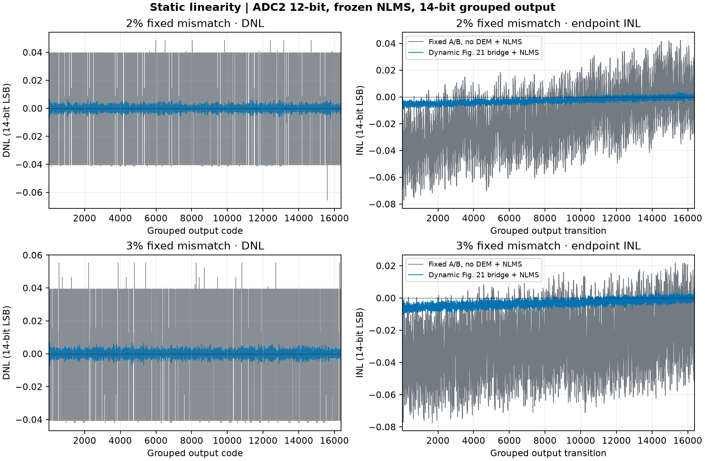
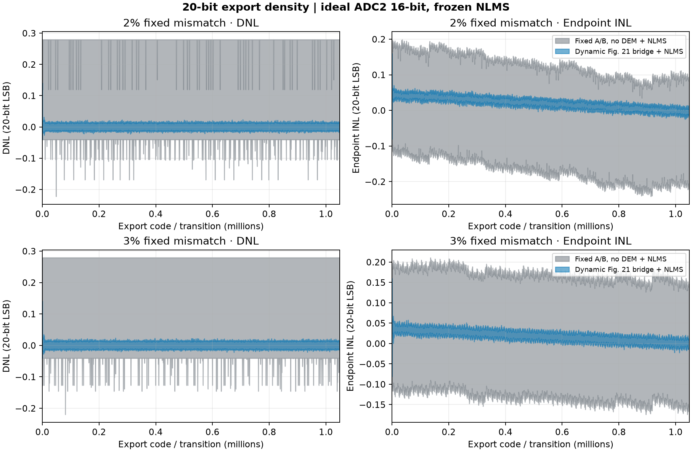

# 固定失配下的静态 INL/DNL 对照

使用同一颗固定失配 CDAC、相同模拟余量模型和两套独立训练后冻结的 NLMS 系数。基线从训练到扫幅均使用固定 A/B 并关闭 DEM。候选启用动态选片和 Fig.21 跨段 DEM。横轴为覆盖 −5 V 至 +5 V 的导出数字码，按每 64 个 20 位导出码归并为一个 14 位码仓。下表是制造 seed 100、理想 12 位 ADC2 输入等效范围 ±100 mV 的结果。

| 固定失配 σ | 路径 | 峰值端点 INL (LSB14) | DNL 范围 (LSB14) | 20 位导出内码零宽数 |
| :--- | :--- | ---: | ---: | ---: |
| 2% | 无 DEM＋LMS | 0.07727 | [−0.06573, +0.04853] | 678,189 |
| 2% | 跨段 DEM＋LMS | 0.00892 | [−0.00691, +0.00680] | 336 |
| 3% | 无 DEM＋LMS | 0.07745 | [−0.04196, +0.05532] | 678,629 |
| 3% | 跨段 DEM＋LMS | 0.01071 | [−0.00742, +0.00710] | 224 |



峰值端点 INL 在 2% 失配时由约 47.16 μV 降至 5.44 μV，在 3% 时由约 47.27 μV 降至 6.54 μV。四组的 16,382 个 14 位内码均有正码宽。12 位 ADC2 的细步长为 48.828 μV，20 位导出码的标称步长为 9.537 μV。在有限状态集合中，两路的 20 位 DNL 最小值均为 −1 LSB20。跨段路径减少大量零宽码，但仍有零宽码，并且逐状态跨粗码边界的最坏向下跳变分别为 58.24 μV 和 59.36 μV。

12 位 ADC2 的五颗配对统计使用制造 seeds 100–104，每颗均单独重跑冻结训练并使用同一测法。2% 和 3% 各有 5/5 颗在峰值 INL、峰值绝对 DNL 和 20 位零宽内码数上改善。14 位峰值 INL 中位数分别由 0.07501 降至 0.01524 LSB14、由 0.07745 降至 0.01486 LSB14。峰值绝对 DNL 的配对路径中位数分别由 0.06609 降至 0.01097 LSB14、由 0.06231 降至 0.01115 LSB14。所有统计都保留了实际逐颗结果。 [逐颗表](seed_sweep.csv) · [完整汇总](seed_sweep.json)

## 16 位 ADC2 候选的 20 位等效码密度

保持相同的 seed 100、固定物理池、理想 ADC2 ±100 mV 输入等效窗口和状态集合，将 ADC2 改为理想 16 位量化并分别重训、冻结 NLMS。细步长由 48.828 μV 降至 3.052 μV，为 20 位标称导出 LSB 的 0.32 倍。此时四组的 1,048,574 个导出内码在各自等权状态混合中均有正宽。

| 固定失配 σ | 路径 | 峰值端点 INL (LSB20) | DNL 范围 (LSB20) | 20 位导出内码零宽数 |
| :--- | :--- | ---: | ---: | ---: |
| 2% | 无 DEM＋LMS | 0.24163 | [−0.22226, +0.27946] | 0 |
| 2% | 跨段 DEM＋LMS | 0.15977 | [−0.04005, +0.14044] | 0 |
| 3% | 无 DEM＋LMS | 0.21094 | [−0.21983, +0.27919] | 0 |
| 3% | 跨段 DEM＋LMS | 0.15966 | [−0.04008, +0.14034] | 0 |



图中的色带保留每组 512 个导出码的极值，完整宽度见 NPZ。16 位候选四组均无 ADC2 超窗输入宽度，逐状态跨粗码边界的重构电压仍可能回跳。跨段路径的最坏回跳在 2% 和 3% 时分别为 3.51 μV 和 3.69 μV，实际导出整数码在 14,538／261,632 和 14,856／261,632 个粗码边界与状态组合下降一码。固定 A/B 的对应数量为 37／1,022 和 50／1,022。码密度和逐状态单调性应分别验收。 [16 位候选汇总](adc2_16bit/summary.json) · [同批 14 位聚合图](adc2_16bit/linearity.png)

## 测法与口径

- 粗判决使用现有 512 个名义 Fig.11 阈值。每个粗码输入区间内固定切片和掩码，在两个输入端点求实际失配两节点余量，再用中点求解核对仿射插值。ADC2 量化按 12 位、输入等效 ±100 mV 和码仓中点解码。重构只使用该路训练已冻结的增益和开关权重，跨段补偿按该路实际掩码和冻结相位应用。
- 对每个 ADC2 码仓求其覆盖的输入电压宽度，累加到实际重构导出码。固定路径对 A/B 两状态等权积分。动态路径对四组各 128 个事先固定且与训练种子不同的调度和 DEM 状态等权积分。同一套状态应用于每个粗码区间，避免坡道位置与调度周期锁定。这里测得的是该状态分布下的等效码密度。四组动态状态分别核算的峰值端点 INL 范围为 2% 时 0.0101–0.0155 LSB14、3% 时 0.0111–0.0155 LSB14。
- 总输入宽度以完整 10 V 为分母。ADC2 超窗的输入宽度单列，出现正宽超窗则该组没有有效线性度结论。本表四组均为零。最终导出码的有限饱和权重进入两端码，并单列于 JSON。INL 和 DNL 按通常的码密度口径移除首尾饱和码，DNL 按内部平均码宽归一，端点 INL 为累计 DNL。表中的 14 位 LSB 约为 610.35 μV，20 位零宽数的分母为 1,048,574 个内部码。
- 每路另对两个固定状态进行相同 524,288 点显式均匀输入交叉核验。直接采样的码密度和积分结果之间的差落在各区间采样步长误差界内。用 ADCToolbox 0.9.1 分析该数值坡道，其 DNL 和端点 INL 数组与独立直方图计算一致。理想线性 ADC 的单元测试给出均匀码宽以及零 INL/DNL。

粗判决阈值在行为模型中仍是名义阈值，实际 CDAC 失配进入余量和重构。完整比较含动态选片、跨段选择和分别训练的作用。物理前级阈值漂移、真实 RA／ADC2、噪声、RTL 的最终 20 位重构量化和硬件签核需分别验证。本图以模型重构电压经明确理想导出量化的码密度为口径。

## 复现

```sh
PYTHONPATH=.:src OPENBLAS_NUM_THREADS=1 MPLBACKEND=Agg \
  python -m task1.experiments.inl_dnl --out build/task1/inl_dnl \
  --training task1/evidence/bridge_lms/sigma_2pct_adc2_100mv \
             task1/evidence/bridge_lms/sigma_3pct_adc2_100mv

PYTHONPATH=.:src OPENBLAS_NUM_THREADS=1 MPLBACKEND=Agg \
  python -m task1.experiments.inl_dnl --out build/task1/inl_dnl_16bit \
  --training task1/evidence/bridge_lms_16bit/sigma_2pct \
             task1/evidence/bridge_lms_16bit/sigma_3pct
```

重跑五颗统计时，对每档的 seed 101–104 分别使用 `task1.experiments.bridge_lms_comparison --sigma 0.02` 或 `--sigma 0.03`，指定 `--seed` 和输出目录，保留冻结观测 NPZ。将这些目录与两个 seed 100 目录一并传给上面的静态入口并加 `--seed-sweep`。

[逐组汇总、限幅质量和源码摘要](summary.json) · [2% 原始宽度和状态](linearity_sigma_2pct.npz) · [3% 原始宽度和状态](linearity_sigma_3pct.npz)
