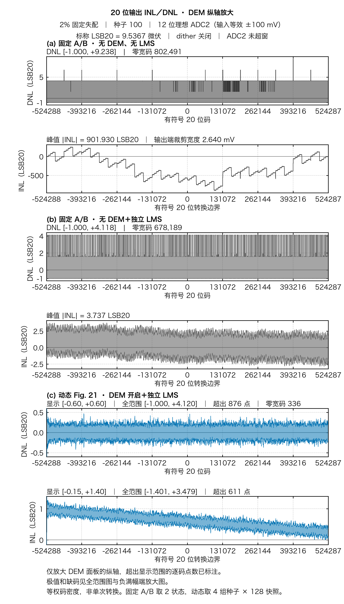

# 20 位全码域 INL／DNL

横轴为有符号 20 位码 **−524288 至 +524287**，共 1,048,576 码，是参考图 16 位码数的 16 倍。10 V 输入跨度下，标称 **1 LSB20 = 9.536743 微伏**。每个 20 位内码先由原始输入覆盖宽度独立计算 DNL，再累计为端点 INL。图中的色带保留每 512 码区段的最小和最大值；明细 CSV 记录区段边界、峰值位置及零宽码数。此前的 14 位聚合图把 64 个 20 位码合成一个码仓，两种 DNL 的定义不同。

## 12 位 ADC2，三路对照

同一固定失配样本，种子 100，理想 12 位 ADC2 输入等效 ±100 mV，dither 关闭。三路均沿用相同输入跨度、名义粗判决和两节点余量模型。

| 路径 | 训练 | 静态统计使用的切换状态 |
| :--- | :--- | :--- |
| 无 DEM、无 LMS | 名义解码，未使用任何拟合系数 | 固定 A/B，两状态等权 |
| 无 DEM＋独立 LMS | 固定 A/B、DEM 关闭，独立训练并冻结 NLMS | 固定 A/B，两状态等权 |
| 跨段 DEM＋独立 LMS | 动态选片、Fig. 21 跨段选择，独立训练并冻结 NLMS | 4 组独立种子 × 128 个快照，等权码密度 |

| 固定失配 | 处理 | DNL 范围，LSB20 | 峰值绝对 INL，LSB20 | 零宽内码数 |
| :--- | :--- | ---: | ---: | ---: |
| 2% | 无 DEM、无 LMS | [−1.000, +9.238] | 901.930 | 802,491 |
| 2% | 无 DEM＋独立 LMS | [−1.000, +4.118] | 3.737 | 678,189 |
| 2% | 跨段 DEM＋独立 LMS | [−1.000, +4.120] | 3.479 | 336 |
| 3% | 无 DEM、无 LMS | [−1.000, +9.238] | 1351.458 | 782,075 |
| 3% | 无 DEM＋独立 LMS | [−1.000, +4.577] | 3.823 | 678,629 |
| 3% | 跨段 DEM＋独立 LMS | [−1.000, +4.120] | 3.478 | 224 |



上图蓝色面板单独放大 DNL 和 INL 纵轴。2%／3% 的 DNL 分别有 876／585 个内码超出显示范围，INL 分别有 611／405 个转换边界超出。全范围图保留真实极值。跨段方案 2%／3% 的全部零宽码分别落在 **−524287…−523459**、**−524287…−523756**，可在负满幅端的逐码放大图中看到。ADC2 两档三路的超窗输入宽度均为 0。无 DEM、无 LMS 基线的 20 位输出端裁剪对应的输入宽度分别为 2.640 mV 和 3.967 mV，和 ADC2 超窗分别统计。计算 DNL 时剔除首尾饱和码，保留全部 1,048,574 个内码；每路以其内码平均宽度做端点归一。

| 失配 | 三路全范围 | 三路 DEM 纵轴放大 | 负满幅端逐码 | 中码逐码 |
| :--- | :--- | :--- | :--- | :--- |
| 2% | [PNG](adc2_12bit_sigma_2pct_three_arms.png) · [SVG](adc2_12bit_sigma_2pct_three_arms.svg) · [PDF](adc2_12bit_sigma_2pct_three_arms.pdf) | [PNG](adc2_12bit_sigma_2pct_three_arms_body_zoom.png) · [SVG](adc2_12bit_sigma_2pct_three_arms_body_zoom.svg) · [PDF](adc2_12bit_sigma_2pct_three_arms_body_zoom.pdf) | [PNG](adc2_12bit_sigma_2pct_low_edge.png) | [PNG](adc2_12bit_sigma_2pct_midscale.png) |
| 3% | [PNG](adc2_12bit_sigma_3pct_three_arms.png) · [SVG](adc2_12bit_sigma_3pct_three_arms.svg) · [PDF](adc2_12bit_sigma_3pct_three_arms.pdf) | [PNG](adc2_12bit_sigma_3pct_three_arms_body_zoom.png) · [SVG](adc2_12bit_sigma_3pct_three_arms_body_zoom.svg) · [PDF](adc2_12bit_sigma_3pct_three_arms_body_zoom.pdf) | [PNG](adc2_12bit_sigma_3pct_low_edge.png) | [PNG](adc2_12bit_sigma_3pct_midscale.png) |

两路独立 LMS 的同纵轴四联图见 [2%](adc2_12bit_sigma_2pct.png) 和 [3%](adc2_12bit_sigma_3pct.png)。12 位后级在当前窗口的细码步长为 48.8281 微伏，相当于 5.12 LSB20。跨段候选显著减少统计零宽码，两档的最坏 DNL 仍为 −1 LSB20。统计码密度也会填补部分固定状态下无法命中的码，逐状态的单次转换仍需单独验收。

## 16 位理想 ADC2 分辨率对照

ADC2 窗口保持输入等效 ±100 mV，位数改为理想 16 位，两条校准路径各自重训。三路全范围图见 [2%](adc2_16bit_sigma_2pct_three_arms.png) 和 [3%](adc2_16bit_sigma_3pct_three_arms.png)。两路独立 LMS 的同轴四联图见 [2%](adc2_16bit_sigma_2pct.png) 和 [3%](adc2_16bit_sigma_3pct.png)。该条件下两条校准路径的全部内部码都有正宽，未校准路径仍有零宽码。逐状态的粗码边界依然可能回跳，见 [16 位对照和逐状态检查](../README.md#16-位-adc2-候选的-20-位等效码密度)。

## 原始数据与复现

- [现有 LMS 路径数据与测法](../README.md) · [独立无校准基线](../uncalibrated/README.md)
- [清单](manifest.json) 记录各图所用源 NPZ、SHA-256、LSB20、极值、饱和处理和文件散列。12 位 ADC2 三路包络明细见 [2% CSV](adc2_12bit_sigma_2pct_three_arms_envelope.csv) 和 [3% CSV](adc2_12bit_sigma_3pct_three_arms_envelope.csv)。

生成图使用 NumPy、Matplotlib 和中文字体。macOS 优先使用 Hiragino Sans GB，Linux 使用 Noto Sans CJK SC（Debian／Ubuntu 软件包 `fonts-noto-cjk`）。SVG 文字已转成路径，便于在无原字体的设备上查看。运行：

```sh
PYTHONPATH=.:src OPENBLAS_NUM_THREADS=1 MPLBACKEND=Agg \
  python -m task1.experiments.full20_linearity_plots --include-uncalibrated \
    --out build/task1/full20
```
