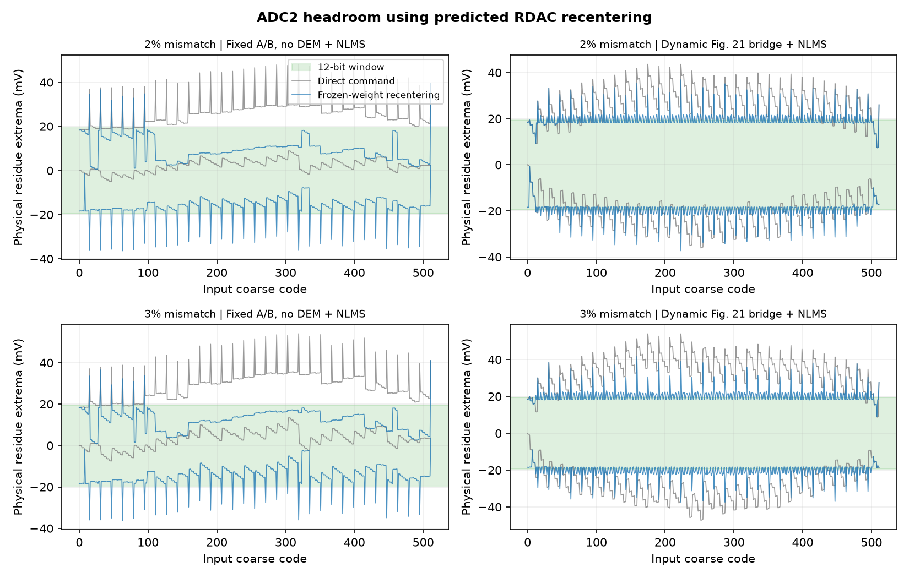

# 12 位 ADC2 窄窗与 RDAC 邻码居中

按粗码区间中心预测余量，搜索邻近 RDAC 命令，可减少过载。2% 和 3% 固定失配的全幅余量仍超出 ±19.53125 mV。这是工程候选的行为评估，尚未接入 RTL 或验证模拟电路。

10 V 输入跨度的 20 位 LSB 为 9.537 µV。12 位 ADC2 要使输入等效细步不大于该 LSB，总窗口最多 39.0625 mV。级间增益为 32 时，对应 ADC2 端总跨度 1.25 V。实验将此窗口置于零点两侧。

| 固定失配与模式 | 正弦过载数 / 4096，原命令 → 居中 | 全幅等权过载输入宽度，原命令 → 居中 | 居中后全幅余量 |
| :--- | ---: | ---: | ---: |
| 2% 固定 A/B＋LMS | 997 → 125 | 23.296% → 3.948% | −36.36～+39.59 mV |
| 2% Fig.21 跨段 DEM＋LMS | 206 → 58 | 5.256% → 1.516% | −37.30～+36.86 mV |
| 3% 固定 A/B＋LMS | 1,523 → 95 | 34.356% → 3.166% | −36.15～+41.01 mV |
| 3% Fig.21 跨段 DEM＋LMS | 439 → 58 | 10.561% → 1.602% | −37.56～+41.66 mV |



任何组都有窄窗过载，所以有效留出 SNDR 留空。若将过载样本夹到 ADC2 边缘码，居中后 20 位导出诊断 SNDR 分别为 65.60、73.25、67.83 和 73.00 dB。理想均匀量化细步在窄窗内为 9.537 µV，对应约 2.75 µV RMS。当前诊断的误差主要来自过载。

## 控制与测量口径

- `c` 来自理想 9 位粗判决。令 `m=(T[c]+T[c+1])/2`，其中 `T` 是名义粗码门限。对 `k∈[c−3,c+3]` 内的合法命令，按当前选片、冻结相位和 `k` 生成实际开关状态。由冻结的 LMS 增益 `G`、开关权重 `w` 计算中心余量 `G(m+Vfs)−B[k]`，其中 `B[k]=T[k]+Vfs+δ[k]+F[k]·w`。选择绝对余量最小的命令。代价相同时保留先比较的命令，原命令优先。
- 命令确定后，将 `k` 的实际开关与制造失配电容带入两节点模型。重构为 `(B[k]+解码余量)/G−Vfs`。跨段 `δ[k]` 在 `B[k]` 中加一次。原来的输入粗码仍决定区间，命令 `k` 决定实际 DAC 和重构。程序核对原命令的掩码、余量及解码与归档留出一致。
- 两档均使用制造 seed 100。正弦沿用 10 MS/s、4096 点、998.535 kHz 和 10/3 V 峰值。全幅静态覆盖 512 个粗码，固定 A/B 取两状态等权，跨段取四个留出调度种子各 128 状态等权。对每个粗码及状态用两节点结果求区间端点，按仿射关系积分进入窄窗外的输入宽度。
- 冻结增益与权重来自各自独立的 ±100 mV 输入等效窗口前台训练。模型使用理想粗判决门限、理想两节点残差和理想 ADC2，dither、热噪声、时偏和实际建立关闭。窄窗前台训练与实际模拟控制时序仍待验证。

## 进一步收窄所需的量级

名义粗码表有 480 个约 18.38 mV 区间，以及 32 个约 36.76 mV 区间。固定同一组状态后，切换 RDAC 命令移动余量中心，区间内增益仍决定余量跨度。现测状态的理想连续居中半窗下界约 18.40～18.45 mV。冻结权重预测端点与两节点结果的最大差异约 7～32 µV，邻码选择留下的主要问题是离散 RDAC 阈值间距。

按当前选中的命令估计，若增加独立的连续模拟余量偏置，需能扣除约 −19.16～+23.21 mV 输入等效的预测中心。按这个预测偏置理想扣除后，模型最坏余量约 18.46 mV，只剩约 1.07 mV 半窗裕量供偏置量化、模型误差、温漂和模拟建立。此预算对应 mV 级的码相关余量控制。细级理想减性 dither 在当前宽窗实验中只有约 ±24 µV 量级。

## 复现

```bash
PYTHONPATH=.:src OPENBLAS_NUM_THREADS=1 MPLBACKEND=Agg \
  python -m task1.experiments.residue_control_study \
  --training task1/evidence/bridge_lms/sigma_2pct_adc2_100mv \
             task1/evidence/bridge_lms/sigma_3pct_adc2_100mv \
  --out build/task1/residue_control
```

[结果与来源 SHA-256](summary.json) · [2% 轨迹](capture_0.npz) · [3% 轨迹](capture_1.npz)
