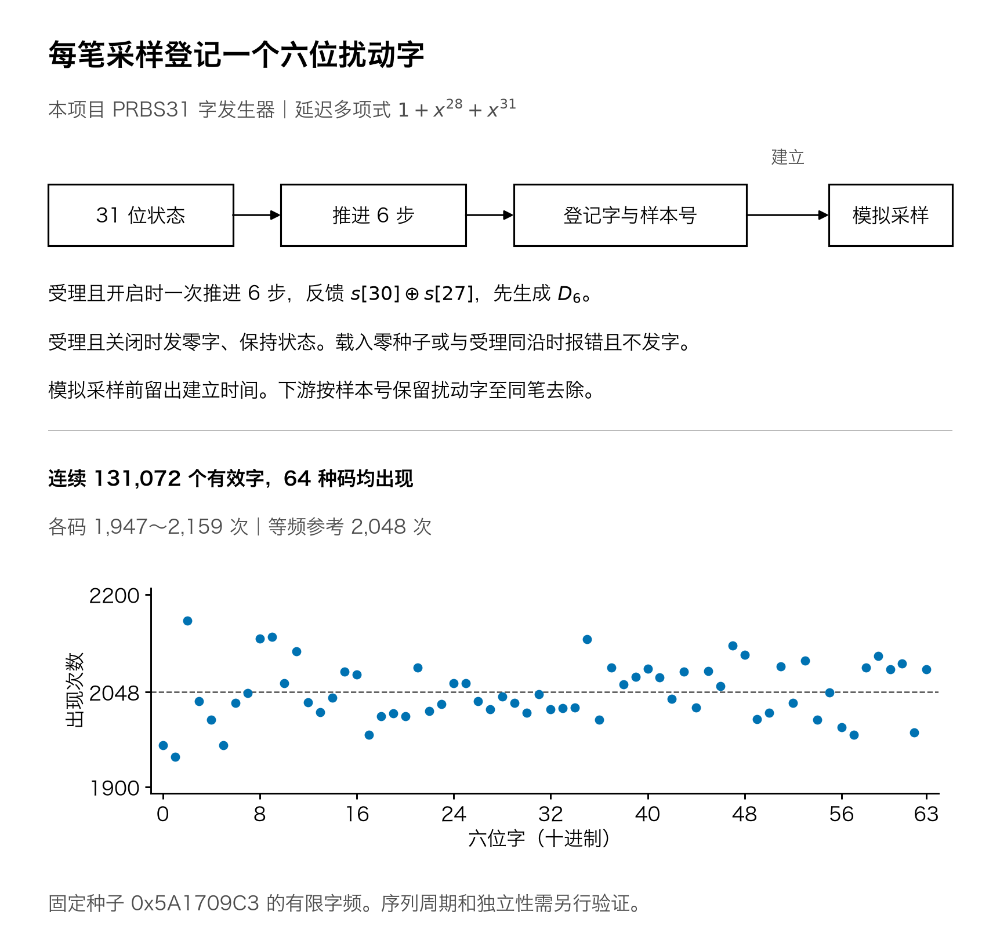
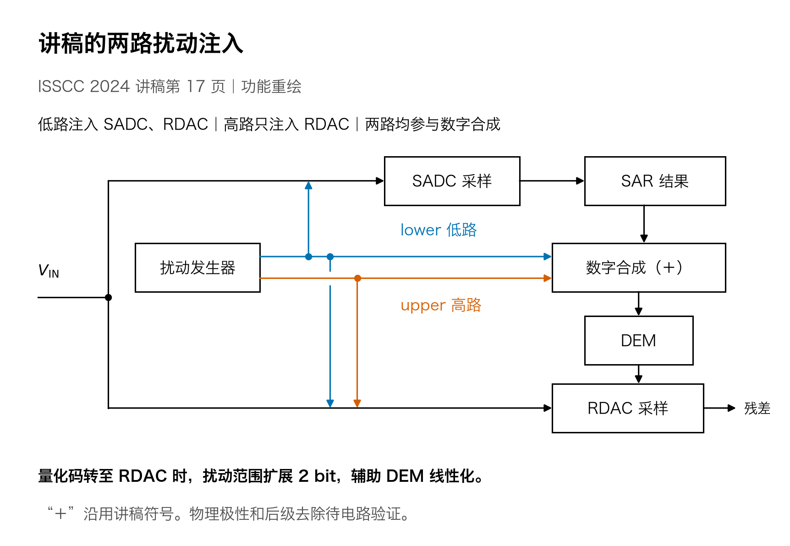
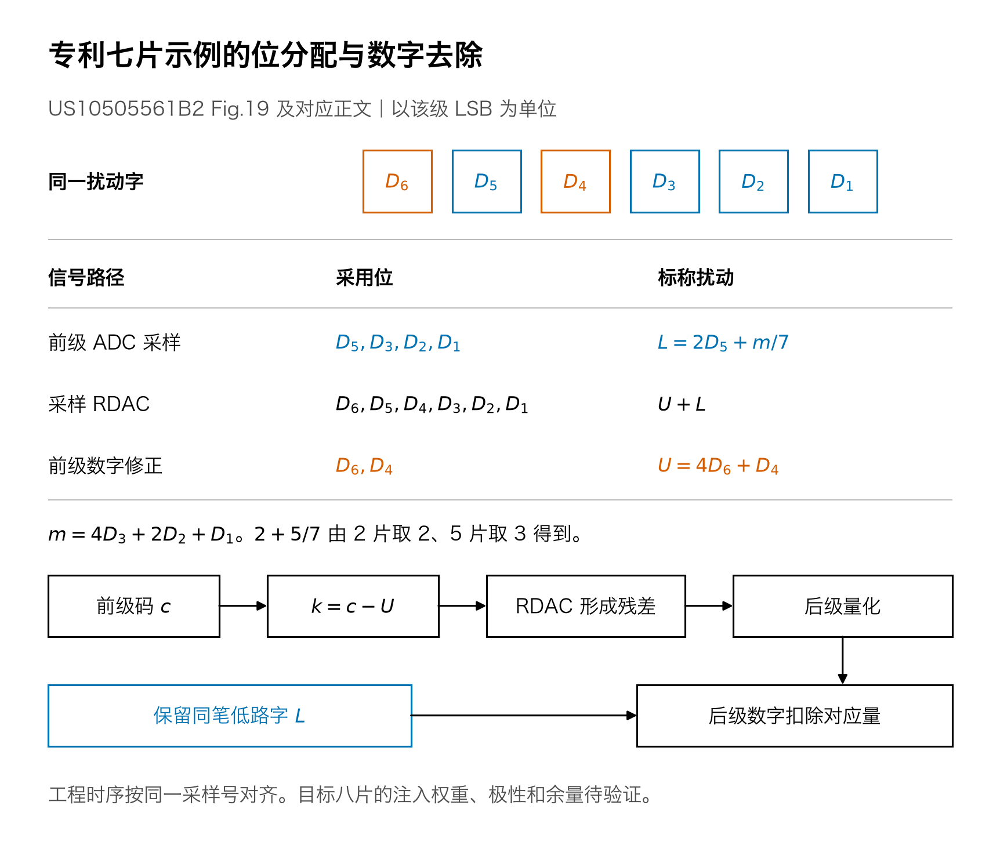
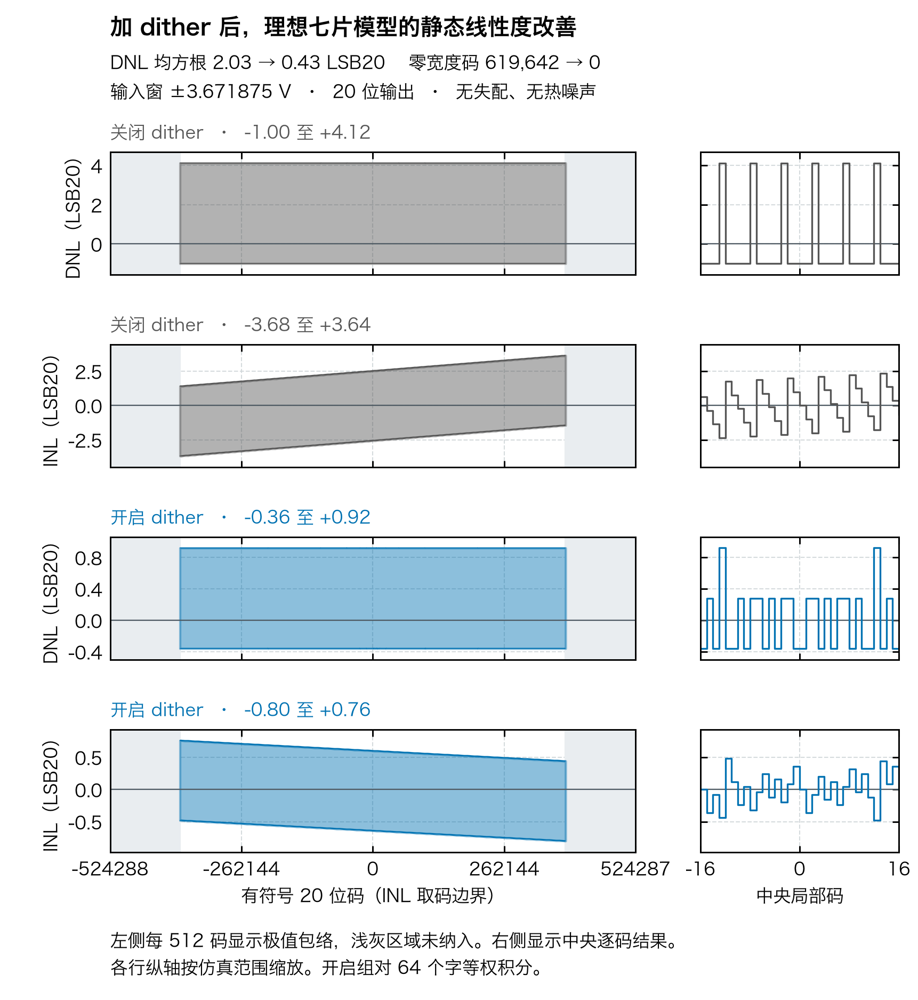

# 模块二｜Dither 生成、注入与效果

**当前进度：**已交付独立六位扰动字发生器、论文／专利注入说明和七片示例行为验证。目标八片的真实电容开关、与模块一的 RTL 联合、LMS／CAAZ 配合及物理后仿仍未完成。

## 原文说了什么？

| 来源 | 原始短句 | 作用 |
| :--- | :--- | :--- |
| ISSCC 讲稿第 17–18 页 | “Extra dither range”；“Improved linearity” | 两路扰动扩大 RDAC 可用范围，辅助线性化。 |
| ISSCC 论文第 182 页 | “Dither is used to complement the DEM linearization” | dither 补充 DEM 的 DAC 线性化；原文所说范围扩展 2 bit 不等于 ADC 精度提高 2 bit。 |
| US10505561B2 | “pseudo-random number generator”；“reduces the effect of DNL” | 用数字伪随机字产生扰动，使码边界误差在统计上更平滑。 |

[原始句子、页码和完整说明](ORIGINAL_SOURCES.md) · [讲稿原件](../references/ISSCC2024_SLIDES.pdf#page=17) · [专利正文](https://patents.google.com/patent/US10505561B2/en#description)

## 字怎么生成、怎样注入？



这是本项目的工程选择，不是论文指定的发生器。PRBS31 的 31 位状态在使能且接受一笔采样事务时推进 6 次，产生 `D6…D1` 并登记样本 ID；禁用时受理输出零字、保持状态。零种子或与采样同沿的种子写入被拒绝。数字登记沿**必须早于实际模拟采样孔径**，留出电容开关建立时间。连续 131,072 个有效字的实测频数和逐拍对拍见 [发生器收据](evidence/dither_rng/result.json)。



讲稿中 lower 同时进入 SADC 与 RDAC，upper 进入 RDAC，两路信息也参与 DEM 前的数字合成；图上加号不独自确定物理电荷极性。专利七片例明确的位分配如下：



以一个前级 LSB 为单位，`m=4D3+2D2+D1`，低路为 `L=2D5+m/7`，高路为 `u=4D6+D4`，总扰动为 `L+u`。专利正文的码域命令是 `k=c−u`；实际采样电荷和最终去扰必须绑定同一笔字。**不能直接把七片的 `/7` 改成目标八片的 `/8` 并称作原文结论。**

## 七片示例：开关效果与代价



这组隔离实验使用七片等值电容、理想 12 位 ADC2、无电容失配和热噪声；静态比较仅覆盖 ±3.671875 V，所有 64 字等权。`m=7` 全片升档是模型约定，边界档位尚须验证。它用于验证 Fig.19 的扰动路径，**不是目标八片 ADC 的实测结果**。

| 同一条件 | dither 关闭 | dither 开启 |
| :--- | ---: | ---: |
| 评估窗口内 DNL 均方根 | 2.030 LSB20 | 0.429 LSB20 |
| 评估窗口内零宽码 | 619,642 | 0 |
| 相干正弦 SFDR／SNDR | 123.30／104.57 dB | 128.47／104.36 dB |

静态码密度和 SFDR 改善，单次量化误差及 SNDR 没有因此改善。将高路关掉后，本例的输出逐笔相同：所示改善来自低路，高路对非理想 RDAC 的收益仍待验证。高路扩大采样与 RDAC 码域范围；本例两组 ADC2 残差均为 0～19.53 mV，实际电容失配下仍需核对残差量程。本例的满幅拒绝统计和前缀边界见[频谱、残差、数据与复现](evidence/fig19_seven/README.md)。

另一组在**理想 ADC2 输入**加减性 dither 的实验使用 2%／3% 固定失配、Fig.21 DEM 和冻结 LMS：[20 位开关对照](../task1/evidence/adc2_dither/full20/README.md)。它不等同于七片真实采样支路，也不能说明目标八片的物理注入已实现。

## 本阶段交付与下一步

- **已有：**`rtl/dither_word_gen.sv`、`model/dither_word_gen.py` 和独立逐拍验证；[七片模型](model/fig19_seven.py)、[实验脚本](experiments/fig19_seven_demo.py)、中文图片和原始数据。
- **未完成：**目标八片的注入电容／开关、Fig.21 非均匀码本下的实际电荷与数字补偿、2%／3% 固定失配＋独立 LMS、逐前缀／端点／ADC2 余量以及模块一联合 RTL；不能宣称已复现原芯片。
- **后续物理交付：**模块二闭环完成后，在 SKY130HD 交 GDS、同约束 STA 和可复现报告；未来 180 nm BCD 模拟宏与后仿另行验收。

```sh
python -m pip install -r task1/requirements-calibration.txt
PYTHONPATH=.:src python -m pytest -q task2/tests
PYTHONPATH=.:src python task2/tools/run_dither_word_checks.py --out /tmp/task2-dither-run-001
PYTHONPATH=.:src python -m task2.experiments.fig19_seven_demo --output /tmp/task2-fig19-run-001
```
