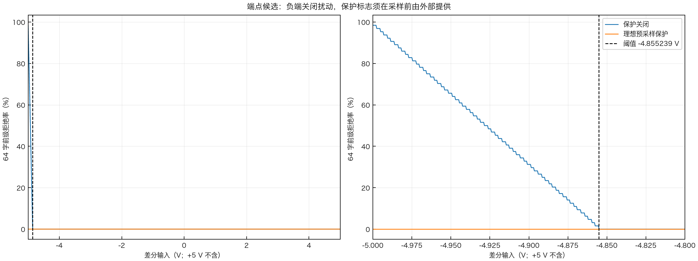
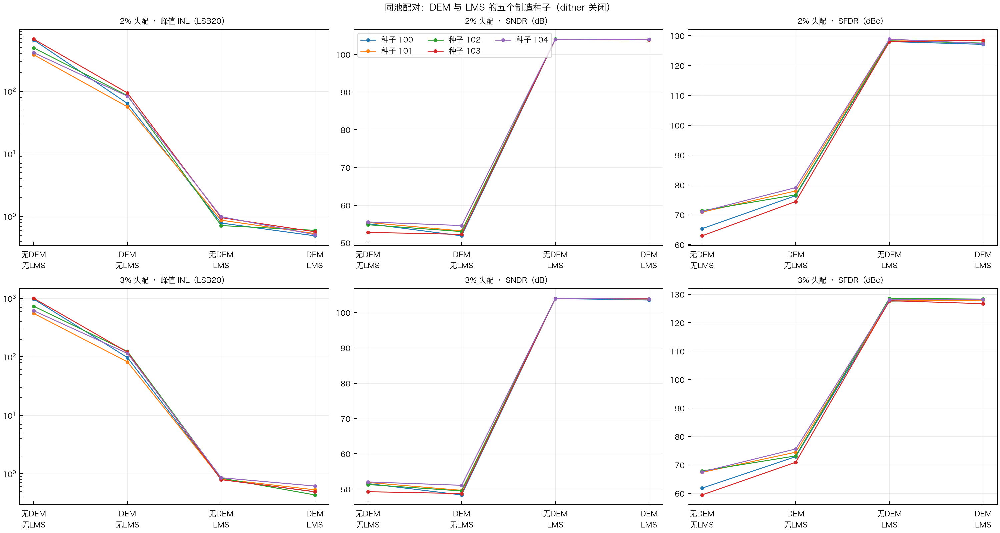
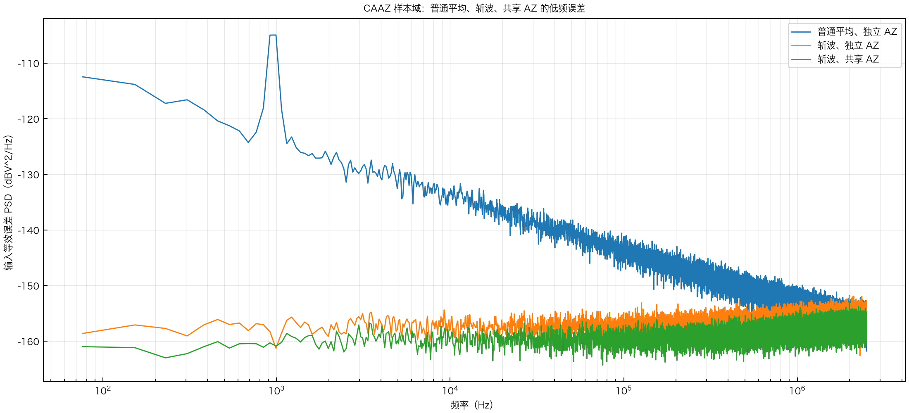

# 行为级补充：端点、多制造种子和低频噪声

本目录是新增行为实验，不修改原有 dither、DEM、RTL 或旧收据。三个结果分别回答不同问题；**端点保护仍是依赖外部预采样标志的候选，不是完整系统已解决的结论。**

## 1. Dither 负端保护候选



[US10505561B2 Fig.19](https://patents.google.com/patent/US10505561B2/en) 使用分路扰动，第三扰动从粗码扣除。原专利七片，本工程是八片受控电荷源的工程等效；**负端关闭扰动是本工程候选，不声称原文披露了该策略**。

当前模型的 64 字最苛刻名义下限为 −4.855238970588 V。实验假设一个采样之前有效的外部保护标志：低于该阈值时令实际采样扰动字为 0，并将同一个有效字传给后级。为了评价理想上界，实验用已知输入电压产生标志，**现有电路、数字接口和保护标志的提前可得性尚未建立**；不能用事后观察本笔 ADC 码伪造预采样标志。

对 `[-5,5)` 内 20,001 个均匀输入点和 64 个候选字，共 1,280,064 个组合：前级拒绝由 9,296 降为 0；seed 100 的 2%／3%、物理片 0–7、固定相位、理想 12 位 ADC2 ±100 mV 和既有浮点冻结 NLMS 条件下，扫描点的 ADC2 及最终重构越界均为 0。结果是**有限网格、固定切片／相位**，不构成所有连续输入、所有随机切片或 +5 V 精确端点的保证；保护区内扰动被关闭，其线性度损失还需单独评价。

[逐点数据](final/endpoint_grid.npz) · [逐项计数与条件](final/summary.json) · [保护函数与实验入口](../../eight/behavioral_closure.py)

## 2. 五颗制造样本的 DEM／LMS 配对



[US10511316B2 Fig.20／21](https://patents.google.com/patent/US10511316B2/en) 的核心作用是重排单元以减轻失配引起的非线性。这里的 Fig.21 映射是声明假设下的候选，不宣称完全实现原电路。每颗虚拟芯片使用一套固定物理失配、同一输入与切片时序；比较无 DEM／无 LMS、仅 DEM、仅 LMS、DEM＋LMS。每种映射各自训练失配权重，共用前台增益参考，冻结后用独立留出；dither 关闭。

| 单位电容失配 | 制造种子 | DEM＋LMS 相对仅 LMS：峰值 INL | 相同比较：SNDR |
| :---: | :---: | :--- | :--- |
| 2% | 100–104 | 五颗均降低；差值 −0.4800～−0.1143 LSB20 | 五颗均下降；差值 −0.1774～−0.0264 dB |
| 3% | 100–104 | 五颗均降低；差值 −0.4078～−0.2381 LSB20 | 五颗均下降；差值 −0.4133～−0.1250 dB |

INL 为 ±3.671875 V 共同窗、256 状态等权的 20 位码宽统计；频谱为 4096 点相干正弦、10 MS/s、理想 12 位 ADC2，热噪声关闭。每种子均重算 12 组频谱和 8 组码宽并核对归档。相同种子对应同一随机制造方向的不同失配幅度；五颗样本不能用于声称工艺良率。

seed 100 引用[原始归档](../eight_negative/README.md)；seed 101–104 的 `sigma_*_seed*/data.npz`、摘要和输入哈希保存在本目录。多种子指标见 [summary.json](final/summary.json)。

## 3. CAAZ 低频噪声样本域对照



[北大 VLSI 2025 论文 Fig.5／6](../../../references/PKU_VLSI2025_C32_1_PAPER.pdf) 披露共享 AZ、输入换相和后续数据处理。下表是**独立噪声样本域实验**，用于分离普通平均、斩波与共享 AZ 的作用，不是复现该论文芯片数值，也尚未接入本工作树的 ADC2／DEM／dither 联合模型。

10 MS/s 原始采样，非重叠配对 5 MS/s；输入信号为零，加入 80 μV RMS 的 1/f 样本、约 954 Hz、100 μV 峰值漂移，以及逐笔独立噪声 10 μV RMS 和 AZ 噪声 20 μV RMS。三组使用相同随机序列；Welch 窗长 65,536，频率分辨率约 76.29 Hz。积分选中的实际频点为 **228.88 Hz～9,994.51 Hz**。

| 对照 | 配对全带宽误差 RMS | 上述低频积分 RMS |
| :--- | ---: | ---: |
| 普通平均、独立 AZ | 106.54 μV | 81.14 μV |
| 斩波、独立 AZ | 24.64 μV | 1.384 μV |
| 斩波、理想共享 AZ | 20.18 μV | 1.031 μV |

低频降低大部分来自斩波对慢变误差的作用；共享 AZ 的额外作用应比较后两行。示例未纳入 ADC2 量化、保持误差、DEM 或模拟宏，因此不能把这些 RMS 写成整机 SNDR。另见已有 [3% DEM／dither／CAAZ 联合对照](../../../task3/evidence/negative/joint_noise/summary.json)，那组尚未注入本次 1/f 噪声。

[原始配对误差与 PSD](final/caaz_low_frequency.npz) · [数值与种子](final/summary.json)

## 复现与验收边界

原始实验使用 Python 3.12.14、NumPy 2.5.3、固定 ADCToolbox 源提交 `8d62fb1863e38ffe5c6cc3ac48fa9c24d9df1ae9`。已有数据保留，新增实验需使用不存在的新目录。例如：

```sh
PYTHONPATH=.:src OPENBLAS_NUM_THREADS=1 MPLBACKEND=Agg \
  python -m task2.eight.experiment --sigma 0.02 --seed 101 --output /tmp/sar-2pct-seed101
PYTHONPATH=.:src OPENBLAS_NUM_THREADS=1 MPLBACKEND=Agg \
  python -m task2.eight.behavioral_closure --out /tmp/sar-behavioral-closure
PYTHONPATH=.:src python -m pytest -q task2/eight/tests/test_behavioral_closure.py
```

汇总脚本读取本目录中种子 101–104 的完整归档及原 seed 100 数据，并逐一验证摘要；因此重新运行汇总需要保留对应原始数据。所有图片与计数是行为模型证据，不是模拟／版图／工艺验收。
