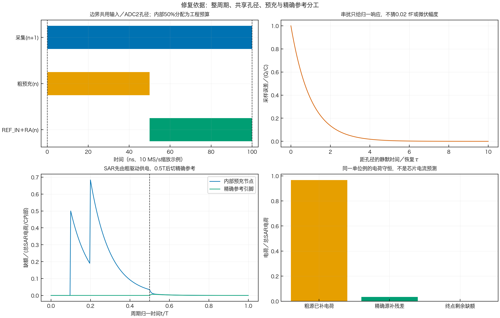
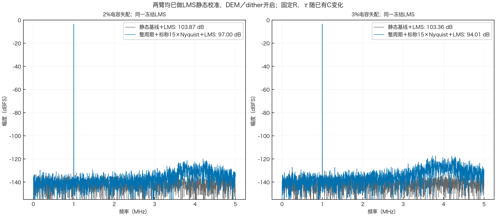
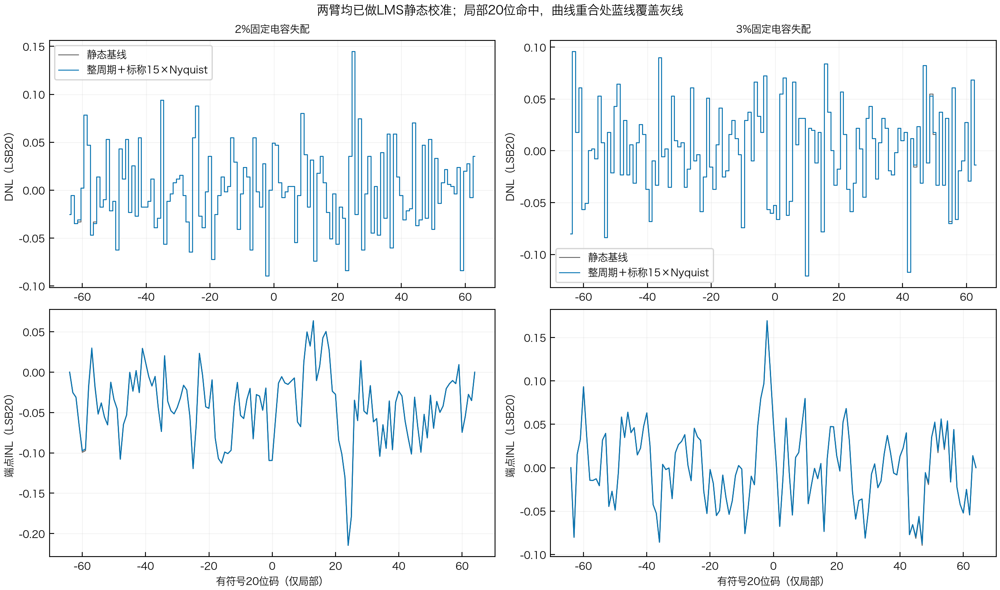

# 修复后的动态模型：结构、条件结果与复现

**已修正结构，未标定芯片的绝对动态误差。** 本次只改Python；静态归档、原有LMS系数和RTL不变。
原文依据、默认值和模拟绑定接口见[模型说明](../../eight/DYNAMIC_MODEL.md)。

## 1. 改对了什么



- 左上：100 ns整周期采集，当前RA残差与下一输入共用采样时刻。内部50%分配只是工程预算。
- 右上：同样的Q/C注入，距孔径越远残留越小；没有寄生数据就不报微伏幅度。
- 左下：单位例的两次SAR电荷先由粗源恢复，切换后精确参考才补剩余电荷。
- 右下：总SAR电荷在粗源补偿、精确源补偿及最终缺额之间守恒；比例仅属于该数学例。

依据为ISSCC论文1页、讲稿8／19／32页及US10826519B1图1／2的功能关系。
图里的单位R/C网络用于验证数学和源分工，不是论文或180 nm BCD的器件值。

## 2. 新的条件频谱



| 制造池单元失配σ | 静态SNDR | 有限输入建立SNDR | 有限输入建立SFDR |
| :--- | :---: | :---: | :---: |
| 2% | 103.869 dB | 96.995 dB | 116.506 dBc |
| 3% | 103.356 dB | 94.015 dB | 113.784 dBc |

条件：原始10 MS/s，4096点、bin 409、峰值10/3 V，预热256笔；DEM和dither始终开启，
每档沿用既有冻结LMS，输入节点模型标称带宽75 MHz=15×Nyquist。
逐片τ只按**固定R、既有主阵列总C比例**计算，没有另加独立随机τ。
这是工程假设下的敏感性结果，不能直接预测真实芯片；真实Ron(V)、相关性和驱动响应需模拟绑定。
本表静态臂采用Q28整数重构及本次连续控制流，不能与旧浮点／不同序列的表逐末位混比。

四组频谱均无拒绝；SNDR由ADCToolbox和独立FFT交叉核对，差异小于1e-5 dB。
重构向量公式每组抽16笔与独立标量大整数参考对拍。没有重训、换种子或删坏样本来提高指标。
这些结果没有被调整到100 dB；先前错误模型的约84 dB结论已撤回。

## 3. 局部20位INL／DNL：有限命中检查



| 单元失配σ | 实际最少命中／码 | DNL范围（LSB20） | 峰值端点INL（LSB20） | 拒绝／零命中码 |
| :--- | :---: | :---: | :---: | :---: |
| 2% | 466 | −0.08984～+0.14453 | 0.21460 | 0／0 |
| 3% | 450 | −0.12109～+0.09570 | 0.16922 | 0／0 |

评价中间128码，输入两侧各64保护码；每输入码512个激励，共131,072次评价转换／臂。
LSB20=10 V/2²⁰=9.536743 μV，DNL=命中数/512−1；INL累加DNL后去端点线。
**两臂完全重合，灰线被蓝线覆盖。** 此慢斜坡下的输入动态扰动不足以改变这些整数命中，
不能由此推断高速正弦也没有动态误差。图含有限随机状态统计起伏，不是解析区间积分。

这不是全幅百万码验收；不能声称已复现讲稿32页每码约250次命中的整机图，
也不能把局部最少450次命中外推到全部20位输出码。

## 4. 验证与复现

[summary.json](summary.json)保存配置、依赖版本、冻结训练与源码SHA；
[data.npz](data.npz)保存四组波形、原码、内部观测和逐整数码直方图；
[validation.json](validation.json)记录本轮验收；[注释统计](comment_stats.csv)列改前／改后口径。
模型文件与每项输出SHA已实际核对，不能把旧图接到新代码上。

在仓库根目录、既有Python 3.12环境和`task1/requirements-ci.txt`依赖下运行，输出目录必须不存在：

```sh
PYTHONPATH=.:src OPENBLAS_NUM_THREADS=1 MPLBACKEND=Agg \
  python -m task2.eight.dynamic_experiment --out /tmp/sar-dynamics-reproduce
PYTHONPATH=.:src python -m pytest src/tests/test_transient_kernels.py task2/eight/tests/test_dynamic_capture.py
```

全Python回归218项通过；其中33项为动态核与接入检查。后者包括独立ODE、电荷守恒、
整周期／共孔径、跨块连续、反因果负例、RA初值记忆和外供采集回调。原静态指纹检查通过。

**仍缺：**经过确认的采集非线性、实际串扰投影、粗／精参考及RA参数、逐位试探电荷、
ADC2端耦合、完整三路径联合图和全幅有限命中验证。模型没有据此宣称模拟性能、RTL或工艺验收通过。
