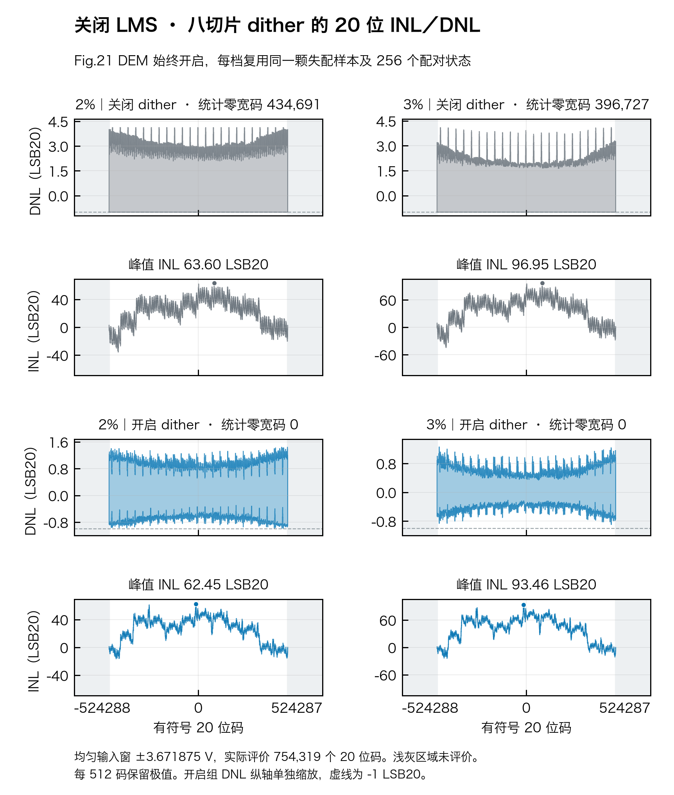
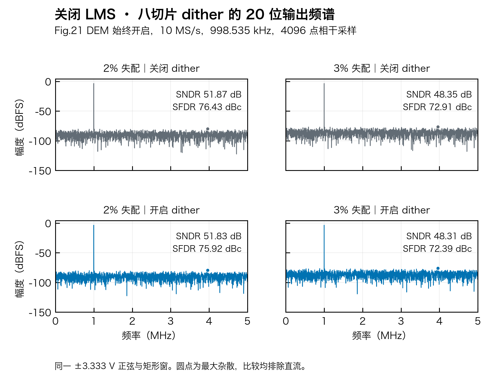

# 关闭 LMS 后，dither 仍能填平统计零宽码

Fig.21 DEM 始终开启，重构只使用名义码本、Fig.21 名义补偿及本笔扰动对消。两组共用制造样本、切片顺序、输入和 ADC2，仅切换 dither。





| 固定电容失配 | 统计零宽码 | DNL RMS（LSB20） | 峰值 INL（LSB20） | SNDR（dB） | SFDR（dBc） |
| :---: | ---: | ---: | ---: | ---: | ---: |
| 2% | 434,691 → 0 | 1.4995 → 0.4575 | 63.60 → 62.45 | 51.87 → 51.83 | 76.43 → 75.92 |
| 3% | 396,727 → 0 | 1.3040 → 0.2828 | 96.95 → 93.46 | 48.35 → 48.31 | 72.91 → 72.39 |

箭头为 dither 关闭 → 开启。前后两组在 ±3.671875 V 共同输入窗内共用 256 个等权切片和相位状态，评价 `−377159…+377159` 共 754,319 个实际 20 位码。各码分别积分，每 512 码只在显示时取极值包络，LSB20 为 9.536743 µV。零宽码来自多状态平均码密度，不能据此判断某个状态或每笔转换都连续。

同一理想 12 位 ADC2 使用输入折算 ±100 mV 窗口。动态测试为峰值 10/3 V、998.535 kHz、10 MS/s、4096 点相干正弦和矩形窗。两档开启后仍有约 62／93 LSB20 峰值 INL，SNDR 和 SFDR 均略降。图中直接看到的是扰动对码宽分布的作用，固定失配造成的大部分系统误差仍需校准。

使用已归档逐码宽和频谱重绘。[2% 原始数据](sigma_2pct/data.npz) · [3% 原始数据](sigma_3pct/data.npz) · [电荷模型与原文对照](README.md) · [数据、源码和图件 SHA-256](no_lms_figures.json)

```sh
out=$(mktemp -d)
PYTHONPATH=.:src MPLBACKEND=Agg python -m task2.eight.no_lms_plots \
  --data-dir task2/evidence/eight_native --output "$out"
```

[线性度 PDF](eight_native_no_lms_linearity.pdf) · [线性度 SVG](eight_native_no_lms_linearity.svg) · [频谱 PDF](eight_native_no_lms_spectra.pdf) · [频谱 SVG](eight_native_no_lms_spectra.svg)
