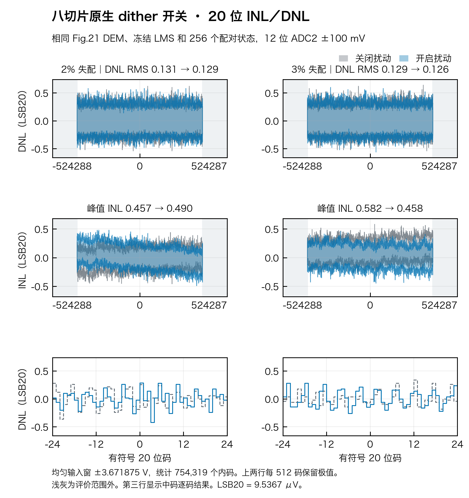
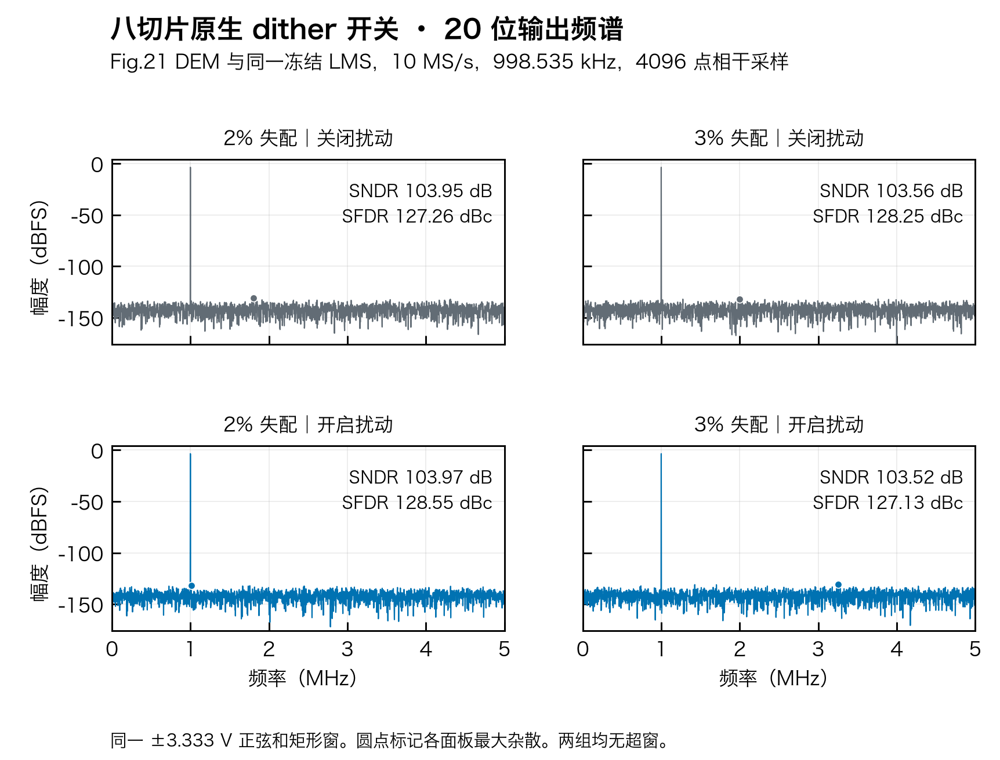
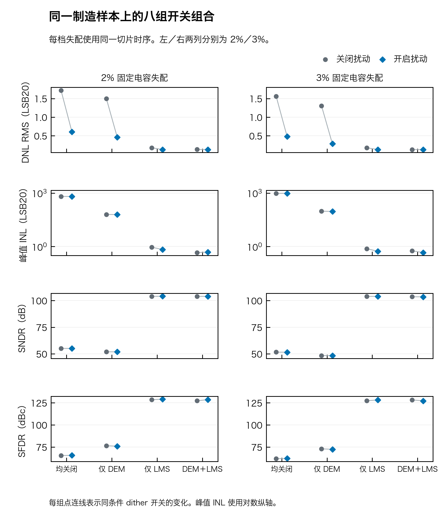
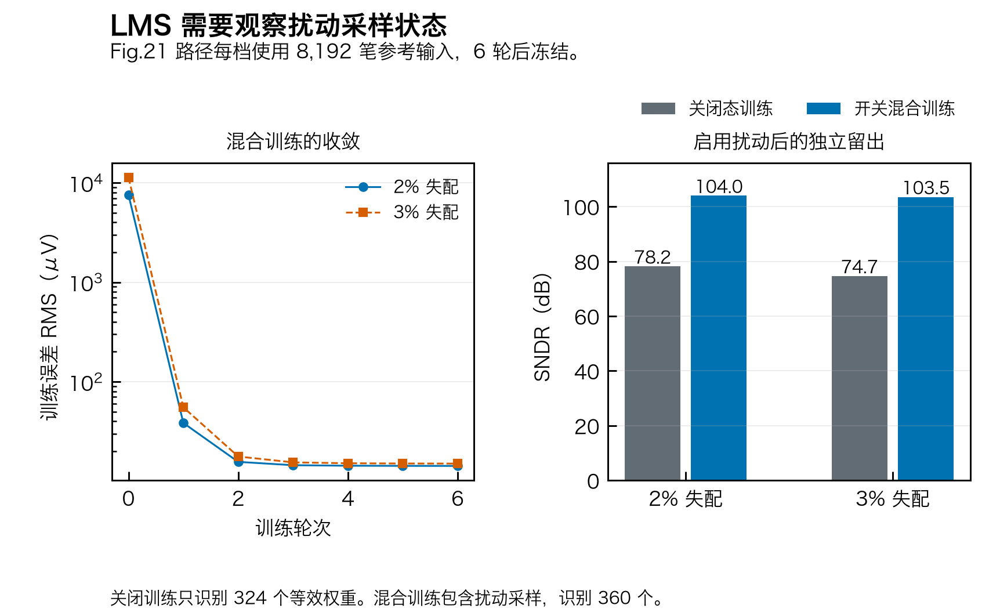

# 八切片子阵列扰动 · 20 位开关对照

同一电容失配样本、切片时序、Fig.21 DEM 和冻结 LMS 下，两档开启 dither 后 DNL 均方根略降。2% 下峰值 INL 上升，3% 下 SFDR 降低。开关前后均无统计零宽码。每档为制造种子 `100` 的一次配对实验。





| 单位电容失配 σ | DNL RMS（LSB20） | 峰值 INL（LSB20） | SFDR（dBc） | SNDR（dB） |
| :---: | ---: | ---: | ---: | ---: |
| 2% | 0.1310 → 0.1288 | 0.4573 → 0.4903 | 127.265 → 128.554 | 103.952 → 103.974 |
| 3% | 0.1294 → 0.1265 | 0.5818 → 0.4584 | 128.253 → 127.126 | 103.563 → 103.520 |

箭头为关闭 → 开启。静态和频谱分别使用均匀输入积分与独立的相干正弦。静态 DNL 是 256 个等权状态下的平均码密度，INL 扣除评价范围的端点直线。图保留 20 位有符号码轴及名义步长 `9.536743 µV`。输入积分窗为 ±3.671875 V。输出端各留 75 mV 保护并逐状态核对两端覆盖，最终评价码 `−377159…+377159`，共 754,319 个。每组 64 个字恰好各一次，独立打乱后与该组 64 个切片／DEM 快照配对，共四组。关闭态复用同一批快照，字归零。本实验与模块一的满幅码密度采用不同窗口和状态集合。频谱使用 10 MS/s、998.535 kHz、峰值 10/3 V、4096 点矩形窗，ADCToolbox 与独立 FFT 对拍。

两档共同窗的 ADC2 均无超窗。以 DEM 路径为例，2% 的输入折算残差从 `−33.85…+43.64` mV 变为 `−38.92…+37.43` mV，3% 从 `−43.88…+53.98` mV 变为 `−47.09…+46.95` mV。完整 ±5 V 的独立积分中，开启后约 **0.8617%** 的等效输入宽度在正端被前级或 RDAC 最终码拒绝，最强扰动字的上界约为 `+4.83686 V`。全幅 ADC2 拒绝量为零，输出越界量另列于数据摘要。共同窗比较无裁剪。该结果使用理想 12 位、输入折算 ±100 mV 的 ADC2，以及理想 SADC 辅助 DAC 和两节点电荷网络。热噪声、参考建立、时偏、真实开关和模拟宏 PVT 留待模拟验收。

与 CAAZ 联合的数字合同要求本页扰动位图作用在输入斩波之后；如果实际注入位于斩波之前，奇数笔的有效极性不同，须重新推导电荷与数字权重。

## 原文与本工程的连接

| 原文机制 | 八片候选 |
| :--- | :--- |
| ISSCC 2024 论文第 182 页与讲稿第 17–18 页，低路送 SADC 与 RDAC，高路送 RDAC，dither 补充 DEM，RDAC 直接设置到最终码 | 一笔六位字在采样前冻结。按采样物理片顺序形成八个子阵列高轨位图，SADC 低路与最终 `k` 同笔归属。 |
| US10505561B2 Fig.6A–F 的底板参考轨切换和码处理，Fig.19 的六位拆分及七片相邻档分配例 | 采用 Fig.6F 的正向切轨和递增码方向，SADC 加低路，最终码 `k=c+U`，重构减总扰动。Fig.19 正文在其示例中从粗码减去高字。这里工程扩展为八片和 `m/8`，取前 `m` 个有序 slot 升一档。 |
| US10511316B2 Fig.11 子阵列几何及 Fig.20–21 跨段选择 | 用现有 `8C/4C/2C/C` 四个子电容作采样档位，dummy 保持低轨。转换阶段复用对应 Fig.11 或 Fig.21 位图，使用实际子电容和每片桥衰减求电荷。 |

[ISSCC 论文](https://doi.org/10.1109/ISSCC49657.2024.10454329) · [讲稿第 17 页](../../../references/ISSCC2024_SLIDES.pdf#page=17) · [扰动专利 Fig.6F](https://patentimages.storage.googleapis.com/18/f8/10/e645e07131c139/US10505561.pdf#page=10) · [扰动专利 Fig.19](https://patentimages.storage.googleapis.com/18/f8/10/e645e07131c139/US10505561.pdf#page=22) · [DEM 专利](https://patents.google.com/patent/US10511316B2/en#description)

`U=4D6+D4`，`m=D3:D1`，`I=U+2D5`。八片均为 `I` 或 `I+1` 档，其中前 `m` 片升档。名义单位档位由 `β=1/17` 和 `32C` 主采样电容决定，`D=10/(32×17)=18.382353 mV`。SADC 的理想辅助 DAC 加 `L=(2D5+m/8)D`，然后按既有的非均匀名义 9 位码本判决。RDAC 的名义总注入为 `T=(I+m/8)D`，实际注入逐片按真实电容和桥衰减求和。名义低路分数步长约为 47.059 个 ADC2 LSB，非均匀码本、最终码变化与电容失配也改变 ADC2 量化相位。原文没有指定这里的八片档位表、辅助 DAC 细节或 LMS。

## 三项开关和校准





DEM 关闭组仍用与开启组相同的交织切片时序。每档对主、子和桥电容各抽取一次固定制造失配，八组共享。校准首先从相同物理位图的 32,768 对已知电压读取估计 18 个片增益。随后对 DEM 开关各训练一套权重。混合训练用同一套 8,192 点外部参考，其中 dither 开关各一半，逐样本 NLMS 六轮，共 49,152 次更新。冻结后才执行所有静态和动态对照，开关共用冻结权重。

每片特征的主阵列项是转换位，子阵列项是 `转换位−采样位`，同一物理子电容共用一个权重。令 `G` 为八片冻结增益之和，`W` 为同笔特征的校正和，`δ` 为现有 Fig.21 补偿。行为重构为 `x̂=(B11[k]+5 V+δ−T+r̂+W)/G−5 V`。其中 `r̂` 由 ADC2 码解出的中点。拟合仅读取实际命令和开关位图、ADC2 码、切片号和已知外部参考，真实电容只进入前向模拟。

Fig.21 的关闭态训练可辨识 324 个组合，混合训练可辨识 360 个，18 组主阵列双 1C 同控。关闭态从未观察到的 36 个子阵列位对应每片 `8C/4C`，会在 dither 采样时出现。若直接延用同预算关闭态训练、这些位的修正按零处理，开启后的留出 SNDR 只有 78.16 dB／74.65 dB。混合训练后分别为 103.97 dB／103.52 dB。

## 原始数据与复现

- 2%：[摘要](sigma_2pct/summary.json) · [逐码宽度、开关位图、冻结系数和频谱](sigma_2pct/data.npz)
- 3%：[摘要](sigma_3pct/summary.json) · [逐码宽度、开关位图、冻结系数和频谱](sigma_3pct/data.npz)
- [模型](../../eight/model.py) · [实验入口](../../eight/experiment.py) · [画图入口](../../eight/plots.py) · [图件哈希](figures.json)
- PDF：[INL／DNL](eight_native_linearity.pdf) · [频谱](eight_native_spectra.pdf) · [八组比较](eight_native_factorial.pdf) · [校准](eight_native_lms.pdf)

```sh
python -m pip install -r task1/requirements-calibration.txt
out=$(mktemp -d)
PYTHONPATH=.:src OPENBLAS_NUM_THREADS=1 python -m task2.eight.experiment --sigma 0.02 --output "$out/sigma_2pct"
PYTHONPATH=.:src OPENBLAS_NUM_THREADS=1 python -m task2.eight.experiment --sigma 0.03 --output "$out/sigma_3pct"
PYTHONPATH=.:src MPLBACKEND=Agg python -m task2.eight.plots --data-dir "$out" --output "$out/figures"
```
