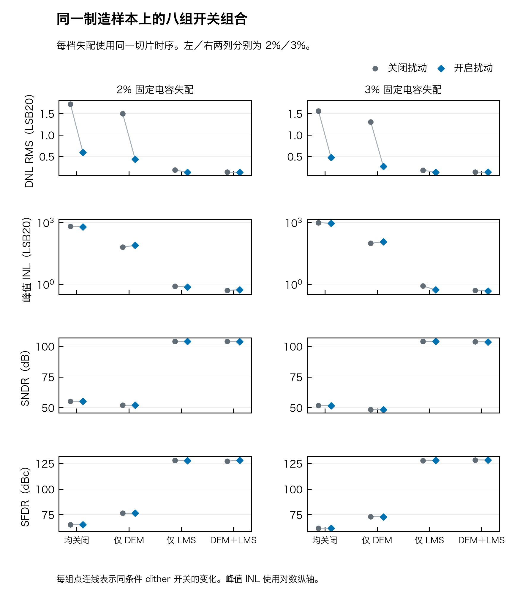
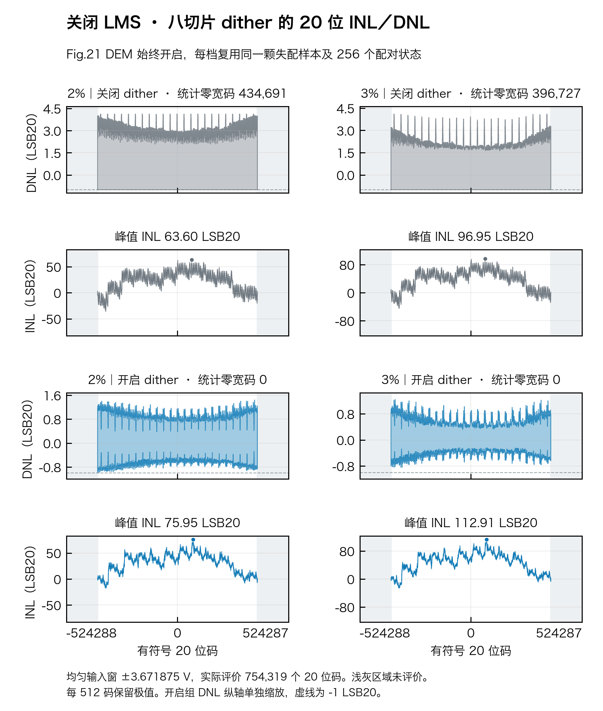
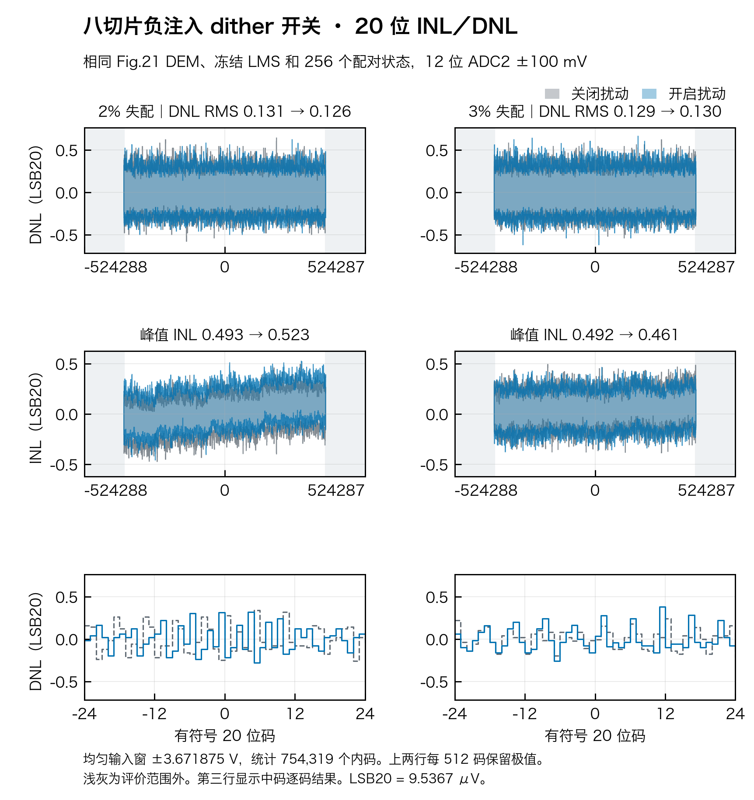
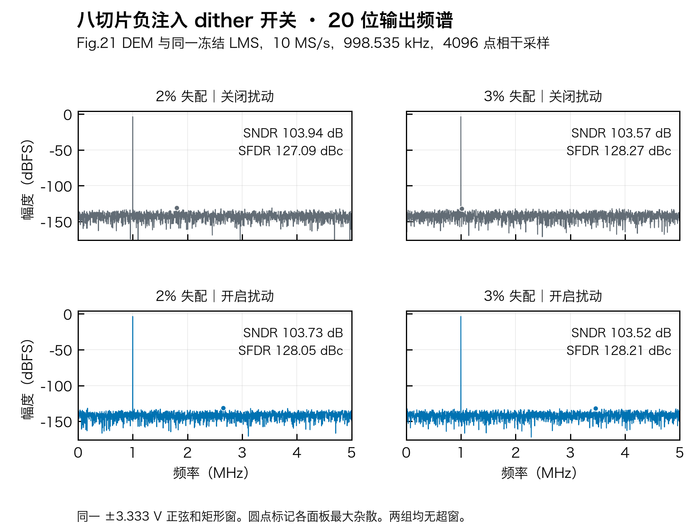
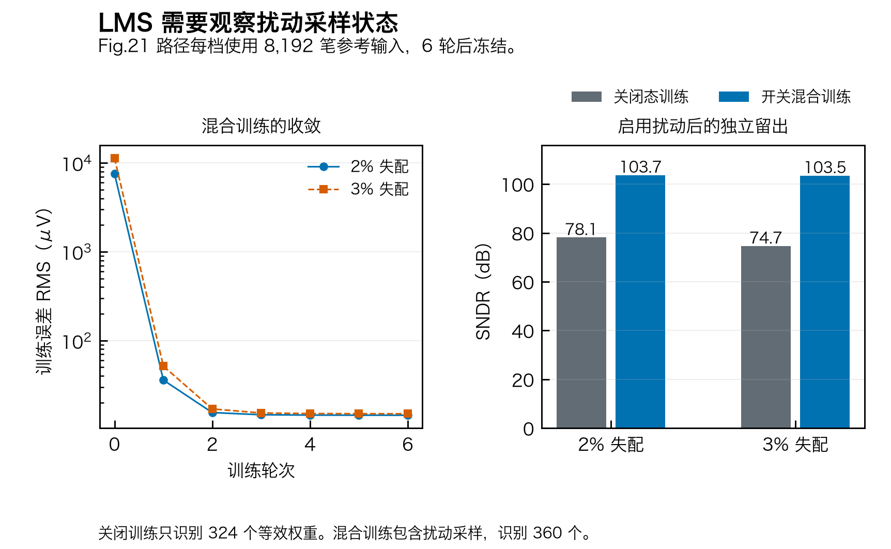

# 八片负注入版本：结果、假设和复现

本目录保存新合同 `k=c−U` 的数据；旧正注入 `eight_native` 保持原样。
这是受控电荷源的行为实验，不能证明真实模拟开关已经按专利连接。

## 看图验收



| 固定失配 | DEM | LMS | dither 关→开零宽内码 | 峰值 INL（LSB20） | SNDR（dB） |
| :--- | :---: | :---: | :--- | :--- | :--- |
| 2% | 关 | 关 | 478,486→11,230 | 655.668→603.643 | 55.091→55.025 |
| 2% | 关 | 开 | 0→0 | 0.788→0.712 | 103.967→103.905 |
| 2% | 开 | 关 | 434,691→0 | 63.602→75.950 | 51.875→51.848 |
| 2% | 开 | 开 | 0→0 | 0.493→0.523 | 103.941→103.728 |
| 3% | 关 | 关 | 450,151→52 | 971.521→903.602 | 51.572→51.507 |
| 3% | 关 | 开 | 0→0 | 0.799→0.520 | 103.986→103.911 |
| 3% | 开 | 关 | 396,727→0 | 96.952→112.907 | 48.352→48.326 |
| 3% | 开 | 开 | 0→0 | 0.492→0.461 | 103.573→103.521 |

dither 可以平滑平均码密度，不能保证所有指标改善：例如 DEM 开、LMS 关时零宽码消失，
但 INL 增大。混合训练 LMS 后 SNDR 约 103.5～103.9 dB，来源是静态理想模型，
不是含热噪声、抖动和建立误差的目标芯片性能。不能从一颗固定制造样本推断 MC 良率。









图的全景每 512 码保留极值，仅压缩显示；指标由全部逐码宽计算。中码图逐码展示。
共同输入窗为 ±3.671875 V，256 个等权配对状态，评价 754,319 个内码。
名义 LSB20=10 V/2^20=9.536743164 μV。统计零宽为零不证明单次转换无缺码。

## 机制与原文的边界

[专利 Fig.19 原图](../../../references/patent/US10505561B2_FIG19.png)及
[原文 OCR 的 worked example](../../../references/patent/US10505561B2_OCR.txt)
明确 upper 的 0／1／4／5 从 ADC 粗码扣除。这里按该命令关系实现 `k=c−U`。
原图是七片；本工程八片的 `/8`、位图、电容网络及共享权重属于工程选择。
不能仅凭扣码关系就断言既有底板低轨→高轨连接能产生负注入。

- `m=D[2:0]`，`U=4D[5]+D[3]`，`L=(2D[4]+m/8)Δ`，`T=UΔ+L`。
- `Δ=10/544 V` 是当前主／子／桥电容假设推导的名义档，不是原文披露的工艺参数。
- SADC 判 `x−L`，RDAC 命令 `c−U`；理想残差 `r=g(x+5)−VD−T`。
- 独立节点参考把 `Qaux=10 V·Σ(Cs·mask)` 直接加入子节点 KCL；不在求解后减 `2T`。
  它假定辅助源幅度与转换子权重一致，真实电路实现和二者失配还未验证。
- 重构子特征为 `conv+sample`，值为 0／1／2；`r+VD+T` 后按增益归一。
  每笔先完成去扰及重构，再交给 CAAZ，扰动定义在输入斩波之后。

满幅、等权字下，平均前端拒绝输入宽度 0.072380515 V，占 10 V 全幅的 0.723805%。
全部 64 字共同的名义下限是 −4.855238971 V，须同时计入 SADC lower 与 upper。
ADC2 是理想 12 位、输入折算 ±100 mV；共同窗内未超窗不代表全幅真实 RA／ADC2 已验收。

## 证据与复现

[独立节点解](independent_oracle.json)覆盖 4,173,824 个名义组合，另重放 2%／3% 原始留出。
[独立归档复算](archive_audit.json)重新积分逐码宽、重算频谱并核对数据和图片摘要。
[数字整体对拍](../../../task_integration/evidence/negative/README.md)与这些数学检查分开验收。

在仓库根目录使用 Python 3.12，先安装 `task1/requirements-calibration.txt`，设置 `PYTHONPATH=.:src`。
输出目录须新建。重新实验与只重画已有数据是两种操作：

```sh
python -m task2.eight.experiment --sigma 0.02 --output /tmp/negative-reproduce/sigma_2pct
python -m task2.eight.experiment --sigma 0.03 --output /tmp/negative-reproduce/sigma_3pct
python -m task2.eight.plots --data-dir /tmp/negative-reproduce --output /tmp/negative-figures
python -m task2.eight.no_lms_plots --data-dir /tmp/negative-reproduce --output /tmp/negative-figures
# 只重绘本次归档数据：
python -m task2.eight.plots --data-dir task2/evidence/eight_negative --output /tmp/negative-redraw
```

本次种子、训练／留出、窗口、原始数组和依赖版本均在各档 `summary.json`、`data.npz`。
新版本的真实 GDS／STA／DRC／LVS 尚须重新取得，不借用旧正注入版通过状态。
