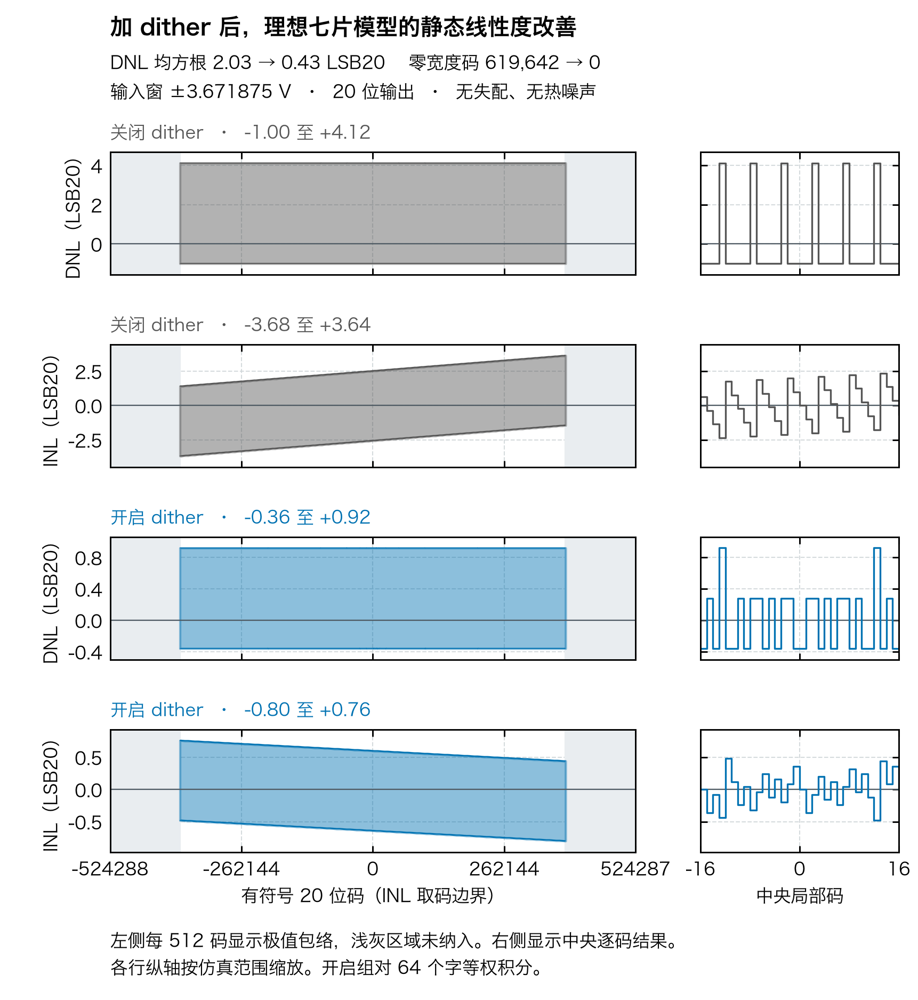
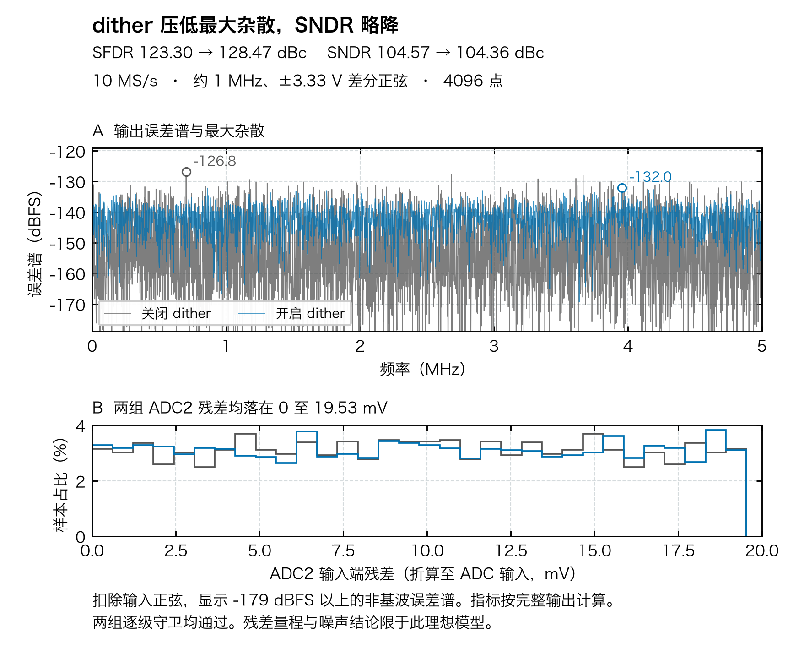

# Fig. 19 七片扰动效果

同一 ADC2 和同一输入下，扰动将 20 位输出的平均码密度拉平，正弦试验的最大杂散降低 5.16 dB，SNDR 下降 0.21 dB。两组的 ADC2 输入折算残差都在 0 至 19.53 mV。





| 指标 | 关闭 dither | 开启 dither |
| :--- | ---: | ---: |
| DNL 范围（LSB20） | −1.00 至 +4.12 | −0.36 至 +0.92 |
| DNL 均方根（LSB20） | 2.030 | 0.429 |
| 端点 INL 范围（LSB20） | −3.68 至 +3.64 | −0.80 至 +0.76 |
| 零宽度码（评估窗口内） | 619,642 | 0 |
| SFDR（dBc） | 123.30 | 128.47 |
| SNDR（dBc） | 104.57 | 104.36 |
| ADC2 输入折算量化误差 RMS（µV） | 13.72 | 14.04 |

## 扰动怎样通过电路

**原文披露。** 专利 Fig. 19 把 6 位中的 $D_5,D_3,D_2,D_1$ 送给 sADC，全部位送给 RDAC。以粗级步长 $\Delta$ 为单位，高字 $U=4D_6+D_4$ 从粗码中减去。$D_5$ 对低字贡献两档，$m=4D_3+2D_2+D_1$ 由七片间分配实现 $m/7$。专利举例 $I=2,m=5$ 时两片置 2、五片置 3。ISSCC 讲稿 PDF 第 17 页绘出 lower 到 sADC 与 RDAC、upper 到 RDAC 的采样支路，并把数字结果送往 DEM 与 RDAC。 [三份来源的定位与短引](../../ORIGINAL_SOURCES.md) · [专利 Fig. 19、PDF 第 22 页及第 33 页栏 19–20](https://patents.google.com/patent/US10505561B2/en) · [ISSCC 论文第 182 页](https://doi.org/10.1109/ISSCC49657.2024.10454329)

**工程等效。** 低扰动 $L=(2D_5+m/7)\Delta$，总扰动 $T=U\Delta+L$。本模型的负等效坐标取 sADC 采样 $x-L$，RDAC 每片采样 $x-p_i\Delta$。粗判决 $c$ 得到后直接设最终码 $k=c-U$。以 $B[k]$ 表示名义 RDAC 回放电压，七片电荷合并给出残差 $r=\operatorname{mean}(x-p_i\Delta-B[k])$。数字重构为 $B[k]+\hat r+T$，其中 $\hat r$ 是 ADC2 的量化结果。按名义均匀码本化简得到 $r=x-L-B[c]$，低字改变输入落在后级量化阶梯上的位置，高字增大 RDAC 可编程扰动范围。

把同一扰动字的 $D_6,D_4$ 清零作对照，RDAC 扰动范围由完整字的 0 至 $8\Delta$ 缩为 0 至 $3\Delta$。两组 4096 笔 ADC2 码和 20 位码逐笔相同，评估窗口内的平均码宽也逐码相同。进一步只保留 $D_3,D_2,D_1$ 的独立复算中，4096 笔结果也逐笔相同；平均码宽的最大差为 $6.94\times10^{-18}$ V，属于浮点舍入。表中改善来自理想模型中 $m/7$ 造成的亚 LSB 相位变化。upper 对非理想 RDAC 的线性化收益待结合物理电容与 DEM 复测。

## 测试口径与边界

- 标称输入为 $[-5,+5)$ V 差分，名义前级 9 位，ADC2 为理想 12 位、输入折算窗口 ±100 mV，输出 LSB20 为 $10/2^{20}$ V，约 9.537 µV。ADC2 步长为 48.828 µV，约 5.12 LSB20。实验隔离量化行为，电容取等值，热噪声为零。
- 静态试验对均匀输入 ±3.671875 V 解析积分。关闭时字固定为零，开启时 64 个字等权，得到 57 个不同的总扰动值。共同窗口按 64 字均通过采样、码域、前缀和 ADC2 守卫选定，边缘各去掉 4 个输出码，避免截断码宽。横轴保留实际有符号 20 位码，共评估 770,040 个码。DNL 为等效输入宽度除以 LSB20 后减一。INL 由 DNL 累加后扣除端点直线。这是平均码密度结果，单次量化误差以独立的正弦结果衡量。
- 动态试验为 10 MS/s、998.535 kHz、差分幅度 ±3.333 V、4096 点相干正弦。开启组使用本工程 PRBS31 的默认种子 `0x5A1709C3`。两组各 4096 笔通过同一守卫。频谱指标由 ADCToolbox 计算并以独立双边 FFT 对照。
- $m=7$ 时，本实验令七片全升档。$I=7,m>0$ 时，至少一片需要档 8。实验允许该等效档位，负例限制到档 7 时拒绝。采样量程、最终码、ADC2 和数字输出各自报告失败位置。`c=8,U=4` 时直接设 $k=4$ 合法，旧工程前缀审计中的前三个命令为 $-4$，因此该样本无法通过逐前缀守卫。
- 另用满幅均匀输入和等权字检查边界。关闭组全部接受，开启组在直接设定最终码时拒绝 0.855% 的等效输入宽度，采用旧逐前缀守卫时拒绝 9.686%。这一边界诊断与上图共同窗口的线性度比较分别报告。
- 这里验证 Fig. 19 的七片示例，论文八片目标的开关绑定、端点余量及失配加 LMS 验证由目标系统单独交付。

## 复现

在交付树根目录运行。绘图需要 Hiragino Sans GB 或 Noto Sans CJK SC，摘要保存实际字体、软件版本和 SHA-256。完整宽度与正弦逐笔轨迹见 [数据](fig19_seven_data.npz)，指标、范围反例与哈希见 [摘要](summary.json)。

```sh
python -m pip install -r task1/requirements-calibration.txt
PYTHONPATH=.:src python -m pytest -q task2/tests/test_fig19_seven.py
PYTHONPATH=.:src python -m task2.experiments.fig19_seven_demo --output /tmp/task2-fig19-run-001
```

[线性度 PDF](fig19_seven_linearity.pdf) · [线性度 SVG](fig19_seven_linearity.svg) · [频谱与残差 PDF](fig19_seven_spectrum_residue.pdf) · [频谱与残差 SVG](fig19_seven_spectrum_residue.svg)
